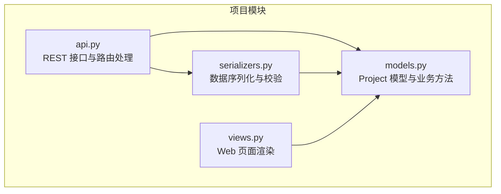
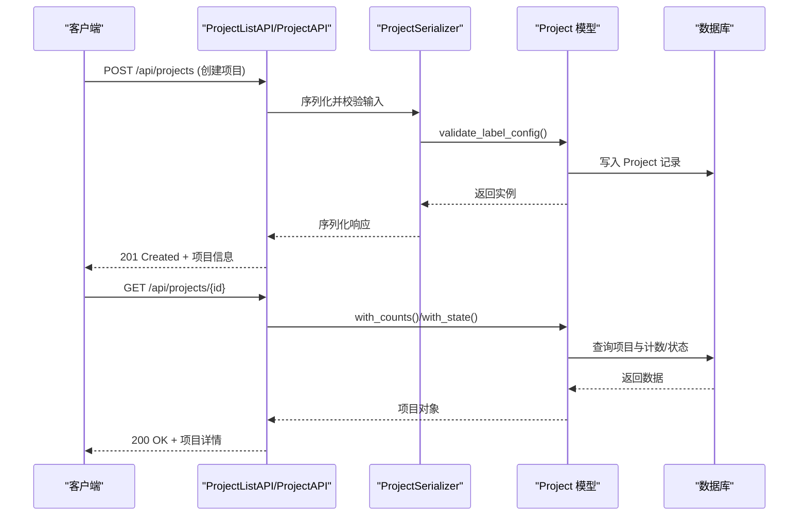
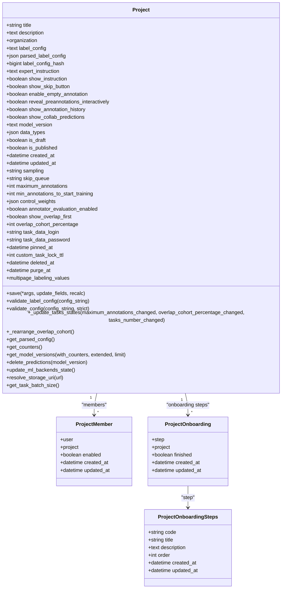
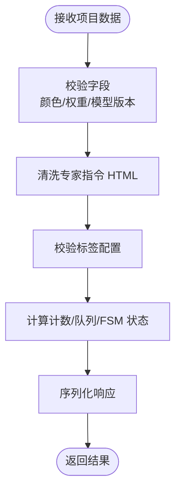
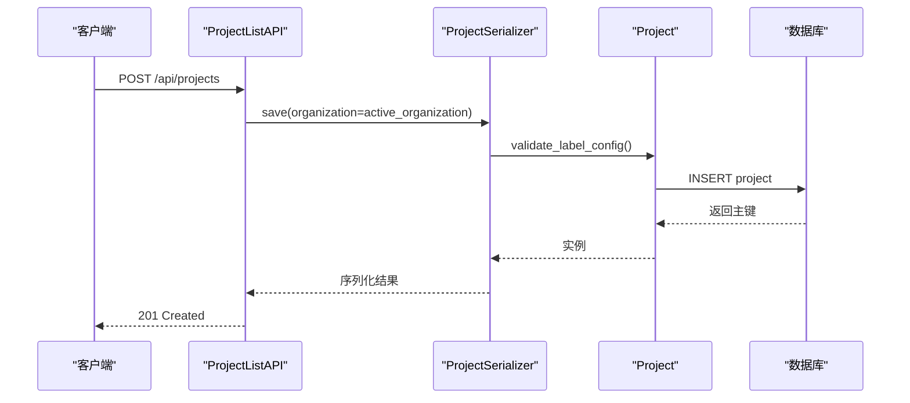
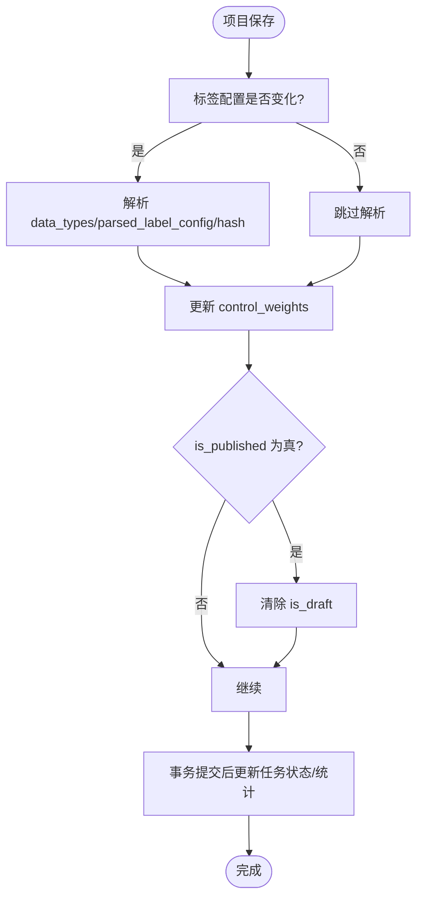
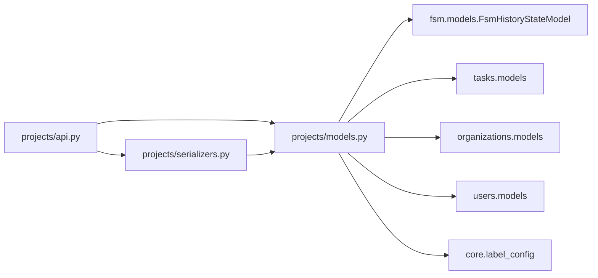

# 项目管理

<cite>
**本文引用的文件**   
- [label_studio/projects/models.py](file://label_studio/projects/models.py)
- [label_studio/projects/api.py](file://label_studio/projects/api.py)
- [label_studio/projects/serializers.py](file://label_studio/projects/serializers.py)
- [label_studio/projects/views.py](file://label_studio/projects/views.py)
</cite>

## 目录
1. [简介](#简介)
2. [项目结构](#项目结构)
3. [核心组件](#核心组件)
4. [架构总览](#架构总览)
5. [详细组件分析](#详细组件分析)
6. [依赖关系分析](#依赖关系分析)
7. [性能与扩展性](#性能与扩展性)
8. [故障排查指南](#故障排查指南)
9. [结论](#结论)
10. [附录：API 使用示例与最佳实践](#附录api-使用示例与最佳实践)

## 简介
本章节面向 Label Studio 的“项目管理”能力，围绕项目的概念、生命周期、状态管理、创建流程、配置选项、标签设置、模板使用、权限与多租户隔离进行系统化说明。文档同时给出基于后端代码的架构图、类图、时序图和流程图，帮助读者从实现角度理解系统行为，并给出可操作的 API 使用建议与常见问题解决方案。

## 项目结构
Label Studio 的项目管理功能主要由以下模块组成：
- 模型层：定义 Project 及其关联实体（成员、引导步骤、摘要统计等），封装业务规则与状态逻辑。
- API 层：提供 RESTful 接口，负责项目列表、创建、更新、删除、任务导入/重导入、标签配置校验、样本任务生成、模型版本管理等。
- 序列化层：统一输入输出结构，包含字段校验、计数聚合、FSM 状态字段注入、批量标注能力检测等。
- 视图层：渲染前端页面（如项目列表与设置页）。

图表来源
- [label_studio/projects/models.py:164-1374](file://label_studio/projects/models.py#L164-L1374)
- [label_studio/projects/api.py:145-438](file://label_studio/projects/api.py#L145-L438)
- [label_studio/projects/serializers.py:94-401](file://label_studio/projects/serializers.py#L94-L401)
- [label_studio/projects/views.py:11-18](file://label_studio/projects/views.py#L11-L18)

章节来源
- [label_studio/projects/models.py:164-1374](file://label_studio/projects/models.py#L164-L1374)
- [label_studio/projects/api.py:145-438](file://label_studio/projects/api.py#L145-L438)
- [label_studio/projects/serializers.py:94-401](file://label_studio/projects/serializers.py#L94-L401)
- [label_studio/projects/views.py:11-18](file://label_studio/projects/views.py#L11-L18)

## 核心组件
- Project 模型：承载项目元数据、标签配置、采样策略、跳过队列策略、协作预测展示、软删除与回收时间等；内置保存钩子用于解析标签配置、计算权重、触发后续任务状态更新与信号事件。
- ProjectManager/ProjectVisibleManager：提供按组织过滤、计数器注解、FSM 状态注解等查询增强。
- ProjectSerializer：对外暴露项目字段、计数、FSM 状态、批量标注能力检测、专家指令清洗、颜色校验、控制权重校验、模型版本校验等。
- ProjectListAPI/ProjectAPI：项目列表与单项目 CRUD，支持分页、搜索、排序、稀疏字段、FSM 状态字段按需注解。
- 其他辅助接口：标签配置校验、项目摘要重置、异步导入/重导入状态查询、任务列表与删除、模板列表、样本任务生成、模型版本管理与删除、唯一标注者列表等。

章节来源
- [label_studio/projects/models.py:68-1374](file://label_studio/projects/models.py#L68-L1374)
- [label_studio/projects/serializers.py:94-401](file://label_studio/projects/serializers.py#L94-L401)
- [label_studio/projects/api.py:145-438](file://label_studio/projects/api.py#L145-L438)

## 架构总览
下图展示了项目管理的核心交互：客户端通过 REST API 发起请求，API 层调用序列化器进行参数校验与结果序列化，再访问模型层执行数据库操作与业务逻辑。

图表来源
- [label_studio/projects/api.py:145-235](file://label_studio/projects/api.py#L145-L235)
- [label_studio/projects/api.py:380-438](file://label_studio/projects/api.py#L380-L438)
- [label_studio/projects/serializers.py:94-401](file://label_studio/projects/serializers.py#L94-L401)
- [label_studio/projects/models.py:164-972](file://label_studio/projects/models.py#L164-L972)

## 详细组件分析

### 项目模型与业务方法
- 关键字段与行为
  - 标题、描述、组织归属、标签配置 XML、解析后的 JSON、哈希值、专家指令、是否显示指令、是否允许跳过、是否允许空标注、是否交互式揭示预标注、是否显示历史、是否展示协作预测、模型版本、数据类型、草稿/发布标志、创建/更新时间。
  - 采样策略（顺序/均匀/不确定性）、跳过队列策略（重新排队给本人/他人/忽略跳过）。
  - 最大标注数、最小标注数以启动训练、重叠比例、任务数据凭据、置顶时间、自定义任务锁 TTL。
  - 软删除字段（deleted_at/deleted_by/purge_at）与 LSE 回收逻辑。
- 保存钩子与副作用
  - 当标签配置变化或首次创建时，解析 data_types、parsed_label_config、label_config_hash，并更新 control_weights。
  - 若项目已发布且为草稿，自动清除草稿标志。
  - 事务提交后根据 maximum_annotations、overlap_cohort_percentage、skip_queue 的变化，异步更新任务状态与统计。
  - 若存在 summary，确保其一致性（无任务或无标注/草稿时重置）。
  - 触发 post_label_config_and_import_tasks 信号（当已有任务导入时）。
- 统计与估算
  - 提供 num_tasks、num_annotations、get_total_possible_count、eta、finished、annotations_lead_time 等方法。
  - 提供 get_model_versions、delete_predictions、update_ml_backends_state 等 ML 相关方法。
  - 提供 multipage_labeling_values、resolve_storage_uri、get_task_batch_size 等高级能力。
- FSM 集成
  - 继承 FsmHistoryStateModel，状态转换由声明式触发器驱动，无需在模型中手写状态机逻辑。

图表来源
- [label_studio/projects/models.py:164-1374](file://label_studio/projects/models.py#L164-L1374)
- [label_studio/projects/models.py:1379-1424](file://label_studio/projects/models.py#L1379-L1424)
- [label_studio/projects/models.py:1465-1473](file://label_studio/projects/models.py#L1465-L1473)

章节来源
- [label_studio/projects/models.py:164-1374](file://label_studio/projects/models.py#L164-L1374)

### 项目序列化器与校验
- ProjectSerializer
  - 暴露计数字段（task_number、total_annotations_number 等）、FSM 状态字段、队列统计（queue_total/queue_done）、批量标注能力检测（config_suitable_for_bulk_annotation）。
  - 专家指令清洗（sanitize_expert_instruction），依据组织是否允许不安全标签决定白名单。
  - 颜色格式校验、控制权重校验（至少一个 overall 非零）、模型版本校验（需匹配 live ML backend 或静态 predictions）。
  - to_internal_value/to_representation 中对 expert_instruction 做安全清洗。
- ProjectCountsSerializer：仅返回计数字段，适合轻量列表场景。
- ProjectLabelConfigSerializer：独立校验任意标签配置字符串。
- ProjectSummarySerializer/Import/Reimport 系列序列化器：用于摘要与异步导入/重导入的状态展示。

图表来源
- [label_studio/projects/serializers.py:94-401](file://label_studio/projects/serializers.py#L94-L401)
- [label_studio/projects/serializers.py:426-431](file://label_studio/projects/serializers.py#L426-L431)

章节来源
- [label_studio/projects/serializers.py:94-401](file://label_studio/projects/serializers.py#L94-L401)
- [label_studio/projects/serializers.py:426-431](file://label_studio/projects/serializers.py#L426-L431)

### 项目 API 与创建流程
- ProjectListAPI
  - 列表：支持分页、搜索、稀疏字段、FSM 状态字段按需注解、成员与创建者预取。
  - 创建：perform_create 将 organization 设置为当前用户的 active_organization，捕获唯一约束冲突并抛出 ProjectExistException。
- ProjectAPI
  - 获取/更新/删除：get_queryset 同样按组织过滤，PATCH 时对 label_config 变更进行必要检查。
  - perform_destroy 在临时断开所有信号的情况下删除项目，避免重复统计更新。
- 其他重要接口
  - LabelConfigValidateAPI/ProjectLabelConfigValidateAPI：校验标签配置。
  - ProjectSummaryResetAPI：异步重建摘要统计。
  - ProjectImportListAPI/ProjectImportAPI：异步导入任务列表与状态查询。
  - ProjectReimportListAPI/ProjectReimportAPI：异步重导入任务列表与状态查询。
  - ProjectTaskListAPI：项目内任务列表、创建、批量删除（清空任务并重置摘要）。
  - TemplateListAPI：加载内置模板与分组。
  - ProjectSampleTask：生成样本任务（含可选完整标注+预测）。
  - ProjectModelVersions：列出/删除模型版本对应的预测。
  - ProjectAnnotatorsAPI：列出项目中唯一标注者用户。

图表来源
- [label_studio/projects/api.py:145-235](file://label_studio/projects/api.py#L145-L235)
- [label_studio/projects/serializers.py:94-401](file://label_studio/projects/serializers.py#L94-L401)
- [label_studio/projects/models.py:645-647](file://label_studio/projects/models.py#L645-L647)

章节来源
- [label_studio/projects/api.py:145-438](file://label_studio/projects/api.py#L145-L438)

### 项目状态管理与生命周期
- 生命周期阶段
  - 草稿/发布：is_draft/is_published 标志位，保存时若 is_published 为真则自动清除 is_draft。
  - 软删除：deleted_at/deleted_by/purge_at 支持延迟清理与回收。
- 任务状态与重叠队列
  - _update_tasks_states/_rearrange_overlap_cohort 根据 maximum_annotations 与 overlap_cohort_percentage 调整任务的 overlap 与 is_labeled。
  - bulk_update_stats_project_tasks 同步更新项目级统计。
- FSM 状态
  - 通过 FsmHistoryStateModel 集成，状态转换由声明式触发器驱动；列表/详情接口可按需注入 state 字段。

图表来源
- [label_studio/projects/models.py:880-972](file://label_studio/projects/models.py#L880-L972)
- [label_studio/projects/models.py:497-610](file://label_studio/projects/models.py#L497-L610)

章节来源
- [label_studio/projects/models.py:880-972](file://label_studio/projects/models.py#L880-L972)
- [label_studio/projects/models.py:497-610](file://label_studio/projects/models.py#L497-L610)

### 项目与组织、用户权限及多租户隔离
- 组织隔离
  - 所有项目查询均按 user.active_organization 过滤，确保不同组织的数据隔离。
  - 创建项目时强制绑定到当前用户的 active_organization。
- 用户权限
  - 使用 ViewClassPermission 与 all_permissions.* 控制各接口的读/写/删权限。
  - 项目成员（ProjectMember）与团队（team_link）支持细粒度协作。
- 多租户环境
  - 通过组织维度隔离项目、任务、标注、预测等数据；API 层在查询前即限定组织范围，避免跨组织访问。

章节来源
- [label_studio/projects/api.py:174-206](file://label_studio/projects/api.py#L174-L206)
- [label_studio/projects/api.py:220-228](file://label_studio/projects/api.py#L220-L228)
- [label_studio/projects/models.py:194-196](file://label_studio/projects/models.py#L194-L196)
- [label_studio/projects/models.py:1465-1473](file://label_studio/projects/models.py#L1465-L1473)

### 标签设置与项目模板
- 标签配置
  - 支持 XML 格式的 label_config，并提供 validate_label_config 与 validate_config 进行语法与一致性校验。
  - 支持动态标签、Taxonomy、Video 等特殊标签的处理与兼容。
- 项目模板
  - TemplateListAPI 读取 annotation_templates 下的 yml 模板文件，并按组返回；非社区版会过滤“community contributions”。
  - 可通过 ProjectSampleTask 生成样本任务以预览标注效果。

章节来源
- [label_studio/projects/models.py:645-807](file://label_studio/projects/models.py#L645-L807)
- [label_studio/projects/api.py:1012-1048](file://label_studio/projects/api.py#L1012-L1048)
- [label_studio/projects/api.py:1051-1086](file://label_studio/projects/api.py#L1051-L1086)

## 依赖关系分析
- 模块耦合
  - api.py 依赖 serializers.py 与 models.py；serializers.py 依赖 models.py。
  - models.py 依赖 fsm、tasks、organizations、users、core.label_config 等。
- 外部依赖
  - FSM 框架（fsm.models.FsmHistoryStateModel）提供状态历史与转换。
  - Django REST Framework 提供通用视图、序列化、权限控制。
  - drf-spectacular 提供 OpenAPI 文档注解。

图表来源
- [label_studio/projects/api.py:1-70](file://label_studio/projects/api.py#L1-L70)
- [label_studio/projects/serializers.py:1-40](file://label_studio/projects/serializers.py#L1-L40)
- [label_studio/projects/models.py:1-64](file://label_studio/projects/models.py#L1-L64)

章节来源
- [label_studio/projects/api.py:1-70](file://label_studio/projects/api.py#L1-L70)
- [label_studio/projects/serializers.py:1-40](file://label_studio/projects/serializers.py#L1-L40)
- [label_studio/projects/models.py:1-64](file://label_studio/projects/models.py#L1-L64)

## 性能与扩展性
- 查询优化
  - ProjectManager.with_counts_annotate 对常用计数字段进行 SQL 注解，减少 N+1。
  - with_state 仅在启用 FSM 状态字段且需要时注入状态注解。
  - prefetch_related 预取 members/created_by，降低多次查询开销。
- 批量更新
  - _batch_update_with_retry 与 bulk_update_stats_project_tasks 提升大批量任务状态更新的稳定性与性能。
- 批大小自适应
  - get_task_batch_size 根据任务数据与标注结果的最大尺寸动态计算批次大小，避免内存溢出。
- 可扩展点
  - settings.PROJECT_MIXIN、settings.RECALCULATE_ALL_STATS、settings.PROJECT_SAVE_DIMENSIONS_POSTPROCESS 等钩子支持扩展行为。

章节来源
- [label_studio/projects/models.py:76-143](file://label_studio/projects/models.py#L76-L143)
- [label_studio/projects/models.py:1225-1350](file://label_studio/projects/models.py#L1225-L1350)
- [label_studio/projects/models.py:960-972](file://label_studio/projects/models.py#L960-L972)

## 故障排查指南
- 创建项目失败
  - 唯一名称冲突：捕获 IntegrityError 并抛出 ProjectExistException，提示项目名称已存在。
  - 标签配置无效：validate_label_config 抛出校验错误，需修正 XML 语法或字段不一致。
- 更新项目失败
  - 模型版本不合法：validate_model_version 要求 model_version 必须匹配 live ML backend 或静态 predictions。
  - 专家指令不安全：sanitize_expert_instruction 会根据组织策略清洗 HTML，必要时拒绝不安全标签。
- 任务导入/重导入异常
  - 使用 ProjectImportListAPI/ProjectImportAPI 或 ProjectReimportListAPI/ProjectReimportAPI 轮询状态，查看 error 字段定位问题。
- 统计不一致
  - 使用 ProjectSummaryResetAPI 异步重建摘要统计，确保 created_labels/created_annotations/dimension_value_counts 一致。

章节来源
- [label_studio/projects/api.py:220-228](file://label_studio/projects/api.py#L220-L228)
- [label_studio/projects/serializers.py:359-376](file://label_studio/projects/serializers.py#L359-L376)
- [label_studio/projects/serializers.py:82-84](file://label_studio/projects/serializers.py#L82-L84)
- [label_studio/projects/api.py:593-616](file://label_studio/projects/api.py#L593-L616)

## 结论
Label Studio 的项目管理模块以 Project 模型为核心，结合序列化器与 API 层提供完整的创建、配置、状态管理与协作能力。通过组织维度的数据隔离与权限控制，满足多租户环境的安全需求。系统在性能上采用计数注解、批量更新与自适应批大小等策略，保障大规模标注场景的稳定与高效。

## 附录：API 使用示例与最佳实践
- 创建项目
  - 端点：POST /api/projects
  - 关键参数：title、description、label_config、maximum_annotations、sampling、show_collab_predictions、model_version 等。
  - 注意事项：确保 label_config 有效；如需启用预测展示，model_version 需匹配 live ML backend 或静态 predictions。
- 获取项目列表
  - 端点：GET /api/projects
  - 查询参数：fields（稀疏字段）、include（计数字段）、filter（pinned_only/exclude_pinned/all）、search（标题/描述搜索）。
- 获取单个项目
  - 端点：GET /api/projects/{id}
  - 可附带 include 指定计数字段，启用 FSM 状态字段时返回 state。
- 更新项目
  - 端点：PATCH /api/projects/{id}
  - 可更新 label_config、expert_instruction、control_weights、model_version 等；注意专家指令的安全清洗与模型版本校验。
- 删除项目
  - 端点：DELETE /api/projects/{id}
  - 删除时会断开信号以避免重复统计更新。
- 标签配置校验
  - 端点：POST /api/projects/validate-label-config（任意配置）或 /api/projects/{id}/validate-label-config（项目上下文）。
- 项目模板与样本任务
  - 端点：GET /api/templates（模板列表）；POST /api/projects/{id}/sample-task（样本任务生成）。
- 异步导入/重导入
  - 端点：GET /api/projects/{id}/imports、GET /api/projects/{id}/imports/{import_pk}、GET /api/projects/{id}/reimports、GET /api/projects/{id}/reimports/{reimport_pk}。
- 最佳实践
  - 使用 fields/include 参数精简响应体积，提高列表性能。
  - 合理设置 maximum_annotations 与 overlap_cohort_percentage，平衡标注质量与效率。
  - 谨慎修改 label_config，避免破坏已有标注与标签一致性。
  - 在多租户环境中，始终通过组织维度访问项目，避免越权访问。

章节来源
- [label_studio/projects/api.py:145-438](file://label_studio/projects/api.py#L145-L438)
- [label_studio/projects/api.py:494-579](file://label_studio/projects/api.py#L494-L579)
- [label_studio/projects/api.py:1012-1086](file://label_studio/projects/api.py#L1012-L1086)
- [label_studio/projects/api.py:1089-1127](file://label_studio/projects/api.py#L1089-L1127)