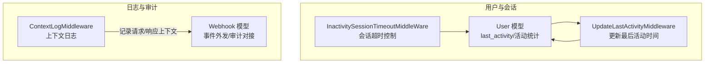
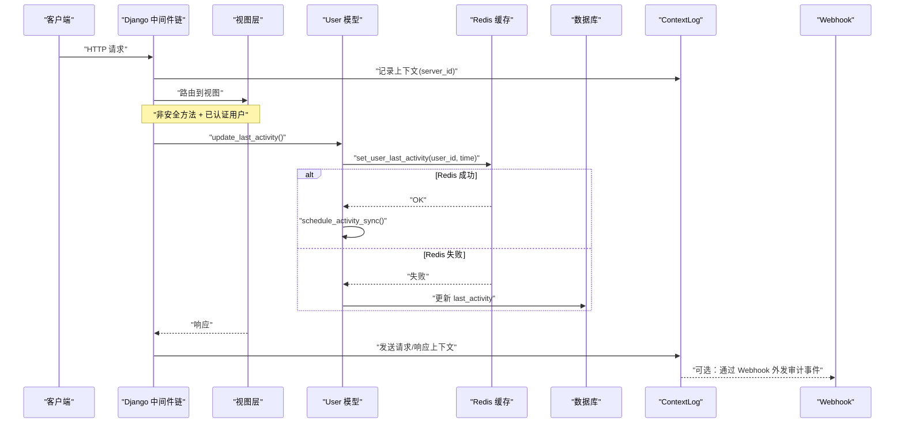
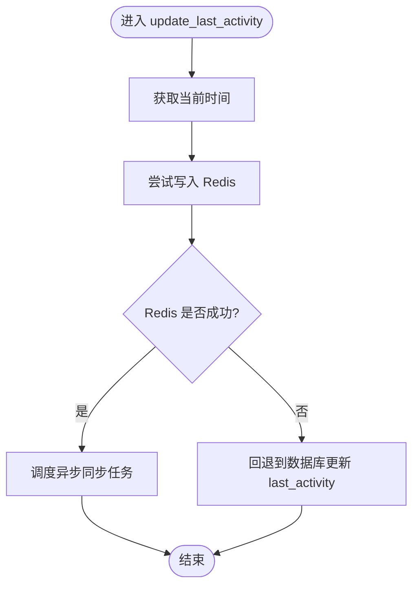
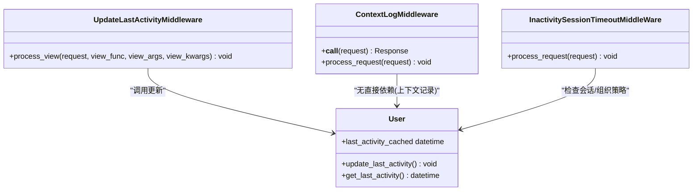
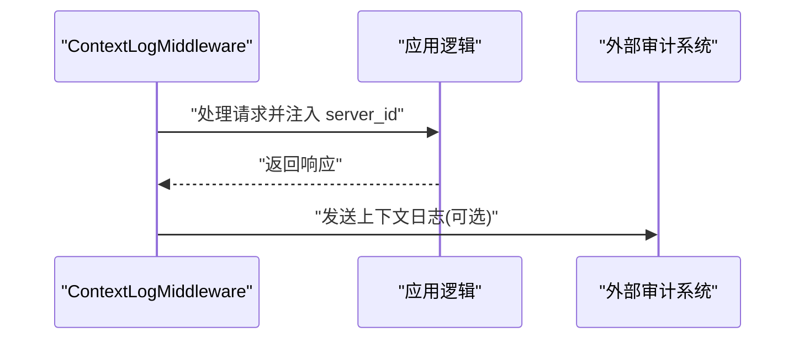
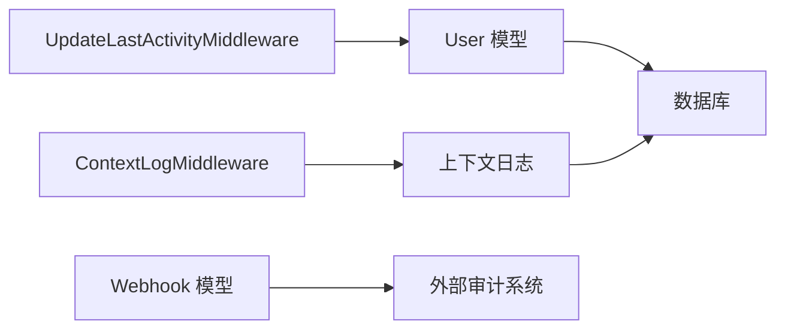

# 活动监控与审计

<cite>
**本文引用的文件**   
- [label_studio/users/models.py](file://label_studio/users/models.py)
- [label_studio/core/middleware.py](file://label_studio/core/middleware.py)
- [label_studio/webhooks/models.py](file://label_studio/webhooks/models.py)
</cite>

## 目录
1. [简介](#简介)
2. [项目结构](#项目结构)
3. [核心组件](#核心组件)
4. [架构总览](#架构总览)
5. [详细组件分析](#详细组件分析)
6. [依赖关系分析](#依赖关系分析)
7. [性能考虑](#性能考虑)
8. [故障排查指南](#故障排查指南)
9. [结论](#结论)
10. [附录](#附录)

## 简介
本文件聚焦 Label Studio 的用户活动监控与审计能力，围绕以下主题展开：
- 用户最后活动时间跟踪机制（Redis 缓存优化与数据库同步策略）
- 用户行为日志记录、上下文日志系统与审计追踪
- 产品引导（Product Tours）功能的配置与管理方法
- 用户活动统计分析、性能监控与异常检测的实现细节
- 审计日志查询、合规性报告生成与安全事件响应操作指南
- 监控数据可视化展示与告警配置示例

## 项目结构
与“活动监控与审计”直接相关的后端代码主要分布在以下模块：
- users 模块：用户模型与最后活动时间管理
- core.middleware：请求中间件链，负责会话超时、上下文日志、最后活动时间更新等
- webhooks 模块：Webhook 模型与动作定义，可用于外部审计与事件通知

图表来源
- [label_studio/users/models.py:65-95](file://label_studio/users/models.py#L65-L95)
- [label_studio/core/middleware.py:181-202](file://label_studio/core/middleware.py#L181-L202)
- [label_studio/core/middleware.py:264-269](file://label_studio/core/middleware.py#L264-L269)
- [label_studio/core/middleware.py:271-325](file://label_studio/core/middleware.py#L271-L325)
- [label_studio/webhooks/models.py:26-74](file://label_studio/webhooks/models.py#L26-L74)

章节来源
- [label_studio/users/models.py:65-95](file://label_studio/users/models.py#L65-L95)
- [label_studio/core/middleware.py:181-202](file://label_studio/core/middleware.py#L181-L202)
- [label_studio/core/middleware.py:264-269](file://label_studio/core/middleware.py#L264-L269)
- [label_studio/core/middleware.py:271-325](file://label_studio/core/middleware.py#L271-L325)
- [label_studio/webhooks/models.py:26-74](file://label_studio/webhooks/models.py#L26-L74)

## 核心组件
- 用户最后活动时间跟踪
  - 通过 UserLastActivityMixin 提供 last_activity 字段与缓存读写方法
  - 写路径优先写入 Redis，失败时回退到数据库；并调度异步同步任务
  - 读路径优先从 Redis 获取，未命中则返回数据库值
- 中间件驱动的活动与审计
  - UpdateLastActivityMiddleware：对非安全 HTTP 方法且已认证用户触发最后活动时间更新
  - ContextLogMiddleware：为每个请求注入 server_id，统一发送上下文日志
  - InactivitySessionTimeoutMiddleWare：基于组织策略或全局配置进行会话超时与续期
- Webhook 审计扩展点
  - Webhook 模型支持按项目/组织维度配置回调，包含动作枚举、重试计数、创建/更新时间等

章节来源
- [label_studio/users/models.py:65-95](file://label_studio/users/models.py#L65-L95)
- [label_studio/core/middleware.py:181-202](file://label_studio/core/middleware.py#L181-L202)
- [label_studio/core/middleware.py:264-269](file://label_studio/core/middleware.py#L264-L269)
- [label_studio/core/middleware.py:271-325](file://label_studio/core/middleware.py#L271-L325)
- [label_studio/webhooks/models.py:26-74](file://label_studio/webhooks/models.py#L26-L74)

## 架构总览
下图展示了用户活动更新、上下文日志与 Webhook 审计的端到端流程。

图表来源
- [label_studio/core/middleware.py:181-202](file://label_studio/core/middleware.py#L181-L202)
- [label_studio/core/middleware.py:264-269](file://label_studio/core/middleware.py#L264-L269)
- [label_studio/users/models.py:65-95](file://label_studio/users/models.py#L65-L95)
- [label_studio/webhooks/models.py:26-74](file://label_studio/webhooks/models.py#L26-L74)

## 详细组件分析

### 用户最后活动时间跟踪（Redis 缓存 + 数据库同步）
- 设计要点
  - 写路径：优先写入 Redis；若失败则降级写入数据库，并调度后台任务将 Redis 中的最新时间同步至数据库
  - 读路径：优先读取 Redis；未命中则回退到数据库字段
  - 属性封装：提供 last_activity_cached 便捷访问
- 关键实现位置
  - 抽象混入类与缓存读写逻辑
  - 调度器调用（异步同步）

图表来源
- [label_studio/users/models.py:65-95](file://label_studio/users/models.py#L65-L95)

章节来源
- [label_studio/users/models.py:65-95](file://label_studio/users/models.py#L65-L95)

### 中间件：活动更新、上下文日志与会话超时
- UpdateLastActivityMiddleware
  - 仅对非安全方法且已认证用户触发最后活动时间更新
- ContextLogMiddleware
  - 解析请求体（JSON 或文本），为请求注入 server_id，并在响应后统一发送上下文日志
- InactivitySessionTimeoutMiddleWare
  - 根据组织策略或全局配置判断会话是否过期，必要时执行登出
  - 每次有效活动请求可延长会话有效期

图表来源
- [label_studio/core/middleware.py:181-202](file://label_studio/core/middleware.py#L181-L202)
- [label_studio/core/middleware.py:264-269](file://label_studio/core/middleware.py#L264-L269)
- [label_studio/core/middleware.py:271-325](file://label_studio/core/middleware.py#L271-L325)
- [label_studio/users/models.py:65-95](file://label_studio/users/models.py#L65-L95)

章节来源
- [label_studio/core/middleware.py:181-202](file://label_studio/core/middleware.py#L181-L202)
- [label_studio/core/middleware.py:264-269](file://label_studio/core/middleware.py#L264-L269)
- [label_studio/core/middleware.py:271-325](file://label_studio/core/middleware.py#L271-L325)
- [label_studio/users/models.py:65-95](file://label_studio/users/models.py#L65-L95)

### 产品引导（Product Tours）功能
- 说明
  - 仓库中存在 product_tours 子模块，通常用于管理与前端交互的产品引导流程
  - 具体配置项、API 与序列化结构位于该目录下，需结合前端集成使用
- 建议
  - 在部署环境中按需启用/禁用特定 Tour 配置
  - 通过 API 暴露 Tour 元数据，由前端渲染步骤与高亮提示

章节来源
- [label_studio/users/product_tours/api.py](file://label_studio/users/product_tours/api.py)
- [label_studio/users/product_tours/models.py](file://label_studio/users/product_tours/models.py)
- [label_studio/users/product_tours/serializers.py](file://label_studio/users/product_tours/serializers.py)

### 用户行为日志、上下文日志与审计追踪
- 上下文日志
  - 中间件自动为请求注入 server_id，并在响应阶段统一发送上下文日志
- 审计追踪
  - 可通过 Webhook 将系统事件（如项目/任务/标注变更）外发到外部审计系统
  - Webhook 支持自定义头部、动作选择、连续失败计数与自动禁用阈值

图表来源
- [label_studio/core/middleware.py:181-202](file://label_studio/core/middleware.py#L181-L202)
- [label_studio/webhooks/models.py:26-74](file://label_studio/webhooks/models.py#L26-L74)

章节来源
- [label_studio/core/middleware.py:181-202](file://label_studio/core/middleware.py#L181-L202)
- [label_studio/webhooks/models.py:26-74](file://label_studio/webhooks/models.py#L26-L74)

### 用户活动统计分析、性能监控与异常检测
- 活动统计
  - 基于 last_activity 与 activity_at 字段进行活跃度分析
  - 结合组织维度的会话策略（最大会话时长、活动间隔）评估用户在线状态
- 性能监控
  - 通过中间件链路观察请求处理耗时与错误率
  - 利用 Webhook 将关键指标事件推送至监控系统
- 异常检测
  - 关注连续失败的 Webhook 投递次数，达到阈值自动禁用以避免雪崩
  - 结合上下文日志定位异常请求与服务器实例

章节来源
- [label_studio/users/models.py:103-164](file://label_studio/users/models.py#L103-L164)
- [label_studio/core/middleware.py:271-325](file://label_studio/core/middleware.py#L271-L325)
- [label_studio/webhooks/models.py:65-74](file://label_studio/webhooks/models.py#L65-L74)

### 审计日志查询、合规性报告与安全事件响应
- 审计日志查询
  - 通过上下文日志与 Webhook 事件聚合，构建审计查询接口
  - 可按 server_id、时间范围、组织/项目维度筛选
- 合规性报告
  - 汇总用户活动、会话超时、Webhook 投递结果，生成周期性报告
- 安全事件响应
  - 针对频繁失败或可疑行为的 Webhook 自动禁用，配合告警通知

章节来源
- [label_studio/core/middleware.py:181-202](file://label_studio/core/middleware.py#L181-L202)
- [label_studio/webhooks/models.py:65-74](file://label_studio/webhooks/models.py#L65-L74)

### 监控数据可视化与告警配置示例
- 可视化
  - 将 last_activity 分布、会话超时比例、Webhook 成功率等指标接入 BI 工具
- 告警
  - 当连续失败超过阈值时触发告警，自动暂停相关 Webhook
  - 对长时间无活动的用户或组织发出提醒

[本节为通用指导，不直接分析具体文件]

## 依赖关系分析
- 组件耦合
  - UpdateLastActivityMiddleware 与 User 模型强耦合（调用更新方法）
  - ContextLogMiddleware 独立于业务逻辑，仅负责上下文记录
  - Webhook 作为外部扩展点，降低与内部模块的耦合度
- 外部依赖
  - Redis（缓存最后活动时间）
  - 数据库（持久化 last_activity 与审计数据）
  - 外部审计系统（通过 Webhook 接收事件）

图表来源
- [label_studio/core/middleware.py:181-202](file://label_studio/core/middleware.py#L181-L202)
- [label_studio/core/middleware.py:264-269](file://label_studio/core/middleware.py#L264-L269)
- [label_studio/users/models.py:65-95](file://label_studio/users/models.py#L65-L95)
- [label_studio/webhooks/models.py:26-74](file://label_studio/webhooks/models.py#L26-L74)

章节来源
- [label_studio/core/middleware.py:181-202](file://label_studio/core/middleware.py#L181-L202)
- [label_studio/core/middleware.py:264-269](file://label_studio/core/middleware.py#L264-L269)
- [label_studio/users/models.py:65-95](file://label_studio/users/models.py#L65-L95)
- [label_studio/webhooks/models.py:26-74](file://label_studio/webhooks/models.py#L26-L74)

## 性能考虑
- Redis 优先写入与异步同步
  - 减少数据库写放大，提升高并发下的活动更新吞吐
- 中间件轻量处理
  - 上下文日志避免阻塞主流程，采用批量发送
- Webhook 失败保护
  - 连续失败计数与自动禁用防止级联故障

[本节为通用指导，不直接分析具体文件]

## 故障排查指南
- 最后活动时间未更新
  - 检查 UpdateLastActivityMiddleware 是否生效（非安全方法、已认证用户）
  - 确认 Redis 可用性与 set_user_last_activity 调用是否成功
- 会话频繁超时
  - 核对组织策略（最大会话时长、活动间隔）与全局配置
  - 检查 NOT_USER_ACTIVITY_PATHS 是否误配导致活动不被识别
- Webhook 投递失败
  - 查看 consecutive_failures 字段，达到阈值后自动禁用
  - 校验目标 URL、Headers 与网络连通性

章节来源
- [label_studio/core/middleware.py:264-269](file://label_studio/core/middleware.py#L264-L269)
- [label_studio/core/middleware.py:271-325](file://label_studio/core/middleware.py#L271-L325)
- [label_studio/webhooks/models.py:65-74](file://label_studio/webhooks/models.py#L65-L74)

## 结论
Label Studio 通过中间件与模型层的协同，实现了高效、可扩展的用户活动监控与审计体系：
- 以 Redis 为核心的最后活动时间缓存与异步同步策略，兼顾性能与一致性
- 上下文日志与 Webhook 提供灵活的审计与外部集成能力
- 会话超时与组织策略保障安全性与资源利用率
建议在部署中结合外部监控系统与 BI 工具，完善可视化与告警闭环。

[本节为总结性内容，不直接分析具体文件]

## 附录
- 术语
  - 最后活动时间：用户最近一次活跃的时间戳
  - 上下文日志：包含请求/响应、server_id 等上下文的日志条目
  - Webhook：面向外部系统的回调通知机制
- 参考路径
  - 用户模型与活动混入：[label_studio/users/models.py](file://label_studio/users/models.py)
  - 中间件链：[label_studio/core/middleware.py](file://label_studio/core/middleware.py)
  - Webhook 模型：[label_studio/webhooks/models.py](file://label_studio/webhooks/models.py)

[本节为补充信息，不直接分析具体文件]