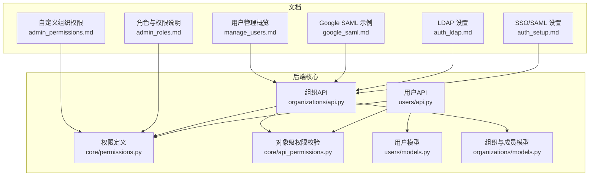
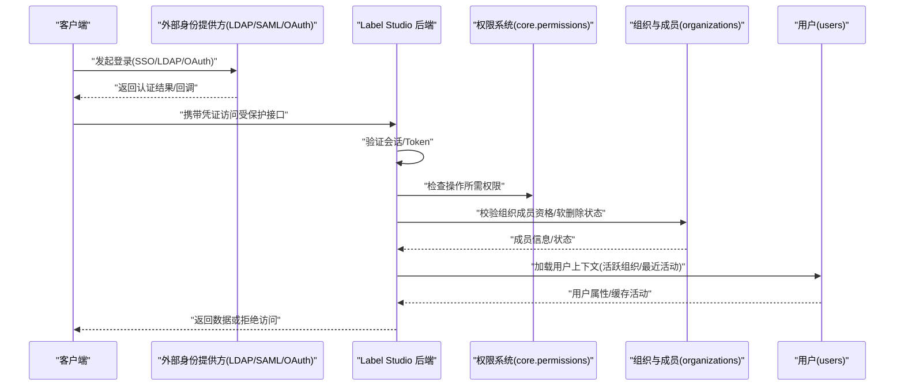
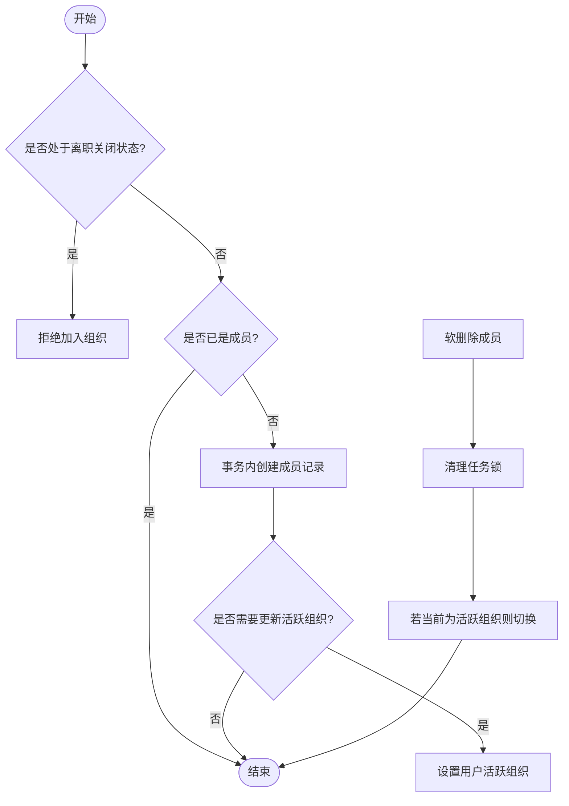
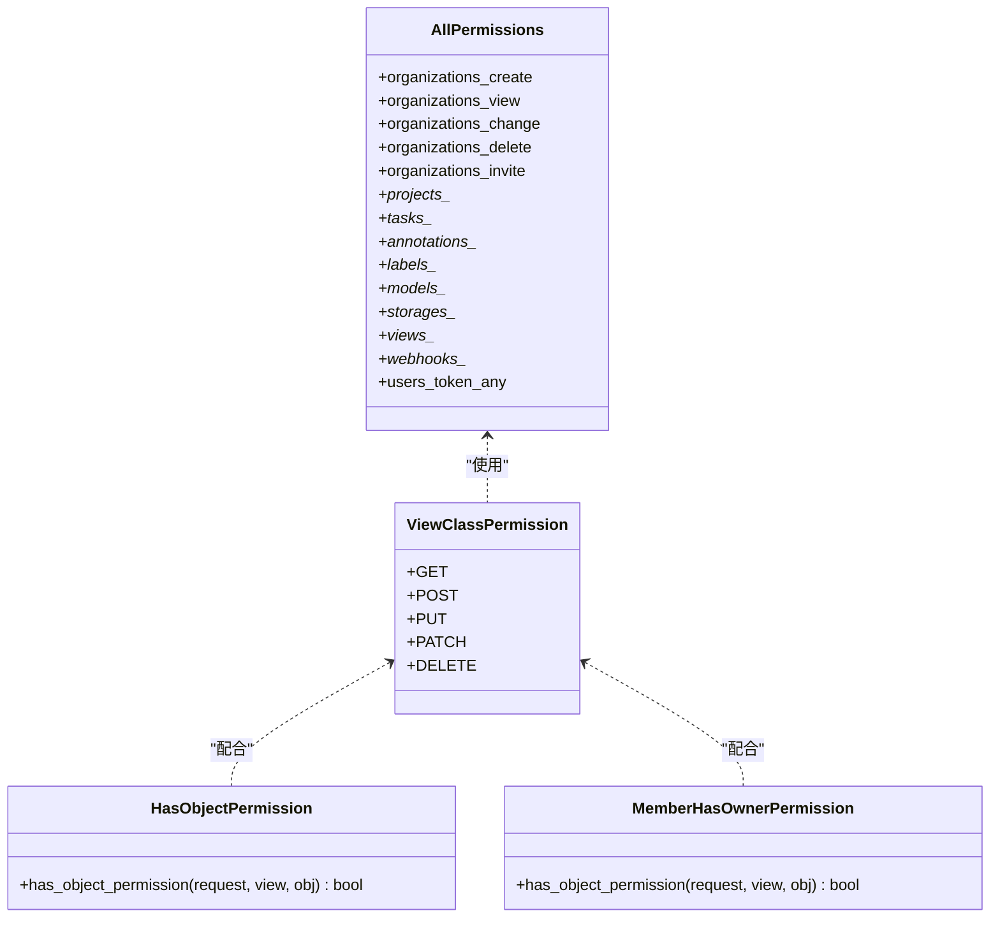
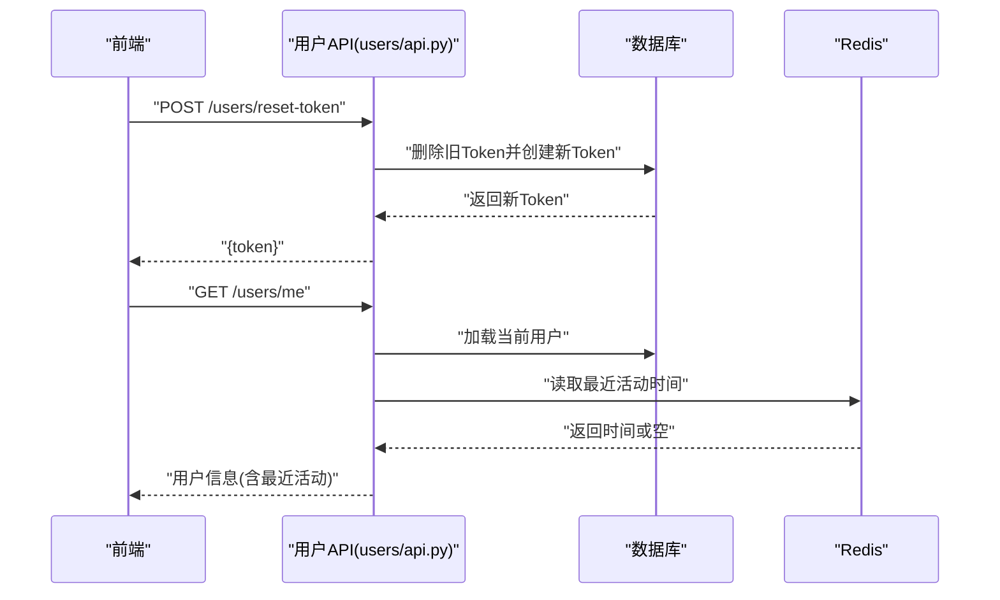
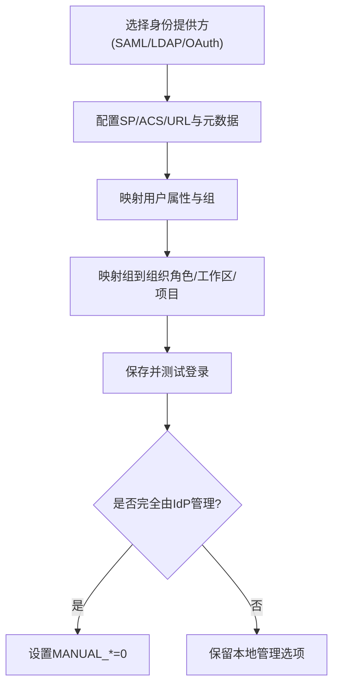
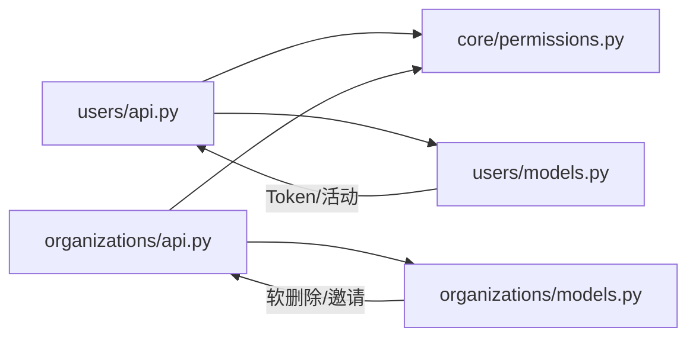

# 用户管理

<cite>
**本文引用的文件**   
- [label_studio/core/permissions.py](file://label_studio/core/permissions.py)
- [label_studio/core/api_permissions.py](file://label_studio/core/api_permissions.py)
- [label_studio/users/models.py](file://label_studio/users/models.py)
- [label_studio/users/api.py](file://label_studio/users/api.py)
- [label_studio/organizations/models.py](file://label_studio/organizations/models.py)
- [label_studio/organizations/api.py](file://label_studio/organizations/api.py)
- [docs/source/guide/auth_setup.md](file://docs/source/guide/auth_setup.md)
- [docs/source/guide/auth_ldap.md](file://docs/source/guide/auth_ldap.md)
- [docs/source/guide/google_saml.md](file://docs/source/guide/google_saml.md)
- [docs/source/guide/admin_roles.md](file://docs/source/guide/admin_roles.md)
- [docs/source/guide/manage_users.md](file://docs/source/guide/manage_users.md)
- [docs/source/guide/admin_permissions.md](file://docs/source/guide/admin_permissions.md)
</cite>

## 目录
1. [简介](#简介)
2. [项目结构](#项目结构)
3. [核心组件](#核心组件)
4. [架构总览](#架构总览)
5. [详细组件分析](#详细组件分析)
6. [依赖关系分析](#依赖关系分析)
7. [性能考虑](#性能考虑)
8. [故障排查指南](#故障排查指南)
9. [结论](#结论)
10. [附录](#附录)

## 简介
本文件系统性阐述 Label Studio 的用户管理与权限控制，覆盖多组织架构设计、成员管理机制、角色与权限模型、认证与会话安全、第三方身份集成（LDAP/SAML/OAuth）、活动监控与审计合规，以及 API 调用示例与前端集成建议。文档面向不同规模组织提供最佳实践与安全建议，帮助构建可审计、可扩展且安全的用户治理体系。

## 项目结构
围绕用户与权限的核心代码分布在以下模块：
- 权限定义与对象级访问控制：core/permissions.py、core/api_permissions.py
- 用户模型与用户相关 API：users/models.py、users/api.py
- 组织与成员模型及组织相关 API：organizations/models.py、organizations/api.py
- 官方文档：SSO/SAML/LDAP 配置、角色与权限说明、用户管理概览

图示来源
- [label_studio/core/permissions.py:13-64](file://label_studio/core/permissions.py#L13-L64)
- [label_studio/core/api_permissions.py:4-14](file://label_studio/core/api_permissions.py#L4-L14)
- [label_studio/users/models.py:103-152](file://label_studio/users/models.py#L103-L152)
- [label_studio/users/api.py:127-180](file://label_studio/users/api.py#L127-L180)
- [label_studio/organizations/models.py:34-95](file://label_studio/organizations/models.py#L34-L95)
- [label_studio/organizations/api.py:59-84](file://label_studio/organizations/api.py#L59-L84)

章节来源
- [label_studio/core/permissions.py:13-86](file://label_studio/core/permissions.py#L13-L86)
- [label_studio/core/api_permissions.py:4-14](file://label_studio/core/api_permissions.py#L4-L14)
- [label_studio/users/models.py:103-243](file://label_studio/users/models.py#L103-L243)
- [label_studio/users/api.py:127-447](file://label_studio/users/api.py#L127-L447)
- [label_studio/organizations/models.py:34-262](file://label_studio/organizations/models.py#L34-L262)
- [label_studio/organizations/api.py:59-440](file://label_studio/organizations/api.py#L59-L440)

## 核心组件
- 权限模型与策略
  - 统一权限常量集合，按资源域划分（组织、项目、任务、标注、标签、模型、存储、视图等），默认要求已认证。
  - 对象级权限校验器用于在修改类请求中强制“非所有者不可写”的约束。
- 用户模型与会话
  - 用户模型包含基础身份信息、头像、热键偏好、活跃组织、最近活动时间等；创建时自动初始化 Token。
  - 最近活动时间通过 Redis 缓存 + 异步落库机制维护，降低数据库压力。
- 组织与成员
  - 组织与用户通过中间表关联，支持软删除成员、邀请链接与过期策略、工作区/项目映射（企业版）。
  - 组织侧提供成员列表、详情、软删除、邀请链接生成与重置等能力。
- 用户与组织 API
  - 用户 API 提供 CRUD、头像管理、Token 获取与重置、个人热键读写等。
  - 组织 API 提供组织列表、成员分页查询、成员详情与软删除、组织设置读取与更新、邀请链接管理等。

章节来源
- [label_studio/core/permissions.py:13-86](file://label_studio/core/permissions.py#L13-L86)
- [label_studio/core/api_permissions.py:4-14](file://label_studio/core/api_permissions.py#L4-L14)
- [label_studio/users/models.py:65-95](file://label_studio/users/models.py#L65-L95)
- [label_studio/users/models.py:103-243](file://label_studio/users/models.py#L103-L243)
- [label_studio/organizations/models.py:34-95](file://label_studio/organizations/models.py#L34-L95)
- [label_studio/organizations/models.py:107-262](file://label_studio/organizations/models.py#L107-L262)
- [label_studio/users/api.py:127-447](file://label_studio/users/api.py#L127-L447)
- [label_studio/organizations/api.py:59-440](file://label_studio/organizations/api.py#L59-L440)

## 架构总览
下图展示从客户端到后端的用户认证、授权与数据访问流程，涵盖 SSO/LDAP 外部 IdP、会话与 Token、组织与成员、对象级权限校验。

图示来源
- [label_studio/core/permissions.py:75-86](file://label_studio/core/permissions.py#L75-L86)
- [label_studio/core/api_permissions.py:4-14](file://label_studio/core/api_permissions.py#L4-L14)
- [label_studio/organizations/models.py:175-215](file://label_studio/organizations/models.py#L175-L215)
- [label_studio/users/models.py:103-152](file://label_studio/users/models.py#L103-L152)

## 详细组件分析

### 多组织架构与成员管理
- 设计要点
  - 组织与用户通过多对多关系连接，支持成员软删除与活跃组织切换。
  - 邀请链接带过期时间，支持重置；新增成员时进行闭户账户拦截（企业特性）。
  - 成员软删除会清理任务锁并调整用户活跃组织。
- 关键流程
  - 添加成员：去重 -> 事务写入 -> 可选设置活跃组织。
  - 移除成员：标记 deleted_at -> 清理任务锁 -> 必要时回退用户活跃组织。
  - 邀请链接：生成 token 与过期时间，支持禁用过期策略。

图示来源
- [label_studio/organizations/models.py:187-215](file://label_studio/organizations/models.py#L187-L215)
- [label_studio/organizations/models.py:78-95](file://label_studio/organizations/models.py#L78-L95)
- [label_studio/organizations/models.py:212-224](file://label_studio/organizations/models.py#L212-L224)

章节来源
- [label_studio/organizations/models.py:34-95](file://label_studio/organizations/models.py#L34-L95)
- [label_studio/organizations/models.py:107-262](file://label_studio/organizations/models.py#L107-L262)

### 用户角色与权限模型
- 角色定义（企业版）
  - Owner、Administrator、Manager、Reviewer、Annotator，具备不同范围的组织/项目/工作区访问与操作权限。
- 权限粒度
  - 以资源域划分的细粒度权限常量（如 organizations.*、projects.*、tasks.*、annotations.* 等），默认仅允许已认证用户。
  - 管理员可在组织层面进一步定制权限开关（如插件编辑、云存储管理、Webhook 管理等）。
- 访问控制策略
  - 基于角色的 RBAC + 对象级权限校验（非所有者禁止写操作）。
  - 成员可见性受工作区/项目成员关系限制。

图示来源
- [label_studio/core/permissions.py:13-64](file://label_studio/core/permissions.py#L13-L64)
- [label_studio/core/api_permissions.py:4-14](file://label_studio/core/api_permissions.py#L4-L14)

章节来源
- [docs/source/guide/admin_roles.md:21-32](file://docs/source/guide/admin_roles.md#L21-L32)
- [docs/source/guide/admin_permissions.md:30-86](file://docs/source/guide/admin_permissions.md#L30-L86)
- [label_studio/core/permissions.py:13-86](file://label_studio/core/permissions.py#L13-L86)
- [label_studio/core/api_permissions.py:4-14](file://label_studio/core/api_permissions.py#L4-L14)

### 用户认证流程与会话管理
- 认证方式
  - 原生账号密码、SSO/SAML、LDAP、OAuth（通过外部 IdP）。
- 会话与令牌
  - 用户创建时自动生成 Token；支持获取与重置 Token。
  - WhoAmI 接口用于获取当前用户上下文。
- 最近活动追踪
  - 通过 Redis 缓存 + 异步同步至数据库，避免高频写库。

图示来源
- [label_studio/users/api.py:240-282](file://label_studio/users/api.py#L240-L282)
- [label_studio/users/api.py:300-310](file://label_studio/users/api.py#L300-L310)
- [label_studio/users/models.py:65-95](file://label_studio/users/models.py#L65-L95)

章节来源
- [docs/source/guide/auth_setup.md:15-39](file://docs/source/guide/auth_setup.md#L15-L39)
- [docs/source/guide/auth_ldap.md:24-67](file://docs/source/guide/auth_ldap.md#L24-L67)
- [docs/source/guide/google_saml.md:19-33](file://docs/source/guide/google_saml.md#L19-L33)
- [label_studio/users/api.py:240-310](file://label_studio/users/api.py#L240-L310)
- [label_studio/users/models.py:65-95](file://label_studio/users/models.py#L65-L95)

### 第三方身份认证集成指南
- SAML/SSO
  - 在组织页面配置 ACS/Login/Logout URL，上传 IdP 元数据，映射属性（Email/FirstName/LastName/Groups）。
  - 支持将 IdP 组映射到组织角色与工作区/项目角色。
  - 可通过环境变量完全交由 IdP 管理角色与工作区。
- LDAP
  - 启用 AUTH_LDAP_ENABLED，配置服务器 URI、绑定 DN/密码、用户 DN 模板或递归搜索。
  - 支持将 LDAP 组映射到组织角色与工作区。
  - 支持 TLS 加密连接。
- OAuth
  - 通过外部 IdP 完成 OAuth 流程，结合 SSO 入口进入 Label Studio。

图示来源
- [docs/source/guide/auth_setup.md:40-120](file://docs/source/guide/auth_setup.md#L40-L120)
- [docs/source/guide/auth_ldap.md:24-121](file://docs/source/guide/auth_ldap.md#L24-L121)
- [docs/source/guide/google_saml.md:55-109](file://docs/source/guide/google_saml.md#L55-L109)

章节来源
- [docs/source/guide/auth_setup.md:15-149](file://docs/source/guide/auth_setup.md#L15-L149)
- [docs/source/guide/auth_ldap.md:1-121](file://docs/source/guide/auth_ldap.md#L1-L121)
- [docs/source/guide/google_saml.md:1-142](file://docs/source/guide/google_saml.md#L1-L142)

### 用户活动监控、审计日志与合规性
- 活动监控
  - 用户最近活动时间通过 Redis 缓存 + 异步落库，便于统计与仪表盘展示。
- 审计日志
  - 管理员可查看系统级活动日志，跟踪谁在何时对哪些数据进行了标注或变更。
- 合规性
  - 通过 RBAC、最小权限原则、SSO/LDAP 集中管控、邀请链接过期与软删除等机制满足 GDPR/HIPAA 等合规要求。

章节来源
- [label_studio/users/models.py:65-95](file://label_studio/users/models.py#L65-L95)
- [docs/source/guide/manage_users.md:19-31](file://docs/source/guide/manage_users.md#L19-L31)

### API 调用示例与前端集成方案
- 用户管理 API
  - 列出/创建/获取/更新/删除用户
  - 头像上传/删除
  - 获取/重置 Token
  - 获取当前用户信息（WhoAmI）
  - 获取/更新个人热键（可按项目作用域）
- 组织与成员 API
  - 列出组织、成员分页查询、成员详情、软删除成员
  - 获取/重置邀请链接
  - 组织设置读取与更新
- 前端集成建议
  - 登录后优先调用 WhoAmI 获取用户上下文与活跃组织。
  - 根据角色与权限常量控制 UI 功能可见性与按钮可用性。
  - 敏感操作前再次校验对象级权限（例如非所有者不可写）。
  - 使用 Token 作为 API 鉴权头，并提供 Token 重置入口。

章节来源
- [label_studio/users/api.py:127-447](file://label_studio/users/api.py#L127-L447)
- [label_studio/organizations/api.py:59-440](file://label_studio/organizations/api.py#L59-L440)

## 依赖关系分析
- 组件耦合
  - users.api 与 organizations.api 均依赖 core.permissions 提供的权限常量与 ViewClassPermission。
  - organizations.models 提供成员软删除与邀请链接逻辑，被 organizations.api 复用。
  - users.models 提供用户基础能力（Token、最近活动、活跃组织），被 users.api 使用。
- 外部依赖
  - SSO/SAML/LDAP 通过环境变量与 IdP 交互，影响组织成员与角色分配。
- 潜在循环依赖
  - 通过延迟导入与 load_func(settings.*) 避免启动期循环依赖。

图示来源
- [label_studio/users/api.py:127-180](file://label_studio/users/api.py#L127-L180)
- [label_studio/organizations/api.py:59-84](file://label_studio/organizations/api.py#L59-L84)
- [label_studio/organizations/models.py:187-215](file://label_studio/organizations/models.py#L187-L215)
- [label_studio/users/models.py:214-243](file://label_studio/users/models.py#L214-L243)

章节来源
- [label_studio/users/api.py:127-447](file://label_studio/users/api.py#L127-L447)
- [label_studio/organizations/api.py:59-440](file://label_studio/organizations/api.py#L59-L440)
- [label_studio/organizations/models.py:187-215](file://label_studio/organizations/models.py#L187-L215)
- [label_studio/users/models.py:214-243](file://label_studio/users/models.py#L214-L243)

## 性能考虑
- 最近活动时间
  - 优先写入 Redis，异步批量同步数据库，减少写放大。
- 成员列表分页
  - 支持 page_size=-1 模拟“无上限”，但建议合理分页以避免大结果集。
- 对象级权限
  - 仅在写操作路径执行额外校验，读操作保持轻量。

[本节为通用指导，不直接分析具体文件]

## 故障排查指南
- 无法创建组织
  - 实例可能禁用了通过 API 创建组织的权限，需检查配置项。
- 成员软删除失败
  - 确认是否为当前活跃组织；尝试自我软删除会被拒绝。
- 邀请链接无效
  - 检查链接是否过期；必要时重置组织 Token。
- 权限不足
  - 确认用户角色与对象级权限；非所有者写操作将被拒绝。
- 最近活动未更新
  - 检查 Redis 连通性与异步任务是否正常执行。

章节来源
- [label_studio/organizations/api.py:79-84](file://label_studio/organizations/api.py#L79-L84)
- [label_studio/organizations/api.py:305-323](file://label_studio/organizations/api.py#L305-L323)
- [label_studio/organizations/api.py:386-440](file://label_studio/organizations/api.py#L386-L440)
- [label_studio/core/api_permissions.py:4-14](file://label_studio/core/api_permissions.py#L4-L14)
- [label_studio/users/models.py:65-95](file://label_studio/users/models.py#L65-L95)

## 结论
Label Studio 的用户与权限体系以组织为中心，结合细粒度权限常量与对象级访问控制，实现灵活而安全的 RBAC。通过 SSO/SAML/LDAP 等第三方身份集成，企业可实现集中化身份治理与自动化角色/工作区分配。结合活动监控与审计日志，可满足合规与可追溯要求。针对不同规模组织，建议遵循最小权限、集中身份、定期审计与密钥轮换等最佳实践。

[本节为总结性内容，不直接分析具体文件]

## 附录
- 最佳实践与安全建议
  - 使用 SSO/LDAP 集中管理用户生命周期与角色。
  - 启用邀请链接过期与软删除，避免僵尸成员。
  - 限制 Token 创建与使用范围，定期轮换。
  - 对敏感数据启用 TLS 与证书校验。
  - 通过组织权限页精细控制插件、存储、Webhook 等高风险能力。
  - 定期审查活动日志与成员清单，确保合规。

[本节为通用指导，不直接分析具体文件]