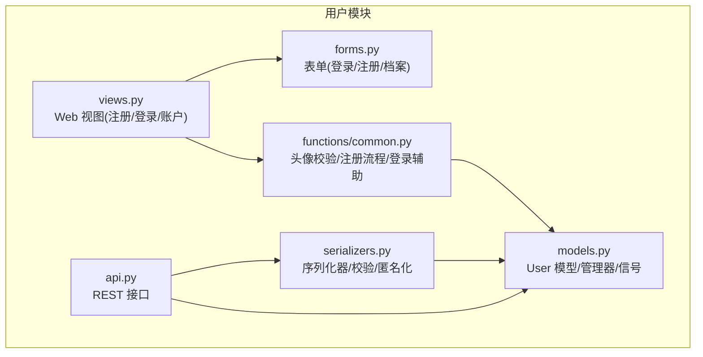
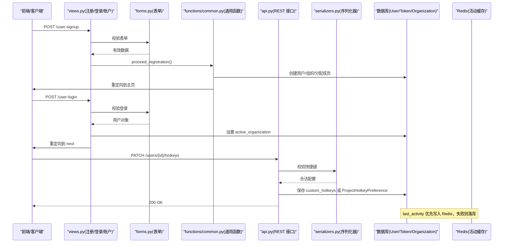
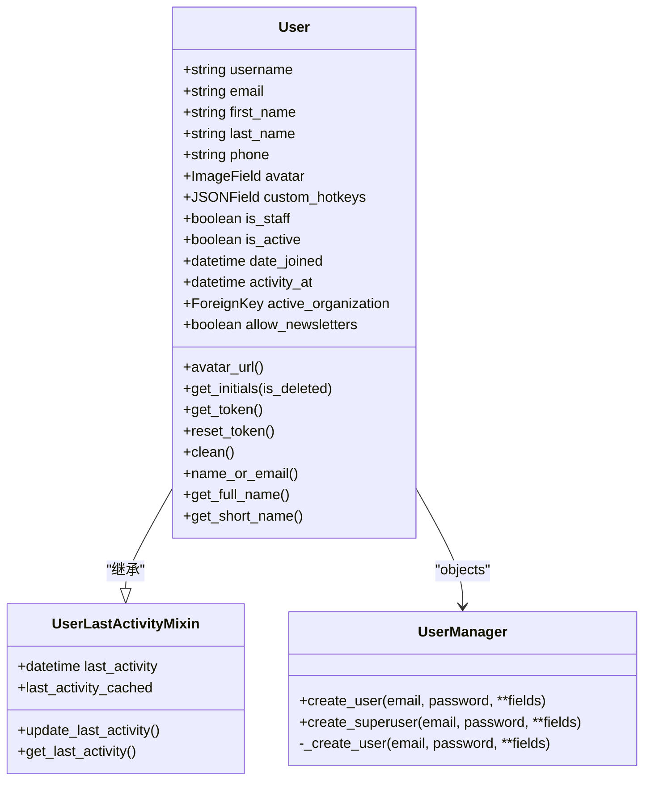
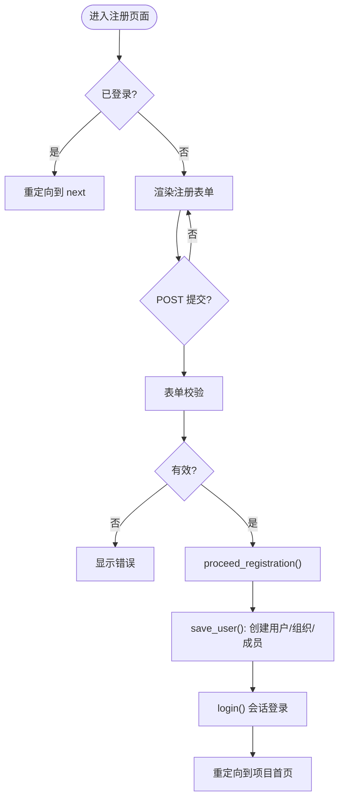
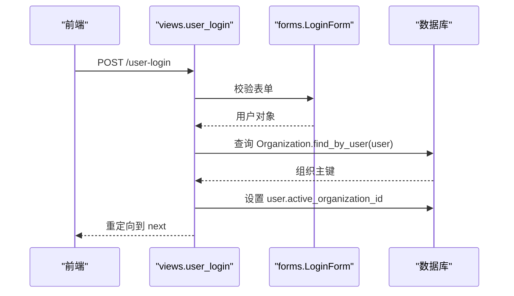
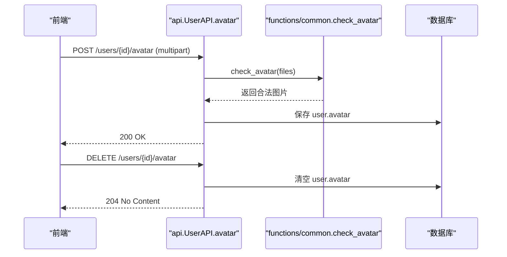
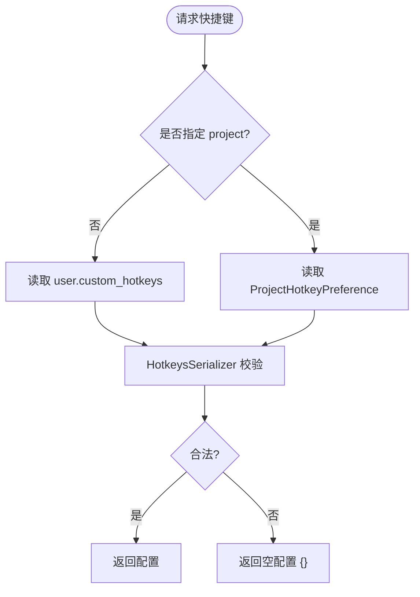
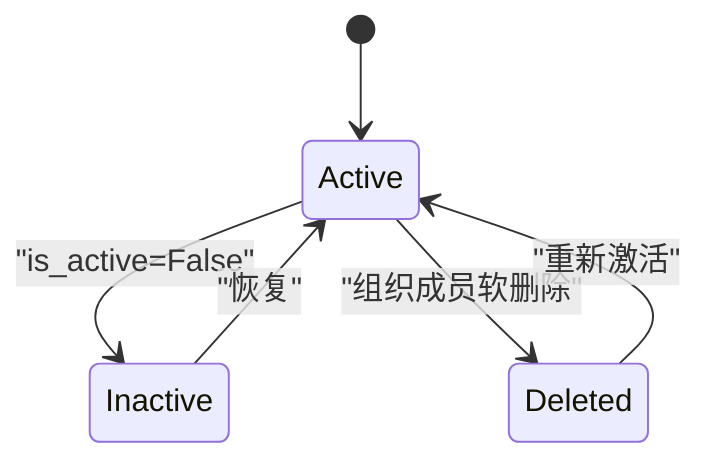
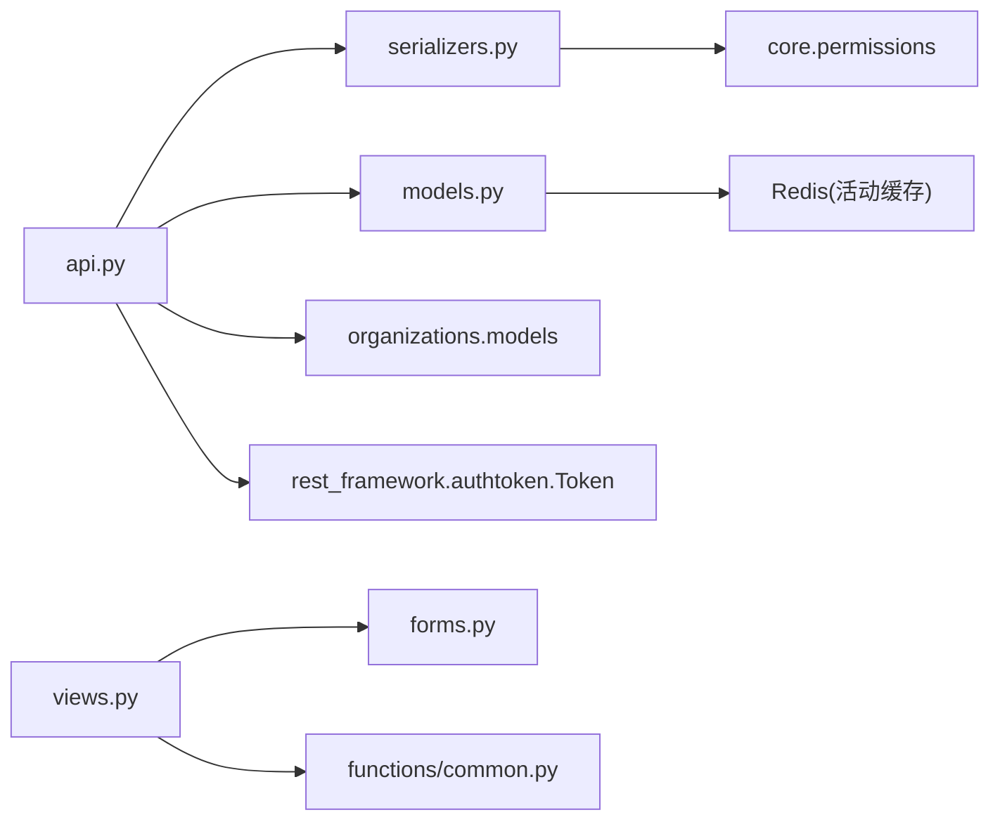

# 用户账户管理

<cite>
**本文引用的文件**   
- [models.py](file://label_studio/users/models.py)
- [api.py](file://label_studio/users/api.py)
- [serializers.py](file://label_studio/users/serializers.py)
- [views.py](file://label_studio/users/views.py)
- [forms.py](file://label_studio/users/forms.py)
- [common.py](file://label_studio/users/functions/common.py)
</cite>

## 目录
1. [简介](#简介)
2. [项目结构](#项目结构)
3. [核心组件](#核心组件)
4. [架构总览](#架构总览)
5. [详细组件分析](#详细组件分析)
6. [依赖关系分析](#依赖关系分析)
7. [性能考虑](#性能考虑)
8. [故障排查指南](#故障排查指南)
9. [结论](#结论)
10. [附录：API参考](#附录api参考)

## 简介
本文件系统性梳理 Label Studio 的用户账户管理实现，覆盖用户模型字段与业务方法、注册/登录/密码重置流程、个人信息更新与头像上传、个性化快捷键配置、用户状态管理与生命周期策略，以及完整的用户相关 API 参考。文档以代码为依据，辅以架构图与时序图帮助理解数据流与控制流。

## 项目结构
用户模块位于 label_studio/users，关键文件职责如下：
- models.py：定义 User 模型、管理器、活动记录混入、信号处理等
- api.py：RESTful 用户接口（CRUD、头像、令牌、WhoAmI、快捷键）
- serializers.py：序列化器（用户信息、快捷键校验、匿名化与防火墙逻辑）
- views.py：Web 视图（注册、登录、注销、账户页）
- forms.py：表单（登录、注册、个人档案）
- functions/common.py：通用函数（头像校验与保存、注册流程封装、登录辅助）

**图示来源**
- [models.py:30-243](file://label_studio/users/models.py#L30-L243)
- [api.py:127-447](file://label_studio/users/api.py#L127-L447)
- [serializers.py:69-346](file://label_studio/users/serializers.py#L69-L346)
- [views.py:24-184](file://label_studio/users/views.py#L24-L184)
- [forms.py:36-119](file://label_studio/users/forms.py#L36-L119)
- [common.py:17-99](file://label_studio/users/functions/common.py#L17-L99)

**章节来源**
- [models.py:30-243](file://label_studio/users/models.py#L30-L243)
- [api.py:127-447](file://label_studio/users/api.py#L127-L447)
- [serializers.py:69-346](file://label_studio/users/serializers.py#L69-L346)
- [views.py:24-184](file://label_studio/users/views.py#L24-L184)
- [forms.py:36-119](file://label_studio/users/forms.py#L36-L119)
- [common.py:17-99](file://label_studio/users/functions/common.py#L17-L99)

## 核心组件
- 用户模型 User：基于 Django AbstractBaseUser + PermissionsMixin，扩展了用户名、邮箱、姓名、电话、头像、自定义快捷键、组织关联、通讯许可、加入时间、最近标注活动时间、最后活跃时间等；提供头像 URL 计算、组织成员统计、Token 获取与重置、首字母缩写生成等方法。
- 用户管理器 UserManager：负责创建普通用户与超级用户，统一设置 is_staff/is_superuser 默认值并调用 _create_user。
- 活动记录混入 UserLastActivityMixin：通过 Redis 缓存与数据库回退机制维护 last_activity，支持异步同步任务。
- 序列化器 BaseUserSerializer/HotkeysSerializer：输出用户基本信息、头像、组织元数据、最后活跃时间；对快捷键进行严格格式与安全校验（危险组合拦截、长度限制、字符集白名单）。
- REST 接口 UserAPI/UserResetTokenAPI/UserGetTokenAPI/UserWhoAmIAPI/UserHotkeysAPI：提供用户 CRUD、头像上传/删除、令牌管理、当前用户信息与快捷键读写。
- Web 视图 user_signup/user_login/user_account/logout：处理注册、登录、账户页渲染与更新、注销跳转。
- 表单 LoginForm/UserSignupForm/UserProfileForm：登录认证、注册校验与保存、个人资料编辑。
- 通用函数 hash_upload/check_avatar/save_user/proceed_registration/login：头像命名与校验、注册流程封装、登录辅助。

**章节来源**
- [models.py:30-243](file://label_studio/users/models.py#L30-L243)
- [serializers.py:69-346](file://label_studio/users/serializers.py#L69-L346)
- [api.py:127-447](file://label_studio/users/api.py#L127-L447)
- [views.py:24-184](file://label_studio/users/views.py#L24-L184)
- [forms.py:36-119](file://label_studio/users/forms.py#L36-L119)
- [common.py:17-99](file://label_studio/users/functions/common.py#L17-L99)

## 架构总览
下图展示用户账户管理的端到端交互：前端页面或客户端调用 Web 视图与 REST API，后端通过表单与序列化器完成数据校验，持久化到数据库，必要时访问 Redis 缓存活动信息，返回结构化响应。

**图示来源**
- [views.py:40-139](file://label_studio/users/views.py#L40-L139)
- [forms.py:36-119](file://label_studio/users/forms.py#L36-L119)
- [common.py:58-99](file://label_studio/users/functions/common.py#L58-L99)
- [api.py:374-447](file://label_studio/users/api.py#L374-L447)
- [serializers.py:190-306](file://label_studio/users/serializers.py#L190-L306)
- [models.py:65-95](file://label_studio/users/models.py#L65-L95)

## 详细组件分析

### 用户模型与业务方法
- 字段定义
  - 身份与联系：username、email（唯一）、first_name、last_name、phone
  - 媒体与偏好：avatar（ImageField，upload_to=hash_upload）、custom_hotkeys（JSONField）
  - 权限与状态：is_staff、is_active、allow_newsletters
  - 时间与组织：date_joined、activity_at、active_organization
  - 活动追踪：last_activity（由 UserLastActivityMixin 提供）
- 属性与方法
  - avatar_url：根据是否启用云存储返回直链或拼接 HOSTNAME
  - get_initials：根据姓名/邮箱生成首字母缩写，支持已删除用户标识
  - get_token/reset_token：获取或重置 Token
  - clean：规范化 email
  - name_or_email/get_full_name/get_short_name：显示名辅助
  - is_organization_admin/active_organization_annotations/own_organization/has_organization：组织相关查询与判断
- 信号 post_save：新用户创建时自动初始化 Token

**图示来源**
- [models.py:30-243](file://label_studio/users/models.py#L30-L243)

**章节来源**
- [models.py:30-243](file://label_studio/users/models.py#L30-L243)

### 注册流程
- 入口：views.user_signup
- 表单：forms.UserSignupForm（邮箱/密码/通讯许可/发现渠道）
- 流程：proceed_registration -> save_user（创建用户、分配/创建组织、设置 active_organization、注入 advanced_json、登录并重定向）
- 安全：可选禁用无邀请链接的注册（DISABLE_SIGNUP_WITHOUT_LINK），校验 next 参数安全性

**图示来源**
- [views.py:40-100](file://label_studio/users/views.py#L40-L100)
- [forms.py:65-110](file://label_studio/users/forms.py#L65-L110)
- [common.py:58-93](file://label_studio/users/functions/common.py#L58-L93)

**章节来源**
- [views.py:40-100](file://label_studio/users/views.py#L40-L100)
- [forms.py:65-110](file://label_studio/users/forms.py#L65-L110)
- [common.py:58-93](file://label_studio/users/functions/common.py#L58-L93)

### 登录流程
- 入口：views.user_login
- 表单：forms.LoginForm（支持用户名或邮箱登录，取决于 USE_USERNAME_FOR_LOGIN）
- 认证：优先使用 settings.USER_AUTH，否则 Django 内置 authenticate
- 会话：可设置 keep_me_logged_in 控制浏览器关闭即过期
- 组织绑定：登录后将 active_organization 设置为该用户所属组织并保存

**图示来源**
- [views.py:103-139](file://label_studio/users/views.py#L103-L139)
- [forms.py:36-63](file://label_studio/users/forms.py#L36-L63)

**章节来源**
- [views.py:103-139](file://label_studio/users/views.py#L103-L139)
- [forms.py:36-63](file://label_studio/users/forms.py#L36-L63)

### 密码重置
- 命令式重置：server._reset_password（命令行工具）
- 确认链接：测试用例中涉及 password_reset_confirm 路由，表明系统支持标准 Django 密码重置流程（含邮件发送与确认链接）
- 说明：具体邮件模板与后端实现未在本仓库片段中直接暴露，但可通过 Django 内置 auth 流程集成

**章节来源**
- [server.py:208-215](file://label_studio/server.py#L208-L215)
- [test_endpoints.py:320-330](file://label_studio/tests/test_endpoints.py#L320-L330)

### 个人信息更新与头像上传
- 个人信息更新
  - Web 账户页：views.user_account 渲染 UserProfileForm，POST 后保存 first_name/last_name/phone/allow_newsletters
  - REST 更新：api.UserAPI 支持 PUT/PATCH，read-only 字段保护（如 email/username），允许更新 allow_newsletters 并同步 advanced_json
- 头像上传/删除
  - REST 接口：/users/{id}/avatar
    - POST：check_avatar 校验尺寸/类型/大小，保存到用户头像字段
    - DELETE：清空头像
  - 头像路径：hash_upload 生成哈希前缀文件名，结合 AVATAR_PATH 配置

**图示来源**
- [api.py:141-156](file://label_studio/users/api.py#L141-L156)
- [common.py:17-55](file://label_studio/users/functions/common.py#L17-L55)

**章节来源**
- [views.py:141-184](file://label_studio/users/views.py#L141-L184)
- [forms.py:113-119](file://label_studio/users/forms.py#L113-L119)
- [api.py:141-156](file://label_studio/users/api.py#L141-L156)
- [common.py:17-55](file://label_studio/users/functions/common.py#L17-L55)

### 个性化设置：快捷键配置
- 数据结构：custom_hotkeys（JSONField），按 section:action 组织，每个动作包含 key 与可选 active 标志
- 读取：UserHotkeysAPI.get
  - 若 project 为空：返回用户级 custom_hotkeys
  - 若指定 project：从 ProjectHotkeyPreference 读取项目级覆盖
- 写入：UserHotkeysAPI.patch
  - 若无 project：更新用户级 custom_hotkeys
  - 若有 project：update_or_create 项目级覆盖；空配置则删除覆盖项
- 安全校验：HotkeysSerializer
  - 最大数量限制（MAX_HOTKEYS）
  - 危险组合黑名单（DANGEROUS_KEY_COMBINATIONS）
  - 键名长度与格式校验（section:action）
  - 键组合字符白名单与修饰符校验

**图示来源**
- [api.py:374-447](file://label_studio/users/api.py#L374-L447)
- [serializers.py:190-306](file://label_studio/users/serializers.py#L190-L306)

**章节来源**
- [api.py:374-447](file://label_studio/users/api.py#L374-L447)
- [serializers.py:190-306](file://label_studio/users/serializers.py#L190-L306)

### 用户状态管理与生命周期
- 激活/停用：is_active 布尔字段控制登录与访问；删除用户时 perform_destroy 会检查组织所有者与成员权限，防止破坏性删除
- 生命周期钩子：post_save 为新用户创建 Token；UserLastActivityMixin 在每次活动后尝试写入 Redis，失败则落库并调度异步同步
- 数据清理：当用户在组织中处于“软删除”状态（OrganizationMember.deleted_at 非空），序列化层会对身份信息做匿名化处理（掩码用户名/邮箱/名称，隐藏头像）

**图示来源**
- [models.py:130-134](file://label_studio/users/models.py#L130-L134)
- [models.py:238-243](file://label_studio/users/models.py#L238-L243)
- [models.py:65-95](file://label_studio/users/models.py#L65-L95)
- [serializers.py:11-66](file://label_studio/users/serializers.py#L11-L66)

**章节来源**
- [models.py:65-95](file://label_studio/users/models.py#L65-L95)
- [models.py:130-134](file://label_studio/users/models.py#L130-L134)
- [models.py:238-243](file://label_studio/users/models.py#L238-L243)
- [serializers.py:11-66](file://label_studio/users/serializers.py#L11-L66)

## 依赖关系分析
- 模块内依赖
  - api.py 依赖 serializers.py 与 models.py，并通过 settings 动态加载序列化器与防火墙类
  - views.py 依赖 forms.py 与 functions/common.py，处理 Web 流程
  - serializers.py 依赖 models.py 与 core.permissions 中的权限枚举
- 外部依赖
  - Django Auth/Session/ORM
  - DRF（APIView/ViewSets/Serializers）
  - organizations.models.Organization（组织与成员）
  - rest_framework.authtoken.Token（API Token）
  - Redis（活动缓存）

**图示来源**
- [api.py:1-23](file://label_studio/users/api.py#L1-L23)
- [serializers.py:1-9](file://label_studio/users/serializers.py#L1-L9)
- [views.py:1-20](file://label_studio/users/views.py#L1-L20)
- [common.py:1-15](file://label_studio/users/functions/common.py#L1-L15)
- [models.py:1-21](file://label_studio/users/models.py#L1-L21)

**章节来源**
- [api.py:1-23](file://label_studio/users/api.py#L1-L23)
- [serializers.py:1-9](file://label_studio/users/serializers.py#L1-L9)
- [views.py:1-20](file://label_studio/users/views.py#L1-L20)
- [common.py:1-15](file://label_studio/users/functions/common.py#L1-L15)
- [models.py:1-21](file://label_studio/users/models.py#L1-L21)

## 性能考虑
- 活动记录缓存：UserLastActivityMixin 优先写 Redis，失败再落库，减少数据库压力；同时调度异步任务批量同步
- 序列化缓存：BaseUserSerializer.to_representation 对同一实例与字段形状进行缓存，避免重复解析云存储链接
- 头像上传校验：在 common.check_avatar 中进行尺寸/类型/大小校验，尽早失败，避免无效 IO
- 快捷键校验：限制数量与键组合长度，降低前端渲染与后端存储开销

[本节为通用指导，不直接分析具体文件]

## 故障排查指南
- 头像上传失败
  - 检查文件格式/大小/维度是否符合 check_avatar 要求
  - 确认 AVATAR_PATH 与存储配置正确
- 快捷键配置无效
  - 检查 HotkeysSerializer 校验规则（危险组合、长度、格式）
  - 确认 project 参数是否存在且用户有访问权限
- 登录失败
  - 检查 USE_USERNAME_FOR_LOGIN 配置与 USER_AUTH 自定义认证逻辑
  - 确认用户 is_active=True 且密码正确
- 注册被拒绝
  - 检查 DISABLE_SIGNUP_WITHOUT_LINK 与邀请 token 有效性
  - 确认邮箱唯一性与密码强度

**章节来源**
- [common.py:22-55](file://label_studio/users/functions/common.py#L22-L55)
- [serializers.py:190-306](file://label_studio/users/serializers.py#L190-L306)
- [forms.py:36-94](file://label_studio/users/forms.py#L36-L94)
- [views.py:40-100](file://label_studio/users/views.py#L40-L100)

## 结论
Label Studio 的用户账户管理以 Django 原生能力为基础，结合 DRF 提供完善的 REST API，并通过 Redis 提升活动记录性能。系统在注册、登录、个人信息与头像管理、快捷键个性化等方面具备完整实现，同时在序列化层实现了敏感信息的匿名化与防火墙策略，保障多角色场景下的数据安全。建议在生产环境开启 Redis 缓存、合理配置存储与权限策略，并遵循快捷键安全规范以避免系统级冲突。

[本节为总结性内容，不直接分析具体文件]

## 附录：API参考

### 用户资源
- 列表用户
  - 方法：GET
  - 路径：/api/users
  - 权限：organizations_change
  - 响应：用户列表（UserSerializer）
- 创建用户
  - 方法：POST
  - 路径：/api/users
  - 权限：organizations_change
  - 请求体：UserSerializer
  - 响应：201 Created，返回用户对象
- 获取用户
  - 方法：GET
  - 路径：/api/users/{id}
  - 权限：organizations_view
  - 响应：200 OK，返回用户对象
- 更新用户
  - 方法：PUT
  - 路径：/api/users/{id}
  - 权限：organizations_change
  - 请求体：UserSerializer
  - 响应：200 OK
- 部分更新用户
  - 方法：PATCH
  - 路径：/api/users/{id}
  - 权限：organizations_view
  - 请求体：UserSerializerUpdate
  - 响应：200 OK
- 删除用户
  - 方法：DELETE
  - 路径：/api/users/{id}
  - 权限：organizations_change
  - 响应：204 No Content

**章节来源**
- [api.py:27-126](file://label_studio/users/api.py#L27-L126)
- [api.py:127-215](file://label_studio/users/api.py#L127-L215)
- [serializers.py:69-183](file://label_studio/users/serializers.py#L69-L183)

### 头像接口
- 上传头像
  - 方法：POST
  - 路径：/api/users/{id}/avatar
  - 权限：avatar_any
  - 请求体：multipart/form-data，字段名为 avatar
  - 校验：尺寸≤1200x1200，类型 JPEG/JPG/GIF/PNG，大小≤1MB
  - 响应：200 OK，{detail: "avatar saved"}
- 删除头像
  - 方法：DELETE
  - 路径：/api/users/{id}/avatar
  - 权限：avatar_any
  - 响应：204 No Content

**章节来源**
- [api.py:141-156](file://label_studio/users/api.py#L141-L156)
- [common.py:22-55](file://label_studio/users/functions/common.py#L22-L55)

### 令牌接口
- 重置令牌
  - 方法：POST
  - 路径：/api/users/token/reset
  - 权限：users_token_any
  - 响应：201 Created，{token: string}
- 获取令牌
  - 方法：GET
  - 路径：/api/users/token
  - 权限：users_token_any
  - 响应：200 OK，{token: string}

**章节来源**
- [api.py:217-283](file://label_studio/users/api.py#L217-L283)
- [models.py:214-219](file://label_studio/users/models.py#L214-L219)

### 当前用户信息
- WhoAmI
  - 方法：GET
  - 路径：/api/users/me
  - 权限：IsAuthenticated
  - 响应：200 OK，WhoAmIUserSerializer（包含 permissions 列表）

**章节来源**
- [api.py:285-311](file://label_studio/users/api.py#L285-L311)
- [serializers.py:174-183](file://label_studio/users/serializers.py#L174-L183)

### 快捷键接口
- 获取快捷键
  - 方法：GET
  - 路径：/api/users/hotkeys?project={project_id}
  - 权限：IsAuthenticated
  - 查询参数：project（可选）
  - 响应：200 OK，{custom_hotkeys: dict}
- 更新快捷键
  - 方法：PATCH
  - 路径：/api/users/hotkeys?project={project_id}
  - 权限：IsAuthenticated
  - 请求体：{custom_hotkeys: dict}
  - 响应：200 OK，{custom_hotkeys: dict}
  - 错误：400（校验失败）、401/403/404（权限/项目不存在）、500（服务器异常）

**章节来源**
- [api.py:313-447](file://label_studio/users/api.py#L313-L447)
- [serializers.py:190-306](file://label_studio/users/serializers.py#L190-L306)