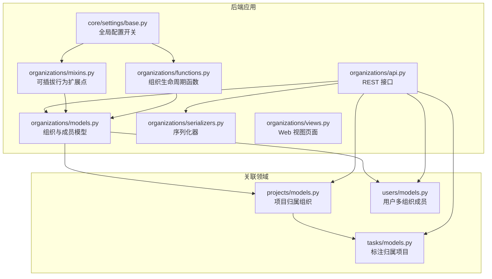
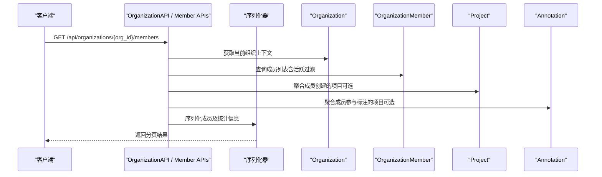
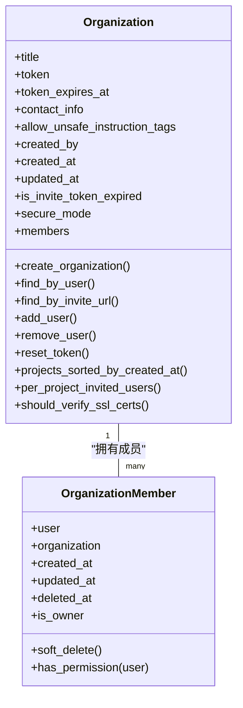
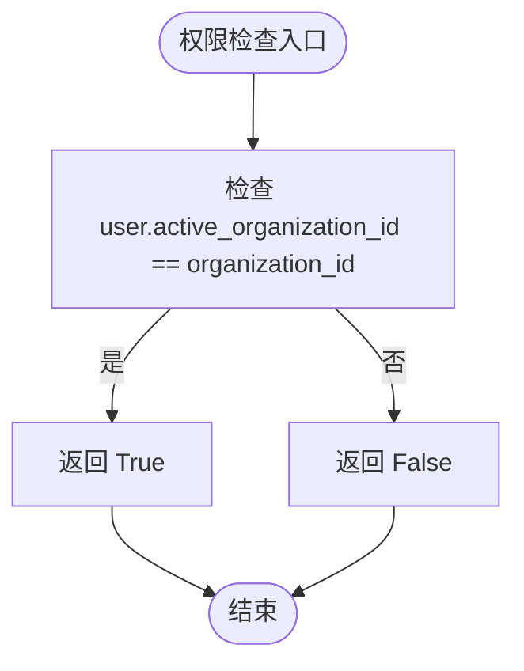
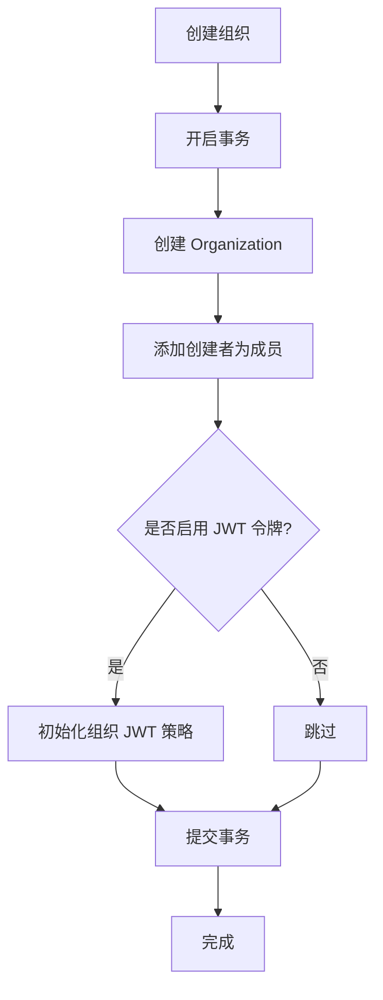
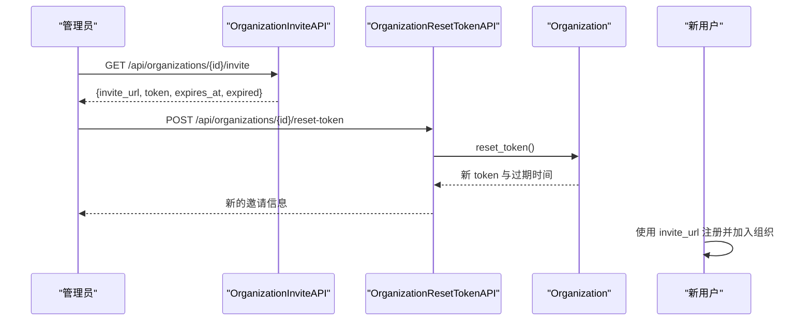
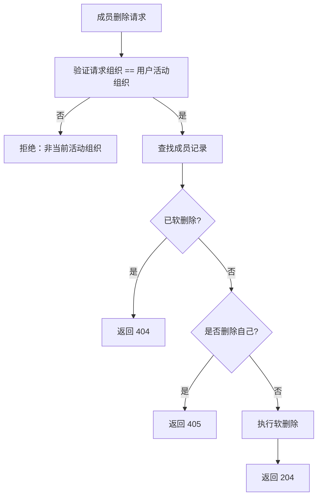
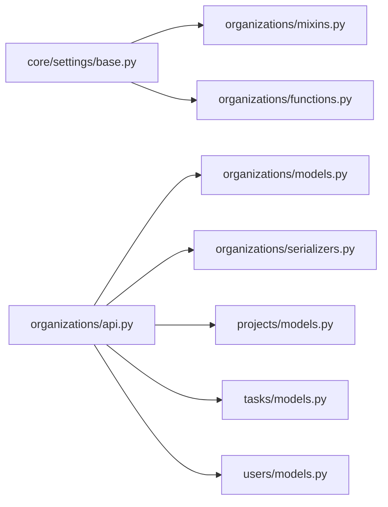

# 组织管理

<cite>
**本文引用的文件**   
- [organizations/models.py](file://label_studio/organizations/models.py)
- [organizations/api.py](file://label_studio/organizations/api.py)
- [organizations/serializers.py](file://label_studio/organizations/serializers.py)
- [organizations/mixins.py](file://label_studio/organizations/mixins.py)
- [organizations/functions.py](file://label_studio/organizations/functions.py)
- [organizations/views.py](file://label_studio/organizations/views.py)
- [core/settings/base.py](file://label_studio/core/settings/base.py)
- [docs/source/guide/organization.md](file://docs/source/guide/organization.md)
</cite>

## 目录
1. [简介](#简介)
2. [项目结构](#项目结构)
3. [核心组件](#核心组件)
4. [架构总览](#架构总览)
5. [详细组件分析](#详细组件分析)
6. [依赖关系分析](#依赖关系分析)
7. [性能与扩展性](#性能与扩展性)
8. [故障排查指南](#故障排查指南)
9. [结论](#结论)
10. [附录：组织 API 接口文档](#附录组织-api-接口文档)

## 简介
本文件面向 Label Studio 多组织架构管理，系统性说明组织模型设计、成员关系与权限继承机制，覆盖组织的创建、配置、邀请加入、角色分配流程，以及组织级设置、项目隔离和数据所有权控制。同时提供组织相关 API 的完整接口说明，并给出常见场景示例与扩展建议。

## 项目结构
Label Studio 的组织能力集中在 organizations 应用内，并与用户、项目、任务等模块协作，形成“组织-成员-项目-数据”的隔离边界。

图表来源
- [organizations/models.py:107-261](file://label_studio/organizations/models.py#L107-L261)
- [organizations/api.py:44-440](file://label_studio/organizations/api.py#L44-L440)
- [organizations/serializers.py:14-163](file://label_studio/organizations/serializers.py#L14-L163)
- [organizations/mixins.py:4-14](file://label_studio/organizations/mixins.py#L4-L14)
- [organizations/functions.py:8-31](file://label_studio/organizations/functions.py#L8-L31)
- [core/settings/base.py:826-828](file://label_studio/core/settings/base.py#L826-L828)

章节来源
- [organizations/models.py:107-261](file://label_studio/organizations/models.py#L107-L261)
- [organizations/api.py:44-440](file://label_studio/organizations/api.py#L44-L440)
- [organizations/serializers.py:14-163](file://label_studio/organizations/serializers.py#L14-L163)
- [organizations/mixins.py:4-14](file://label_studio/organizations/mixins.py#L4-L14)
- [organizations/functions.py:8-31](file://label_studio/organizations/functions.py#L8-L31)
- [core/settings/base.py:826-828](file://label_studio/core/settings/base.py#L826-L828)

## 核心组件
- 组织模型 Organization：承载组织基本信息、邀请令牌、创建者、安全策略开关等；提供成员增删、邀请链接校验、项目统计等能力。
- 成员关系 OrganizationMember：表示用户与组织的成员关系，支持软删除、所有者判定、活跃成员集合等。
- 可插拔 Mixin：通过 settings 注入 ORGANIZATION_MIXIN 与 ORGANIZATION_MEMBER_MIXIN，实现行为扩展点。
- REST API：组织列表/详情/更新、成员列表/详情/软删除、邀请链接获取与重置等。
- 序列化器：统一输出组织、成员及其项目贡献统计等信息。
- 生命周期函数：create_organization/destroy_organization 封装事务与副作用处理。

章节来源
- [organizations/models.py:34-261](file://label_studio/organizations/models.py#L34-L261)
- [organizations/mixins.py:4-14](file://label_studio/organizations/mixins.py#L4-L14)
- [organizations/api.py:44-440](file://label_studio/organizations/api.py#L44-L440)
- [organizations/serializers.py:14-163](file://label_studio/organizations/serializers.py#L14-L163)
- [organizations/functions.py:8-31](file://label_studio/organizations/functions.py#L8-L31)

## 架构总览
下图展示从请求到模型的调用链，以及组织、成员、项目、标注之间的数据边界。

图表来源
- [organizations/api.py:100-214](file://label_studio/organizations/api.py#L100-L214)
- [organizations/serializers.py:71-149](file://label_studio/organizations/serializers.py#L71-L149)
- [organizations/models.py:107-261](file://label_studio/organizations/models.py#L107-L261)

## 详细组件分析

### 组织与成员模型
- Organization
  - 字段：标题、邀请令牌与过期时间、联系人邮箱、是否允许不安全指令标签等。
  - 关键方法：
    - create_organization：通过可配置工厂创建组织并自动添加创建者为成员。
    - find_by_user/find_by_invite_url：按用户或邀请链接解析组织。
    - add_user/remove_user：成员增删，内部会处理 active_organization 一致性。
    - reset_token/is_invite_token_expired：邀请令牌管理与过期判断。
    - projects_sorted_by_created_at/per_project_invited_users：组织级项目统计与按项目邀请的用户集合。
    - should_verify_ssl_certs/secure_mode：组织级安全策略扩展点。
- OrganizationMember
  - 字段：用户、组织、创建/更新时间、deleted_at（软删除）。
  - 关键属性与方法：
    - is_owner：基于 created_by 判定是否为组织所有者。
    - soft_delete：标记删除，清理用户在该组织的任务锁，必要时迁移 active_organization。
    - has_permission：默认仅当用户当前活动组织匹配时返回真（可通过 Mixin 扩展）。

图表来源
- [organizations/models.py:34-261](file://label_studio/organizations/models.py#L34-L261)

章节来源
- [organizations/models.py:34-261](file://label_studio/organizations/models.py#L34-L261)

### 可插拔 Mixin 与权限继承
- ORGANIZATION_MIXIN：为 Organization 注入扩展方法，如 active_members 默认返回 members，可在企业版中扩展为“活跃成员”集合。
- ORGANIZATION_MEMBER_MIXIN：为 OrganizationMember 注入 has_permission(user)，默认逻辑是“只有用户在当前活动组织时才认为有权限”，便于在更细粒度权限体系中扩展。

图表来源
- [organizations/mixins.py:4-14](file://label_studio/organizations/mixins.py#L4-L14)

章节来源
- [organizations/mixins.py:4-14](file://label_studio/organizations/mixins.py#L4-L14)
- [core/settings/base.py:826-828](file://label_studio/core/settings/base.py#L826-L828)

### 组织生命周期与数据隔离
- 创建组织：create_organization 在事务中创建组织并自动将创建者设为成员；若启用 JWT 访问令牌，则初始化组织级令牌策略。
- 销毁组织：destroy_organization 先删除组织下所有项目，再删除 SAML 配置（如有），最后删除组织本身。
- 数据隔离：
  - 项目属于组织：Project.organization 作为外键，确保项目数据与组织绑定。
  - 标注属于项目：Annotation.project 间接归属组织。
  - 成员软删除：OrganizationMember.soft_delete 会清理该用户在目标组织的任务锁，避免跨组织残留状态。

图表来源
- [organizations/functions.py:8-23](file://label_studio/organizations/functions.py#L8-L23)

章节来源
- [organizations/functions.py:8-31](file://label_studio/organizations/functions.py#L8-L31)
- [organizations/models.py:187-215](file://label_studio/organizations/models.py#L187-L215)

### 成员邀请与加入流程
- 获取邀请链接：OrganizationInviteAPI 返回 invite_url、token、expires_at、expired。
- 重置邀请令牌：OrganizationResetTokenAPI 调用 org.reset_token() 生成新令牌与过期时间。
- 邀请链接有效性：Organization.is_invite_token_expired 根据 token_expires_at 与 ORG_INVITE_EXPIRATION_DAYS 判断。
- 加入组织：注册流程使用邀请链接中的 token 定位组织并完成加入（由用户注册端点处理，此处不展开）。

图表来源
- [organizations/api.py:372-440](file://label_studio/organizations/api.py#L372-L440)
- [organizations/models.py:212-223](file://label_studio/organizations/models.py#L212-L223)

章节来源
- [organizations/api.py:372-440](file://label_studio/organizations/api.py#L372-L440)
- [organizations/models.py:212-223](file://label_studio/organizations/models.py#L212-L223)

### 成员管理与权限控制
- 成员列表：OrganizationMemberListAPI 支持分页、可选包含“创建项目/参与项目”统计，支持按活跃用户过滤（受特性开关控制）。
- 成员详情：OrganizationMemberDetailAPI 支持查看成员详情与软删除成员；禁止自我软删除；要求对当前活动组织进行操作。
- 权限控制：
  - 列表/详情读取需要 organizations_view。
  - 修改/删除需要 organizations_change。
  - 邀请相关操作需要 organizations_invite。
  - 对象级权限通过 HasObjectPermission（可配置）进行增强。

图表来源
- [organizations/api.py:272-323](file://label_studio/organizations/api.py#L272-L323)

章节来源
- [organizations/api.py:100-323](file://label_studio/organizations/api.py#L100-L323)

### 组织级设置与项目隔离
- 组织设置：OrganizationAPI 支持获取与更新组织设置；read_only_fields 保护 created_by 与 allow_unsafe_instruction_tags，防止越权写入。
- 项目隔离：
  - 项目通过 organization 外键与组织绑定。
  - 成员统计（创建项目、参与项目）均限定在当前组织范围内，避免跨组织数据泄露。
- 安全策略：
  - allow_unsafe_instruction_tags：控制是否允许项目指令中包含不安全标签。
  - should_verify_ssl_certs：组织级 SSL 证书校验策略优先于全局设置。

章节来源
- [organizations/api.py:326-369](file://label_studio/organizations/api.py#L326-L369)
- [organizations/serializers.py:20-27](file://label_studio/organizations/serializers.py#L20-L27)
- [organizations/models.py:137-145](file://label_studio/organizations/models.py#L137-L145)
- [organizations/models.py:247-250](file://label_studio/organizations/models.py#L247-L250)

## 依赖关系分析
- 配置驱动扩展：
  - ORGANIZATION_MIXIN 与 ORGANIZATION_MEMBER_MIXIN 指向 mixins 中的类，支持在企业版中替换实现。
  - CREATE_ORGANIZATION 指向 functions.create_organization，便于扩展创建逻辑。
  - ALLOW_ORGANIZATION_CREATION 控制是否允许通过 API 创建组织。
- 跨模块依赖：
  - API 层依赖 Project、Annotation、User 以计算成员贡献统计。
  - 序列化器依赖 users.serializers.UserSerializer 输出用户信息。

图表来源
- [core/settings/base.py:826-828](file://label_studio/core/settings/base.py#L826-L828)
- [organizations/api.py:44-440](file://label_studio/organizations/api.py#L44-L440)
- [organizations/models.py:107-261](file://label_studio/organizations/models.py#L107-L261)

章节来源
- [core/settings/base.py:826-828](file://label_studio/core/settings/base.py#L826-L828)
- [organizations/api.py:44-440](file://label_studio/organizations/api.py#L44-L440)

## 性能与扩展性
- 分页与缓存：
  - 成员列表使用 PageNumberPagination，支持 page_size=-1 模拟“无限制”。
  - 使用 cached_property 缓存 paginated_members 与成员统计映射，减少重复查询。
- 批量统计优化：
  - 通过 values/in_bulk 聚合成员创建/参与项目，避免 N+1 查询。
- 可扩展点：
  - 通过 ORGANIZATION_MIXIN/OrganizationMemberMixin 扩展活跃成员判定与权限逻辑。
  - 通过 CREATE_ORGANIZATION 自定义组织创建流程（例如集成计费、配额、SSO 策略）。

[本节为通用指导，不直接分析具体文件]

## 故障排查指南
- 无法通过 API 创建组织：
  - 检查 ALLOW_ORGANIZATION_CREATION 是否启用。
- 邀请链接失效：
  - 检查 ORG_INVITE_EXPIRATION_DAYS 与 token_expires_at；必要时调用重置令牌接口。
- 成员软删除失败：
  - 确认请求组织为用户当前活动组织；禁止自我软删除；成员未被提前软删除。
- 成员列表为空或异常：
  - 检查用户是否仍为组织成员（deleted_at 是否为空）；确认权限 scopes 是否正确。

章节来源
- [organizations/api.py:79-83](file://label_studio/organizations/api.py#L79-L83)
- [organizations/models.py:212-223](file://label_studio/organizations/models.py#L212-L223)
- [organizations/api.py:305-323](file://label_studio/organizations/api.py#L305-L323)

## 结论
Label Studio 的多组织架构以 Organization 与 OrganizationMember 为核心，结合可插拔 Mixin 与配置开关，实现了灵活的成员关系管理、权限继承与数据隔离。API 层提供了完整的组织与成员管理能力，并通过序列化器暴露成员在项目维度的贡献统计，便于运营与审计。通过扩展点，企业版可进一步增强活跃成员判定、权限模型与组织生命周期行为。

[本节为总结性内容，不直接分析具体文件]

## 附录：组织 API 接口文档

### 组织列表与创建
- 路径：GET /api/organizations
- 功能：列出当前用户所属的组织（排除已软删除的成员关系）。
- 权限：organizations_view
- 响应：组织 ID、标题、联系信息、创建时间

- 路径：POST /api/organizations
- 功能：创建新组织（需 ALLOW_ORGANIZATION_CREATION 启用）。
- 权限：organizations_create
- 请求体：组织标题等基础字段
- 响应：组织 ID、标题、联系信息、创建时间

章节来源
- [organizations/api.py:44-83](file://label_studio/organizations/api.py#L44-L83)
- [organizations/serializers.py:14-17](file://label_studio/organizations/serializers.py#L14-L17)

### 组织详情与设置
- 路径：GET /api/organizations/{id}
- 功能：获取组织设置（只读字段包含 created_by、allow_unsafe_instruction_tags）。
- 权限：organizations_change

- 路径：PATCH /api/organizations/{id}
- 功能：更新组织设置（不允许写 created_by、allow_unsafe_instruction_tags）。
- 权限：organizations_change

章节来源
- [organizations/api.py:326-369](file://label_studio/organizations/api.py#L326-L369)
- [organizations/serializers.py:20-27](file://label_studio/organizations/serializers.py#L20-L27)

### 成员列表
- 路径：GET /api/organizations/{id}/members
- 功能：分页获取组织成员列表，可选包含成员创建项目与参与项目统计。
- 参数：
  - contributed_to_projects：布尔值，是否包含项目统计
  - page_size：分页大小，-1 表示“无限制”
- 权限：organizations_view

章节来源
- [organizations/api.py:100-214](file://label_studio/organizations/api.py#L100-L214)
- [organizations/serializers.py:40-90](file://label_studio/organizations/serializers.py#L40-L90)

### 成员详情与软删除
- 路径：GET /api/organizations/{id}/members/{user_pk}
- 功能：获取指定成员的详细信息（含标注数量、参与项目数、创建项目、参与项目）。
- 权限：organizations_view

- 路径：DELETE /api/organizations/{id}/members/{user_pk}
- 功能：软删除成员（禁止自我删除；仅对当前活动组织有效）。
- 权限：organizations_change

章节来源
- [organizations/api.py:217-323](file://label_studio/organizations/api.py#L217-L323)
- [organizations/serializers.py:93-149](file://label_studio/organizations/serializers.py#L93-L149)

### 邀请链接与令牌
- 路径：GET /api/organizations/{id}/invite
- 功能：获取邀请链接、令牌、过期时间与过期状态。
- 权限：organizations_invite

- 路径：POST /api/organizations/{id}/reset-token
- 功能：重置邀请令牌，返回新的邀请信息与过期时间。
- 权限：organizations_invite

章节来源
- [organizations/api.py:372-440](file://label_studio/organizations/api.py#L372-L440)
- [organizations/serializers.py:155-163](file://label_studio/organizations/serializers.py#L155-L163)

### 组织统计信息
- 成员详情返回列表包含：
  - annotations_count：成员在组织内项目的标注总数
  - contributed_projects_count：成员参与的不同项目数
  - created_projects：成员创建的项目列表（最多 100 条）
  - contributed_to_projects：成员参与标注的项目列表（最多 100 条）

章节来源
- [organizations/serializers.py:93-149](file://label_studio/organizations/serializers.py#L93-L149)

### 实际场景示例
- 场景一：为新部门创建独立组织
  - 步骤：
    - 管理员调用 POST /api/organizations 创建组织。
    - 调用 GET /api/organizations/{id}/invite 获取邀请链接。
    - 邀请链接发送给新员工，员工注册后自动加入组织。
    - 管理员通过 GET /api/organizations/{id}/members 查看成员列表与统计。
- 场景二：调整组织安全策略
  - 步骤：
    - 调用 PATCH /api/organizations/{id} 更新 allow_unsafe_instruction_tags。
    - 如需强制 SSL 校验，可在企业版扩展 should_verify_ssl_certs。
- 场景三：移除离职员工
  - 步骤：
    - 调用 DELETE /api/organizations/{id}/members/{user_pk} 软删除成员。
    - 系统自动清理该用户在目标组织的任务锁，并迁移用户的 active_organization。

章节来源
- [docs/source/guide/organization.md:15-75](file://docs/source/guide/organization.md#L15-L75)
- [organizations/api.py:44-440](file://label_studio/organizations/api.py#L44-L440)
- [organizations/models.py:187-215](file://label_studio/organizations/models.py#L187-L215)

### 扩展指南
- 扩展活跃成员判定：
  - 修改 ORGANIZATION_MIXIN 指向自定义类，重写 active_members 以返回符合业务定义的活跃成员集合。
- 扩展权限继承：
  - 修改 ORGANIZATION_MEMBER_MIXIN 指向自定义类，重写 has_permission 以接入更细粒度的 RBAC/ABAC。
- 自定义组织创建流程：
  - 修改 CREATE_ORGANIZATION 指向自定义函数，集成计费、配额、SSO 策略等。

章节来源
- [core/settings/base.py:826-828](file://label_studio/core/settings/base.py#L826-L828)
- [organizations/mixins.py:4-14](file://label_studio/organizations/mixins.py#L4-L14)
- [organizations/functions.py:8-23](file://label_studio/organizations/functions.py#L8-L23)