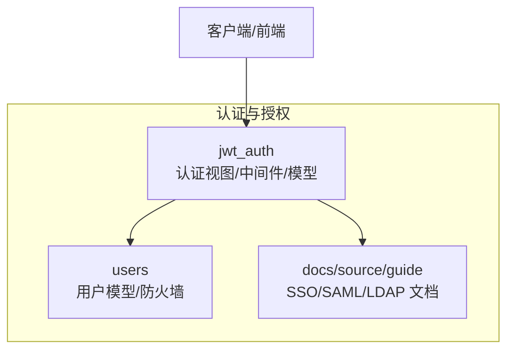
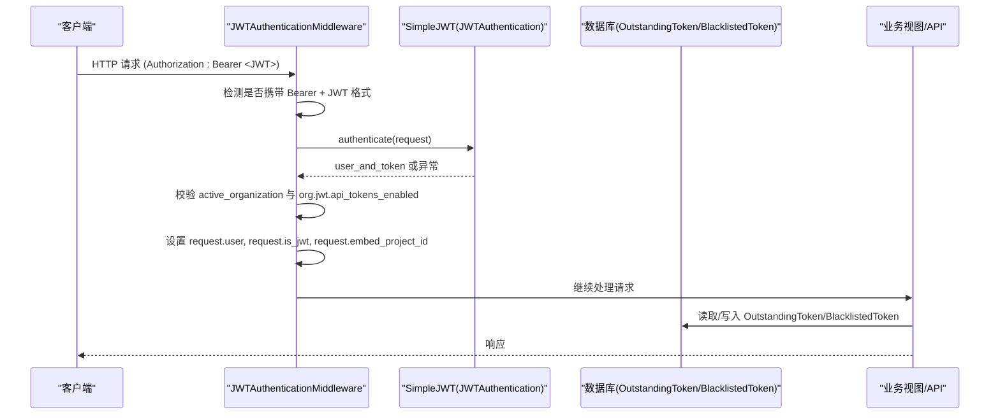
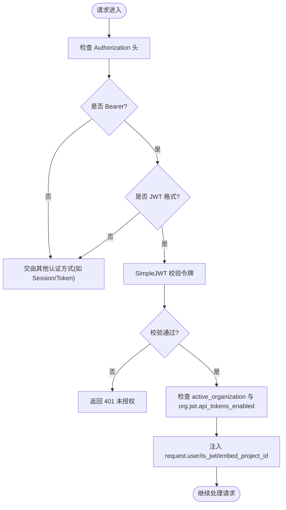
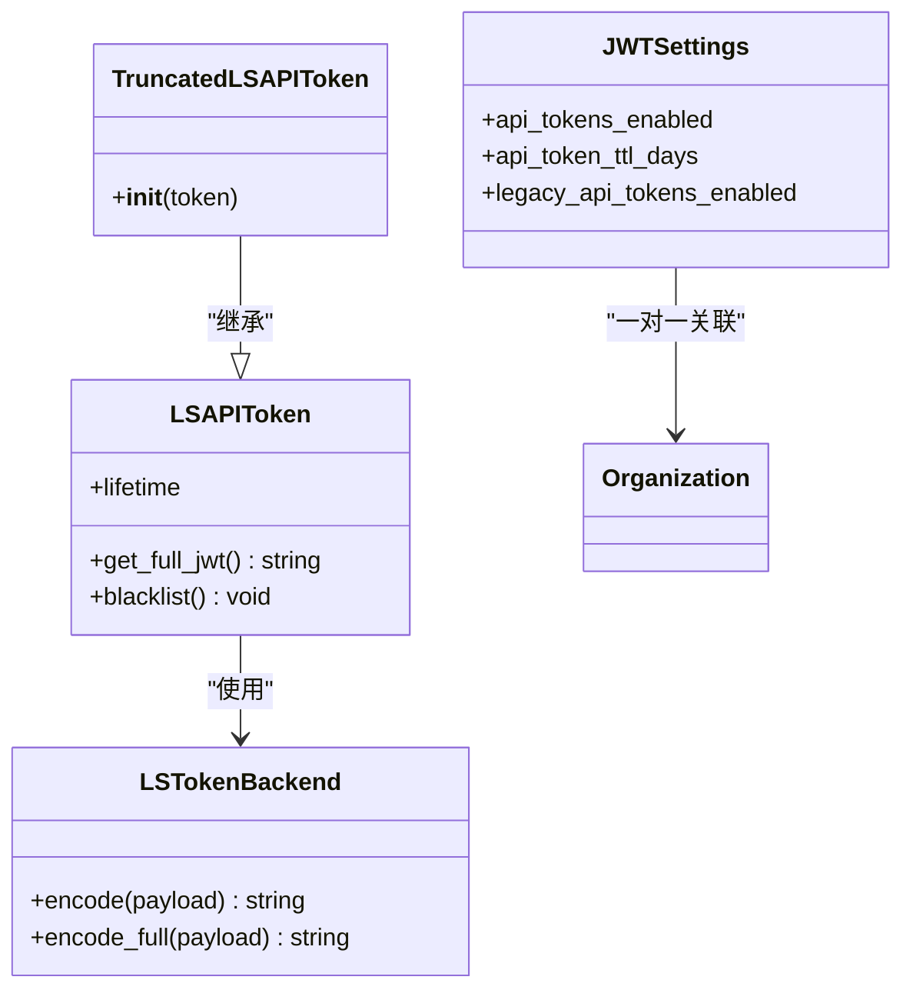
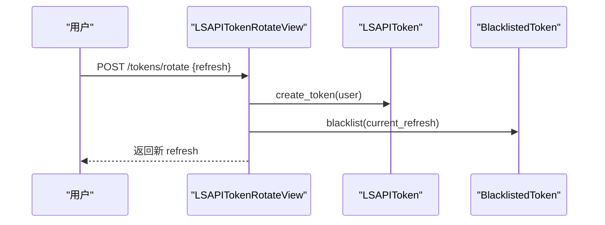
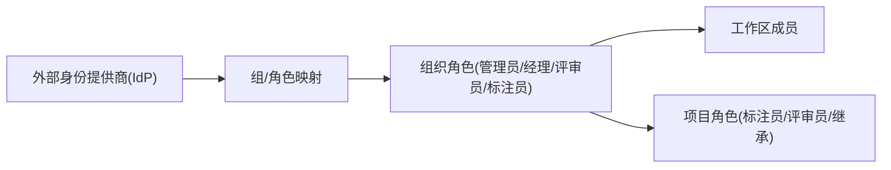
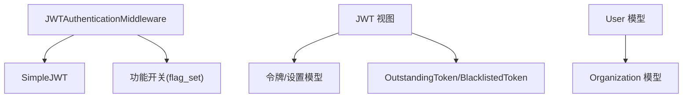

# 认证与授权

<cite>
**本文引用的文件**   
- [auth.py](file://label_studio/jwt_auth/auth.py)
- [middleware.py](file://label_studio/jwt_auth/middleware.py)
- [views.py](file://label_studio/jwt_auth/views.py)
- [token_format.py](file://label_studio/jwt_auth/token_format.py)
- [models.py](file://label_studio/jwt_auth/models.py)
- [firewall.py](file://label_studio/users/firewall.py)
- [models.py](file://label_studio/users/models.py)
- [auth_setup.md](file://docs/source/guide/auth_setup.md)
- [auth_ldap.md](file://docs/source/guide/auth_ldap.md)
- [google_saml.md](file://docs/source/guide/google_saml.md)
</cite>

## 目录
1. [简介](#简介)
2. [项目结构](#项目结构)
3. [核心组件](#核心组件)
4. [架构总览](#架构总览)
5. [详细组件分析](#详细组件分析)
6. [依赖关系分析](#依赖关系分析)
7. [性能考虑](#性能考虑)
8. [故障排查指南](#故障排查指南)
9. [结论](#结论)
10. [附录](#附录)

## 简介
本文件系统性梳理 Label Studio 的认证与授权实现，重点覆盖：
- JWT 令牌认证机制、令牌格式识别与签发/刷新/轮换/黑名单管理
- 中间件对 Bearer JWT 的请求解析、组织权限校验与嵌入项目范围注入
- 基于角色的访问控制（RBAC）模型与第三方身份认证集成（LDAP、SAML、OAuth）
- API 权限验证、CSRF 保护与防火墙安全策略的实现要点
- 安全配置最佳实践与常见问题解决方案

## 项目结构
围绕认证与授权的核心代码分布在以下模块：
- jwt_auth：JWT 认证相关视图、中间件、模型、序列化器与令牌格式工具
- users：用户模型、匿名化防火墙（Annotator/Reviewer Firewall）
- docs/source/guide：SSO/SAML/LDAP 等第三方认证配置文档

图表来源
- [auth.py:10-66](file://label_studio/jwt_auth/auth.py#L10-L66)
- [middleware.py:12-62](file://label_studio/jwt_auth/middleware.py#L12-L62)
- [views.py:63-270](file://label_studio/jwt_auth/views.py#L63-L270)
- [models.py:14-131](file://label_studio/jwt_auth/models.py#L14-L131)
- [firewall.py:26-74](file://label_studio/users/firewall.py#L26-L74)
- [models.py:103-148](file://label_studio/users/models.py#L103-L148)

章节来源
- [auth.py:10-66](file://label_studio/jwt_auth/auth.py#L10-L66)
- [middleware.py:12-62](file://label_studio/jwt_auth/middleware.py#L12-L62)
- [views.py:63-270](file://label_studio/jwt_auth/views.py#L63-L270)
- [models.py:14-131](file://label_studio/jwt_auth/models.py#L14-L131)
- [firewall.py:26-74](file://label_studio/users/firewall.py#L26-L74)
- [models.py:103-148](file://label_studio/users/models.py#L103-L148)

## 核心组件
- JWT 认证扩展与令牌鉴权
  - TokenAuthenticationPhaseout：兼容旧版 Token 鉴权，支持按组织开关 legacy token，并在启用 JWT 时记录日志与强制拒绝未启用的组织。
  - JWTAuthScheme：为 OpenAPI 文档声明 Authorization: Token 的安全定义。
- JWT 中间件
  - JWTAuthenticationMiddleware：检测 Authorization: Bearer 且符合 JWT 格式的令牌，调用 SimpleJWT 进行校验，设置 request.user、is_jwt，并注入 embed_project_id。
- 令牌格式识别
  - is_jwt_formatted：在不验签的情况下判断令牌是否为 JWT 结构，用于区分 Bearer JWT 与 Token API Key。
- 令牌模型与后端
  - LSTokenBackend：自定义后端，支持生成截断令牌（仅 header+payload），避免将签名暴露给前端。
  - LSAPIToken/TruncatedLSAPIToken：封装 RefreshToken，支持组织级 TTL、黑名单与截断令牌处理。
- 用户与组织
  - User：用户模型，包含 active_organization 关联，用于组织级 JWT 设置与权限判定。
- 防火墙（匿名化）
  - AnnotatorReviewerFirewall：默认无操作实现，企业版可替换以隐藏标注员/评审员身份信息。

章节来源
- [auth.py:10-66](file://label_studio/jwt_auth/auth.py#L10-L66)
- [middleware.py:12-62](file://label_studio/jwt_auth/middleware.py#L12-L62)
- [token_format.py:7-19](file://label_studio/jwt_auth/token_format.py#L7-L19)
- [models.py:41-131](file://label_studio/jwt_auth/models.py#L41-L131)
- [models.py:103-148](file://label_studio/users/models.py#L103-L148)
- [firewall.py:26-74](file://label_studio/users/firewall.py#L26-L74)

## 架构总览
下图展示从请求进入 Django 到业务处理的认证与授权流程，包括 JWT 中间件、SimpleJWT 校验、组织权限检查与嵌入项目范围注入。

图表来源
- [middleware.py:17-61](file://label_studio/jwt_auth/middleware.py#L17-L61)
- [views.py:137-190](file://label_studio/jwt_auth/views.py#L137-L190)

## 详细组件分析

### JWT 令牌认证机制
- 令牌格式识别
  - 使用 is_jwt_formatted 快速判断 Authorization 头中的值是否为 JWT 结构，从而分流到 Bearer JWT 或 Token API Key 路径。
- 中间件鉴权
  - 若检测到 Bearer JWT，则调用 SimpleJWT 的 JWTAuthentication 进行校验；失败返回 401。
  - 成功时加载用户对象，根据功能开关 fflag__feature_develop__prompts__dia_1829_jwt_token_auth 决定是否要求 active_organization 存在且启用 api_tokens_enabled。
  - 从 token claims 中解析 embed_project_id 并注入到 request.embed_project_id，供后续视图使用。
- 旧版 Token 鉴权兼容
  - TokenAuthenticationPhaseout 在启用 JWT 功能后，若组织的 legacy_api_tokens_enabled 为 False，则直接拒绝旧版 Token 鉴权，并记录审计日志。

图表来源
- [middleware.py:17-61](file://label_studio/jwt_auth/middleware.py#L17-L61)
- [token_format.py:7-19](file://label_studio/jwt_auth/token_format.py#L7-L19)

章节来源
- [middleware.py:17-61](file://label_studio/jwt_auth/middleware.py#L17-L61)
- [token_format.py:7-19](file://label_studio/jwt_auth/token_format.py#L7-L19)
- [auth.py:10-43](file://label_studio/jwt_auth/auth.py#L10-L43)

### 会话管理与令牌生命周期
- 令牌类型与存储
  - LSAPIToken 继承 RefreshToken，使用 LSTokenBackend 生成截断令牌（不含签名），降低前端泄露风险。
  - TruncatedLSAPIToken 处理仅含 header+payload 的令牌，自动补齐占位签名以满足解码器要求。
- 过期与黑名单
  - 列表接口过滤未过期且未被拉黑的 OutstandingToken。
  - 轮换与拉黑接口提供 refresh 令牌的轮换与失效能力。
- 组织级 TTL
  - JWTSettings 提供 api_token_ttl_days 与 api_tokens_enabled 等组织级开关与参数。

图表来源
- [models.py:41-131](file://label_studio/jwt_auth/models.py#L41-L131)
- [models.py:14-39](file://label_studio/jwt_auth/models.py#L14-L39)

章节来源
- [models.py:41-131](file://label_studio/jwt_auth/models.py#L41-L131)
- [models.py:14-39](file://label_studio/jwt_auth/models.py#L14-L39)

### 令牌管理 API 与权限
- 令牌设置
  - JWTSettingsAPI：获取/更新当前组织的 JWT 设置，需组织查看/变更权限。
- 令牌列表与创建
  - LSAPITokenView：列出当前用户的非过期、非拉黑令牌；创建前检查是否存在有效令牌，避免重复。
- 令牌轮换与黑名单
  - LSAPITokenRotateView：对当前 refresh 令牌执行黑名单，然后为用户生成新令牌。
  - LSTokenBlacklistView：将 refresh 令牌加入黑名单。

图表来源
- [views.py:226-270](file://label_studio/jwt_auth/views.py#L226-L270)
- [views.py:193-224](file://label_studio/jwt_auth/views.py#L193-L224)
- [views.py:137-190](file://label_studio/jwt_auth/views.py#L137-L190)

章节来源
- [views.py:63-84](file://label_studio/jwt_auth/views.py#L63-L84)
- [views.py:137-190](file://label_studio/jwt_auth/views.py#L137-L190)
- [views.py:193-270](file://label_studio/jwt_auth/views.py#L193-L270)

### 基于角色的访问控制（RBAC）模型
- 角色与组织
  - 用户模型 User 关联 active_organization，组织级 JWT 设置控制 API 令牌开关与 TTL。
- 第三方 IdP 映射
  - SAML/LDAP 文档提供了将 IdP 组映射到组织角色与工作区的配置方法，从而实现 RBAC。
- 项目级角色
  - 文档说明项目级角色可为“标注员”、“评审员”或“继承”，支持多组映射与跨项目分配。

图表来源
- [auth_setup.md:101-120](file://docs/source/guide/auth_setup.md#L101-L120)
- [auth_ldap.md:78-98](file://docs/source/guide/auth_ldap.md#L78-L98)

章节来源
- [models.py:103-148](file://label_studio/users/models.py#L103-L148)
- [auth_setup.md:101-120](file://docs/source/guide/auth_setup.md#L101-L120)
- [auth_ldap.md:78-98](file://docs/source/guide/auth_ldap.md#L78-L98)

### 第三方身份认证集成（LDAP、SAML、OAuth）
- LDAP
  - 通过环境变量启用 AUTH_LDAP_ENABLED，配置服务器地址、绑定 DN/密码、用户属性映射、组搜索与递归扫描等。
  - 支持将 LDAP 组映射到组织角色与工作区，并可禁用本地 UI/API 的角色与工作区管理，完全由 LDAP 驱动。
- SAML
  - 作为 SP 配置 ACS URL、登录/登出 URL，上传 IdP metadata，配置属性映射与组映射。
  - 提供 Google SAML 示例步骤，涵盖 IdP 端应用添加、属性映射、组分配与测试登录。
- OAuth
  - 本仓库未提供具体 OAuth 实现细节，但可通过 SSO 框架与 IdP 集成（例如 Okta、Auth0、Entra ID）。

章节来源
- [auth_ldap.md:24-121](file://docs/source/guide/auth_ldap.md#L24-L121)
- [auth_setup.md:23-149](file://docs/source/guide/auth_setup.md#L23-L149)
- [google_saml.md:19-142](file://docs/source/guide/google_saml.md#L19-L142)

### API 权限验证、CSRF 保护与防火墙安全策略
- API 权限验证
  - 视图层使用 permission_required 与 all_permissions 进行细粒度权限控制（如 organizations_view/change、users_token_any）。
- CSRF 保护
  - 文档中包含 CSRF 测试用例，表明系统对 CSRF 防护有相应保障；具体实现参考 Django REST Framework 默认策略与中间件链。
- 防火墙（匿名化）
  - AnnotatorReviewerFirewall 默认不生效，企业版可替换以实现标注员/评审员身份的匿名化，防止泄露其他用户信息。

章节来源
- [views.py:63-84](file://label_studio/jwt_auth/views.py#L63-L84)
- [firewall.py:26-74](file://label_studio/users/firewall.py#L26-L74)

## 依赖关系分析
- 组件耦合
  - JWT 中间件依赖 SimpleJWT 进行令牌校验，依赖功能开关 flag_set 控制行为分支。
  - 视图层依赖 models 与 serializers，使用 OutstandingToken/BlacklistedToken 管理令牌状态。
  - 用户模型与组织模型通过 active_organization 建立关联，支撑组织级 JWT 设置与权限判定。
- 外部依赖
  - PyJWT：用于 JWT 格式识别与解码（不验签）。
  - django-rest-framework-simplejwt：提供令牌签发、刷新、黑名单等能力。

图表来源
- [middleware.py:27-61](file://label_studio/jwt_auth/middleware.py#L27-L61)
- [views.py:137-190](file://label_studio/jwt_auth/views.py#L137-L190)
- [models.py:14-39](file://label_studio/jwt_auth/models.py#L14-L39)
- [models.py:103-148](file://label_studio/users/models.py#L103-L148)

章节来源
- [middleware.py:27-61](file://label_studio/jwt_auth/middleware.py#L27-L61)
- [views.py:137-190](file://label_studio/jwt_auth/views.py#L137-L190)
- [models.py:14-39](file://label_studio/jwt_auth/models.py#L14-L39)
- [models.py:103-148](file://label_studio/users/models.py#L103-L148)

## 性能考虑
- 令牌列表查询优化
  - 列表接口先过滤未过期令牌，再排除已拉黑的令牌；若黑名单条目过多可能影响性能，建议定期清理过期黑名单。
- Redis 缓存活动
  - 用户最后活动时间通过 Redis 缓存，减少数据库压力；当 Redis 不可用时回退到数据库字段。
- 截断令牌
  - 使用 LSTokenBackend 生成截断令牌，避免在前端暴露签名，同时减少敏感数据泄露风险。

章节来源
- [views.py:141-176](file://label_studio/jwt_auth/views.py#L141-L176)
- [models.py:65-95](file://label_studio/users/models.py#L65-L95)
- [models.py:41-72](file://label_studio/jwt_auth/models.py#L41-L72)

## 故障排查指南
- JWT 认证失败
  - 检查 Authorization 头是否为 Bearer 且令牌为 JWT 格式。
  - 确认用户存在且 active_organization 存在，且 org.jwt.api_tokens_enabled 为 True。
  - 查看日志中关于“User not found”或“JWT authentication failed”的记录。
- 令牌无效或已拉黑
  - 使用轮换接口重新生成 refresh 令牌；若仍报错，检查令牌是否已被拉黑。
- 旧版 Token 被拒绝
  - 若组织禁用了 legacy_api_tokens_enabled，旧版 Token 将被拒绝；请迁移至 JWT Bearer 模式。
- CSRF 相关问题
  - 确保前端在提交表单或敏感请求时携带正确的 CSRF Token，遵循 DRF 默认策略。

章节来源
- [middleware.py:45-61](file://label_studio/jwt_auth/middleware.py#L45-L61)
- [views.py:193-270](file://label_studio/jwt_auth/views.py#L193-L270)
- [auth.py:27-43](file://label_studio/jwt_auth/auth.py#L27-L43)

## 结论
Label Studio 的认证与授权体系以 JWT 为核心，结合中间件与 SimpleJWT 完成请求级鉴权，并通过组织级设置与第三方 IdP（LDAP/SAML/OAuth）实现灵活的 RBAC。系统提供令牌生命周期管理、黑名单与轮换能力，同时在企业版中支持标注员/评审员的身份匿名化。建议在生产环境中启用组织级 JWT 开关、限制 legacy token、合理配置 IdP 属性映射与组映射，并遵循 CSRF 与最小权限原则。

## 附录
- 安全配置最佳实践
  - 启用组织级 JWT API 令牌开关，禁用 legacy token。
  - 合理设置 api_token_ttl_days，避免长期有效的令牌。
  - 使用 HTTPS 传输，确保 IdP 与 SP 之间的通信安全。
  - 定期清理黑名单与过期令牌，降低存储与查询开销。
- 常见安全问题与解决方案
  - 令牌泄露：优先使用截断令牌，避免前端持有签名；轮换失效令牌。
  - 越权访问：严格配置组织/项目级角色映射，限制不必要的权限。
  - CSRF 攻击：遵循 DRF 默认 CSRF 策略，确保前端正确携带 CSRF Token。