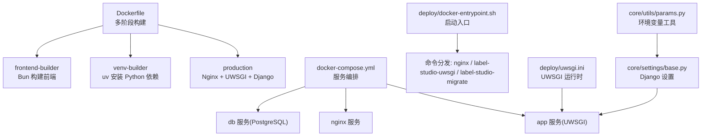
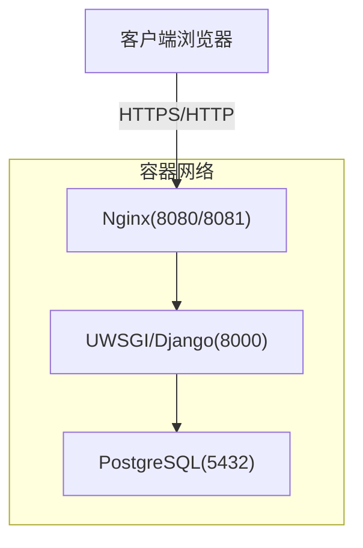
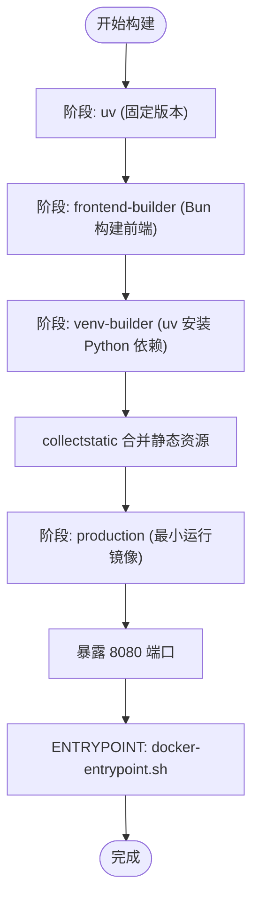
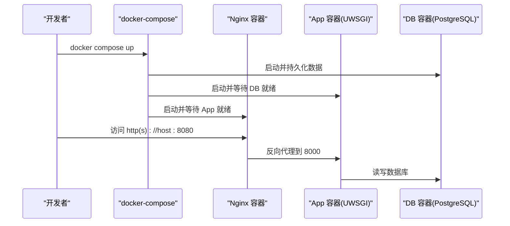
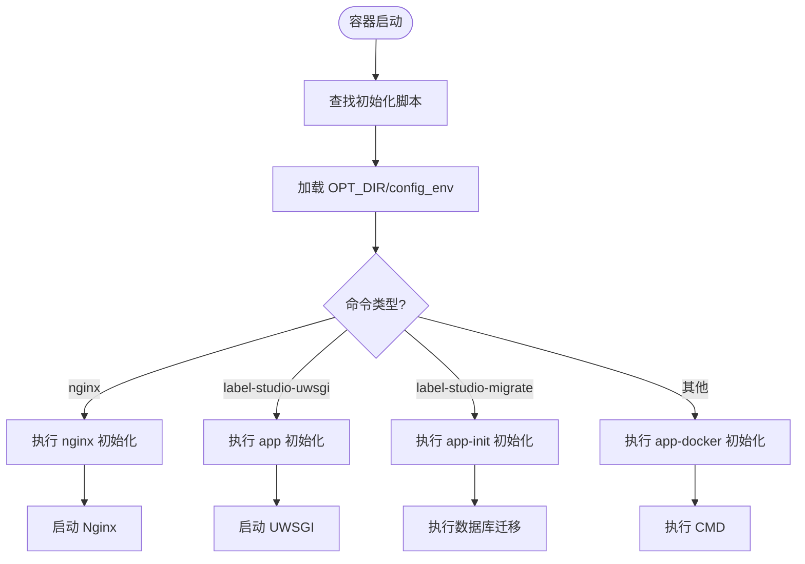
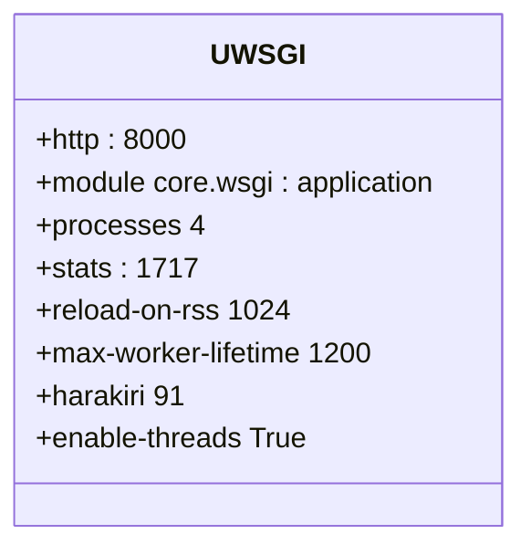
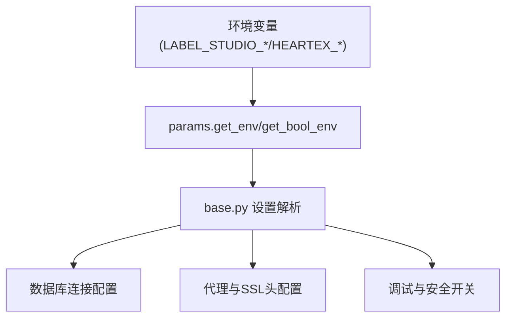
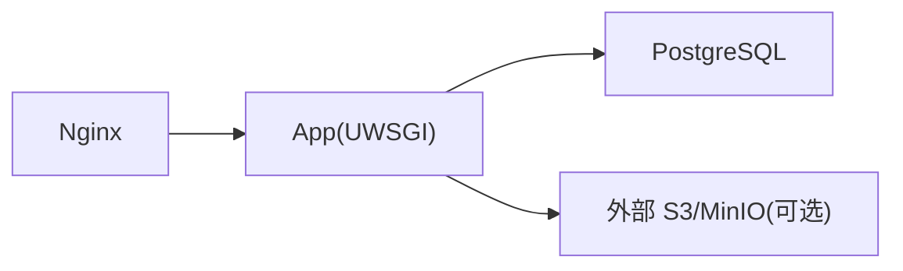

# Docker容器化部署

<cite>
**本文引用的文件**   
- [Dockerfile](file://Dockerfile)
- [docker-compose.yml](file://docker-compose.yml)
- [.devcontainer/docker-compose.yml](file://.devcontainer/docker-compose.yml)
- [deploy/docker-entrypoint.sh](file://deploy/docker-entrypoint.sh)
- [deploy/uwsgi.ini](file://deploy/uwsgi.ini)
- [label_studio/core/settings/base.py](file://label_studio/core/settings/base.py)
- [label_studio/core/utils/params.py](file://label_studio/core/utils/params.py)
- [Dockerfile.cloudrun](file://Dockerfile.cloudrun)
- [Dockerfile.heroku](file://Dockerfile.heroku)
- [Dockerfile.hgface](file://Dockerfile.hgface)
</cite>

## 目录
1. [简介](#简介)
2. [项目结构](#项目结构)
3. [核心组件](#核心组件)
4. [架构总览](#架构总览)
5. [详细组件分析](#详细组件分析)
6. [依赖关系分析](#依赖关系分析)
7. [性能与资源优化](#性能与资源优化)
8. [故障排除指南](#故障排除指南)
9. [结论](#结论)
10. [附录：环境变量与配置清单](#附录环境变量与配置清单)

## 简介
本指南面向使用 Label Studio 的运维与开发者，提供基于 Docker 与 docker-compose 的本地开发、测试与生产部署方案。内容涵盖服务编排、镜像构建（多阶段构建、前端静态资源编译、Python 依赖管理）、容器间通信与网络、端口映射、数据卷挂载、安全加固、健康检查、日志收集与常见问题排查。

## 项目结构
Label Studio 的容器化相关关键文件如下：
- 根级 Dockerfile：定义多阶段构建流程，包含前端构建、Python 虚拟环境准备与最终运行镜像。
- docker-compose.yml：编排 Nginx、应用（UWSGI）与 PostgreSQL 三个服务，并暴露对外端口。
- .devcontainer/docker-compose.yml：VS Code Dev Container 的开发辅助编排。
- deploy/docker-entrypoint.sh：容器启动入口脚本，负责初始化脚本执行、环境变量注入与命令分发。
- deploy/uwsgi.ini：UWSGI 服务器运行时参数，控制进程数、日志、超时与回收策略等。
- label_studio/core/settings/base.py：Django 基础设置，解析数据库、主机名、代理头、调试开关等。
- label_studio/core/utils/params.py：统一的环境变量读取工具函数。
- Dockerfile.cloudrun / Dockerfile.heroku / Dockerfile.hgface：面向特定云平台的轻量覆盖镜像。

图表来源
- [Dockerfile:1-160](file://Dockerfile#L1-L160)
- [docker-compose.yml:1-72](file://docker-compose.yml#L1-L72)
- [deploy/docker-entrypoint.sh:1-83](file://deploy/docker-entrypoint.sh#L1-L83)
- [deploy/uwsgi.ini:1-104](file://deploy/uwsgi.ini#L1-L104)
- [label_studio/core/settings/base.py:100-299](file://label_studio/core/settings/base.py#L100-L299)
- [label_studio/core/utils/params.py:100-177](file://label_studio/core/utils/params.py#L100-L177)

章节来源
- [Dockerfile:1-160](file://Dockerfile#L1-L160)
- [docker-compose.yml:1-72](file://docker-compose.yml#L1-L72)
- [.devcontainer/docker-compose.yml:1-38](file://.devcontainer/docker-compose.yml#L1-L38)

## 核心组件
- 镜像构建（Dockerfile）
  - 多阶段构建：uv（固定版本）→ frontend-builder（Bun 构建前端）→ venv-builder（uv 同步 Python 依赖）→ production（最小运行镜像）。
  - 前端产物通过 collectstatic 合并到 Django 静态目录；最终镜像仅包含必要运行时依赖与 Nginx。
  - 非 root 用户运行，暴露 8080 端口，ENTRYPOINT 指向容器启动脚本。
- 服务编排（docker-compose.yml）
  - nginx：反向代理，转发至 app 服务，支持 SSL 证书挂载与错误日志级别调整。
  - app：运行 UWSGI + Django，连接 PostgreSQL，输出 JSON 日志。
  - db：PostgreSQL 持久化数据目录，可选 TLS 证书挂载。
- 启动入口（deploy/docker-entrypoint.sh）
  - 按命名顺序执行初始化脚本；支持从 OPT_DIR/config_env 加载额外环境变量；根据命令分发到 nginx、UWSGI 或迁移任务。
- UWSGI 运行时（deploy/uwsgi.ini）
  - 默认 4 个 worker，统计端口 1717，JSON 格式日志，线程开启，自动回收 worker（内存、生命周期、请求超时）。
- Django 设置（core/settings/base.py）
  - 解析 HOSTNAME、FORCE_SCRIPT_NAME、SECURE_PROXY_SSL_HEADER、USE_X_FORWARDED_HOST/PORT、DEBUG、数据库连接等。
- 环境变量工具（core/utils/params.py）
  - 统一读取 LABEL_STUDIO_* / HEARTEX_* / 无前缀变量，支持布尔、整数、列表转换。

章节来源
- [Dockerfile:1-160](file://Dockerfile#L1-L160)
- [docker-compose.yml:1-72](file://docker-compose.yml#L1-L72)
- [deploy/docker-entrypoint.sh:1-83](file://deploy/docker-entrypoint.sh#L1-L83)
- [deploy/uwsgi.ini:1-104](file://deploy/uwsgi.ini#L1-L104)
- [label_studio/core/settings/base.py:100-299](file://label_studio/core/settings/base.py#L100-L299)
- [label_studio/core/utils/params.py:100-177](file://label_studio/core/utils/params.py#L100-L177)

## 架构总览
Label Studio 在容器中采用“Nginx 反向代理 + UWSGI/Django 应用 + PostgreSQL 数据库”的经典三层架构。Nginx 处理静态资源与 HTTPS 终止，UWSGI 承载 Django 应用，PostgreSQL 存储业务数据。容器间通过 Docker 内部网络通信，外部通过端口映射访问。

图表来源
- [docker-compose.yml:1-72](file://docker-compose.yml#L1-L72)
- [deploy/docker-entrypoint.sh:68-82](file://deploy/docker-entrypoint.sh#L68-L82)
- [deploy/uwsgi.ini:1-104](file://deploy/uwsgi.ini#L1-L104)

## 详细组件分析

### 镜像构建流程（多阶段构建）
- uv 阶段：固定 uv 二进制版本，确保依赖安装一致性。
- frontend-builder 阶段：使用 Bun 构建前端静态资源，输出 manifest.json 与 sw.js 等，供 Django collectstatic 使用。
- venv-builder 阶段：使用 uv 安装 Python 依赖（可选项包含 dev/test 组），并将前端产物复制到 Django 静态目录后执行 collectstatic。
- production 阶段：仅复制必要文件与非 root 用户，安装 Nginx 与运行时库，暴露 8080 端口，ENTRYPOINT 为容器启动脚本。

图表来源
- [Dockerfile:1-160](file://Dockerfile#L1-L160)

章节来源
- [Dockerfile:1-160](file://Dockerfile#L1-L160)

### 服务编排与网络（docker-compose）
- 服务定义
  - nginx：构建自根镜像，image 指定为 heartexlabs/label-studio:latest，端口映射 8080:8085、8081:8086，挂载数据目录与证书目录，命令为 nginx。
  - app：构建自根镜像，image 指定为 heartexlabs/label-studio:latest，内部暴露 8000，依赖 db，命令为 label-studio-uwsgi。
  - db：使用 pgautoupgrade/pgautoupgrade:17-alpine，持久化数据目录，可选 TLS 证书挂载。
- 环境变量
  - 应用侧：DJANGO_DB、POSTGRE_*、LABEL_STUDIO_HOST、JSON_LOG、S3_ENDPOINT 等。
  - Nginx 侧：LABEL_STUDIO_HOST、NGINX_ERROR_LOG_LEVEL、NGINX_SSL_CERT/KEY。
- 数据卷
  - ./mydata:/label-studio/data:rw（应用数据）
  - ./deploy/nginx/certs:/certs:ro（Nginx 证书）
  - ${POSTGRES_DATA_DIR:-./postgres-data}:/var/lib/postgresql/data（数据库持久化）

图表来源
- [docker-compose.yml:1-72](file://docker-compose.yml#L1-L72)

章节来源
- [docker-compose.yml:1-72](file://docker-compose.yml#L1-L72)

### 启动入口与初始化脚本（docker-entrypoint.sh）
- 行为概述
  - 扫描 ENTRYPOINT_PATH 下的初始化脚本并按序执行。
  - 若存在 OPT_DIR/config_env，则加载其环境变量。
  - 根据传入命令分发：
    - nginx：执行 nginx 初始化脚本后启动 Nginx。
    - label-studio-uwsgi：执行 app 初始化脚本后启动 UWSGI。
    - label-studio-migrate：执行 app-init 初始化脚本后执行数据库迁移。
    - 其他：执行 app-docker 初始化脚本后调用 CMD。
- 环境变量注入
  - 支持 ENV_INJECT_SOURCES 逗号分隔的文件路径，启动时 source 这些文件以注入环境变量。
  - CMD_WRAPPER 支持包装主命令。

图表来源
- [deploy/docker-entrypoint.sh:1-83](file://deploy/docker-entrypoint.sh#L1-L83)

章节来源
- [deploy/docker-entrypoint.sh:1-83](file://deploy/docker-entrypoint.sh#L1-L83)

### UWSGI 运行时配置（uwsgi.ini）
- 进程与线程
  - master=true，cheaper=true，single-interpreter=true，enable-threads=True。
  - 默认 processes=4，可通过 UWSGI_PROCESSES 覆盖。
- 日志与监控
  - stats 端口 1717，启用 stats-http；JSON 格式日志输出。
- 稳定性与回收
  - reload-on-rss、max-worker-lifetime、harakiri 等参数用于自动回收与超时保护。
  - thunder-lock、lazy-apps 提升并发与隔离性。

图表来源
- [deploy/uwsgi.ini:1-104](file://deploy/uwsgi.ini#L1-L104)

章节来源
- [deploy/uwsgi.ini:1-104](file://deploy/uwsgi.ini#L1-L104)

### Django 设置与环境变量解析
- 主机与代理
  - 支持 DOMAIN_FROM_REQUEST、FORCE_SCRIPT_NAME、SECURE_PROXY_SSL_HEADER、USE_X_FORWARDED_HOST/PORT。
- 调试与安全
  - DEBUG、VERIFY_SSL_CERTS、CSRF/Session Cookie 相关设置（平台覆盖镜像中可能关闭 CSRF 校验）。
- 数据库
  - 支持 PostgreSQL/MySQL/SQLite，默认使用 PostgreSQL，连接参数由 POSTGRE_* 环境变量决定。

图表来源
- [label_studio/core/utils/params.py:100-177](file://label_studio/core/utils/params.py#L100-L177)
- [label_studio/core/settings/base.py:100-299](file://label_studio/core/settings/base.py#L100-L299)

章节来源
- [label_studio/core/settings/base.py:100-299](file://label_studio/core/settings/base.py#L100-L299)
- [label_studio/core/utils/params.py:100-177](file://label_studio/core/utils/params.py#L100-L177)

### 云平台覆盖镜像
- Dockerfile.cloudrun：一键部署标志与禁用存储持久化。
- Dockerfile.heroku：Heroku 适配，复制 heroku_run.sh，ENTRYPOINT 改为 bash -c。
- Dockerfile.hgface：Hugging Face Spaces 适配，设置部署类型与 Cookie 安全属性，CMD 直接启动 label-studio。

章节来源
- [Dockerfile.cloudrun:1-3](file://Dockerfile.cloudrun#L1-L3)
- [Dockerfile.heroku:1-9](file://Dockerfile.heroku#L1-L9)
- [Dockerfile.hgface:1-12](file://Dockerfile.hgface#L1-L12)

## 依赖关系分析
- 组件耦合
  - Nginx 依赖 App（反向代理），App 依赖 DB（数据库）。
  - 初始化脚本依赖 OPT_DIR/config_env 与 ENV_INJECT_SOURCES。
  - Django 设置依赖环境变量，UWSGI 配置影响进程模型与日志。
- 外部依赖
  - PostgreSQL（pgautoupgrade 镜像）
  - 可选 MinIO/S3（通过 S3_ENDPOINT 配置受信任端点）

图表来源
- [docker-compose.yml:1-72](file://docker-compose.yml#L1-L72)

章节来源
- [docker-compose.yml:1-72](file://docker-compose.yml#L1-L72)

## 性能与资源优化
- 构建优化
  - 多阶段构建减少最终镜像体积；前端构建与 Python 依赖安装分离，利用缓存层加速重复构建。
  - 使用 uv 锁定依赖版本，避免构建期网络波动。
- 运行时优化
  - UWSGI worker 数量可通过 UWSGI_PROCESSES 调整；worker 回收策略防止内存泄漏与长请求阻塞。
  - 启用线程以提升并发处理能力。
- 资源限制建议（生产）
  - 为容器设置 CPU 与内存限制（如 --cpus、--memory），结合 UWSGI_WORKER_RELOAD_ON_RSS 控制单进程内存上限。
  - 合理设置 harakiri 与 max-worker-lifetime，避免慢请求拖垮服务。
- 日志与监控
  - 启用 JSON_LOG 输出结构化日志；UWSGI stats 端口可用于 Prometheus 抓取指标。
  - 将 Nginx 错误日志级别调整为 warn 以减少噪声。

[本节为通用指导，不直接分析具体文件]

## 故障排除指南
- 无法访问前端页面
  - 检查 Nginx 是否成功启动，端口映射是否正确（8080/8081）。
  - 确认 LABEL_STUDIO_HOST 与域名/子路径设置一致。
- 数据库连接失败
  - 检查 POSTGRE_HOST、POSTGRE_PORT、POSTGRE_USER、POSTGRE_PASSWORD、POSTGRE_NAME 是否与 db 服务一致。
  - 确认 PostgreSQL 数据目录已持久化且权限正确。
- 静态资源缺失
  - 确认前端构建阶段已完成，manifest.json 与 sw.js 已复制到 Django 静态目录。
  - 检查 collectstatic 是否成功执行。
- 启动脚本未执行
  - 检查 OPT_DIR/config_env 是否存在以及 ENV_INJECT_SOURCES 路径是否正确。
  - 确认初始化脚本具有可执行权限。
- 日志过多或噪声大
  - 调整 NGINX_ERROR_LOG_LEVEL 为 warn 或更高。
  - 检查 JSON_LOG 与 UWSGI 日志配置。

章节来源
- [docker-compose.yml:1-72](file://docker-compose.yml#L1-L72)
- [deploy/docker-entrypoint.sh:1-83](file://deploy/docker-entrypoint.sh#L1-L83)
- [deploy/uwsgi.ini:1-104](file://deploy/uwsgi.ini#L1-L104)
- [label_studio/core/settings/base.py:100-299](file://label_studio/core/settings/base.py#L100-L299)

## 结论
通过多阶段构建与 docker-compose 编排，Label Studio 可在本地与生产环境中快速部署。Nginx 作为反向代理与 HTTPS 终止层，UWSGI/Django 承载业务逻辑，PostgreSQL 提供稳定数据存储。借助环境变量与初始化脚本，系统具备良好的可配置性与可扩展性。生产环境应关注资源限制、健康检查、日志收集与安全加固，并结合云平台特性选择合适的覆盖镜像。

[本节为总结性内容，不直接分析具体文件]

## 附录：环境变量与配置清单
- 应用侧（app）
  - DJANGO_DB：数据库类型（默认 default，对应 PostgreSQL）。
  - POSTGRE_NAME/USER/PASSWORD/HOST/PORT：PostgreSQL 连接参数。
  - LABEL_STUDIO_HOST：应用主机名或子路径。
  - JSON_LOG：启用 JSON 格式日志。
  - S3_ENDPOINT：外部 S3/MinIO 受信任端点（私有网段需显式配置）。
- Nginx 侧（nginx）
  - LABEL_STUDIO_HOST：Nginx 反向代理目标主机。
  - NGINX_ERROR_LOG_LEVEL：错误日志级别（warn 及以上）。
  - NGINX_SSL_CERT/NGINX_SSL_CERT_KEY：TLS 证书与私钥路径。
- 数据库侧（db）
  - POSTGRES_HOST_AUTH_METHOD：认证方法（示例 trust）。
  - POSTGRES_USER：数据库用户。
- Django 设置相关
  - DOMAIN_FROM_REQUEST：是否从请求动态解析域名。
  - FORCE_SCRIPT_NAME：Django URL 前缀。
  - SECURE_PROXY_SSL_HEADER：反向代理 SSL 头配置。
  - USE_X_FORWARDED_HOST/PORT：是否信任 X-Forwarded-* 头。
  - DEBUG：调试模式开关。
  - VERIFY_SSL_CERTS：外部请求是否验证 SSL 证书。
- UWSGI 运行时
  - UWSGI_PROCESSES：worker 数量。
  - UWSGI_WORKER_RELOAD_ON_RSS：内存阈值触发回收。
  - UWSGI_WORKER_MAX_LIFETIME：最大生命周期。
  - UWSGI_WORKER_HARAKIRI：请求超时时间。

章节来源
- [docker-compose.yml:1-72](file://docker-compose.yml#L1-L72)
- [label_studio/core/settings/base.py:100-299](file://label_studio/core/settings/base.py#L100-L299)
- [deploy/uwsgi.ini:1-104](file://deploy/uwsgi.ini#L1-L104)