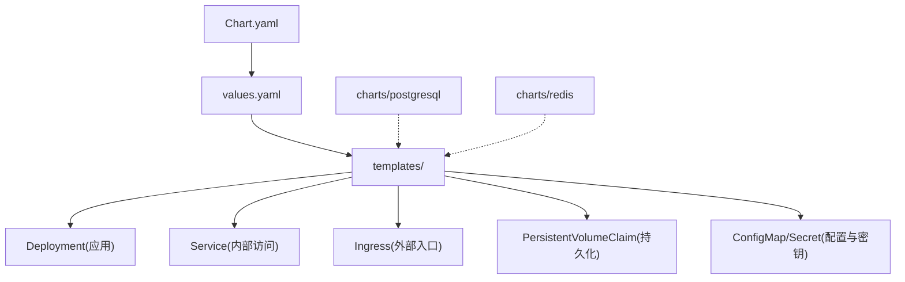
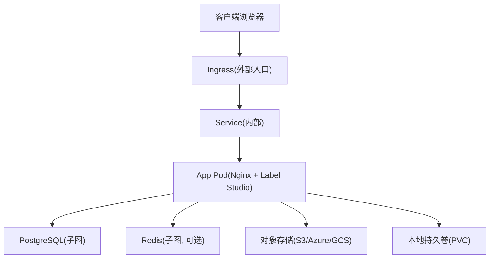
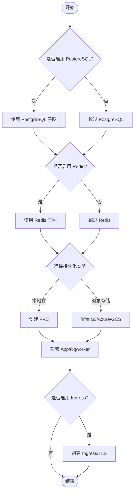

# Helm Chart部署

<cite>
**本文引用的文件**   
- [helm_values.md](file://docs/source/guide/helm_values.md)
- [install_k8s.md](file://docs/source/guide/install_k8s.md)
- [ingress_config.md](file://docs/source/guide/ingress_config.md)
</cite>

## 目录
1. [简介](#简介)
2. [项目结构](#项目结构)
3. [核心组件](#核心组件)
4. [架构总览](#架构总览)
5. [详细组件分析](#详细组件分析)
6. [依赖关系分析](#依赖关系分析)
7. [性能与容量规划](#性能与容量规划)
8. [故障排除指南](#故障排除指南)
9. [结论](#结论)
10. [附录：常用命令与示例](#附录常用命令与示例)

## 简介
本文件面向在 Kubernetes 上使用 Helm 部署 Label Studio 的用户，系统化说明如何基于官方 Helm Chart 完成安装、升级、配置覆盖与排障。文档重点涵盖：
- Chart 目录结构与关键配置文件（Chart.yaml、values.yaml、templates）
- 通过 values 自定义数据库连接、存储卷、Ingress、环境变量等
- 完整的 helm install 与 helm upgrade 流程与版本管理策略
- 覆盖默认配置、添加自定义 ConfigMap/Secret 的方法
- 常见问题排查与最佳实践

## 项目结构
Label Studio 的 Helm Chart 遵循标准 Helm 目录组织方式：
- Chart.yaml：Chart 元数据（名称、版本、依赖等）
- values.yaml：默认参数值，用户可通过 -f 或 --set 覆盖
- templates/：Kubernetes 资源模板（Deployment、Service、Ingress、ConfigMap、Secret、PVC 等）
- charts/：子图表（如 PostgreSQL、Redis），由 values 控制启用与否

图示来源
- [helm_values.md:54-124](file://docs/source/guide/helm_values.md#L54-L124)
- [helm_values.md:126-214](file://docs/source/guide/helm_values.md#L126-L214)
- [helm_values.md:288-309](file://docs/source/guide/helm_values.md#L288-L309)

章节来源
- [helm_values.md:54-124](file://docs/source/guide/helm_values.md#L54-L124)
- [helm_values.md:126-214](file://docs/source/guide/helm_values.md#L126-L214)
- [helm_values.md:288-309](file://docs/source/guide/helm_values.md#L288-L309)

## 核心组件
- 全局参数 global：镜像仓库、标签、拉取策略；PostgreSQL/Redis 连接；持久化存储（S3/Azure/GCS/Volume）；额外环境变量与 Secret；特性开关等
- 应用组件 app：Deployment、Sidecar Nginx、探针、Service、Ingress、RBAC、安全上下文、拓扑约束等
- 队列 worker rqworker：多队列（high/low/default/critical/all）、探针、安全上下文、RBAC 等
- 子图表 postgresql、redis：可独立启停与配置
- 其他参数：升级检查、CI 标记、集群域名、环境变量校验开关等

章节来源
- [helm_values.md:54-124](file://docs/source/guide/helm_values.md#L54-L124)
- [helm_values.md:126-214](file://docs/source/guide/helm_values.md#L126-L214)
- [helm_values.md:216-274](file://docs/source/guide/helm_values.md#L216-L274)
- [helm_values.md:288-309](file://docs/source/guide/helm_values.md#L288-L309)

## 架构总览
Helm Chart 将 Label Studio 以容器化方式部署到 Kubernetes，典型组件包括：
- 应用 Pod（含 Nginx Sidecar）
- Service（ClusterIP 暴露内部服务）
- Ingress（对外暴露 HTTP/HTTPS 路由）
- 持久化存储（本地 PVC 或对象存储 S3/Azure/GCS）
- 数据库（PostgreSQL，可选子图）
- 缓存/任务队列（Redis，可选子图）

图示来源
- [helm_values.md:126-214](file://docs/source/guide/helm_values.md#L126-L214)
- [helm_values.md:288-309](file://docs/source/guide/helm_values.md#L288-L309)

## 详细组件分析

### 全局参数（global）
- 镜像与拉取：repository、tag、pullPolicy、imagePullSecrets
- 数据库连接：pgConfig.host/port/dbName/userName/password.secretName/key；SSL 模式与证书 Secret
- Redis 连接：redisConfig.connectionString、password.secretName/key；SSL 证书与验证模式
- 持久化：type=volume 或对象存储（S3/Azure/GCS），支持现有 Secret 读取、过期时间、Endpoint、Bucket/Folder 等
- 环境变量与 Secret：extraEnvironmentVars、extraEnvironmentSecrets、envInjectSources、customCaCerts
- 特性开关：featureFlags

章节来源
- [helm_values.md:54-124](file://docs/source/guide/helm_values.md#L54-L124)

### 应用组件（app）
- 部署策略与副本数：deploymentStrategy.type、replicas
- 资源请求与限制：requests/limits（CPU/Memory）
- 启动初始化：initContainer.resources（数据库迁移）
- 健康检查：readinessProbe/livenessProbe（路径、阈值、超时等）
- 环境变量与 Secret：extraEnvironmentVars、extraEnvironmentSecrets
- 调度与安全：nodeSelector、affinity、tolerations、podSecurityContext、containerSecurityContext
- 扩展挂载：extraVolumes、extraVolumeMounts
- 网络与服务：service.type/port/targetPort/name/annotations/sessionAffinity；ingress.enabled/host/path/className/annotations/tls
- RBAC：create/rules
- 其他：dnsPolicy、enableServiceLinks、shareProcessNamespace、automountServiceAccountToken、topologySpreadConstraints、cmdWrapper

章节来源
- [helm_values.md:126-214](file://docs/source/guide/helm_values.md#L126-L214)

### 队列 Worker（rqworker）
- 多队列副本与参数：queues.high/low/default/critical/all.replicas 与 args
- 健康检查：readinessProbe/livenessProbe
- 环境变量与 Secret：extraEnvironmentVars、extraEnvironmentSecrets
- 调度与安全：nodeSelector、affinity、tolerations、podSecurityContext、containerSecurityContext
- 网络与 RBAC：dnsPolicy、enableServiceLinks、shareProcessNamespace、automountServiceAccountToken、rbac.create/rules
- 扩展挂载与拓扑：extraVolumes、extraVolumeMounts、topologySpreadConstraints
- 其他：cmdWrapper

章节来源
- [helm_values.md:216-274](file://docs/source/guide/helm_values.md#L216-L274)

### 子图表（postgresql、redis）
- PostgreSQL：enabled、architecture、image.tag、auth.username/password/database、existingSecret 支持
- Redis：enabled、architecture、auth.enabled

章节来源
- [helm_values.md:288-309](file://docs/source/guide/helm_values.md#L288-L309)

### 其他参数
- upgradeCheck.enabled：是否启用升级检查
- ci：是否为 CI 环境
- clusterDomain：Kubernetes 集群域名
- checkConfig.skipEnvValues：跳过环境变量校验

章节来源
- [helm_values.md:302-309](file://docs/source/guide/helm_values.md#L302-L309)

### 环境变量注入机制
- global.extraEnvironmentVars：键名会被转为大写后作为环境变量注入
- 生产环境建议开启 SSRF_PROTECTION_ENABLED=true

章节来源
- [helm_values.md:310-326](file://docs/source/guide/helm_values.md#L310-L326)

## 依赖关系分析
- App 依赖 PostgreSQL（数据库）与可选 Redis（缓存/任务队列）
- App 依赖持久化后端（本地 PVC 或对象存储 S3/Azure/GCS）
- Ingress 依赖 Service 与 TLS Secret（若启用）
- 子图表可由 values 控制启用/禁用

图示来源
- [helm_values.md:54-124](file://docs/source/guide/helm_values.md#L54-L124)
- [helm_values.md:126-214](file://docs/source/guide/helm_values.md#L126-L214)
- [helm_values.md:288-309](file://docs/source/guide/helm_values.md#L288-L309)

章节来源
- [helm_values.md:54-124](file://docs/source/guide/helm_values.md#L54-L124)
- [helm_values.md:126-214](file://docs/source/guide/helm_values.md#L126-L214)
- [helm_values.md:288-309](file://docs/source/guide/helm_values.md#L288-L309)

## 性能与容量规划
- 默认资源请求与限制：参考官方容量规划中的默认值，根据并发标注人数与可用性区域调整 replicas 与 resources
- 高可用：副本数建议不小于可用区数量
- 大文件上传：通过 Ingress 注解设置代理请求体大小上限（例如 nginx.ingress.kubernetes.io/proxy-body-size）

章节来源
- [install_k8s.md:49-76](file://docs/source/guide/install_k8s.md#L49-L76)
- [ingress_config.md:135-154](file://docs/source/guide/ingress_config.md#L135-L154)

## 故障排除指南
- 数据库 TLS 连接失败
  - 确认已创建包含 CA、客户端证书与私钥的 Secret
  - 在 values 中正确设置 pgConfig.ssl.pgSslMode 与对应 SecretKey
- Ingress 无法访问或 413 错误
  - 检查 ingress.className、host、path 与 annotations 是否正确
  - 针对 NGINX Ingress，设置 proxy-body-size 注解以支持大文件上传
- 环境变量未生效
  - 确认 extraEnvironmentVars 键名将被转大写；生产环境建议开启 SSRF_PROTECTION_ENABLED
- 升级失败或回滚
  - 使用 helm upgrade 并指定正确的 image tag；必要时使用 --version 指定 Chart 版本
- 命名空间隔离
  - 使用 helm install/upgrade 的 --namespace 参数进行命名空间管理

章节来源
- [install_k8s.md:95-121](file://docs/source/guide/install_k8s.md#L95-L121)
- [ingress_config.md:135-154](file://docs/source/guide/ingress_config.md#L135-L154)
- [helm_values.md:310-326](file://docs/source/guide/helm_values.md#L310-L326)

## 结论
通过 Helm Chart，Label Studio 可在 Kubernetes 上快速、可控地部署与升级。借助 values.yaml 与模板机制，用户可以灵活定制数据库、存储、Ingress、环境变量与安全策略，满足从开发到生产的多样化需求。结合容量规划与排障指南，可实现稳定、可扩展的标注平台运行环境。

## 附录：常用命令与示例

### 安装前准备
- 添加 Helm 仓库并更新索引
- 查看可用 Chart 版本

章节来源
- [install_k8s.md:81-93](file://docs/source/guide/install_k8s.md#L81-L93)

### 安装 Label Studio
- 使用自定义 values 文件安装
- 通过 --set 直接覆盖参数
- 指定命名空间

章节来源
- [install_k8s.md:123-140](file://docs/source/guide/install_k8s.md#L123-L140)

### 升级 Label Studio
- 更新 values 中的镜像 tag
- 执行 helm repo update 与 helm upgrade
- 通过命令行覆盖 tag 避免降级

章节来源
- [install_k8s.md:156-178](file://docs/source/guide/install_k8s.md#L156-L178)

### 卸载 Label Studio
- 删除发布

章节来源
- [install_k8s.md:180-189](file://docs/source/guide/install_k8s.md#L180-L189)

### Ingress 配置示例
- AWS ALB、GKE、AKS、NGINX 等不同云厂商与控制器配置
- 在负载均衡处终止 TLS 时设置 LABEL_STUDIO_HOST
- 处理大文件上传的代理请求体大小注解

章节来源
- [ingress_config.md:29-121](file://docs/source/guide/ingress_config.md#L29-L121)
- [ingress_config.md:123-154](file://docs/source/guide/ingress_config.md#L123-L154)