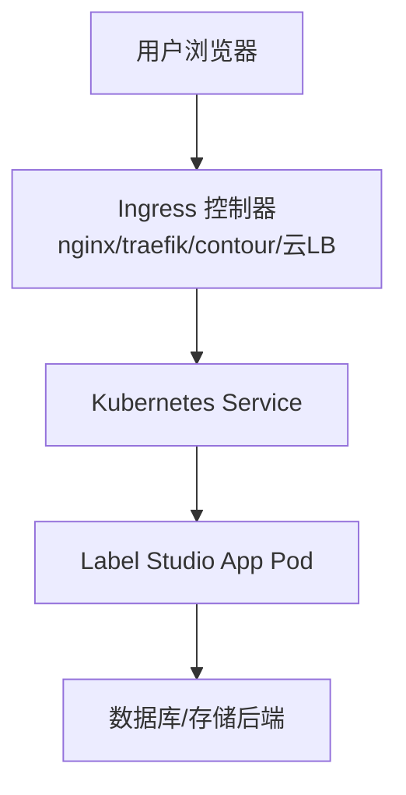
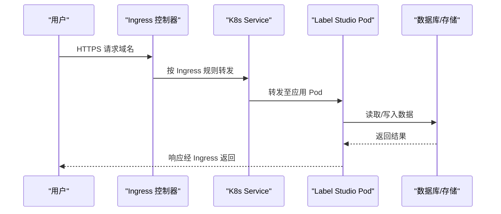
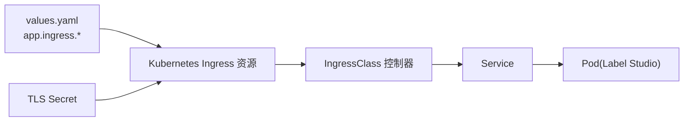

# Ingress路由配置

<cite>
**本文引用的文件**   
- [ingress_config.md](file://docs/source/guide/ingress_config.md)
- [install_k8s.md](file://docs/source/guide/install_k8s.md)
- [helm_values.md](file://docs/source/guide/helm_values.md)
- [security.md](file://docs/source/guide/security.md)
</cite>

## 目录
1. [简介](#简介)
2. [项目结构](#项目结构)
3. [核心组件](#核心组件)
4. [架构总览](#架构总览)
5. [详细组件分析](#详细组件分析)
6. [依赖关系分析](#依赖关系分析)
7. [性能与容量规划](#性能与容量规划)
8. [故障排查指南](#故障排查指南)
9. [结论](#结论)
10. [附录：控制器对照表](#附录控制器对照表)

## 简介
本文件面向在 Kubernetes 上部署 Label Studio 的工程师，系统化说明如何通过 Ingress 将外部 HTTP/HTTPS 流量安全、稳定地转发到集群内的 Label Studio 服务。内容覆盖：
- 主流 Ingress 控制器（nginx、traefik、contour）的配置要点
- SSL/TLS 证书管理（含 Let’s Encrypt 自动签发与自定义证书上传）
- 域名解析、负载均衡与会话保持
- WebSocket 支持（实时功能）
- 安全策略（访问控制、请求过滤、速率限制等）

## 项目结构
Label Studio 官方文档提供了针对 Kubernetes 的 Ingress 配置指南与 Helm Values 参考，涵盖云厂商托管方案与通用 nginx 方案，并给出大文件上传、TLS 终止等关键场景的处理建议。

[本节为概念性图示，不直接映射具体源码文件]

## 核心组件
- Ingress 资源与 IngressClass：用于声明对外暴露的路由规则、TLS 与注解能力。
- Ingress 控制器：实现 Ingress 资源的实际转发逻辑（如 nginx-ingress-controller、Traefik、Contour 或云厂商 LB Controller）。
- TLS Secret：保存证书与私钥，供 Ingress 使用。
- Helm Values：通过 values.yaml 统一注入 app.ingress.* 相关参数。

章节来源
- [helm_values.md:203-209](file://docs/source/guide/helm_values.md#L203-L209)

## 架构总览
下图展示从客户端到 Label Studio 的典型请求路径，以及 Ingress 控制器在其中的作用。

[本节为概念性时序图，不直接映射具体源码文件]

## 详细组件分析

### 一、不同 Ingress 控制器的配置方法

#### 1) NGINX Ingress Controller（云无关）
- 适用场景：通用 Kubernetes 环境，配合 cert-manager 与 ExternalDNS 实现自动化证书与 DNS 同步。
- 关键点：
  - 指定 className: nginx
  - 配置 tls.secretName 与 hosts
  - 大文件上传需调整 proxy-body-size 注解
  - 若前端需要 WebSocket，确保控制器开启相应透传（通常默认支持）

章节来源
- [ingress_config.md:103-121](file://docs/source/guide/ingress_config.md#L103-L121)
- [ingress_config.md:135-151](file://docs/source/guide/ingress_config.md#L135-L151)

#### 2) Traefik Ingress Controller
- 适用场景：容器原生、动态路由能力强，适合微服务与多租户。
- 关键点：
  - 通过 Middleware 设置 maxRequestBodyBytes 以支持大文件上传
  - 启用 Websocket 透传（通常默认开启，必要时检查中间件）
  - 使用 ACME 自动申请 Let’s Encrypt 证书（需正确配置入口与 DNS）

章节来源
- [ingress_config.md:147-151](file://docs/source/guide/ingress_config.md#L147-L151)

#### 3) Contour（Envoy）Ingress Controller
- 适用场景：高性能 L7 网关，适合大规模流量。
- 关键点：
  - 通过 Annotation 或 ConfigMap 调整请求体大小限制
  - 确保 WebSocket 升级头透传（Upgrade/Connection）
  - 结合 cert-manager 管理 TLS

章节来源
- [ingress_config.md:147-151](file://docs/source/guide/ingress_config.md#L147-L151)

#### 4) 云厂商托管方案（EKS/GKE/AKS）
- EKS（AWS Load Balancer Controller + ACM）
  - 使用 alb IngressClass
  - 通过注解绑定 ACM 证书 ARN
- GKE（gce IngressClass）
  - 使用 Google Managed Certificate
- AKS（Application Gateway Ingress Controller）
  - 使用 azure/application-gateway IngressClass
  - 可配置自签证书

章节来源
- [ingress_config.md:29-54](file://docs/source/guide/ingress_config.md#L29-L54)
- [ingress_config.md:56-82](file://docs/source/guide/ingress_config.md#L56-L82)
- [ingress_config.md:84-101](file://docs/source/guide/ingress_config.md#L84-L101)

### 二、SSL/TLS 证书配置

#### 1) Let’s Encrypt 自动证书申请
- 推荐搭配 cert-manager 与 Ingress 控制器（如 nginx），通过 ClusterIssuer/Issuer 自动签发与续期。
- 在 values.yaml 中通过 app.ingress.tls 引用 Secret 名称。

章节来源
- [ingress_config.md:103-121](file://docs/source/guide/ingress_config.md#L103-L121)
- [helm_values.md:203-209](file://docs/source/guide/helm_values.md#L203-L209)

#### 2) 自定义证书上传
- 将证书与私钥放入 Kubernetes Secret，并在 Ingress 的 tls 字段引用该 Secret。
- 对于云 LB 前缀 TLS 终止场景，需在应用侧设置 LABEL_STUDIO_HOST 环境变量以生成正确的 URL。

章节来源
- [ingress_config.md:123-132](file://docs/source/guide/ingress_config.md#L123-L132)
- [helm_values.md:203-209](file://docs/source/guide/helm_values.md#L203-L209)

### 三、域名解析与负载均衡

- 域名解析：建议使用 ExternalDNS 与 Ingress 控制器联动，自动同步 Ingress host 到 DNS 记录。
- 负载均衡：
  - 云 LB：通过 IngressClass 与注解选择外部 LB 类型与目标类型（如 ALB target-type=ip）。
  - 内部 LB：GKE 提供 gce-internal 类；根据业务需求选择内/外网 LB。

章节来源
- [ingress_config.md:29-54](file://docs/source/guide/ingress_config.md#L29-L54)
- [ingress_config.md:56-82](file://docs/source/guide/ingress_config.md#L56-L82)
- [ingress_config.md:103-121](file://docs/source/guide/ingress_config.md#L103-L121)

### 四、会话保持（Session Affinity）

- 通过 Service 级别配置 sessionAffinity 与 sessionAffinityConfig，保证同一用户的请求落到同一 Pod，避免状态丢失。
- 适用于无状态化不足或存在本地缓存的场景。

章节来源
- [helm_values.md:201-202](file://docs/source/guide/helm_values.md#L201-L202)

### 五、WebSocket 支持（实时功能）

- 大多数现代 Ingress 控制器默认支持 WebSocket 升级（Upgrade/Connection 头透传）。
- 若出现连接中断，请检查控制器是否启用了 WebSocket 透传，并确保未拦截相关头部。
- 大文件上传与长连接并存时，注意同时调整请求体大小与超时时间。

章节来源
- [ingress_config.md:135-151](file://docs/source/guide/ingress_config.md#L135-L151)

### 六、安全策略（访问控制、请求过滤、速率限制）

- 访问控制：
  - 生产环境建议仅开放必要端口，并通过 Ingress 白名单/认证中间件进行访问控制。
  - 启用 SSRF 防护（SSRF_PROTECTION_ENABLED=true）。
- 请求过滤与速率限制：
  - 通过 Ingress 控制器的注解或中间件实现 IP 白名单、UA 过滤、限流等。
- 证书与加密：
  - 强制 HTTPS，合理配置 Cookie Secure/HttpOnly。
  - 如需私有 CA，可将自签证书加入信任链（见“添加自签名证书到受信任根存储”）。

章节来源
- [security.md:24-31](file://docs/source/guide/security.md#L24-L31)
- [security.md:64-68](file://docs/source/guide/security.md#L64-L68)
- [security.md:171-226](file://docs/source/guide/security.md#L171-L226)

## 依赖关系分析
- Helm Chart 的 app.ingress.* 参数会渲染出 Kubernetes Ingress 资源，并由 IngressClass 指定的控制器生效。
- TLS 通过 Secret 挂载到 Ingress；证书可由 cert-manager 自动管理。
- 当流量先经云 LB 终止 TLS 再进入 Ingress 时，需设置 LABEL_STUDIO_HOST 以保证应用生成的链接正确。

[本节为概念性依赖图，不直接映射具体源码文件]

## 性能与容量规划
- 副本数与资源配额：根据并发标注人数与任务规模调整 replicas 与 resources。
- 大文件上传：按需增大 Ingress 的请求体大小限制（如 nginx 的 proxy-body-size、Traefik 的 maxRequestBodyBytes）。
- 健康检查：合理配置 liveness/readiness probe，确保滚动更新与故障自愈。

章节来源
- [install_k8s.md:49-67](file://docs/source/guide/install_k8s.md#L49-L67)
- [helm_values.md:143-156](file://docs/source/guide/helm_values.md#L143-L156)
- [ingress_config.md:135-151](file://docs/source/guide/ingress_config.md#L135-L151)

## 故障排查指南
- 413 Request Entity Too Large：
  - 现象：NGINX Ingress 默认限制请求体大小为 1MB，导致大文件上传失败。
  - 处理：调整对应控制器的请求体大小限制（如 nginx.ingress.kubernetes.io/proxy-body-size 或 Traefik 的 maxRequestBodyBytes）。
- WebSocket 连接不稳定：
  - 现象：实时编辑/协作中断。
  - 处理：确认控制器已透传 Upgrade/Connection 头，检查超时与缓冲配置。
- 证书问题：
  - 现象：HTTPS 握手失败或浏览器提示不安全。
  - 处理：检查 cert-manager 状态、Secret 是否正确挂载、ACM/ManagedCertificate 是否绑定。
- 应用生成链接错误（经 LB 终止 TLS）：
  - 现象：页面内资源链接为 http 或主机名不正确。
  - 处理：设置 LABEL_STUDIO_HOST 环境变量为 https://your_domain_name。

章节来源
- [ingress_config.md:135-151](file://docs/source/guide/ingress_config.md#L135-L151)
- [ingress_config.md:123-132](file://docs/source/guide/ingress_config.md#L123-L132)

## 结论
通过选择合适的 Ingress 控制器并结合 Helm Values 统一管理路由、TLS 与安全策略，可以在 Kubernetes 上稳定、安全地对外暴露 Label Studio。对于大文件上传、WebSocket 与高可用场景，应重点校验控制器能力与参数配置，并结合云厂商最佳实践完成证书与 DNS 的自动化管理。

## 附录：控制器对照表
- NGINX Ingress Controller
  - 大文件上传：proxy-body-size
  - WebSocket：默认支持，必要时检查透传
  - TLS：cert-manager + Secret
- Traefik Ingress Controller
  - 大文件上传：maxRequestBodyBytes（Middleware）
  - WebSocket：默认支持
  - TLS：ACME 自动签发
- Contour（Envoy）Ingress Controller
  - 大文件上传：Annotation/ConfigMap 调整
  - WebSocket：默认支持
  - TLS：cert-manager

章节来源
- [ingress_config.md:135-151](file://docs/source/guide/ingress_config.md#L135-L151)