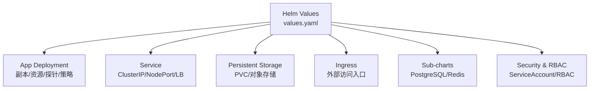
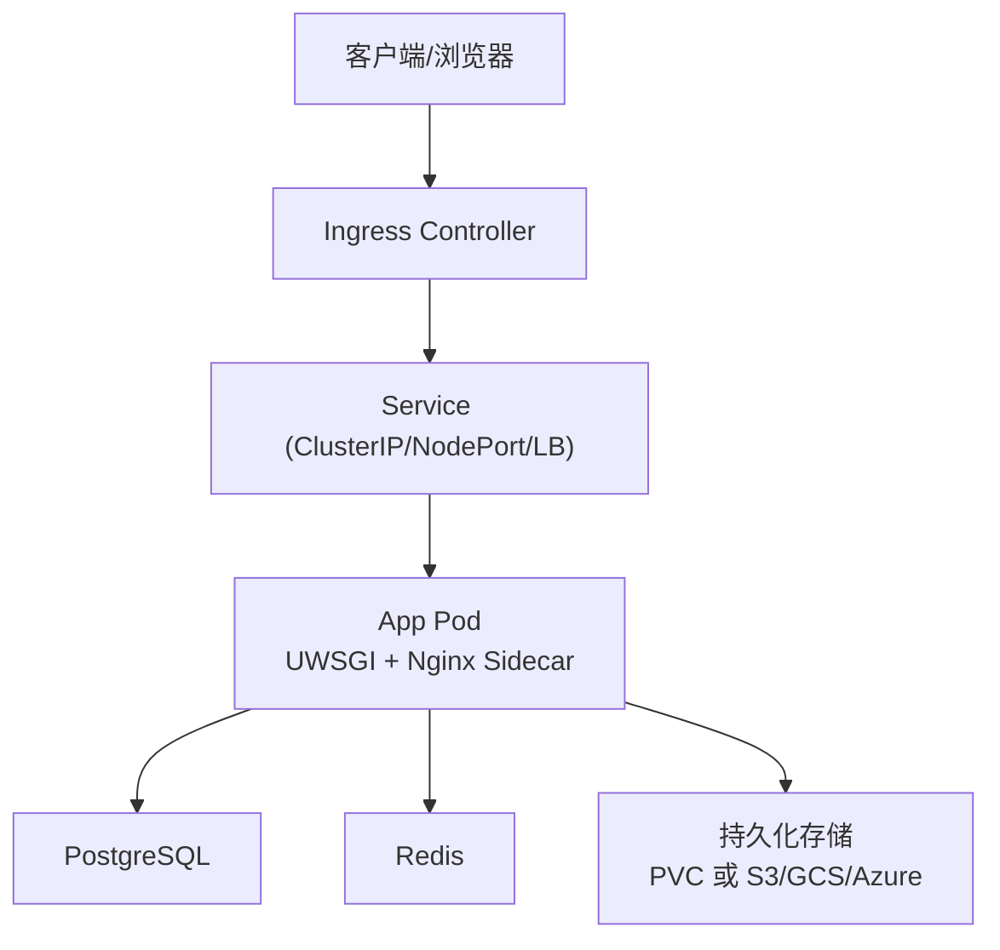
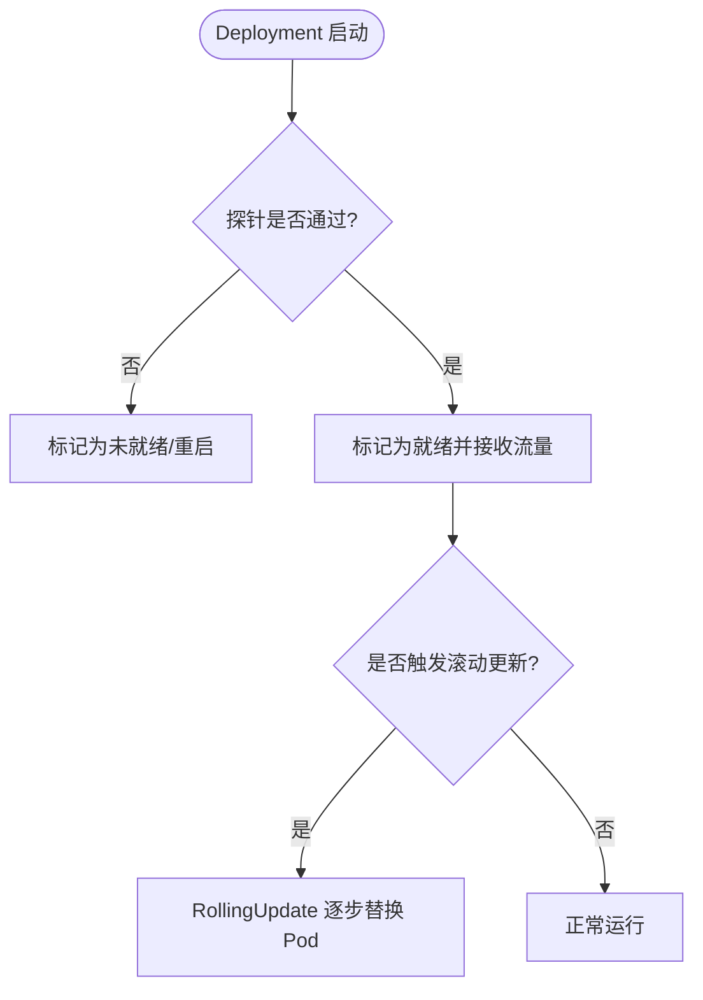
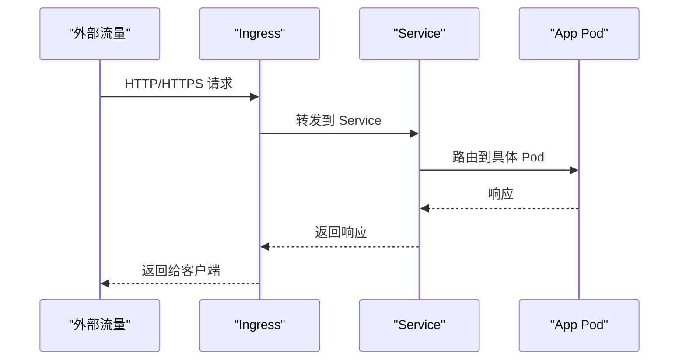
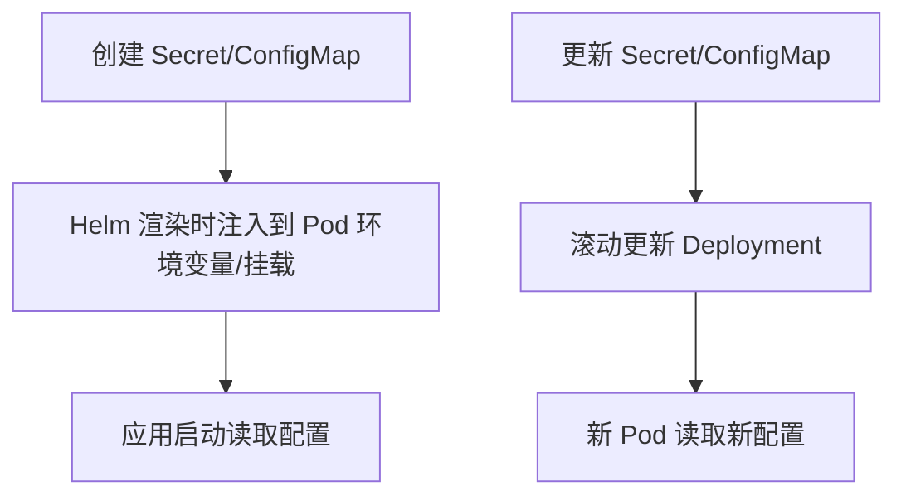
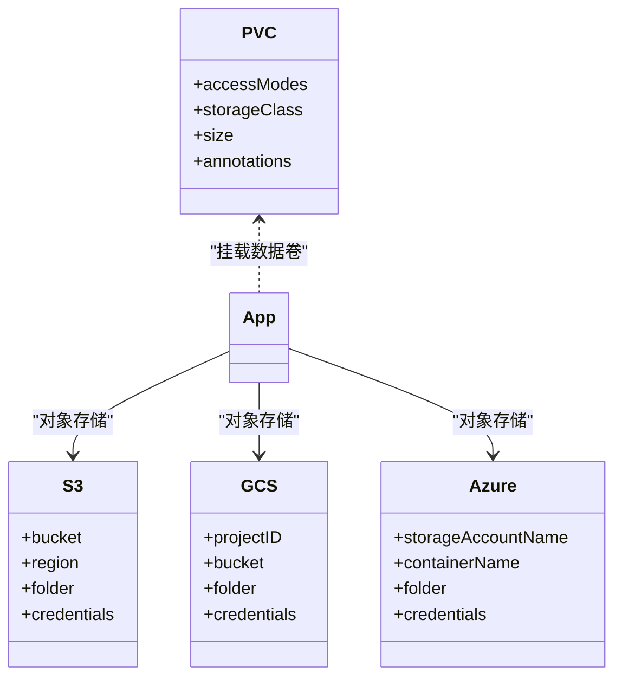
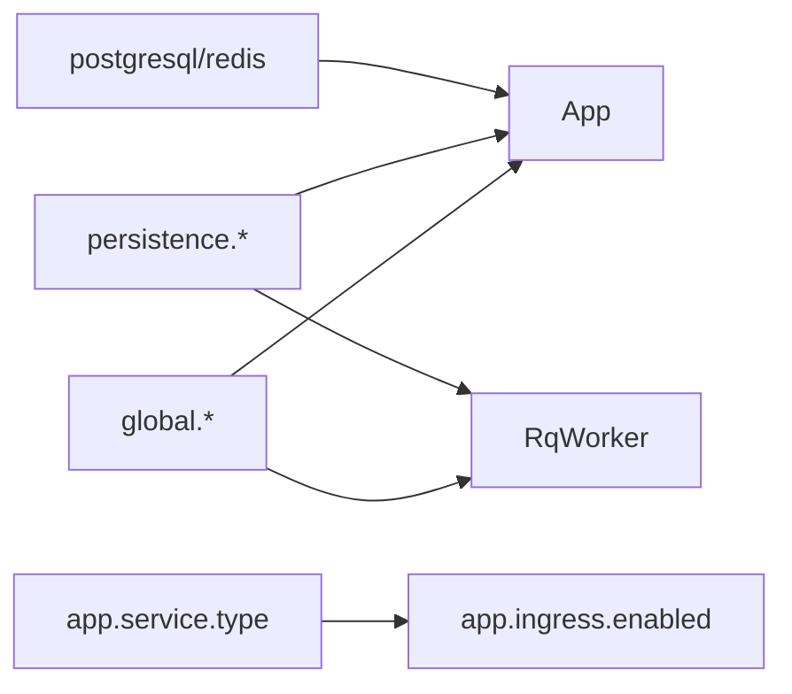

# Kubernetes资源配置

<cite>
**本文引用的文件**   
- [helm_values.md](file://docs/source/guide/helm_values.md)
- [install_k8s.md](file://docs/source/guide/install_k8s.md)
- [persistent_storage.md](file://docs/source/guide/persistent_storage.md)
- [ingress_config.md](file://docs/source/guide/ingress_config.md)
</cite>

## 目录
1. [简介](#简介)
2. [项目结构](#项目结构)
3. [核心组件](#核心组件)
4. [架构总览](#架构总览)
5. [详细组件分析](#详细组件分析)
6. [依赖关系分析](#依赖关系分析)
7. [性能与容量规划](#性能与容量规划)
8. [故障排查指南](#故障排查指南)
9. [结论](#结论)
10. [附录：配置清单速查](#附录配置清单速查)

## 简介
本文件面向在 Kubernetes 上部署 Label Studio 的运维与平台工程师，系统化说明以下资源的配置方法与最佳实践：
- Deployment（副本数、资源限制、健康检查探针、滚动更新策略）
- Service（ClusterIP、NodePort、LoadBalancer 选型与使用场景）
- ConfigMap 与 Secret（敏感信息加密、配置热更新）
- PersistentVolume 与 PersistentVolumeClaim（多云存储后端适配）
- NetworkPolicy（网络安全）
- ResourceQuota（资源配额管理）

文档内容基于官方 Helm Chart 参数与安装指南整理，确保可直接落地到生产环境。

## 项目结构
Label Studio 在 Kubernetes 上的部署主要通过 Helm Chart 进行编排，关键可配置项集中在 values.yaml 中，涵盖全局参数、应用容器、队列 Worker、持久化、Ingress、子图表（PostgreSQL、Redis）等。

图示来源
- [helm_values.md:54-124](file://docs/source/guide/helm_values.md#L54-L124)
- [helm_values.md:126-214](file://docs/source/guide/helm_values.md#L126-L214)
- [helm_values.md:288-309](file://docs/source/guide/helm_values.md#L288-L309)

章节来源
- [helm_values.md:54-124](file://docs/source/guide/helm_values.md#L54-L124)
- [helm_values.md:126-214](file://docs/source/guide/helm_values.md#L126-L214)
- [helm_values.md:288-309](file://docs/source/guide/helm_values.md#L288-L309)

## 核心组件
本节聚焦于 Helm Chart 暴露的关键可调参数，覆盖 Deployment、Service、探针、持久化、Ingress 与安全相关设置。

- 全局参数（global）
  - 镜像仓库、标签、拉取策略
  - PostgreSQL/Redis 连接与 SSL 证书 Secret 引用
  - 额外环境变量与 Secret 注入
  - 持久化类型与后端（volume/s3/azure/gcs）
  - 特性开关与环境脚本加载

- 应用参数（app）
  - 副本数、资源请求/限制
  - Liveness/Readiness 探针路径与阈值
  - Nginx Sidecar 探针与资源
  - Service 类型、端口、注解与会话亲和
  - Ingress 启用、主机、路径、TLS、注解
  - ServiceAccount、RBAC、安全上下文、拓扑约束

- 队列 Worker（rqworker）
  - 队列分组与副本（high/default/critical/all）
  - 探针、安全上下文、拓扑约束、RBAC

- 子图表（postgresql、redis）
  - 架构模式、镜像版本、认证与密码 Secret

章节来源
- [helm_values.md:54-124](file://docs/source/guide/helm_values.md#L54-L124)
- [helm_values.md:126-214](file://docs/source/guide/helm_values.md#L126-L214)
- [helm_values.md:216-274](file://docs/source/guide/helm_values.md#L216-L274)
- [helm_values.md:288-309](file://docs/source/guide/helm_values.md#L288-L309)

## 架构总览
下图展示 Label Studio 在 Kubernetes 中的典型部署形态：Ingress 将外部流量转发至 Service，Service 再路由到 App Pod；Nginx Sidecar 负责静态资源与上传加速；持久化通过 PVC 或对象存储（S3/GCS/Azure）提供；数据库与缓存由子图表或外部服务提供。

图示来源
- [ingress_config.md:15-24](file://docs/source/guide/ingress_config.md#L15-L24)
- [helm_values.md:196-210](file://docs/source/guide/helm_values.md#L196-L210)
- [helm_values.md:288-309](file://docs/source/guide/helm_values.md#L288-L309)
- [persistent_storage.md:26-46](file://docs/source/guide/persistent_storage.md#L26-L46)

## 详细组件分析

### Deployment 配置详解
- 副本数
  - app.replicas：默认 1，生产建议按可用区数量扩展以提升容错能力。
- 资源限制与请求
  - app.resources.requests/limits：CPU 与内存的请求/限制，需根据并发标注人数调整。
- 健康检查探针
  - livenessProbe：默认 /health，用于崩溃自愈。
  - readinessProbe：默认 /version，用于就绪控制。
  - nginx sidecar 探针：/nginx_health 与 /version。
- 滚动更新策略
  - app.deploymentStrategy.type：默认 RollingUpdate，保证升级期间服务不中断。
- 安全上下文
  - podSecurityContext/fsGroup、containerSecurityContext/runAsUser/runAsNonRoot：以非 root 用户运行，降低权限风险。
- 其他
  - nodeSelector/affinity/tolerations/topologySpreadConstraints：调度与拓扑分布控制。
  - extraEnvironmentVars/extraEnvironmentSecrets：注入业务变量与密钥。

图示来源
- [helm_values.md:133-156](file://docs/source/guide/helm_values.md#L133-L156)
- [helm_values.md:173-178](file://docs/source/guide/helm_values.md#L173-L178)

章节来源
- [helm_values.md:126-214](file://docs/source/guide/helm_values.md#L126-L214)

### Service 配置与服务类型选择
- ClusterIP（默认）
  - 仅集群内部访问，适合与 Ingress 配合对外暴露。
- NodePort
  - 通过节点端口暴露，便于调试或无 Ingress 的场景。
- LoadBalancer
  - 云平台自动创建负载均衡器，直接对外暴露。
- 端口与会话亲和
  - service.port/targetPort/portName：定义监听与转发端口。
  - sessionAffinity/sessionAffinityConfig：会话保持策略。

图示来源
- [ingress_config.md:15-24](file://docs/source/guide/ingress_config.md#L15-L24)
- [helm_values.md:196-202](file://docs/source/guide/helm_values.md#L196-L202)

章节来源
- [helm_values.md:196-202](file://docs/source/guide/helm_values.md#L196-L202)
- [ingress_config.md:56-82](file://docs/source/guide/ingress_config.md#L56-L82)

### ConfigMap 与 Secret 管理
- Secret 使用场景
  - PostgreSQL 用户名/密码、SSL 证书与私钥
  - Redis 密码与 SSL 证书
  - AWS/GCP/Azure 对象存储凭据
- 注入方式
  - global.pgConfig.password.secretName/secretKey
  - global.redisConfig.password.secretName/secretKey
  - persistence.config.*ExistingSecret/*ExistingSecretKey
- 配置热更新
  - 通过更新 Secret/ConfigMap 后重启 Pod 或滚动更新 Deployment 使新配置生效。
  - 对于仅影响运行时行为的环境变量，可通过 extraEnvironmentVars 动态注入。

图示来源
- [helm_values.md:64-84](file://docs/source/guide/helm_values.md#L64-L84)
- [helm_values.md:85-124](file://docs/source/guide/helm_values.md#L85-L124)
- [install_k8s.md:95-121](file://docs/source/guide/install_k8s.md#L95-L121)

章节来源
- [helm_values.md:64-84](file://docs/source/guide/helm_values.md#L64-L84)
- [helm_values.md:85-124](file://docs/source/guide/helm_values.md#L85-L124)
- [install_k8s.md:95-121](file://docs/source/guide/install_k8s.md#L95-L121)

### PersistentVolume 与 PersistentVolumeClaim
- 本地 PVC（ReadWriteMany）
  - 适用于集群内共享存储（如 NFS/EFS/Azure Files），要求支持 ReadWriteMany。
  - 通过 global.persistence.config.volume.accessModes 指定。
- 对象存储（S3/GCS/Azure）
  - 推荐在生产中使用对象存储作为持久化后端，具备高可用与弹性。
  - 支持通过 IAM Role/Workload Identity 或 Access Key/Secret 接入。
- 云厂商示例要点
  - AWS S3：CORS 配置、IAM Role（OIDC）、Access Keys、Bucket 权限。
  - GCP GCS：Workload Identity、Service Account JSON、Bucket 权限。
  - Azure Blob：Storage Account、Container、CORS、Account Key。

图示来源
- [persistent_storage.md:26-46](file://docs/source/guide/persistent_storage.md#L26-L46)
- [persistent_storage.md:47-340](file://docs/source/guide/persistent_storage.md#L47-L340)
- [persistent_storage.md:342-502](file://docs/source/guide/persistent_storage.md#L342-L502)
- [persistent_storage.md:505-603](file://docs/source/guide/persistent_storage.md#L505-L603)

章节来源
- [persistent_storage.md:26-46](file://docs/source/guide/persistent_storage.md#L26-L46)
- [persistent_storage.md:47-340](file://docs/source/guide/persistent_storage.md#L47-L340)
- [persistent_storage.md:342-502](file://docs/source/guide/persistent_storage.md#L342-L502)
- [persistent_storage.md:505-603](file://docs/source/guide/persistent_storage.md#L505-L603)

### NetworkPolicy 网络安全
- 目标
  - 限制 Pod 间网络访问，仅允许必要通信（如 App 到 DB/Cache）。
- 建议
  - 使用命名空间隔离与最小权限原则。
  - 结合 ServiceAccount 与 RBAC 控制 API 访问。
- 参考
  - 可在 Helm values 中启用 ServiceAccount 与 RBAC 资源，并结合集群级 NetworkPolicy 实现细粒度访问控制。

章节来源
- [helm_values.md:170-172](file://docs/source/guide/helm_values.md#L170-L172)
- [helm_values.md:209-211](file://docs/source/guide/helm_values.md#L209-L211)

### 资源配额管理（ResourceQuota）
- 目标
  - 在 Namespace 级别限制 CPU/内存/存储等资源上限，防止资源争用。
- 建议
  - 为不同团队/环境划分独立 Namespace，并设置合理的 Quota 与 LimitRange。
  - 结合 Pod 的资源 requests/limits 与 HPA/VPA 进行弹性伸缩。

[本节为通用指导，不涉及具体源码文件]

## 依赖关系分析
- Helm Chart 参数之间的耦合
  - global.* 影响 App 与 RqWorker 的环境变量与存储后端。
  - persistence.type 决定使用 PVC 还是对象存储（S3/GCS/Azure）。
  - app.service.type 与 ingress.enabled 共同决定外部访问方式。
- 外部依赖
  - PostgreSQL/Redis：可通过子图表或外部服务提供。
  - 对象存储：AWS S3、GCP GCS、Azure Blob。

图示来源
- [helm_values.md:54-124](file://docs/source/guide/helm_values.md#L54-L124)
- [helm_values.md:126-214](file://docs/source/guide/helm_values.md#L126-L214)
- [helm_values.md:216-274](file://docs/source/guide/helm_values.md#L216-L274)
- [helm_values.md:288-309](file://docs/source/guide/helm_values.md#L288-L309)

章节来源
- [helm_values.md:54-124](file://docs/source/guide/helm_values.md#L54-L124)
- [helm_values.md:126-214](file://docs/source/guide/helm_values.md#L126-L214)
- [helm_values.md:216-274](file://docs/source/guide/helm_values.md#L216-L274)
- [helm_values.md:288-309](file://docs/source/guide/helm_values.md#L288-L309)

## 性能与容量规划
- 默认资源建议
  - replicas=1，requests/limits 可按并发标注人数调优。
- 扩容策略
  - 增加 app 副本提升容错与吞吐。
  - 调整 resources.requests/limits 匹配工作负载特征。
- 升级策略
  - 使用 RollingUpdate 保证零停机升级。
  - 通过 helm upgrade 平滑更新镜像与配置。

章节来源
- [install_k8s.md:49-76](file://docs/source/guide/install_k8s.md#L49-L76)
- [install_k8s.md:156-178](file://docs/source/guide/install_k8s.md#L156-L178)
- [helm_values.md:133-156](file://docs/source/guide/helm_values.md#L133-L156)

## 故障排查指南
- 探针失败
  - 检查 liveness/readiness 路径是否正确（/health、/version、/nginx_health）。
  - 调整 initialDelaySeconds/periodSeconds/failureThreshold 以适应启动时间。
- 大文件上传失败
  - Ingress 层限制导致 413，需调整 proxy-body-size 或对应控制器注解。
- 持久化不可用
  - PVC 不支持 ReadWriteMany 导致多 Pod 写入失败，需更换支持的网络存储。
  - 对象存储凭据错误或权限不足，检查 Secret 与 IAM/Service Account 配置。
- 数据库 TLS 连接失败
  - 检查 Secret 中 CA/Client 证书与私钥键名是否与 Helm values 一致。

章节来源
- [helm_values.md:143-156](file://docs/source/guide/helm_values.md#L143-L156)
- [ingress_config.md:135-154](file://docs/source/guide/ingress_config.md#L135-L154)
- [persistent_storage.md:26-46](file://docs/source/guide/persistent_storage.md#L26-L46)
- [install_k8s.md:95-121](file://docs/source/guide/install_k8s.md#L95-L121)

## 结论
通过 Helm Chart 提供的丰富参数，Label Studio 在 Kubernetes 上可实现高可用、可扩展且安全的部署。建议生产环境采用对象存储作为持久化后端，结合 Ingress 与 TLS 管理外部访问，并通过 Secret/ConfigMap 集中管理敏感信息与配置。同时，利用探针、滚动更新与资源配额保障系统的稳定性与资源利用率。

[本节为总结性内容，不涉及具体源码文件]

## 附录：配置清单速查
- Deployment
  - replicas、resources.requests/limits、liveness/readiness probes、deploymentStrategy.type
- Service
  - type（ClusterIP/NodePort/LB）、port/targetPort/portName、sessionAffinity
- ConfigMap/Secret
  - pgConfig/redisConfig 的 secretName/secretKey
  - persistence.config.*ExistingSecret/*ExistingSecretKey
- Persistent Storage
  - volume.accessModes=ReadWriteMany（PVC）
  - s3/gcs/azure 凭据与 bucket/container 配置
- Ingress
  - enabled、host、path、className、tls、annotations（含大文件上传限制）
- Security & RBAC
  - serviceAccount.create/name/annotations、rbac.create/rules
- Sub-charts
  - postgresql.enabled/architecture/image.tag/auth.*
  - redis.enabled/architecture/auth.enabled

章节来源
- [helm_values.md:54-124](file://docs/source/guide/helm_values.md#L54-L124)
- [helm_values.md:126-214](file://docs/source/guide/helm_values.md#L126-L214)
- [helm_values.md:216-274](file://docs/source/guide/helm_values.md#L216-L274)
- [helm_values.md:288-309](file://docs/source/guide/helm_values.md#L288-L309)
- [ingress_config.md:103-154](file://docs/source/guide/ingress_config.md#L103-L154)
- [persistent_storage.md:26-46](file://docs/source/guide/persistent_storage.md#L26-L46)
- [persistent_storage.md:47-340](file://docs/source/guide/persistent_storage.md#L47-L340)
- [persistent_storage.md:342-502](file://docs/source/guide/persistent_storage.md#L342-L502)
- [persistent_storage.md:505-603](file://docs/source/guide/persistent_storage.md#L505-L603)