# Kubernetes集群部署

<cite>
**本文引用的文件**   
- [helm_values.md](file://docs/source/guide/helm_values.md)
- [install_k8s.md](file://docs/source/guide/install_k8s.md)
- [ingress_config.md](file://docs/source/guide/ingress_config.md)
- [persistent_storage.md](file://docs/source/guide/persistent_storage.md)
</cite>

## 目录
1. [简介](#简介)
2. [项目结构](#项目结构)
3. [核心组件](#核心组件)
4. [架构总览](#架构总览)
5. [详细组件分析](#详细组件分析)
6. [依赖关系分析](#依赖关系分析)
7. [性能与容量规划](#性能与容量规划)
8. [监控与告警集成](#监控与告警集成)
9. [高级部署策略](#高级部署策略)
10. [故障排查指南](#故障排查指南)
11. [结论](#结论)

## 简介
本指南面向在Kubernetes集群中部署Label Studio的运维与平台工程师，围绕Helm Chart的使用、Kubernetes资源（Deployment、Service、ConfigMap、Secret等）的配置与管理、持久化存储、Ingress路由、HPA水平扩缩容、监控告警集成以及滚动更新、蓝绿部署、金丝雀发布等高级策略进行系统化说明。文档内容基于仓库内官方安装与配置文档整理而成，确保可操作性与准确性。

## 项目结构
本仓库包含Label Studio应用代码与部署相关文档。针对Kubernetes部署，主要参考以下文档：
- Helm Values参数清单与默认值
- Kubernetes安装步骤与版本要求
- Ingress控制器与TLS终止配置
- 持久化存储（PVC/S3/GCS/Azure）配置

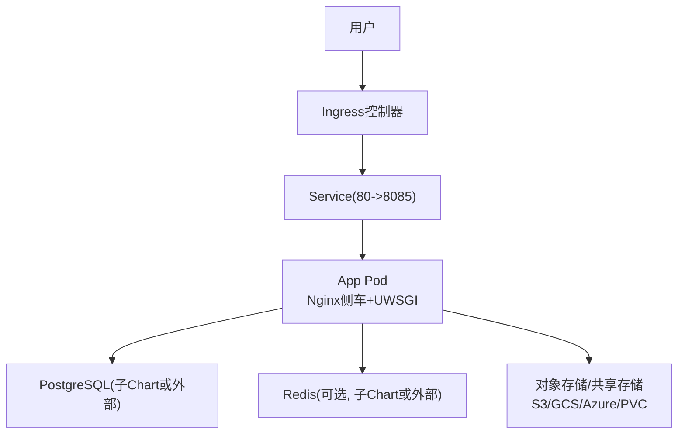

图示来源
- [install_k8s.md:14-47](file://docs/source/guide/install_k8s.md#L14-L47)
- [helm_values.md:196-212](file://docs/source/guide/helm_values.md#L196-L212)
- [persistent_storage.md:26-46](file://docs/source/guide/persistent_storage.md#L26-L46)

章节来源
- [install_k8s.md:14-47](file://docs/source/guide/install_k8s.md#L14-L47)

## 核心组件
- Helm Chart与Values
  - 全局参数：镜像仓库、标签、拉取策略、环境变量注入、特性开关、自定义CA证书等
  - App组件：副本数、探针、资源请求/限制、服务端口、Ingress、RBAC、安全上下文、拓扑约束等
  - Rqworker组件：队列副本、探针、安全上下文、额外卷挂载等
  - 子Chart：PostgreSQL、Redis启用与基础配置
  - 其他：升级检查、CI标记、集群域名、环境变量校验跳过等
- Kubernetes资源
  - Deployment：App与Rqworker工作负载
  - Service：内部暴露端口映射
  - ConfigMap/Secret：环境变量、密钥、证书
  - PersistentVolumeClaim：本地共享存储
  - Ingress：外部访问入口与TLS
- 存储后端
  - PVC（ReadWriteMany）
  - S3/GCS/Azure Blob
- 扩展能力
  - HPA（水平扩缩容）
  - 监控与告警（Prometheus/Grafana/AlertManager）
  - 高级发布策略（滚动、蓝绿、金丝雀）

章节来源
- [helm_values.md:54-124](file://docs/source/guide/helm_values.md#L54-L124)
- [helm_values.md:126-214](file://docs/source/guide/helm_values.md#L126-L214)
- [helm_values.md:216-275](file://docs/source/guide/helm_values.md#L216-L275)
- [helm_values.md:288-309](file://docs/source/guide/helm_values.md#L288-L309)

## 架构总览
Label Studio在Kubernetes中的典型部署由以下层次组成：
- 入口层：Ingress控制器（云厂商LB或NGINX），负责TLS终止、路径转发、大文件上传限制等
- 服务层：Service将流量转发到App Pod的Nginx侧车
- 应用层：App Pod包含Nginx与UWSGI进程，处理Web请求与静态资源；Rqworker Pod执行后台任务
- 数据层：PostgreSQL作为主数据库，Redis作为缓存/队列（可选），对象存储或共享存储承载媒体与导出文件

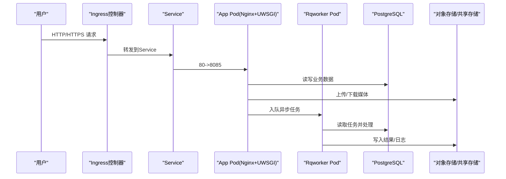

图示来源
- [ingress_config.md:103-121](file://docs/source/guide/ingress_config.md#L103-L121)
- [helm_values.md:196-212](file://docs/source/guide/helm_values.md#L196-L212)
- [persistent_storage.md:26-46](file://docs/source/guide/persistent_storage.md#L26-L46)

## 详细组件分析

### Helm Chart结构与Values配置
- 全局参数
  - 镜像与拉取：仓库、标签、拉取策略、私有仓库Secret
  - 数据库连接：PostgreSQL主机、端口、库名、用户名、密码Secret、SSL模式与证书Secret键
  - Redis连接：连接串、密码Secret、SSL证书与私钥Secret键
  - 环境变量与Secret注入：extraEnvironmentVars、extraEnvironmentSecrets
  - 持久化：类型（volume/s3/gcs/azure）、S3/GCS/Azure参数、PVC StorageClass/大小/访问模式/注解/现有Claim
  - 特性开关与启动前命令：featureFlags、cmdWrapper、customCaCerts
- App参数
  - 部署策略、副本数、资源请求/限制
  - 探针：liveness/readiness路径、阈值、延迟、周期
  - 环境变量与Secret注入、节点选择器、亲和性、容忍度、拓扑约束
  - Nginx侧车：资源、探针、参数
  - Service：类型、端口、目标端口、名称、注解、会话亲和
  - Ingress：启用、类名、主机、路径、TLS、注解
  - RBAC：创建与规则
  - 安全上下文：Pod与容器运行用户、非root、fsGroup
  - 额外卷与挂载、ServiceAccount创建与注解
- Rqworker参数
  - 队列副本与启动参数（high/low/default/critical/all）
  - 探针、安全上下文、ServiceAccount、RBAC、额外卷与拓扑约束
- 子Chart参数
  - PostgreSQL：架构、镜像标签、认证、数据库名
  - Redis：架构、认证
- 其他参数
  - 升级检查、CI标记、集群域名、环境变量校验跳过

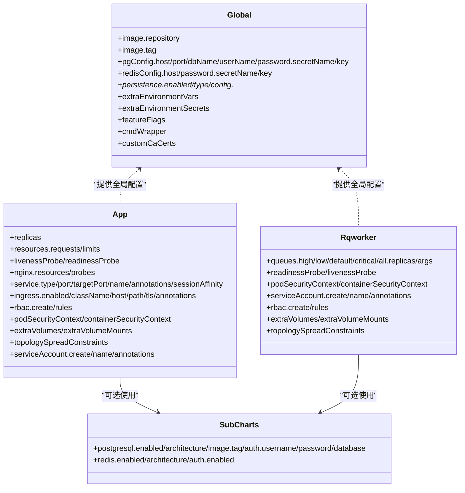

图示来源
- [helm_values.md:54-124](file://docs/source/guide/helm_values.md#L54-L124)
- [helm_values.md:126-214](file://docs/source/guide/helm_values.md#L126-L214)
- [helm_values.md:216-275](file://docs/source/guide/helm_values.md#L216-L275)
- [helm_values.md:288-309](file://docs/source/guide/helm_values.md#L288-L309)

章节来源
- [helm_values.md:54-124](file://docs/source/guide/helm_values.md#L54-L124)
- [helm_values.md:126-214](file://docs/source/guide/helm_values.md#L126-L214)
- [helm_values.md:216-275](file://docs/source/guide/helm_values.md#L216-L275)
- [helm_values.md:288-309](file://docs/source/guide/helm_values.md#L288-L309)

### Kubernetes资源管理与配置要点
- Deployment
  - App与Rqworker分别管理，支持不同的部署策略与探针
  - 通过资源请求/限制控制调度与稳定性
- Service
  - 默认ClusterIP，端口80映射到目标端口8085
  - 可配置会话亲和与注解
- ConfigMap/Secret
  - 通过extraEnvironmentVars注入环境变量
  - 通过extraEnvironmentSecrets注入密钥
  - PostgreSQL/Redis SSL证书与私钥通过Secret引用
- PersistentVolumeClaim
  - 当type=volume时，需设置StorageClass、大小、访问模式（建议ReadWriteMany）
- Ingress
  - 支持多种IngressClass（AWS ALB、GKE gce、AKS AGIC、NGINX）
  - 可配置TLS Secret与注解（如proxy-body-size）

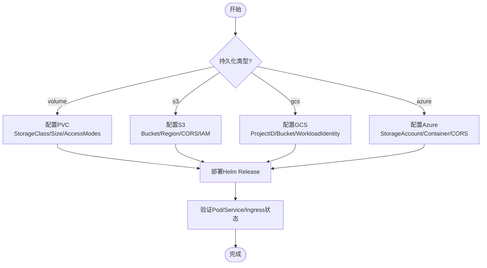

图示来源
- [persistent_storage.md:26-46](file://docs/source/guide/persistent_storage.md#L26-L46)
- [persistent_storage.md:47-340](file://docs/source/guide/persistent_storage.md#L47-L340)
- [persistent_storage.md:342-502](file://docs/source/guide/persistent_storage.md#L342-L502)
- [persistent_storage.md:505-604](file://docs/source/guide/persistent_storage.md#L505-L604)

章节来源
- [helm_values.md:196-212](file://docs/source/guide/helm_values.md#L196-L212)
- [persistent_storage.md:26-46](file://docs/source/guide/persistent_storage.md#L26-L46)

### Ingress路由与TLS配置
- 云厂商Ingress
  - AWS EKS：ALB Controller，path/*，className alb，注解internet-facing/target-type ip
  - GKE：gce或gce-internal类，external LB用gce，可配置ManagedCertificate注解
  - AKS：Application Gateway Ingress Controller，className azure/application-gateway
- 通用NGINX Ingress
  - 安装NGINX Ingress Controller与cert-manager
  - ExternalDNS同步主机记录
  - TLS Secret与hosts绑定
- Load Balancer终止TLS
  - 设置LABEL_STUDIO_HOST环境变量以匹配外部域名
- 大文件上传
  - NGINX ingress需调整proxy-body-size注解以避免413错误

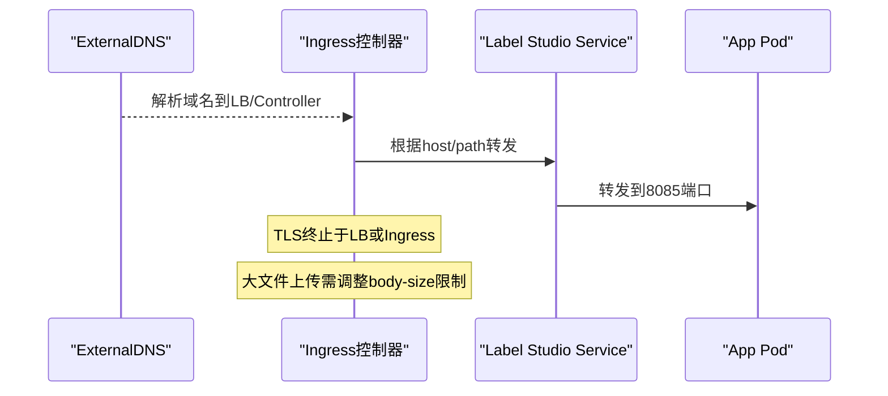

图示来源
- [ingress_config.md:29-54](file://docs/source/guide/ingress_config.md#L29-L54)
- [ingress_config.md:56-82](file://docs/source/guide/ingress_config.md#L56-L82)
- [ingress_config.md:84-101](file://docs/source/guide/ingress_config.md#L84-L101)
- [ingress_config.md:103-121](file://docs/source/guide/ingress_config.md#L103-L121)
- [ingress_config.md:123-132](file://docs/source/guide/ingress_config.md#L123-L132)
- [ingress_config.md:135-154](file://docs/source/guide/ingress_config.md#L135-L154)

章节来源
- [ingress_config.md:29-54](file://docs/source/guide/ingress_config.md#L29-L54)
- [ingress_config.md:56-82](file://docs/source/guide/ingress_config.md#L56-L82)
- [ingress_config.md:84-101](file://docs/source/guide/ingress_config.md#L84-L101)
- [ingress_config.md:103-121](file://docs/source/guide/ingress_config.md#L103-L121)
- [ingress_config.md:123-132](file://docs/source/guide/ingress_config.md#L123-L132)
- [ingress_config.md:135-154](file://docs/source/guide/ingress_config.md#L135-L154)

### 持久化存储配置
- PVC（ReadWriteMany）
  - 适用于多Pod共享数据的场景（app与rqworker同时读写）
  - 需要集群提供支持ReadWriteMany的StorageClass（如NFS/EFS/Azure Files）
- S3
  - 创建Bucket、配置CORS、IAM权限（推荐OIDC Role或Access Keys）
  - 可通过ServiceAccount注解或Kubernetes Secret注入凭据
- GCS
  - 创建Bucket、配置CORS、IAM角色与工作负载身份（Workload Identity）
  - 或通过Service Account Key与Kubernetes Secret注入
- Azure Blob
  - 创建Storage Account与Container、配置CORS
  - 通过Account Key或Kubernetes Secret注入

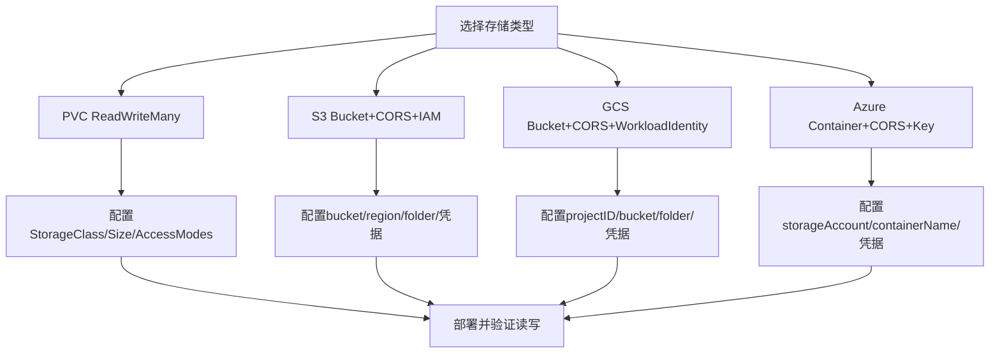

图示来源
- [persistent_storage.md:26-46](file://docs/source/guide/persistent_storage.md#L26-L46)
- [persistent_storage.md:47-340](file://docs/source/guide/persistent_storage.md#L47-L340)
- [persistent_storage.md:342-502](file://docs/source/guide/persistent_storage.md#L342-L502)
- [persistent_storage.md:505-604](file://docs/source/guide/persistent_storage.md#L505-L604)

章节来源
- [persistent_storage.md:26-46](file://docs/source/guide/persistent_storage.md#L26-L46)
- [persistent_storage.md:47-340](file://docs/source/guide/persistent_storage.md#L47-L340)
- [persistent_storage.md:342-502](file://docs/source/guide/persistent_storage.md#L342-L502)
- [persistent_storage.md:505-604](file://docs/source/guide/persistent_storage.md#L505-L604)

## 依赖关系分析
- Helm Chart依赖
  - 子Chart：PostgreSQL（默认启用）、Redis（默认禁用）
  - 外部依赖：对象存储服务（S3/GCS/Azure）、Ingress控制器、TLS证书管理器
- 运行时依赖
  - App Pod依赖PostgreSQL与对象存储/共享存储
  - Rqworker Pod依赖PostgreSQL与对象存储/共享存储
  - Ingress控制器依赖DNS与证书管理

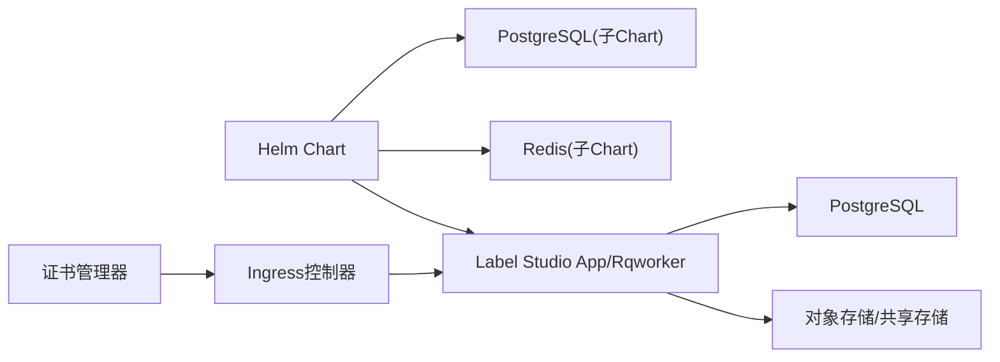

图示来源
- [helm_values.md:288-309](file://docs/source/guide/helm_values.md#L288-L309)
- [ingress_config.md:103-121](file://docs/source/guide/ingress_config.md#L103-L121)

章节来源
- [helm_values.md:288-309](file://docs/source/guide/helm_values.md#L288-L309)
- [ingress_config.md:103-121](file://docs/source/guide/ingress_config.md#L103-L121)

## 性能与容量规划
- 默认资源配置
  - App副本数为1，资源请求/限制可按并发标注者数量调整
- 容量规划建议
  - 并发标注者超过10时，提升App Pod的资源请求/限制
  - 提高容错能力可增加App副本数
  - 生产环境副本数应不小于可用区数量
- 探针与健康检查
  - Liveness/Readiness探针用于保障服务可用性
  - Nginx侧车具备独立探针路径

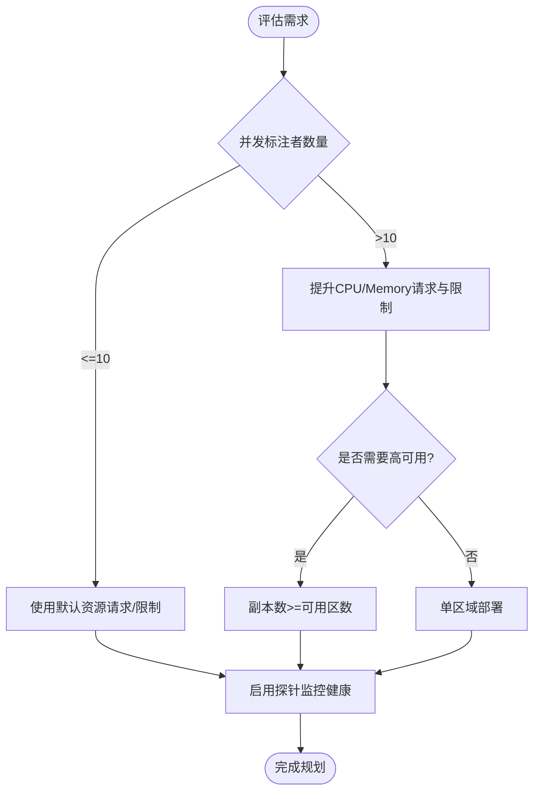

图示来源
- [install_k8s.md:49-76](file://docs/source/guide/install_k8s.md#L49-L76)
- [helm_values.md:137-156](file://docs/source/guide/helm_values.md#L137-L156)

章节来源
- [install_k8s.md:49-76](file://docs/source/guide/install_k8s.md#L49-L76)
- [helm_values.md:137-156](file://docs/source/guide/helm_values.md#L137-L156)

## 监控与告警集成
- Prometheus指标收集
  - 通过ServiceMonitor或Prometheus scrape配置抓取App与Rqworker的指标端点
  - 结合Ingress控制器与Service暴露指标端口
- Grafana可视化
  - 导入Label Studio相关Dashboard模板
  - 配置数据源为Prometheus
- AlertManager告警规则
  - 定义关键指标阈值（如Pod重启次数、错误率、响应时间）
  - 配置通知渠道（邮件、Slack、企业微信等）

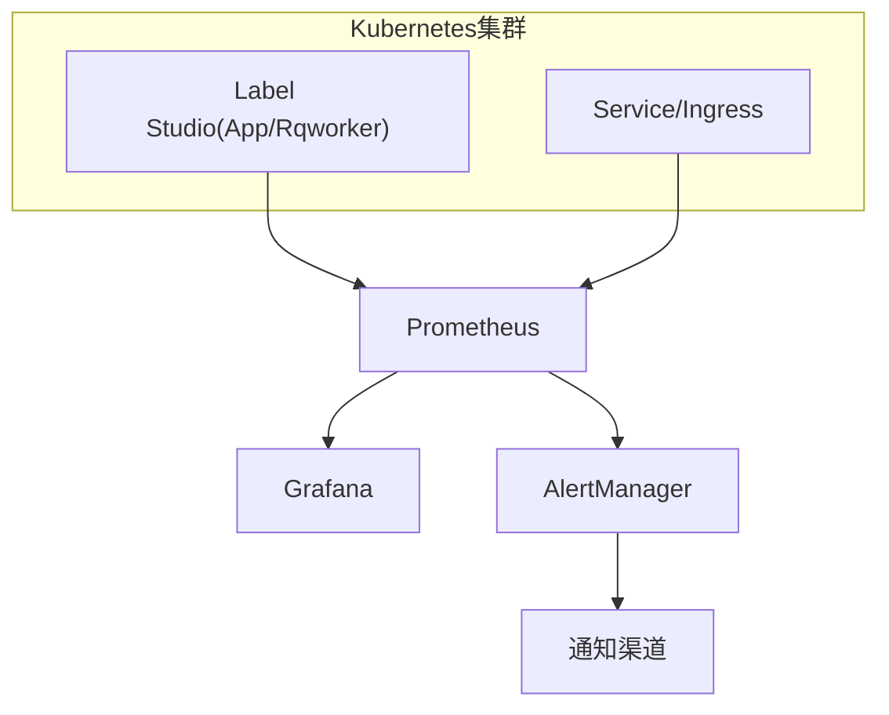

[本节为概念性说明，不直接分析具体源码文件]

## 高级部署策略
- 滚动更新
  - 使用Helm upgrade进行平滑升级
  - 通过Deployment策略RollingUpdate实现零停机更新
- 蓝绿部署
  - 通过双Release或双命名空间切换流量
  - 借助Ingress权重或Service切换实现快速回滚
- 金丝雀发布
  - 通过Ingress注解或Service权重逐步放量
  - 结合监控与告警观察关键指标后全量发布

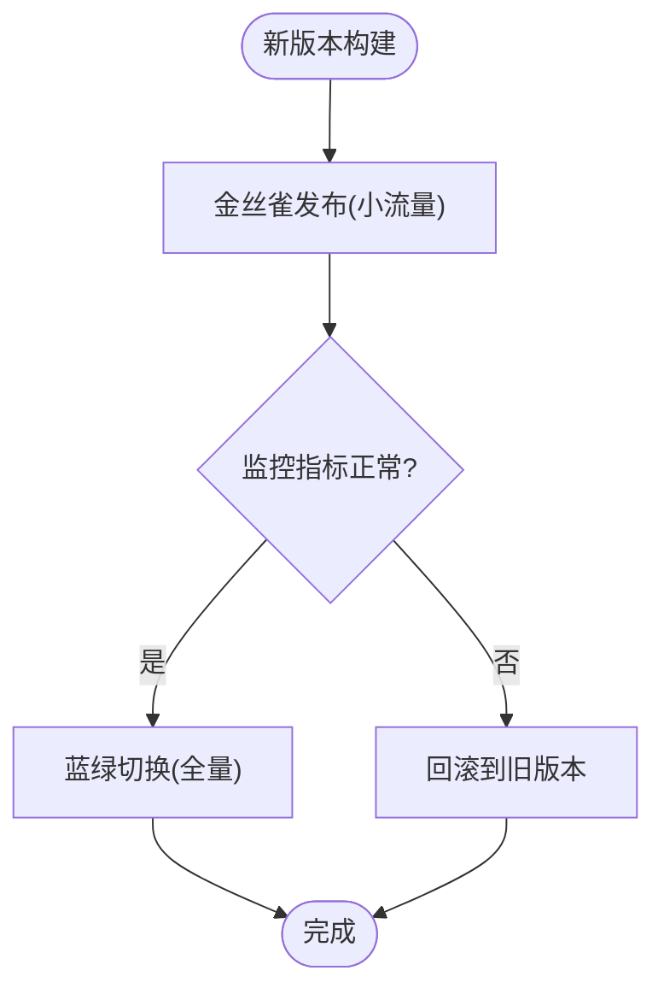

[本节为概念性说明，不直接分析具体源码文件]

## 故障排查指南
- 安装与升级
  - 使用helm list查看Release状态
  - 使用kubectl rollout restart deployment/<RELEASE>-ls-app重启应用
  - 使用helm upgrade进行版本升级，注意镜像tag避免降级
- 常见问题
  - Ingress 413错误：调整proxy-body-size注解
  - 大文件上传失败：确认对象存储CORS与权限
  - PostgreSQL SSL连接失败：检查Secret键与SSL模式
  - 多Pod读写冲突：确保PVC为ReadWriteMany且StorageClass支持

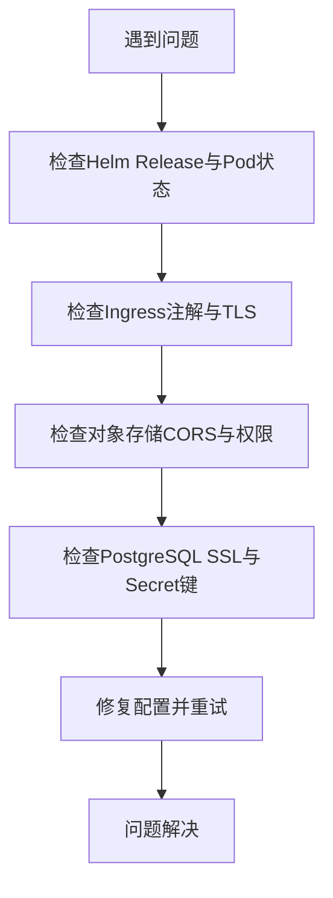

图示来源
- [install_k8s.md:142-178](file://docs/source/guide/install_k8s.md#L142-L178)
- [ingress_config.md:135-154](file://docs/source/guide/ingress_config.md#L135-L154)
- [persistent_storage.md:47-340](file://docs/source/guide/persistent_storage.md#L47-L340)

章节来源
- [install_k8s.md:142-178](file://docs/source/guide/install_k8s.md#L142-L178)
- [ingress_config.md:135-154](file://docs/source/guide/ingress_config.md#L135-L154)
- [persistent_storage.md:47-340](file://docs/source/guide/persistent_storage.md#L47-L340)

## 结论
通过Helm Chart与Kubernetes原生资源，Label Studio可在各类云平台上稳定部署与扩展。合理配置持久化存储、Ingress路由与TLS、探针与健康检查，并结合监控告警与高级发布策略，可实现高可用、易维护、可扩展的生产级部署。建议在生产环境中启用SSRF保护、最小权限原则与严格的资源配额，以确保系统的安全与稳定。