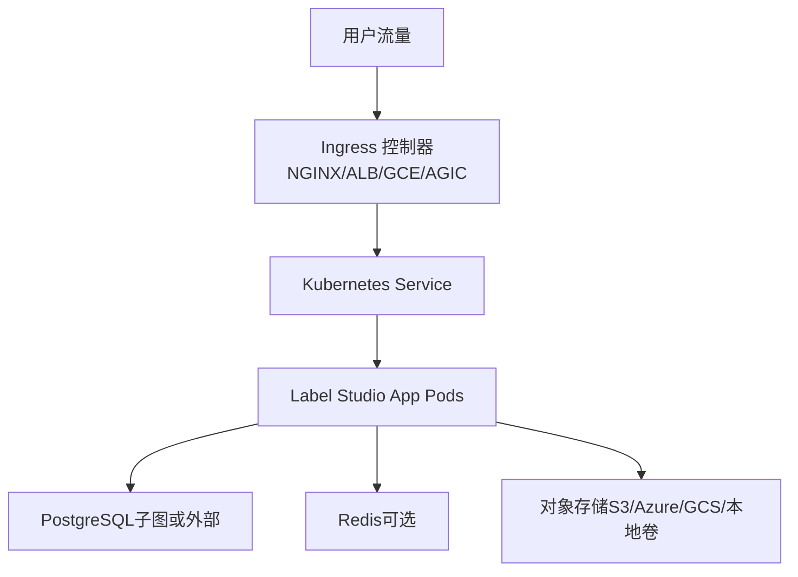
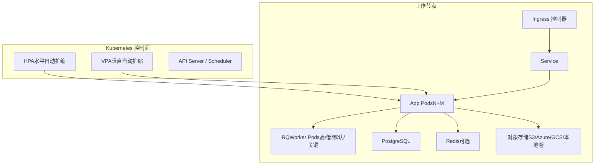
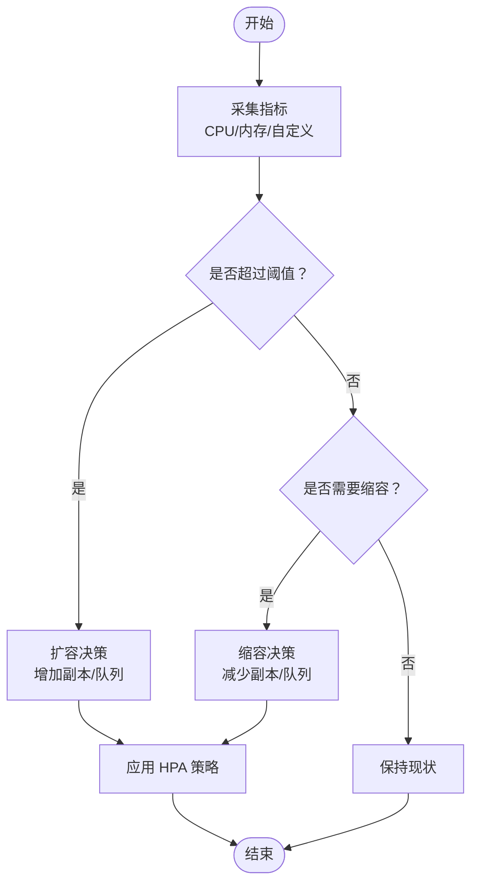
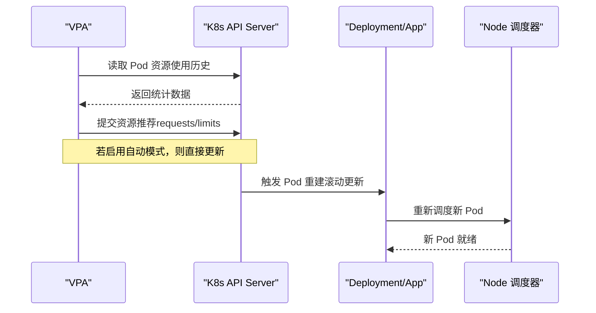
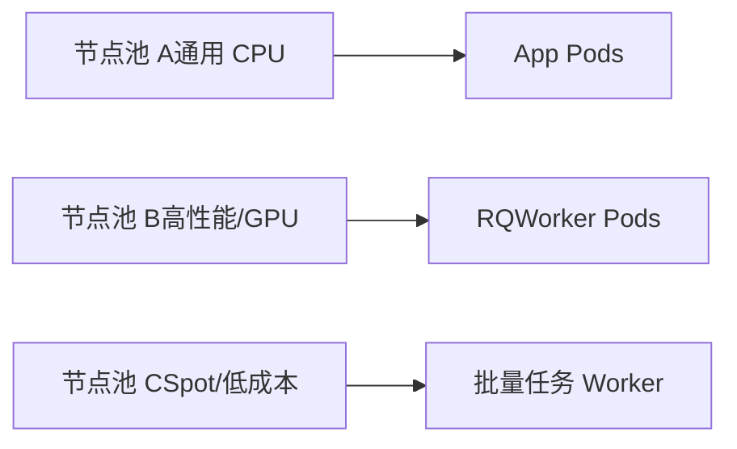
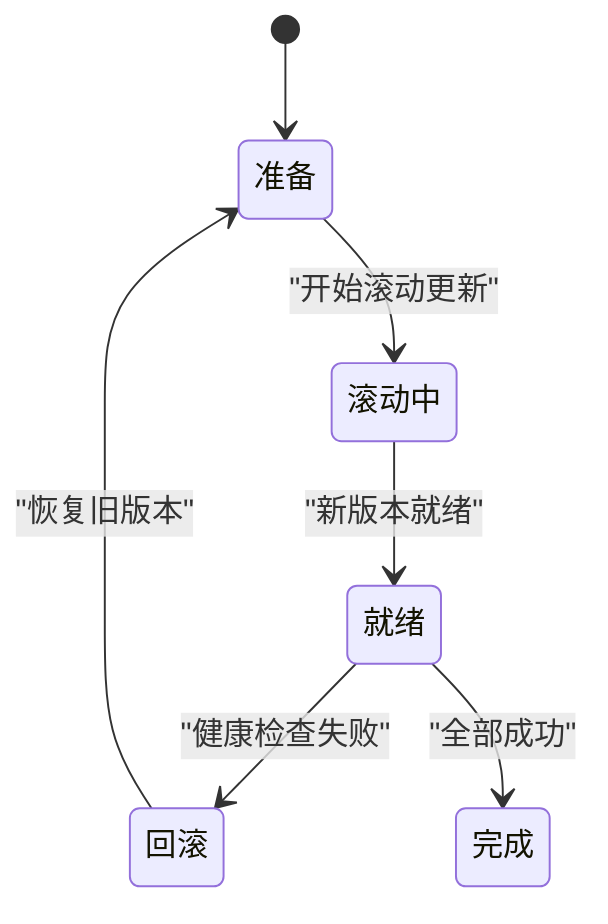
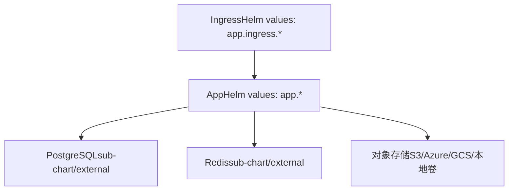

# 扩缩容策略

<cite>
**本文引用的文件**   
- [install_k8s.md](file://docs/source/guide/install_k8s.md)
- [helm_values.md](file://docs/source/guide/helm_values.md)
- [ingress_config.md](file://docs/source/guide/ingress_config.md)
</cite>

## 目录
1. [简介](#简介)
2. [项目结构](#项目结构)
3. [核心组件](#核心组件)
4. [架构总览](#架构总览)
5. [详细组件分析](#详细组件分析)
6. [依赖关系分析](#依赖关系分析)
7. [性能考虑](#性能考虑)
8. [故障排查指南](#故障排查指南)
9. [结论](#结论)
10. [附录](#附录)

## 简介
本文件面向在 Kubernetes 上部署 Label Studio 的运维与平台团队，提供一套可落地的扩缩容策略文档。内容覆盖：
- HPA（水平 Pod 自动扩缩）配置思路与指标选择（CPU、内存、自定义指标）
- VPA（垂直 Pod 自动扩缩）资源推荐与自动调整策略
- 集群级扩缩容（节点池管理、混合实例类型）
- 高级发布策略（滚动更新、蓝绿部署、金丝雀发布）
- 最佳实践与性能调优建议

说明：Label Studio 官方 Helm Chart 默认未内置 HPA/VPA 定义，但提供了丰富的 Deployment、Service、Ingress 等参数，便于结合 K8s 原生能力进行扩缩容与发布编排。

## 项目结构
围绕 Label Studio 在 Kubernetes 上的部署，关键参考文档如下：
- 安装与容量规划：[install_k8s.md](file://docs/source/guide/install_k8s.md)
- Helm Values 参数详解（含 app/rqworker 等资源与探针配置）：[helm_values.md](file://docs/source/guide/helm_values.md)
- Ingress 控制器与 TLS 终止配置：[ingress_config.md](file://docs/source/guide/ingress_config.md)

图表来源
- [ingress_config.md:29-121](file://docs/source/guide/ingress_config.md#L29-L121)
- [helm_values.md:196-212](file://docs/source/guide/helm_values.md#L196-L212)

章节来源
- [install_k8s.md:14-47](file://docs/source/guide/install_k8s.md#L14-L47)
- [helm_values.md:126-212](file://docs/source/guide/helm_values.md#L126-L212)
- [ingress_config.md:15-24](file://docs/source/guide/ingress_config.md#L15-L24)

## 核心组件
- Label Studio App（Web 服务 + Nginx Sidecar）
  - 通过 Deployment 管理副本数与资源请求/限制
  - 暴露 Service，供 Ingress 转发
- RQWorker（异步任务 Worker，企业版启用）
  - 按队列维度独立扩缩
- 持久化存储
  - PostgreSQL（子图或外部）、Redis（可选）、对象存储（S3/Azure/GCS/本地卷）
- Ingress 控制器
  - 云厂商 ALB/GCE/AGIC 或 NGINX Ingress Controller

章节来源
- [helm_values.md:126-212](file://docs/source/guide/helm_values.md#L126-L212)
- [helm_values.md:216-274](file://docs/source/guide/helm_values.md#L216-L274)
- [helm_values.md:288-309](file://docs/source/guide/helm_values.md#L288-L309)
- [ingress_config.md:29-121](file://docs/source/guide/ingress_config.md#L29-L121)

## 架构总览
下图展示基于 Helm Chart 的典型部署拓扑，以及 HPA/VPA 与 Ingress 的协作关系。

图表来源
- [helm_values.md:126-212](file://docs/source/guide/helm_values.md#L126-L212)
- [helm_values.md:216-274](file://docs/source/guide/helm_values.md#L216-L274)
- [helm_values.md:288-309](file://docs/source/guide/helm_values.md#L288-L309)
- [ingress_config.md:29-121](file://docs/source/guide/ingress_config.md#L29-L121)

## 详细组件分析

### HPA（水平 Pod 自动扩缩）
目标：根据 CPU、内存或业务自定义指标自动调整 App/RQWorker 副本数，以应对标注并发与批处理负载波动。

- 指标选择建议
  - CPU/内存：适用于通用 Web 与 Worker 负载；注意设置合理的 requests/limits
  - 自定义指标：如 QPS、P99 延迟、队列深度、GPU 利用率（若使用 ML 后端）
- 扩缩容规则要点
  - 目标利用率阈值（例如 CPU 60%-70%）
  - 最小/最大副本数（保障可用性并控制成本）
  - 扩缩容冷却时间（避免抖动）
  - 针对 RQWorker 按队列维度分别扩缩（high/default/low/critical）

图表来源
- [helm_values.md:126-212](file://docs/source/guide/helm_values.md#L126-L212)
- [helm_values.md:216-274](file://docs/source/guide/helm_values.md#L216-L274)

章节来源
- [helm_values.md:126-212](file://docs/source/guide/helm_values.md#L126-L212)
- [helm_values.md:216-274](file://docs/source/guide/helm_values.md#L216-L274)

### VPA（垂直 Pod 自动扩缩）
目标：基于历史资源使用数据给出资源请求/限制的推荐值，并可开启“自动调整”模式动态修正容器资源。

- 推荐模式
  - 仅推荐：不自动修改，用于观察与校准
  - 自动：直接更新 Pod 的资源请求/限制
- 适用场景
  - 启动慢、冷启动抖动、突发峰值导致 OOMKill
  - 不同环境（开发/测试/生产）差异化资源基线
- 注意事项
  - 与 HPA 配合时，优先稳定资源基线再启用 HPA
  - 对 StatefulSet/有状态组件谨慎使用自动模式

图表来源
- [helm_values.md:126-212](file://docs/source/guide/helm_values.md#L126-L212)

章节来源
- [helm_values.md:126-212](file://docs/source/guide/helm_values.md#L126-L212)

### 集群级扩缩容（节点池与混合实例）
- 节点池管理
  - 为 App 与 RQWorker 设置不同的节点池，结合 nodeSelector/tolerations 实现隔离
  - 利用亲和性/反亲和性与拓扑约束提升可用性与扩展性
- 混合实例类型
  - 将 CPU 密集型任务与 GPU 加速任务拆分到不同节点池
  - 结合 Spot/抢占式实例降低成本（需容忍中断）

图表来源
- [helm_values.md:159-180](file://docs/source/guide/helm_values.md#L159-L180)
- [helm_values.md:228-274](file://docs/source/guide/helm_values.md#L228-L274)

章节来源
- [helm_values.md:159-180](file://docs/source/guide/helm_values.md#L159-L180)
- [helm_values.md:228-274](file://docs/source/guide/helm_values.md#L228-L274)

### 高级部署策略（滚动更新、蓝绿、金丝雀）
- 滚动更新（默认）
  - 通过 DeploymentStrategy=RollingUpdate 逐步替换旧 Pod，保证服务连续性
- 蓝绿部署
  - 两套并行环境（Blue/Green），通过切换 Ingress 或 Service 实现快速回滚
- 金丝雀发布
  - 小比例流量灰度验证新版本，逐步放量；结合 Ingress 权重或外部负载均衡特性

图表来源
- [helm_values.md:133-140](file://docs/source/guide/helm_values.md#L133-L140)
- [helm_values.md:225-226](file://docs/source/guide/helm_values.md#L225-L226)

章节来源
- [helm_values.md:133-140](file://docs/source/guide/helm_values.md#L133-L140)
- [helm_values.md:225-226](file://docs/source/guide/helm_values.md#L225-L226)

## 依赖关系分析
- App 依赖
  - PostgreSQL（数据库）
  - Redis（可选，缓存/会话）
  - 对象存储（S3/Azure Blob/GCS/本地卷）
- Ingress 控制器
  - 云厂商 ALB/GCE/AGIC 或 NGINX Ingress Controller
- Helm Chart 提供的关键可配项
  - App/RQWorker 的副本数、资源请求/限制、探针、亲和/反亲和、拓扑约束
  - Service/Ingress 端口、TLS、注解

图表来源
- [helm_values.md:126-212](file://docs/source/guide/helm_values.md#L126-L212)
- [helm_values.md:288-309](file://docs/source/guide/helm_values.md#L288-L309)
- [ingress_config.md:29-121](file://docs/source/guide/ingress_config.md#L29-L121)

章节来源
- [helm_values.md:126-212](file://docs/source/guide/helm_values.md#L126-L212)
- [helm_values.md:288-309](file://docs/source/guide/helm_values.md#L288-L309)
- [ingress_config.md:29-121](file://docs/source/guide/ingress_config.md#L29-L121)

## 性能考虑
- 容量规划与资源基线
  - 依据并发标注人数与任务复杂度调整 App 的 requests/limits
  - 生产环境建议副本数不小于可用区数量，提高容错能力
- 探针与健康检查
  - 合理配置 liveness/readiness 探针路径与超时，避免误判
- 存储与 I/O
  - 选择合适的持久化方案（对象存储 vs 本地卷），关注吞吐与延迟
- Ingress 与大文件上传
  - 针对大文件上传场景，调整代理 body size 限制

章节来源
- [install_k8s.md:49-76](file://docs/source/guide/install_k8s.md#L49-L76)
- [helm_values.md:143-156](file://docs/source/guide/helm_values.md#L143-L156)
- [helm_values.md:182-195](file://docs/source/guide/helm_values.md#L182-L195)
- [ingress_config.md:135-154](file://docs/source/guide/ingress_config.md#L135-L154)

## 故障排查指南
- 扩缩容不生效
  - 检查 HPA 指标是否可达、阈值是否合理
  - 确认 Pod 资源 requests/limits 已正确设置
- 滚动更新卡住
  - 查看探针失败原因与事件日志
  - 必要时手动回滚或暂停更新
- Ingress 无法访问
  - 核对 Ingress Class、TLS 证书、域名解析
  - 检查云厂商 Load Balancer 状态与注解配置

章节来源
- [helm_values.md:143-156](file://docs/source/guide/helm_values.md#L143-L156)
- [helm_values.md:182-195](file://docs/source/guide/helm_values.md#L182-L195)
- [ingress_config.md:29-121](file://docs/source/guide/ingress_config.md#L29-L121)

## 结论
- Label Studio 在 Kubernetes 上的扩缩容应遵循“先稳后快”的原则：先用 VPA 校准资源基线，再用 HPA 实现弹性伸缩
- 结合 Ingress 与 Service 的配置，可实现平滑的滚动更新、蓝绿与金丝雀发布
- 通过节点池与混合实例类型，兼顾性能与成本
- 持续监控与压测是优化扩缩容策略的关键

## 附录
- 常用命令（参考官方安装文档）
  - 安装/升级/重启/卸载 Helm Release
  - 查看 Pod 状态与事件

章节来源
- [install_k8s.md:123-189](file://docs/source/guide/install_k8s.md#L123-L189)