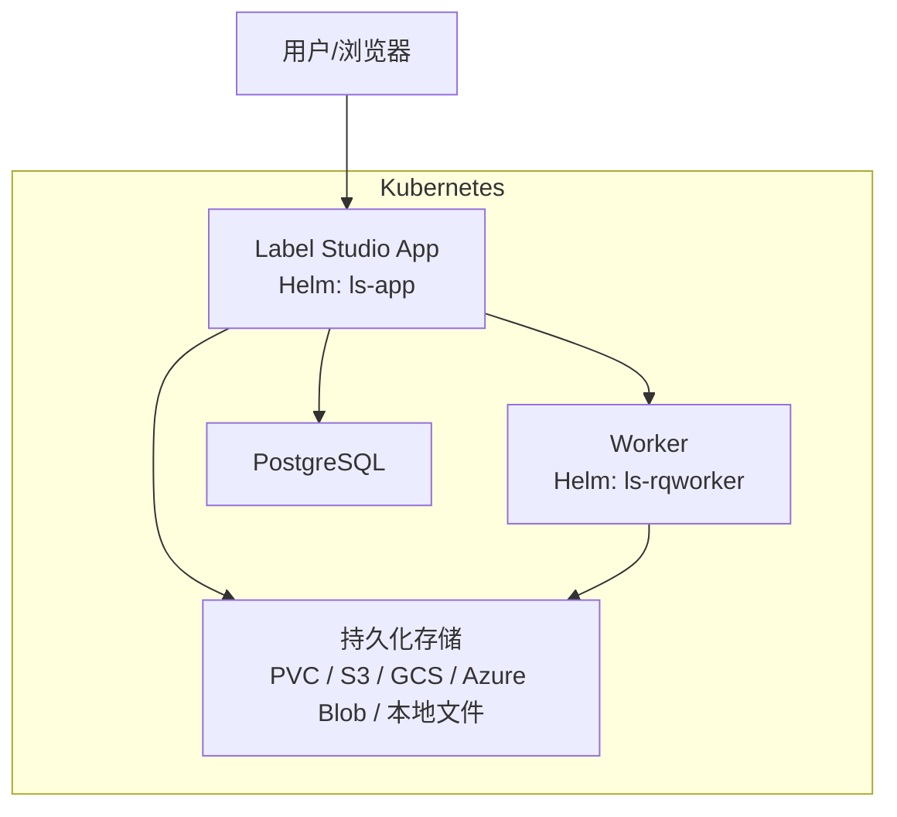
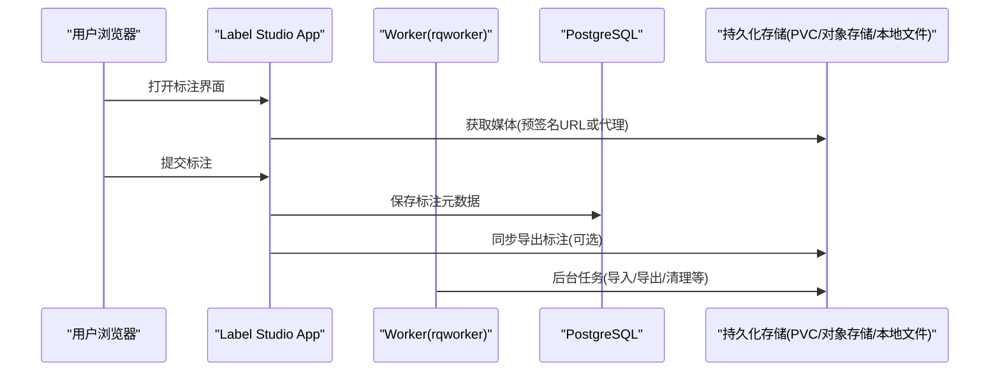
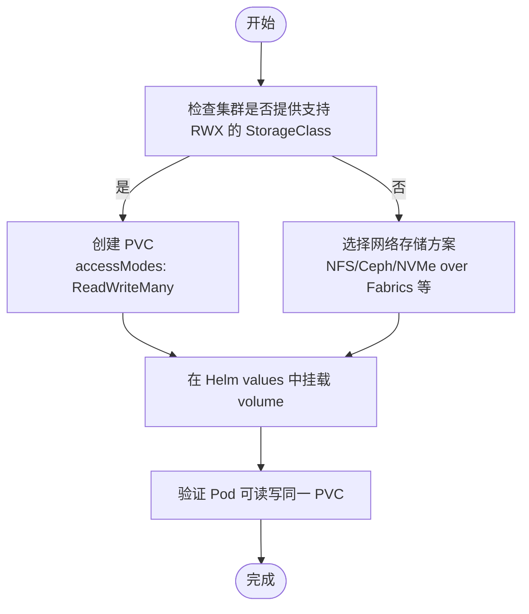
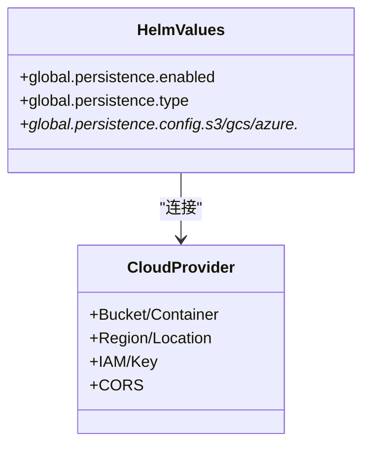
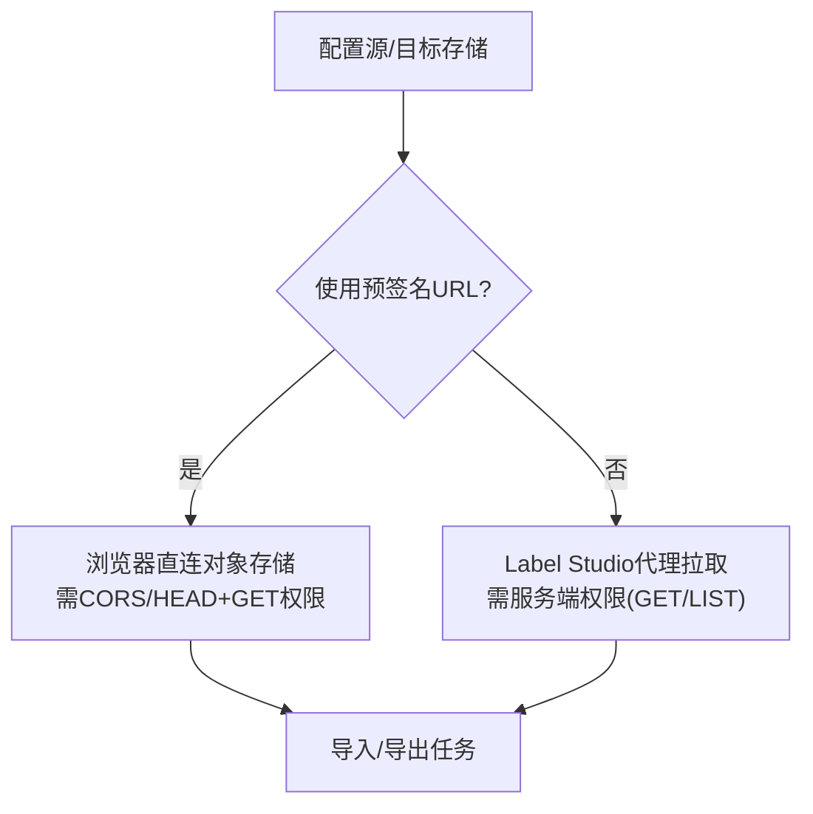
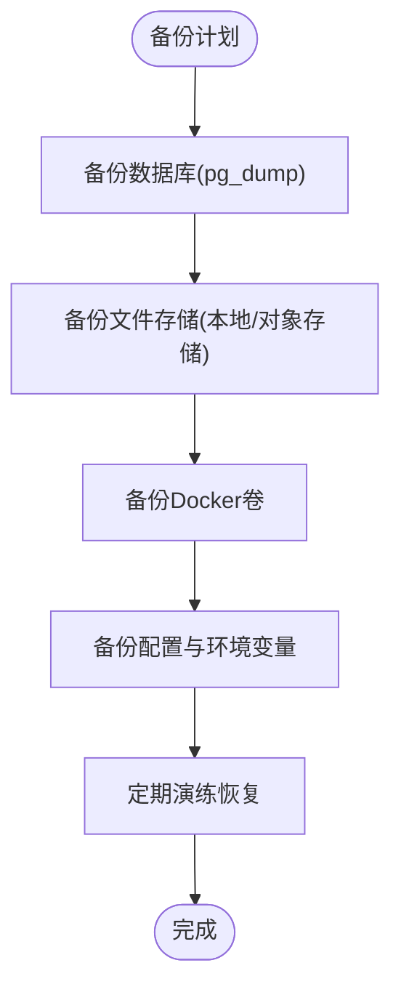
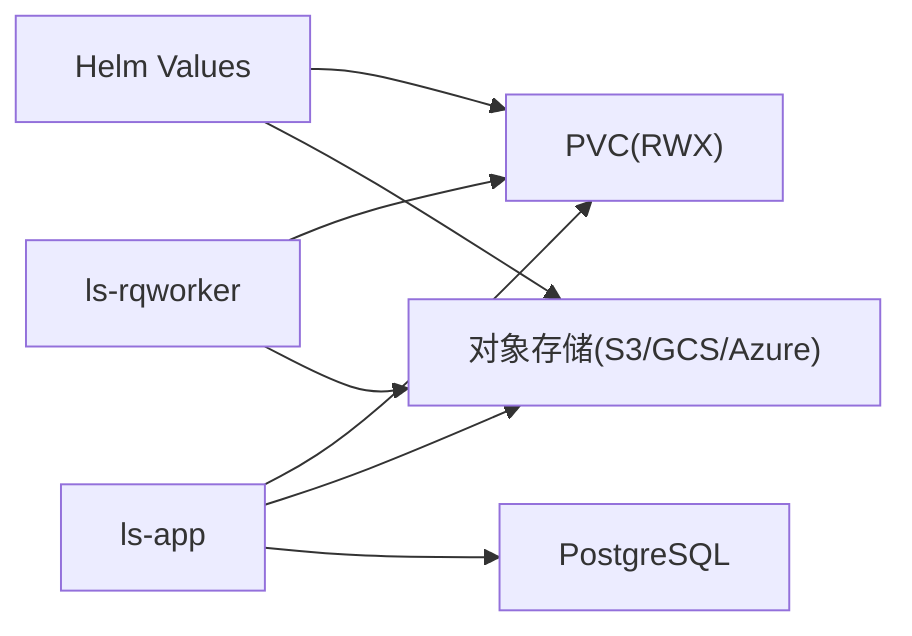

# 持久化存储配置

<cite>
**本文引用的文件**   
- [persistent_storage.md](file://docs/source/guide/persistent_storage.md)
- [install_k8s.md](file://docs/source/guide/install_k8s.md)
- [storage.md](file://docs/source/guide/storage.md)
- [storage_local.md](file://docs/source/guide/storage_local.md)
- [backup_enterprise.md](file://docs/source/guide/backup_enterprise.md)
</cite>

## 目录
1. [简介](#简介)
2. [项目结构](#项目结构)
3. [核心组件](#核心组件)
4. [架构总览](#架构总览)
5. [详细组件分析](#详细组件分析)
6. [依赖关系分析](#依赖关系分析)
7. [性能与容量规划](#性能与容量规划)
8. [故障排查指南](#故障排查指南)
9. [结论](#结论)
10. [附录：云厂商与存储类型对照](#附录云厂商与存储类型对照)

## 简介
本指南聚焦于在 Kubernetes 中为 Label Studio 配置持久化存储，重点包括：
- PVC（PersistentVolumeClaim）的创建与使用、访问模式选择（ReadWriteMany）、StorageClass 与容量规划
- 不同云提供商（AWS EBS、Azure Disk、GCP PD）在块存储上的差异与注意事项
- 本地存储与网络存储（NFS、Ceph/RWX）的配置思路
- 数据备份与恢复策略（数据库、对象存储、卷快照、迁移方案）
- 存储性能优化建议与监控指标

说明：Label Studio 官方文档提供了两类“持久化”概念：
- 应用级持久化：通过 Helm Chart 的 persistence.config.volume 挂载 PVC，供多 Pod 共享读写（如 app 与 rqworker）
- 数据层持久化：将任务媒体与标注结果落盘到对象存储（S3/GCS/Azure Blob）或本地文件系统

本指南同时覆盖这两类场景，并给出可操作的步骤与最佳实践。

## 项目结构
与持久化相关的官方文档主要位于 docs/source/guide 下：
- persistent_storage.md：Kubernetes PVC、S3/GCS/Azure 作为持久化后端
- install_k8s.md：Kubernetes 安装与容量规划
- storage.md：外部存储集成（源/目标存储、预签名 URL 与代理）
- storage_local.md：本地文件存储配置
- backup_enterprise.md：企业版本地部署的备份清单

图表来源
- [install_k8s.md:25-38](file://docs/source/guide/install_k8s.md#L25-L38)
- [persistent_storage.md:26-45](file://docs/source/guide/persistent_storage.md#L26-L45)

章节来源
- [install_k8s.md:25-38](file://docs/source/guide/install_k8s.md#L25-L38)
- [persistent_storage.md:26-45](file://docs/source/guide/persistent_storage.md#L26-L45)

## 核心组件
- Helm Chart 持久化配置：通过 global.persistence.type=volume 与 accessModes=ReadWriteMany 启用 PVC
- 对象存储后端：S3/GCS/Azure Blob，可作为应用持久化或数据源/目标
- 本地文件存储：LABEL_STUDIO_LOCAL_FILES_SERVING_ENABLED + DOCUMENT_ROOT
- 数据库：PostgreSQL（可选 TLS）
- 备份与恢复：数据库、文件存储、Docker 卷、环境变量与配置

章节来源
- [persistent_storage.md:26-45](file://docs/source/guide/persistent_storage.md#L26-L45)
- [storage.md:14-33](file://docs/source/guide/storage.md#L14-L33)
- [storage_local.md:28-43](file://docs/source/guide/storage_local.md#L28-L43)
- [install_k8s.md:95-121](file://docs/source/guide/install_k8s.md#L95-L121)

## 架构总览
Label Studio 在 Kubernetes 中的典型数据流：
- 用户上传/下载媒体：默认由 Nginx 提供静态资源服务；若禁用 Nginx，则由 uwsgi worker 直接处理大文件，可能增加负载
- 标注数据写入：数据库 + 可选的目标存储（对象存储或本地文件）
- 任务媒体读取：可通过预签名 URL 直连对象存储，或通过 Label Studio 代理拉取

图表来源
- [persistent_storage.md:14-18](file://docs/source/guide/persistent_storage.md#L14-L18)
- [storage.md:185-281](file://docs/source/guide/storage.md#L185-L281)

## 详细组件分析

### Kubernetes PVC 配置（应用级持久化）
- 必须支持 ReadWriteMany（RWX），以便多个 Pod（app、rqworker）同时读写同一份数据
- 通过 Helm values 设置 persistence.config.volume.accessModes 为 ReadWriteMany
- 集群需提供支持 RWX 的 StorageClass（例如 NFS、EFS、Azure Files 或其他网络存储）

图表来源
- [persistent_storage.md:26-45](file://docs/source/guide/persistent_storage.md#L26-L45)

章节来源
- [persistent_storage.md:26-45](file://docs/source/guide/persistent_storage.md#L26-L45)

### 云厂商块存储（AWS EBS、Azure Disk、GCP PD）的差异
- 大多数云默认块存储仅支持 ReadWriteOnce（RWO），不适合多 Pod 共享
- 当需要多 Pod 共享时，应改用云厂商提供的网络文件系统（如 AWS FSx for Lustre/Windows File Server、Azure Files、GCP Filestore）或第三方 RWX 存储（NFS/Ceph）
- 对于单 Pod 独占写且无需共享的场景，可使用 RWO 块存储提升 IOPS/吞吐

注意：官方文档强调 PVC 需 ReadWriteMany，因此标准云盘通常不满足多 Pod 共享需求。

章节来源
- [persistent_storage.md:26-45](file://docs/source/guide/persistent_storage.md#L26-L45)

### 对象存储作为持久化后端（S3/GCS/Azure Blob）
- 可将对象存储作为 Label Studio 的持久化后端，用于任务媒体与导出结果
- 认证方式：
  - AWS：IAM Role（OIDC/EKS）、Access Keys、Node IAM Role、Docker Compose
  - GCP：Workload Identity、Service Account Key、Docker Compose
  - Azure：Account Key（Kubernetes Secret 或直接配置）、Docker Compose
- CORS 配置：如需前端直传/直读媒体，需按各云要求配置 CORS

图表来源
- [persistent_storage.md:47-340](file://docs/source/guide/persistent_storage.md#L47-L340)
- [persistent_storage.md:342-502](file://docs/source/guide/persistent_storage.md#L342-L502)
- [persistent_storage.md:505-603](file://docs/source/guide/persistent_storage.md#L505-L603)

章节来源
- [persistent_storage.md:47-340](file://docs/source/guide/persistent_storage.md#L47-L340)
- [persistent_storage.md:342-502](file://docs/source/guide/persistent_storage.md#L342-L502)
- [persistent_storage.md:505-603](file://docs/source/guide/persistent_storage.md#L505-L603)

### 本地文件存储（Local Files）
- 适用场景：本地开发、小规模部署、对延迟敏感的内网环境
- 关键环境变量：
  - LABEL_STUDIO_LOCAL_FILES_SERVING_ENABLED=true
  - LABEL_STUDIO_LOCAL_FILES_DOCUMENT_ROOT=根目录
- 在 UI 中配置 Local Files 源/目标存储，指定绝对路径与过滤规则
- 安全提示：本地文件系统暴露存在安全风险，需谨慎配置权限

章节来源
- [storage_local.md:28-43](file://docs/source/guide/storage_local.md#L28-L43)
- [storage_local.md:109-161](file://docs/source/guide/storage_local.md#L109-L161)
- [storage_local.md:275-306](file://docs/source/guide/storage_local.md#L275-L306)

### 外部存储集成（源/目标存储、预签名 URL 与代理）
- 源存储：从外部存储扫描/导入任务（Files/Tasks 两种导入方式）
- 目标存储：将标注结果导出至外部存储
- 访问模式：
  - 预签名 URL：浏览器直连对象存储，减少 Label Studio 带宽压力
  - 代理模式：Label Studio 服务端拉取并流式转发给浏览器，适合内网安全边界

图表来源
- [storage.md:34-53](file://docs/source/guide/storage.md#L34-L53)
- [storage.md:185-281](file://docs/source/guide/storage.md#L185-L281)

章节来源
- [storage.md:34-53](file://docs/source/guide/storage.md#L34-L53)
- [storage.md:185-281](file://docs/source/guide/storage.md#L185-L281)

### 数据备份与恢复策略
- 数据库：使用 pg_dump 等工具备份 PostgreSQL
- 文件存储：本地文件或已同步的对象存储均需备份
- Docker 卷：包含数据库数据、媒体上传等持久数据
- 配置与环境变量：保存 label-studio 配置文件、自定义脚本、ML 模型与环境变量
- 定期演练恢复流程，并将备份存放于异地安全位置，必要时加密

图表来源
- [backup_enterprise.md:15-32](file://docs/source/guide/backup_enterprise.md#L15-L32)

章节来源
- [backup_enterprise.md:15-32](file://docs/source/guide/backup_enterprise.md#L15-L32)

## 依赖关系分析
- Helm Chart 与持久化：
  - persistence.enabled/type/config 控制是否启用 PVC 或对象存储
  - app/rqworker 均依赖持久化存储以共享数据
- 外部存储依赖：
  - 对象存储（S3/GCS/Azure）需要正确的 IAM/Key 与 CORS 配置
  - 代理模式需要服务端具备读取对象的权限
- 数据库依赖：
  - PostgreSQL 可选 TLS，证书通过 Kubernetes Secret 注入

图表来源
- [persistent_storage.md:26-45](file://docs/source/guide/persistent_storage.md#L26-L45)
- [install_k8s.md:95-121](file://docs/source/guide/install_k8s.md#L95-L121)

章节来源
- [persistent_storage.md:26-45](file://docs/source/guide/persistent_storage.md#L26-L45)
- [install_k8s.md:95-121](file://docs/source/guide/install_k8s.md#L95-L121)

## 性能与容量规划
- 容量规划（Pod 资源）：
  - 默认 app 副本数为 1，requests/limits 与 CPU/Memory 可按并发标注人数与可用性要求调整
  - 生产环境建议副本数不小于可用区数量
- 存储性能：
  - 对象存储：优先选择靠近团队地理位置的区域以降低延迟
  - 代理模式：大文件按 8MB 分片顺序传输，频繁请求会增加后端负载；可调参数包括最大范围大小与超时时间
  - 本地文件：避免跨网络文件系统的大规模并发 IO，必要时使用高性能 NVMe 或分布式文件系统
- 监控指标建议：
  - 存储侧：IOPS、吞吐、延迟、错误率、配额使用率
  - 应用侧：uWSGI worker 请求耗时、队列积压、导出/导入任务时长
  - 对象存储：API 调用次数、4xx/5xx 错误、预签名 URL 命中率

章节来源
- [install_k8s.md:49-76](file://docs/source/guide/install_k8s.md#L49-L76)
- [storage.md:274-281](file://docs/source/guide/storage.md#L274-L281)

## 故障排查指南
- 外部存储连接问题：
  - 确认 IAM/Key 权限正确（List/Get/Put/Delete 等）
  - 若使用预签名 URL，确保 CORS 与 HEAD/GET 权限
  - 若使用代理模式，确认服务端具备读取对象权限
- 导入/导出一致性：
  - 源存储单向同步，变更不会自动反向同步
  - Tasks 模式下，文件被视为不可变；更新需新文件名或删除后重同步
- 大文件代理：
  - 关注 RESOLVER_PROXY_MAX_RANGE_SIZE 与 RESOLVER_PROXY_TIMEOUT 参数
- 备份与恢复：
  - 定期测试恢复流程，确保备份有效
  - 备份数据库、文件存储、Docker 卷、配置与环境变量

章节来源
- [storage.md:298-313](file://docs/source/guide/storage.md#L298-L313)
- [storage.md:274-281](file://docs/source/guide/storage.md#L274-L281)
- [backup_enterprise.md:15-32](file://docs/source/guide/backup_enterprise.md#L15-L32)

## 结论
- 在 Kubernetes 中，Label Studio 的持久化存储首选支持 ReadWriteMany 的网络存储（NFS/Ceph/云厂商文件服务）
- 对象存储（S3/GCS/Azure Blob）是推荐的数据持久化与导入/导出后端，配合预签名 URL 可降低后端压力
- 本地文件存储适用于小规模或内网场景，但需注意安全与性能
- 建立完善的备份与恢复流程，涵盖数据库、文件存储、卷与配置，并定期演练
- 根据业务规模进行容量规划与性能调优，结合监控指标持续优化

## 附录：云厂商与存储类型对照
- AWS
  - 对象存储：S3（推荐）
  - 块存储：EBS（通常 RWO，不适合多 Pod 共享）
  - 文件服务：FSx for Lustre/Windows File Server（RWX）
- Azure
  - 对象存储：Blob Storage（推荐）
  - 块存储：Managed Disks（通常 RWO）
  - 文件服务：Azure Files（RWX）
- GCP
  - 对象存储：GCS（推荐）
  - 块存储：PD（通常 RWO）
  - 文件服务：Filestore（RWX）

[本节为概念性对照，不直接分析具体代码文件]