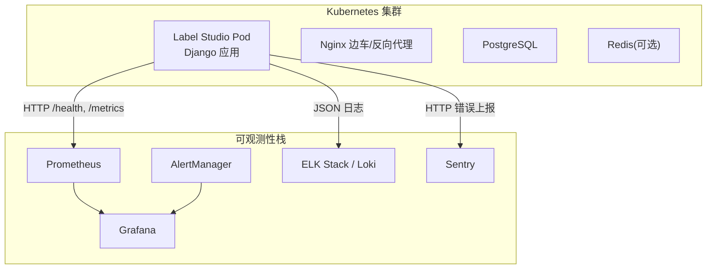
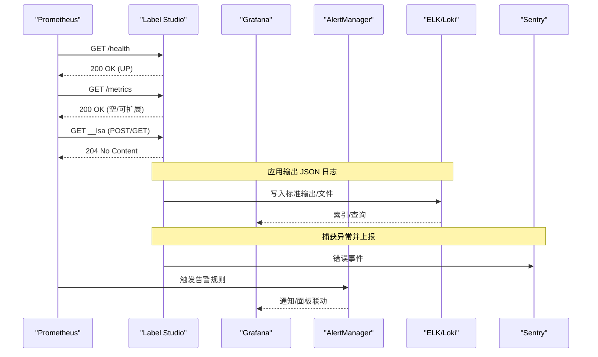
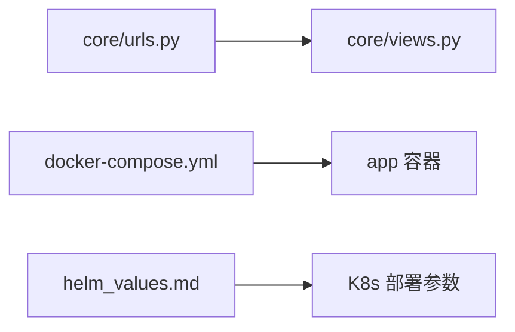

# 监控告警集成

<cite>
**本文引用的文件**   
- [label_studio/core/urls.py](file://label_studio/core/urls.py)
- [label_studio/core/views.py](file://label_studio/core/views.py)
- [docker-compose.yml](file://docker-compose.yml)
- [docs/source/guide/install_k8s.md](file://docs/source/guide/install_k8s.md)
- [docs/source/guide/helm_values.md](file://docs/source/guide/helm_values.md)
</cite>

## 目录
1. [简介](#简介)
2. [项目结构](#项目结构)
3. [核心组件](#核心组件)
4. [架构总览](#架构总览)
5. [详细组件分析](#详细组件分析)
6. [依赖关系分析](#依赖关系分析)
7. [性能考虑](#性能考虑)
8. [故障排查指南](#故障排查指南)
9. [结论](#结论)
10. [附录](#附录)

## 简介
本指南面向在 Kubernetes 环境下部署 Label Studio 的团队，提供完整的监控、日志与告警集成方案。内容涵盖：
- Prometheus 指标采集配置（应用指标暴露、自定义指标定义、服务发现）
- Grafana 仪表板与关键指标可视化建议
- AlertManager 告警规则（CPU、内存、磁盘、业务异常等）
- 日志收集方案（ELK Stack、Loki）
- 错误追踪集成（Sentry）
- 性能监控与优化建议

## 项目结构
Label Studio 后端通过 Django URL 路由暴露健康检查与轻量级指标端点；容器编排示例中启用 JSON 日志输出，便于日志系统采集。Helm Chart 文档提供了 K8s 部署所需的资源请求/限制、探针与 Ingress 等参数，可作为监控与可观测性集成的基础。

图表来源
- [label_studio/core/urls.py:71-103](file://label_studio/core/urls.py#L71-L103)
- [label_studio/core/views.py:70-78](file://label_studio/core/views.py#L70-L78)
- [docker-compose.yml:27-53](file://docker-compose.yml#L27-L53)

章节来源
- [label_studio/core/urls.py:71-103](file://label_studio/core/urls.py#L71-L103)
- [label_studio/core/views.py:70-78](file://label_studio/core/views.py#L70-L78)
- [docker-compose.yml:27-53](file://docker-compose.yml#L27-L53)

## 核心组件
- 健康检查端点：/health，返回 UP 状态，供 Liveness/Readiness 探针使用
- 指标端点：/metrics（当前为空响应），用于占位或扩展
- 前端使用指标收集端点：__lsa（POST/GET），默认返回 204，仅在启用 COLLECT_ANALYTICS 时生效
- JSON 日志：通过环境变量开启，便于集中式日志采集

章节来源
- [label_studio/core/urls.py:71-103](file://label_studio/core/urls.py#L71-L103)
- [label_studio/core/views.py:70-78](file://label_studio/core/views.py#L70-L78)
- [label_studio/core/views.py:214-218](file://label_studio/core/views.py#L214-L218)
- [docker-compose.yml:37-53](file://docker-compose.yml#L37-L53)

## 架构总览
下图展示 Prometheus、Grafana、AlertManager、日志系统与错误追踪如何与 Label Studio 集成。

图表来源
- [label_studio/core/urls.py:71-103](file://label_studio/core/urls.py#L71-L103)
- [label_studio/core/views.py:70-78](file://label_studio/core/views.py#L70-L78)
- [label_studio/core/views.py:214-218](file://label_studio/core/views.py#L214-L218)

## 详细组件分析

### Prometheus 指标采集配置
- 目标抓取
  - 将 Prometheus 的 scrape_configs 指向 Label Studio Service 的 /metrics 路径
  - 若使用 K8s ServiceMonitor/CRD，确保 namespace、labels 与 selector 匹配
- 应用指标暴露
  - /metrics 当前为空响应，可在后端视图扩展为 Python metrics（如 prometheus_client）
  - /health 可用于 Liveness/Readiness 探针，也可作为可用性指标源
- 自定义指标定义
  - 建议在业务关键路径（任务创建、标注提交、导入导出、ML 调用）埋点，暴露计数器、直方图、摘要等指标
  - 指标命名遵循组织规范，添加 label（如 project_id、task_type、status）
- 服务发现
  - 基于 K8s Endpoints/ServiceMonitor 自动发现 Pod
  - 对多副本场景，确保每个 Pod 独立暴露指标

章节来源
- [label_studio/core/urls.py:71-103](file://label_studio/core/urls.py#L71-L103)
- [label_studio/core/views.py:70-78](file://label_studio/core/views.py#L70-L78)

### Grafana 仪表板配置
- 数据源
  - 添加 Prometheus 数据源，验证连接与基本查询
- 预定义面板建议
  - 系统资源：CPU、内存、磁盘 I/O、网络吞吐
  - 应用健康：/health 成功率、延迟分布
  - 业务指标：任务创建速率、标注完成数、导入导出耗时、错误率
  - 队列与工作器：RQ 队列长度、处理时长（如启用 Enterprise RQworker）
- 模板与变量
  - 使用 namespace、pod、project_id 等变量实现多维筛选
- 共享与版本化
  - 将 Dashboard JSON 纳入 Git 管理，配合 Helm ConfigMap/Secret 注入

[本节为概念性说明，不直接分析具体文件]

### AlertManager 告警规则配置
- 系统级告警
  - CPU 使用率持续高于阈值（如 >80% 持续 5 分钟）
  - 内存使用率持续高于阈值（如 >85% 持续 5 分钟）
  - 磁盘使用率超过阈值（如 >90%）
  - Pod CrashLoopBackOff、Node NotReady
- 应用级告警
  - /health 失败或延迟升高
  - /metrics 不可达或返回异常
  - 业务指标异常：任务创建失败率、标注提交错误率、导入导出失败率突增
- 通知渠道
  - 邮件、企业微信、钉钉、Slack、Webhook 等
- 抑制与静默
  - 针对已知维护窗口设置静默
  - 对关联告警进行抑制，避免风暴

[本节为概念性说明，不直接分析具体文件]

### 日志收集方案（ELK Stack、Loki）
- 应用日志
  - 通过环境变量启用 JSON 日志格式，便于结构化解析
  - 将标准输出重定向到文件系统或 stdout，由 DaemonSet/Fluent Bit/Filebeat 采集
- ELK Stack
  - Elasticsearch + Logstash/Kafka + Kibana
  - 适合复杂过滤、聚合与全文检索
- Loki
  - 轻量、低成本，与 Promtail/Fluent Bit 集成
  - 与 Prometheus 标签体系对齐，便于联合查询
- 日志级别与采样
  - 生产环境建议 INFO/WARN，DEBUG 按需开启
  - 对高频日志进行采样或过滤，降低存储压力

章节来源
- [docker-compose.yml:37-53](file://docker-compose.yml#L37-L53)

### 错误追踪集成（Sentry）
- 集成方式
  - 在后端初始化 Sentry SDK，配置 DSN 与环境信息
  - 捕获未处理异常、HTTP 错误、数据库错误等
- 上下文增强
  - 附加用户、项目、任务 ID、Trace ID 等上下文
- 告警联动
  - 将 Sentry 告警与 AlertManager 或通知系统集成
- 性能剖析
  - 结合事务与性能追踪，定位慢接口与瓶颈

[本节为概念性说明，不直接分析具体文件]

### 性能监控与优化建议
- 资源规划
  - 根据并发标注人数调整 requests/limits 与副本数
  - 参考 Helm Chart 默认值与容量规划建议
- 探针调优
  - 合理设置 initialDelaySeconds、periodSeconds、failureThreshold
- 缓存与异步
  - 使用 Redis 做会话/缓存，提升热点数据访问
  - 使用 RQ 队列异步处理导入导出、ML 推理等耗时任务
- 存储与 I/O
  - 使用对象存储（S3/Azure/GCS）替代本地持久卷
  - 合理设置分片与并发，避免单点瓶颈
- 指标埋点
  - 对关键路径增加延迟直方图与错误计数，便于定位性能问题

章节来源
- [docs/source/guide/install_k8s.md:49-76](file://docs/source/guide/install_k8s.md#L49-L76)
- [docs/source/guide/helm_values.md:130-213](file://docs/source/guide/helm_values.md#L130-L213)

## 依赖关系分析
- URL 路由与视图
  - /health、/metrics、__lsa 等端点在 urls.py 中注册，对应 views.py 中的处理函数
- 容器编排
  - docker-compose.yml 展示了 app 与 nginx 的关系，以及 JSON 日志的环境变量开关
- Helm Chart
  - helm_values.md 提供 App/Rqworker 的资源、探针、Ingress 等参数，支撑 K8s 部署与可观测性集成

图表来源
- [label_studio/core/urls.py:71-103](file://label_studio/core/urls.py#L71-L103)
- [label_studio/core/views.py:70-78](file://label_studio/core/views.py#L70-L78)
- [docker-compose.yml:27-53](file://docker-compose.yml#L27-L53)
- [docs/source/guide/helm_values.md:130-213](file://docs/source/guide/helm_values.md#L130-L213)

章节来源
- [label_studio/core/urls.py:71-103](file://label_studio/core/urls.py#L71-L103)
- [label_studio/core/views.py:70-78](file://label_studio/core/views.py#L70-L78)
- [docker-compose.yml:27-53](file://docker-compose.yml#L27-L53)
- [docs/source/guide/helm_values.md:130-213](file://docs/source/guide/helm_values.md#L130-L213)

## 性能考虑
- 副本与水平扩展
  - 多副本下确保无状态设计，会话与缓存外置
- 资源配额
  - 依据负载模型设定 requests/limits，避免 OOMKill 与 CPU Throttling
- 探针与自愈
  - 合理配置 Liveness/Readiness，避免误杀与滚动更新抖动
- 指标粒度
  - 控制指标 cardinality，避免高基数导致 Prometheus 性能下降
- 日志保留策略
  - 设置合理的保留期与压缩策略，平衡成本与可追溯性

[本节为概念性说明，不直接分析具体文件]

## 故障排查指南
- /health 不可用
  - 检查 Pod 状态、探针配置、应用启动顺序
- /metrics 为空
  - 确认是否已扩展指标暴露逻辑；必要时引入 prometheus_client
- JSON 日志缺失
  - 检查环境变量是否启用 JSON_LOG，确认日志输出路径与采集器配置
- 告警风暴
  - 检查 AlertManager 抑制规则与通知去重策略
- 性能退化
  - 查看 CPU/内存/磁盘指标，结合业务指标定位瓶颈

章节来源
- [label_studio/core/views.py:70-78](file://label_studio/core/views.py#L70-L78)
- [docker-compose.yml:37-53](file://docker-compose.yml#L37-L53)

## 结论
通过在 Label Studio 上暴露健康与指标端点、启用 JSON 日志，并结合 Prometheus、Grafana、AlertManager、ELK/Loki 与 Sentry，可以构建完整的可观测性与告警体系。借助 Helm Chart 提供的部署参数，可以在 Kubernetes 环境中快速落地并持续优化。

[本节为总结性内容，不直接分析具体文件]

## 附录
- 关键端点
  - /health：健康检查
  - /metrics：指标（可扩展）
  - __lsa：前端使用指标收集（默认 204）
- Helm 相关参数
  - App 资源请求/限制、探针、Ingress、ServiceAccount 等
  - RQworker 队列与副本配置（Enterprise）

章节来源
- [label_studio/core/urls.py:71-103](file://label_studio/core/urls.py#L71-L103)
- [label_studio/core/views.py:70-78](file://label_studio/core/views.py#L70-L78)
- [label_studio/core/views.py:214-218](file://label_studio/core/views.py#L214-L218)
- [docs/source/guide/helm_values.md:130-213](file://docs/source/guide/helm_values.md#L130-L213)