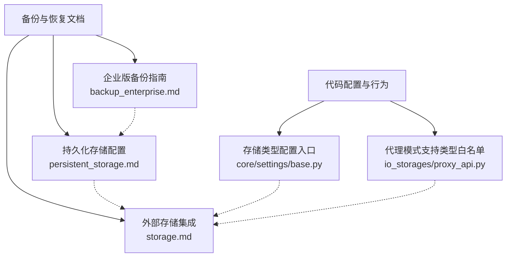
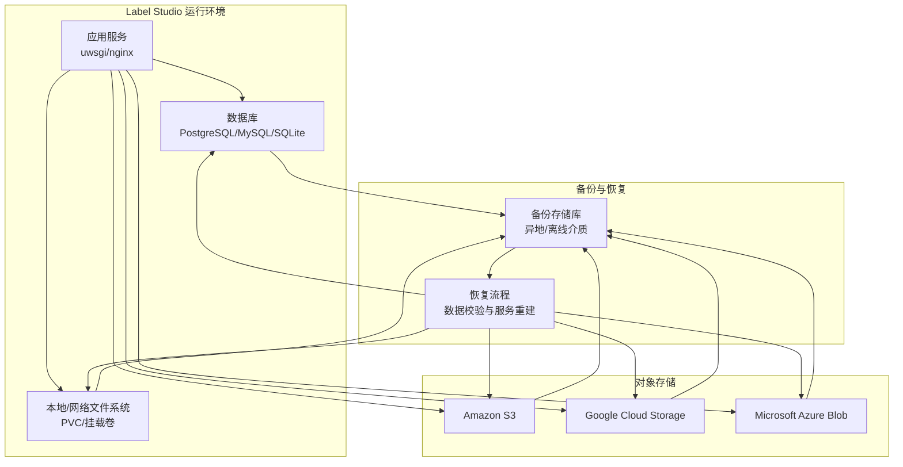
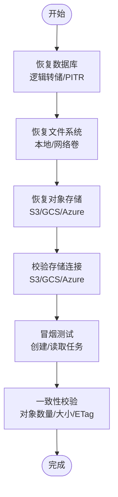
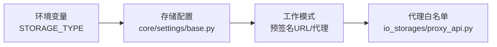

# 备份恢复

<cite>
**本文引用的文件**   
- [backup_enterprise.md](file://docs/source/guide/backup_enterprise.md)
- [persistent_storage.md](file://docs/source/guide/persistent_storage.md)
- [storage.md](file://docs/source/guide/storage.md)
- [base.py](file://label_studio/core/settings/base.py)
- [proxy_api.py](file://label_studio/io_storages/proxy_api.py)
</cite>

## 目录
1. [简介](#简介)
2. [项目结构](#项目结构)
3. [核心组件](#核心组件)
4. [架构总览](#架构总览)
5. [详细组件分析](#详细组件分析)
6. [依赖关系分析](#依赖关系分析)
7. [性能考虑](#性能考虑)
8. [故障排查指南](#故障排查指南)
9. [结论](#结论)
10. [附录](#附录)

## 简介
本指南面向在本地或私有环境部署 Label Studio 的运维与数据管理团队，提供一套完整的备份与灾难恢复方案。内容覆盖：
- 数据库备份策略（全量、增量、逻辑备份）
- 对象存储数据的备份方法（S3、Azure Blob、GCS）
- 文件系统数据的备份策略（标注结果、配置文件、上传媒体等）
- 灾难恢复流程（数据恢复、服务重建、一致性验证）
- 备份自动化脚本编写与调度
- 备份数据的加密与传输安全

本指南基于仓库中的企业版备份文档、持久化存储配置文档以及外部存储集成文档进行系统化整理，并结合代码中对存储类型与代理模式的实现要点给出可操作的实践建议。

## 项目结构
围绕备份与恢复，Label Studio 相关的关键文档与代码分布如下：
- 企业版备份指南：概述了数据库、文件存储、配置文件、环境变量、Docker 卷及版本记录的备份要点
- 持久化存储配置：涵盖 Kubernetes PVC、Amazon S3、Google Cloud Storage、Microsoft Azure Storage 的配置与权限
- 外部存储集成：说明源存储与目标存储的工作模式、预签名 URL 与代理模式差异、权限要求与注意事项
- 代码侧配置入口：通过环境变量控制存储后端类型；代理模式对支持的存储类型有白名单限制

图示来源
- [backup_enterprise.md:15-32](file://docs/source/guide/backup_enterprise.md#L15-L32)
- [persistent_storage.md:26-603](file://docs/source/guide/persistent_storage.md#L26-L603)
- [storage.md:34-290](file://docs/source/guide/storage.md#L34-L290)
- [base.py:958-987](file://label_studio/core/settings/base.py#L958-L987)
- [proxy_api.py:35-64](file://label_studio/io_storages/proxy_api.py#L35-L64)

章节来源
- [backup_enterprise.md:15-32](file://docs/source/guide/backup_enterprise.md#L15-L32)
- [persistent_storage.md:26-603](file://docs/source/guide/persistent_storage.md#L26-L603)
- [storage.md:34-290](file://docs/source/guide/storage.md#L34-L290)
- [base.py:958-987](file://label_studio/core/settings/base.py#L958-L987)
- [proxy_api.py:35-64](file://label_studio/io_storages/proxy_api.py#L35-L64)

## 核心组件
- 数据库层
  - 使用 PostgreSQL、MySQL 或 SQLite（由环境变量决定），需分别制定备份策略
  - 推荐采用逻辑备份工具（如 pg_dump）生成 SQL 转储，便于跨版本迁移与选择性恢复
- 对象存储层
  - 支持 Amazon S3、Google Cloud Storage、Microsoft Azure Blob
  - 可通过 Helm/Kubernetes 或 Docker Compose 配置存储桶、区域、文件夹、鉴权方式（访问密钥或服务角色）
- 文件系统层
  - 本地文件或网络共享（Kubernetes PVC ReadWriteMany）作为持久化存储
  - 媒体文件、导出结果、插件与模型等需纳入备份范围
- 代理与直连模式
  - 预签名 URL 模式：浏览器直接访问云存储，减少后端负载
  - 代理模式：后端流式转发，适合内网隔离与统一出口场景

章节来源
- [persistent_storage.md:26-603](file://docs/source/guide/persistent_storage.md#L26-L603)
- [storage.md:186-290](file://docs/source/guide/storage.md#L186-L290)

## 架构总览
下图展示备份与恢复涉及的系统边界与关键路径：应用服务、数据库、对象存储、本地/网络文件系统、备份存储库之间的交互。

图示来源
- [persistent_storage.md:26-603](file://docs/source/guide/persistent_storage.md#L26-L603)
- [storage.md:34-290](file://docs/source/guide/storage.md#L34-L290)

## 详细组件分析

### 数据库备份策略
- 全量备份
  - 使用逻辑备份工具（例如 PostgreSQL 的 pg_dump）定期生成完整 SQL 转储
  - 适用于首次初始化、重大变更前后或周期性归档
- 增量/连续备份
  - 对于 PostgreSQL，可使用 WAL 归档配合时间点恢复（PITR）
  - 对于 MySQL，可采用 binlog 增量复制与时间点恢复
- 逻辑备份与物理备份结合
  - 逻辑备份便于跨版本迁移与选择性恢复
  - 物理备份用于快速恢复大体积数据（结合对象存储快照）

实施要点
- 将数据库转储文件压缩并加密后上传至异地备份存储
- 记录每次备份的时间戳、版本号与校验和，便于恢复时选择正确快照

章节来源
- [backup_enterprise.md:17-23](file://docs/source/guide/backup_enterprise.md#L17-L23)

### 对象存储数据备份（S3、Azure Blob、GCS）
- 备份方法
  - 使用云厂商提供的同步/复制工具（如 aws s3 sync、gsutil cp/rsync、azcopy）将桶内对象复制到异地桶或冷存储
  - 利用云厂商的对象版本控制与生命周期策略，保留历史版本与归档副本
- 权限与安全
  - 为备份账号授予只读权限（ListBucket、GetObject 等）
  - 启用传输加密（HTTPS/TLS）与静态加密（服务端加密）

实施要点
- 按项目或业务域划分桶/前缀，避免不同项目数据混放
- 定期执行一致性校验（对象数量、大小、ETag/MD5）

章节来源
- [persistent_storage.md:47-603](file://docs/source/guide/persistent_storage.md#L47-L603)
- [storage.md:34-290](file://docs/source/guide/storage.md#L34-L290)

### 文件系统数据备份（标注结果、配置文件、上传文件）
- 备份范围
  - 标注结果与导出文件（若未写入目标存储）
  - 配置文件与环境变量（数据库连接、存储凭据、功能开关）
  - 上传媒体文件（图片、音频、视频等）
  - Docker 卷（数据库数据、媒体上传、插件与模型）
- 备份策略
  - 对本地/网络文件系统使用 rsync 或快照工具（如 LVM/ZFS 快照）
  - 对 Kubernetes PVC，确保使用支持 ReadWriteMany 的存储类，并在 Pod 外进行快照或拷贝

实施要点
- 将文件系统备份与对象存储备份统一归档到异地存储库
- 记录版本与变更日志，便于回滚与审计

章节来源
- [backup_enterprise.md:19-27](file://docs/source/guide/backup_enterprise.md#L19-L27)
- [persistent_storage.md:26-46](file://docs/source/guide/persistent_storage.md#L26-L46)

### 灾难恢复流程
- 数据恢复
  - 先恢复数据库（逻辑转储导入或 PITR 恢复到指定时间点）
  - 再恢复文件系统与对象存储（从备份存储库拉取最新一致快照）
- 服务重建
  - 根据配置文档重建应用服务、反向代理与任务队列
  - 校验环境变量与存储连接（S3/GCS/Azure）是否可用
- 一致性验证
  - 比对数据库记录与对象存储对象数量/大小
  - 抽样验证媒体文件可访问性与完整性
  - 执行最小化标注任务流程，确认端到端可用性

图示来源
- [backup_enterprise.md:15-32](file://docs/source/guide/backup_enterprise.md#L15-L32)
- [persistent_storage.md:47-603](file://docs/source/guide/persistent_storage.md#L47-L603)
- [storage.md:34-290](file://docs/source/guide/storage.md#L34-L290)

章节来源
- [backup_enterprise.md:15-32](file://docs/source/guide/backup_enterprise.md#L15-L32)

### 备份自动化脚本与调度
- 脚本设计
  - 数据库：封装 pg_dump/mysql 逻辑备份命令，输出带时间戳的压缩文件，计算校验和
  - 对象存储：调用云 CLI 进行增量同步，记录差异日志
  - 文件系统：使用 rsync 或快照工具，排除临时文件与缓存
  - 上传与清理：将备份上传至异地存储库，删除过期快照
- 调度机制
  - 使用 cron/systemd timer 或 Kubernetes CronJob 定时执行
  - 失败重试与告警通知（邮件/IM）

实施要点
- 所有敏感信息（数据库密码、访问密钥）通过环境变量或密钥管理服务注入
- 脚本幂等设计，支持断点续传与重复执行不产生副作用

章节来源
- [backup_enterprise.md:15-32](file://docs/source/guide/backup_enterprise.md#L15-L32)

### 备份数据加密与传输安全
- 静态加密
  - 备份文件在落盘前使用对称加密（如 AES-256）
  - 对象存储开启服务端加密（SSE-S3/SSE-KMS 等）
- 传输加密
  - 所有备份传输走 HTTPS/TLS
  - 云 CLI 与 API 调用强制 TLS
- 密钥管理
  - 使用独立的密钥管理系统（KMS/Vault）管理加密密钥
  - 定期轮换密钥并更新备份解密流程

章节来源
- [backup_enterprise.md:32-33](file://docs/source/guide/backup_enterprise.md#L32-L33)

## 依赖关系分析
- 存储类型配置
  - 通过环境变量 STORAGE_TYPE 控制后端类型（s3/azure/gcs 等）
- 代理模式支持
  - 代理模式仅对特定存储类型生效（s3/s3s/gcs/gcswif/azure/azure_spi）

图示来源
- [base.py:958-987](file://label_studio/core/settings/base.py#L958-L987)
- [proxy_api.py:35-64](file://label_studio/io_storages/proxy_api.py#L35-L64)

章节来源
- [base.py:958-987](file://label_studio/core/settings/base.py#L958-L987)
- [proxy_api.py:35-64](file://label_studio/io_storages/proxy_api.py#L35-L64)

## 性能考虑
- 对象存储访问模式
  - 预签名 URL 模式可降低后端压力，适合大规模媒体直连
  - 代理模式适合内网隔离与统一出口，但需注意分块传输带来的请求频率与资源占用
- 备份窗口与吞吐
  - 合理设置备份并发与限速，避免影响在线标注服务
  - 使用增量同步减少带宽与 I/O 压力

章节来源
- [storage.md:274-281](file://docs/source/guide/storage.md#L274-L281)

## 故障排查指南
- 外部存储连接问题
  - 检查 CORS 配置与权限（ListBucket/GetObject/PUT/DELETE）
  - 确认预签名 URL 与代理模式的选择是否符合网络策略
- 一致性不一致
  - 核对对象数量、大小与 ETag/MD5
  - 校验数据库记录与对象存储映射关系
- 代理模式性能问题
  - 调整分块大小与超时参数，降低频繁请求

章节来源
- [storage.md:298-319](file://docs/source/guide/storage.md#L298-L319)

## 结论
通过统一的备份策略（数据库、对象存储、文件系统）、严格的加密与传输安全、自动化的脚本与调度，以及完善的灾难恢复流程，可以显著提升 Label Studio 环境的韧性与可恢复性。建议在生产环境中定期演练恢复流程，持续优化备份窗口与一致性校验，确保业务连续性。

## 附录
- 参考文档
  - 企业版备份指南：[backup_enterprise.md](file://docs/source/guide/backup_enterprise.md)
  - 持久化存储配置：[persistent_storage.md](file://docs/source/guide/persistent_storage.md)
  - 外部存储集成：[storage.md](file://docs/source/guide/storage.md)
  - 代码配置入口：[base.py](file://label_studio/core/settings/base.py)、[proxy_api.py](file://label_studio/io_storages/proxy_api.py)