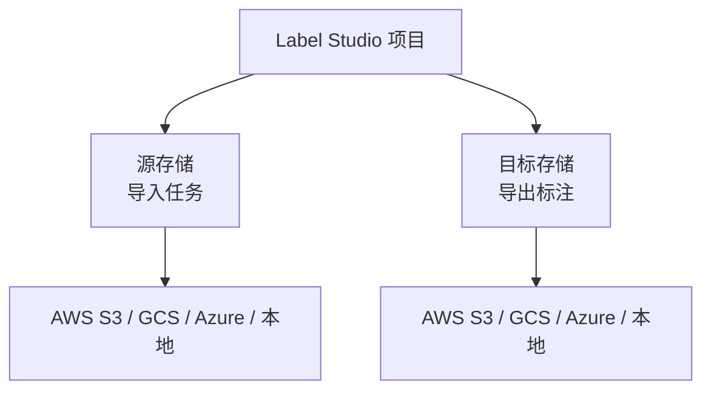
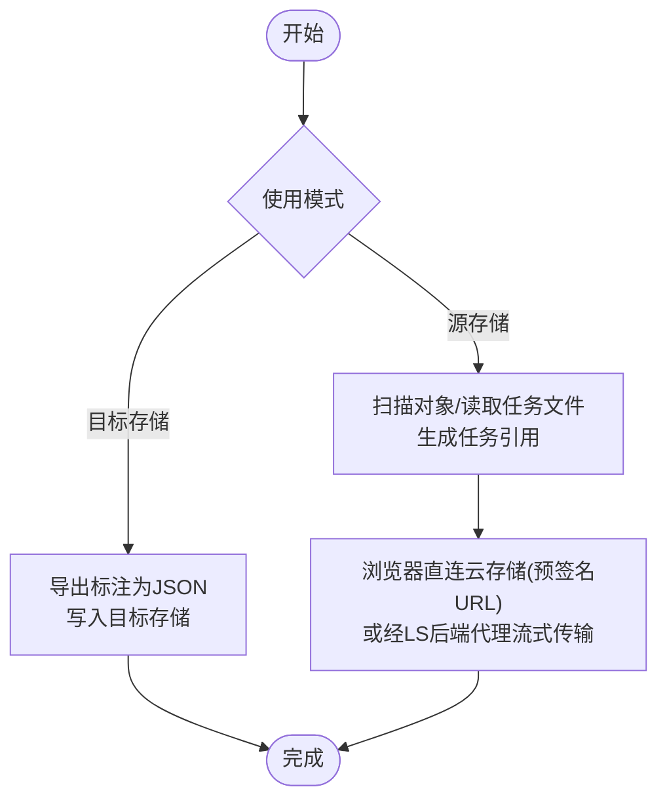
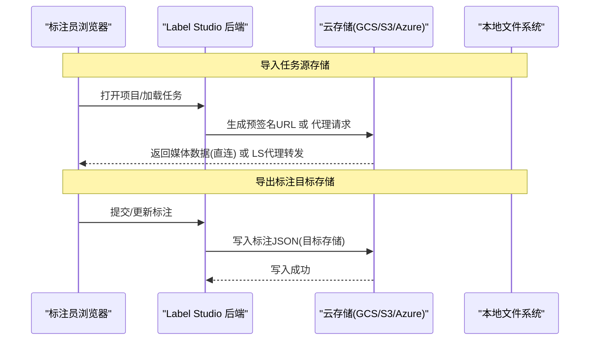
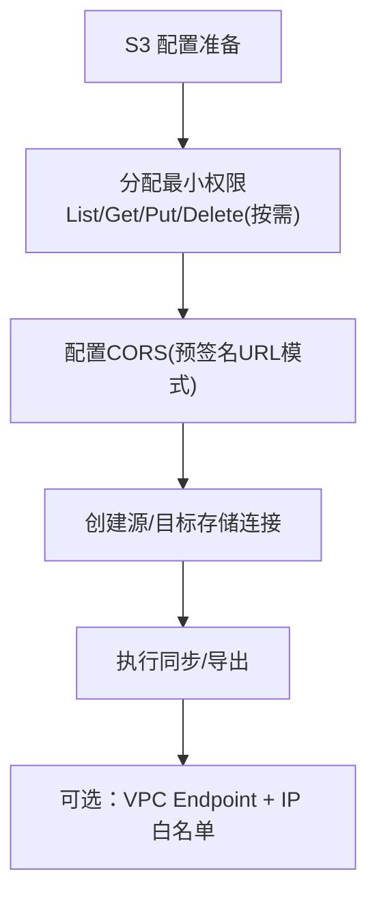
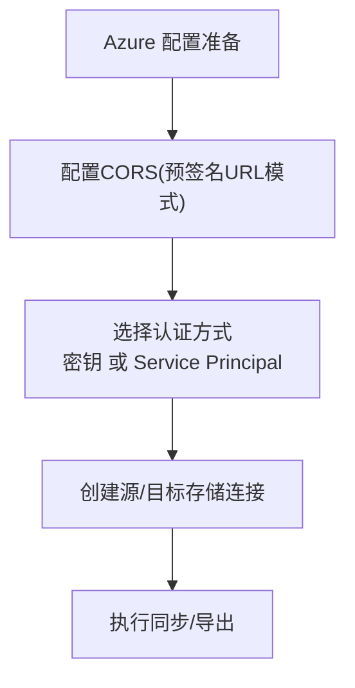
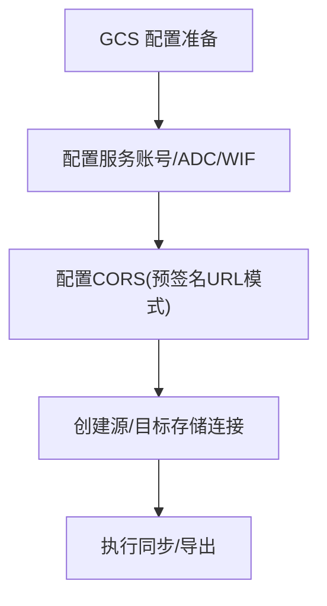
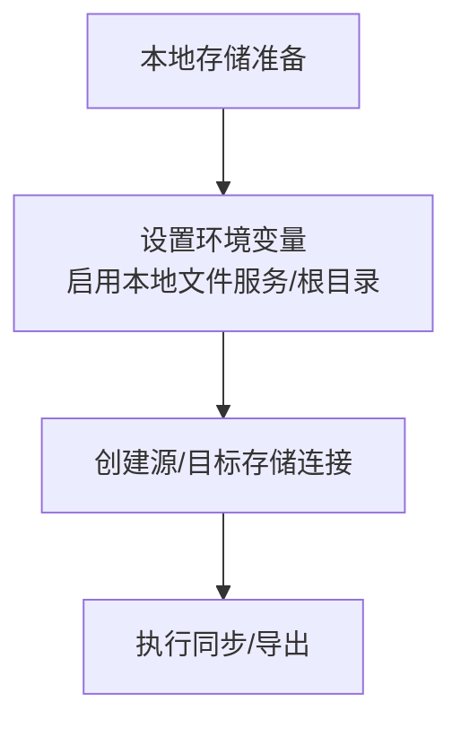
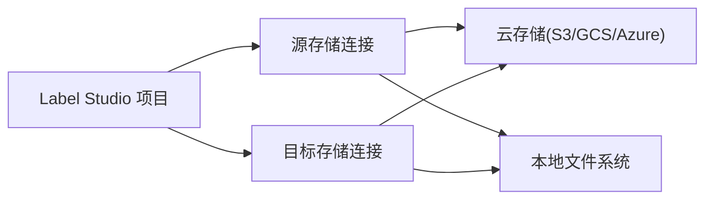

# 对象存储备份

<cite>
**本文引用的文件**   
- [storage.md](file://docs/source/guide/storage.md)
- [storage_s3.md](file://docs/source/guide/storage_s3.md)
- [storage_azure.md](file://docs/source/guide/storage_azure.md)
- [storage_gcp.md](file://docs/source/guide/storage_gcp.md)
- [storage_local.md](file://docs/source/guide/storage_local.md)
</cite>

## 目录
1. [引言](#引言)
2. [项目结构](#项目结构)
3. [核心组件](#核心组件)
4. [架构总览](#架构总览)
5. [详细组件分析](#详细组件分析)
6. [依赖关系分析](#依赖关系分析)
7. [性能与容量规划](#性能与容量规划)
8. [故障排查指南](#故障排查指南)
9. [结论](#结论)
10. [附录：跨云备份与自动化建议](#附录跨云备份与自动化建议)

## 引言
本文件面向在 Label Studio 中基于对象存储进行数据备份与同步的运维与数据工程人员，覆盖 AWS S3、Azure Blob Storage、Google Cloud Storage（GCS）以及本地文件存储。文档聚焦以下目标：
- 说明如何在 Label Studio 中将云存储作为“源存储”导入标注任务，或将“目标存储”用于导出标注结果，从而形成可复用的备份路径。
- 给出各云平台的权限、CORS、代理/预签名 URL 等关键配置要点。
- 提供本地文件存储的数据同步与备份策略。
- 补充跨地域复制、版本控制、生命周期管理等高级能力的使用思路。
- 给出备份自动化脚本与监控告警的实践建议。

注意：Label Studio 的对象存储集成主要提供“导入/导出”能力；官方未内置“完整系统级备份”功能。因此，本文以“将云存储作为备份落点”的方式，结合云平台自身的复制、版本与生命周期能力，构建完整的备份方案。

## 项目结构
与对象存储相关的文档集中在 docs/source/guide 下，包含通用存储说明与各云厂商的具体指南：
- 通用存储概念与流程：[storage.md](file://docs/source/guide/storage.md)
- Amazon S3 接入与配置：[storage_s3.md](file://docs/source/guide/storage_s3.md)
- Azure Blob Storage 接入与配置：[storage_azure.md](file://docs/source/guide/storage_azure.md)
- Google Cloud Storage 接入与配置：[storage_gcp.md](file://docs/source/guide/storage_gcp.md)
- 本地文件存储接入与配置：[storage_local.md](file://docs/source/guide/storage_local.md)

图表来源
- [storage.md:34-52](file://docs/source/guide/storage.md#L34-L52)
- [storage.md:283-296](file://docs/source/guide/storage.md#L283-L296)

章节来源
- [storage.md:1-319](file://docs/source/guide/storage.md#L1-L319)

## 核心组件
- 源存储（Source Storage）
  - 作用：从外部存储扫描并导入任务到 Label Studio。
  - 行为：不直接拷贝数据到 LS 数据库，而是通过预签名 URL 或后端代理访问对象。
  - 权限：按导入方式不同需要 LIST/GET 等权限。
- 目标存储（Target Storage）
  - 作用：将标注结果以 JSON 格式导出到外部存储。
  - 行为：提交/更新时写入目标存储；也可选择删除时同步删除目标对象。
  - 权限：通常需要 PUT，可选 DELETE。

图表来源
- [storage.md:34-52](file://docs/source/guide/storage.md#L34-L52)
- [storage.md:185-227](file://docs/source/guide/storage.md#L185-L227)
- [storage.md:283-296](file://docs/source/guide/storage.md#L283-L296)

章节来源
- [storage.md:34-52](file://docs/source/guide/storage.md#L34-L52)
- [storage.md:185-227](file://docs/source/guide/storage.md#L185-L227)
- [storage.md:283-296](file://docs/source/guide/storage.md#L283-L296)

## 架构总览
Label Studio 的对象存储备份方案由三层组成：
- 应用层：Label Studio 项目中的“源/目标存储连接”，负责导入/导出。
- 传输层：预签名 URL（浏览器直连云存储）或后端代理（LS 服务器中转）。
- 存储层：S3/GCS/Azure/本地文件系统，承载原始媒体与导出的标注 JSON。

图表来源
- [storage.md:185-227](file://docs/source/guide/storage.md#L185-L227)
- [storage.md:283-296](file://docs/source/guide/storage.md#L283-L296)

## 详细组件分析

### AWS S3 备份与同步
- 角色与权限
  - 源存储：至少需要 ListBucket、GetObject；若仅“Files”导入方式，通常只需 LIST。
  - 目标存储：需要 PutObject；如需删除同步则需 DeleteObject。
- CORS 与访问模式
  - 使用预签名 URL：需配置 CORS，允许 GET/HEAD/OPTIONS 等。
  - 使用代理模式：无需 CORS，但 LS 后端会流式传输，占用更多资源。
- 连接创建
  - 支持标准密钥与 IAM Role（企业版）两种方式。
  - 可在 UI 或 API 中创建源/目标存储连接并执行同步。
- 安全加固
  - 可通过 VPC Endpoint 与 IP 白名单限制访问来源。

图表来源
- [storage_s3.md:24-68](file://docs/source/guide/storage_s3.md#L24-L68)
- [storage_s3.md:105-213](file://docs/source/guide/storage_s3.md#L105-L213)
- [storage_s3.md:219-300](file://docs/source/guide/storage_s3.md#L219-L300)
- [storage_s3.md:603-667](file://docs/source/guide/storage_s3.md#L603-L667)

章节来源
- [storage_s3.md:24-68](file://docs/source/guide/storage_s3.md#L24-L68)
- [storage_s3.md:105-213](file://docs/source/guide/storage_s3.md#L105-L213)
- [storage_s3.md:219-300](file://docs/source/guide/storage_s3.md#L219-L300)
- [storage_s3.md:603-667](file://docs/source/guide/storage_s3.md#L603-L667)

### Azure Blob Storage 备份与同步
- 前置条件
  - 容器名、存储账户名、访问密钥（或使用 Service Principal）。
  - 如使用预签名 URL，需配置 CORS。
- 连接创建
  - 支持标准密钥与 Service Principal（企业版）两种认证方式。
  - 可在 UI 或 API 中创建源/目标存储连接并执行同步。
- 权限模型
  - 建议使用更细粒度的 RBAC 角色（如 Storage Blob Data Contributor），并按源/目标分别授权。

图表来源
- [storage_azure.md:17-37](file://docs/source/guide/storage_azure.md#L17-L37)
- [storage_azure.md:56-143](file://docs/source/guide/storage_azure.md#L56-L143)
- [storage_azure.md:145-201](file://docs/source/guide/storage_azure.md#L145-L201)
- [storage_azure.md:204-362](file://docs/source/guide/storage_azure.md#L204-L362)

章节来源
- [storage_azure.md:17-37](file://docs/source/guide/storage_azure.md#L17-L37)
- [storage_azure.md:56-143](file://docs/source/guide/storage_azure.md#L56-L143)
- [storage_azure.md:145-201](file://docs/source/guide/storage_azure.md#L145-L201)
- [storage_azure.md:204-362](file://docs/source/guide/storage_azure.md#L204-L362)

### Google Cloud Storage 备份与同步
- 前置条件
  - 启用程序化访问、设置服务账号与必要 IAM 权限。
  - 如使用预签名 URL，需配置 CORS。
- 连接创建
  - 支持标准 Application Credentials 与 WIF（企业版）认证。
  - 可在 UI 或 API 中创建源/目标存储连接并执行同步。
- 增强安全
  - 推荐使用 ADC（Application Default Credentials）与环境变量集中管理凭据。
  - 企业版支持 Workload Identity Federation（WIF）与 GKE 服务账号委派。

图表来源
- [storage_gcp.md:17-62](file://docs/source/guide/storage_gcp.md#L17-L62)
- [storage_gcp.md:71-175](file://docs/source/guide/storage_gcp.md#L71-L175)
- [storage_gcp.md:177-233](file://docs/source/guide/storage_gcp.md#L177-L233)
- [storage_gcp.md:235-243](file://docs/source/guide/storage_gcp.md#L235-L243)
- [storage_gcp.md:245-743](file://docs/source/guide/storage_gcp.md#L245-L743)

章节来源
- [storage_gcp.md:17-62](file://docs/source/guide/storage_gcp.md#L17-L62)
- [storage_gcp.md:71-175](file://docs/source/guide/storage_gcp.md#L71-L175)
- [storage_gcp.md:177-233](file://docs/source/guide/storage_gcp.md#L177-L233)
- [storage_gcp.md:235-243](file://docs/source/guide/storage_gcp.md#L235-L243)
- [storage_gcp.md:245-743](file://docs/source/guide/storage_gcp.md#L245-L743)

### 本地文件存储备份与同步
- 适用场景
  - 本地部署环境，将 LS 所在机器的目录作为源/目标存储。
- 环境变量
  - 启用本地文件服务与根目录。
- 连接创建
  - 支持“Files”与“Tasks”两种导入方式；Tasks 模式下可使用相对路径引用本地文件。
- 注意事项
  - 本地文件存在安全风险，应谨慎暴露目录范围。
  - Docker 环境下需挂载卷并正确映射路径。

图表来源
- [storage_local.md:28-43](file://docs/source/guide/storage_local.md#L28-L43)
- [storage_local.md:109-164](file://docs/source/guide/storage_local.md#L109-L164)
- [storage_local.md:166-273](file://docs/source/guide/storage_local.md#L166-L273)
- [storage_local.md:275-302](file://docs/source/guide/storage_local.md#L275-L302)
- [storage_local.md:304-316](file://docs/source/guide/storage_local.md#L304-L316)

章节来源
- [storage_local.md:28-43](file://docs/source/guide/storage_local.md#L28-L43)
- [storage_local.md:109-164](file://docs/source/guide/storage_local.md#L109-L164)
- [storage_local.md:166-273](file://docs/source/guide/storage_local.md#L166-L273)
- [storage_local.md:275-302](file://docs/source/guide/storage_local.md#L275-L302)
- [storage_local.md:304-316](file://docs/source/guide/storage_local.md#L304-L316)

## 依赖关系分析
- 组件耦合
  - Label Studio 项目与“源/目标存储连接”强耦合，连接类型决定导入/导出行为。
  - 传输模式（预签名 URL vs 代理）影响网络边界、权限与性能。
- 外部依赖
  - 云存储 SDK/CLI（aws cli、az cli、gsutil）用于辅助配置与验证。
  - 云平台 IAM/RBAC、CORS、VPC/Endpoint 等安全设施。
- 潜在循环依赖
  - 无代码级循环依赖；逻辑上“导入/导出”相互独立。

图表来源
- [storage.md:34-52](file://docs/source/guide/storage.md#L34-L52)
- [storage.md:283-296](file://docs/source/guide/storage.md#L283-L296)

章节来源
- [storage.md:34-52](file://docs/source/guide/storage.md#L34-L52)
- [storage.md:283-296](file://docs/source/guide/storage.md#L283-L296)

## 性能与容量规划
- 传输模式选择
  - 预签名 URL：浏览器直连云存储，延迟低、扩展性好，但需正确 CORS 与权限。
  - 代理模式：所有流量经 LS 后端，安全性高，但消耗更多后端资源。
- 大文件分片
  - 代理模式下，大文件按固定大小分块传输，可能引发频繁请求。
  - 可通过环境变量调整分片大小与超时参数。
- 区域与就近原则
  - 将存储桶/容器置于靠近团队的位置以降低延迟。
- 容量与成本
  - 合理划分源/目标存储目录，避免单桶过大导致元数据查询变慢。
  - 利用生命周期策略归档冷数据，降低存储成本。

章节来源
- [storage.md:185-227](file://docs/source/guide/storage.md#L185-L227)
- [storage.md:274-281](file://docs/source/guide/storage.md#L274-L281)
- [storage.md:307-308](file://docs/source/guide/storage.md#L307-L308)

## 故障排查指南
- 源存储
  - Files 导入方式：不会真正导入数据，只创建对象引用；确保权限与 CORS 正确。
  - Tasks 导入方式：假设任务文件不可变；更新需上传新文件名或删除旧任务后重同步。
- 目标存储
  - 确认具备 PUT/DELETE（可选）权限。
  - 删除同步需在目标存储连接中开启相应选项。
- 代理模式
  - 检查后端日志与网络连通性；必要时调整分片大小与超时。
- 常见错误
  - CORS 未配置或域名不匹配。
  - 预签名 URL 过期时间过短。
  - 权限不足（List/Get/Put/Delete）。

章节来源
- [storage.md:298-313](file://docs/source/guide/storage.md#L298-L313)
- [storage.md:283-296](file://docs/source/guide/storage.md#L283-L296)
- [storage.md:274-281](file://docs/source/guide/storage.md#L274-L281)

## 结论
通过将 Label Studio 的“源/目标存储”与云存储对接，可将标注任务与结果持久化至 S3/GCS/Azure/本地文件系统，形成稳定可靠的备份路径。配合云平台的复制、版本与生命周期策略，可实现跨地域容灾、历史回溯与成本优化。对于生产环境，建议优先采用预签名 URL 以提升性能，并在必要时启用代理模式以满足严格的安全合规要求。

## 附录：跨云备份与自动化建议
- 跨地域复制
  - 在各云控制台启用跨区域复制规则，将源桶复制到异地桶，实现灾难恢复。
- 版本控制
  - 启用对象版本控制，保留历史标注与媒体文件，便于回滚与审计。
- 生命周期管理
  - 对冷数据设置归档/低频访问策略，减少长期存储成本。
- 自动化脚本
  - 使用 aws cli、az cli、gsutil 定期校验连接、列出对象、统计容量与失败率。
  - 结合 cron/systemd 定时任务触发 LS 的同步 API，保证数据一致性。
- 监控与告警
  - 监控 LS 后端代理流量、错误率与响应时间。
  - 监控云存储 API 调用失败率、配额与费用异常。
  - 当同步失败或对象数量异常波动时触发告警。

[本节为通用实践建议，不直接分析具体源码文件]