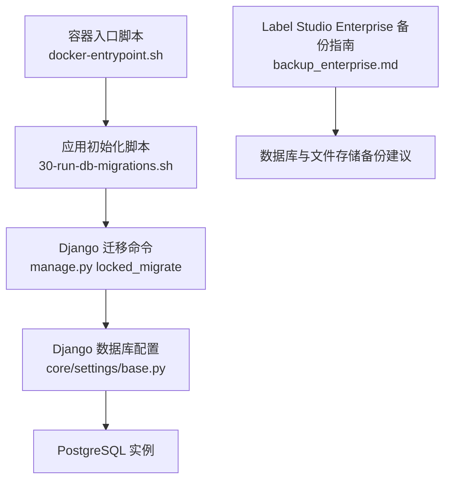
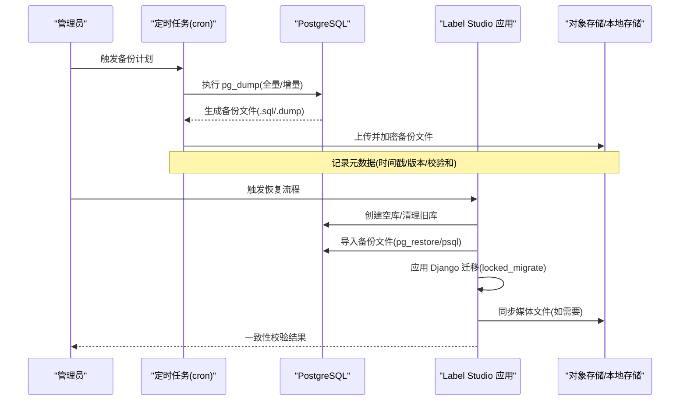
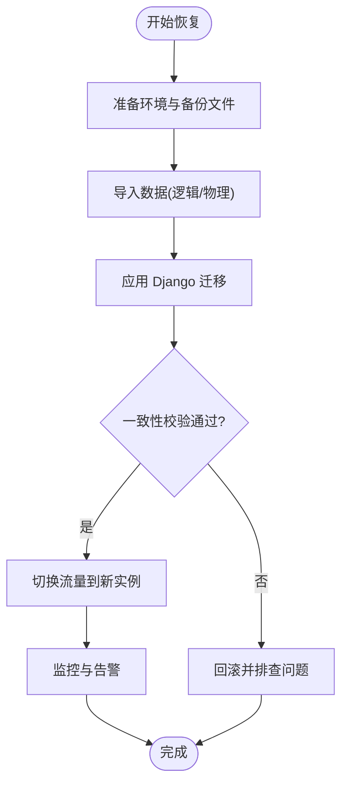
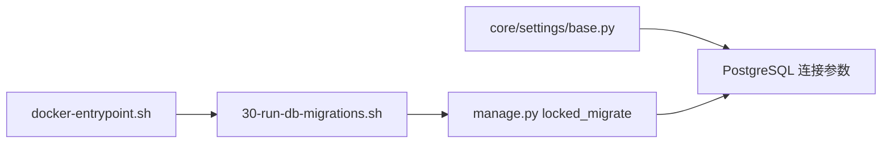

# 数据库备份

<cite>
**本文引用的文件**   
- [backup_enterprise.md](file://docs/source/guide/backup_enterprise.md)
- [30-run-db-migrations.sh](file://deploy/docker-entrypoint.d/common/30-run-db-migrations.sh)
- [docker-entrypoint.sh](file://deploy/docker-entrypoint.sh)
- [base.py](file://label_studio/core/settings/base.py)
</cite>

## 目录
1. [简介](#简介)
2. [项目结构](#项目结构)
3. [核心组件](#核心组件)
4. [架构总览](#架构总览)
5. [详细组件分析](#详细组件分析)
6. [依赖关系分析](#依赖关系分析)
7. [性能考虑](#性能考虑)
8. [故障排查指南](#故障排查指南)
9. [结论](#结论)
10. [附录](#附录)

## 简介
本指南面向使用 Label Studio 的运维与数据团队，提供基于 PostgreSQL 的数据库备份与恢复完整方案。内容涵盖：
- 全量与增量备份策略（pg_dump、WAL 归档）
- Django 迁移文件的版本管理与备份重要性
- 数据库恢复流程（导入、迁移应用、一致性验证）
- 自动化备份脚本示例（cron、命名规范、存储管理）
- 备份加密与安全传输策略

## 项目结构
Label Studio 在容器化部署中通过入口脚本执行初始化与迁移；数据库连接由 Django 设置驱动，默认使用 PostgreSQL。备份与恢复需同时关注数据库与媒体文件等持久化数据。

图表来源
- [docker-entrypoint.sh:68-82](file://deploy/docker-entrypoint.sh#L68-L82)
- [30-run-db-migrations.sh:1-10](file://deploy/docker-entrypoint.d/common/30-run-db-migrations.sh#L1-L10)
- [base.py:174-208](file://label_studio/core/settings/base.py#L174-L208)
- [backup_enterprise.md:15-32](file://docs/source/guide/backup_enterprise.md#L15-L32)

章节来源
- [docker-entrypoint.sh:68-82](file://deploy/docker-entrypoint.sh#L68-L82)
- [30-run-db-migrations.sh:1-10](file://deploy/docker-entrypoint.d/common/30-run-db-migrations.sh#L1-L10)
- [base.py:174-208](file://label_studio/core/settings/base.py#L174-L208)
- [backup_enterprise.md:15-32](file://docs/source/guide/backup_enterprise.md#L15-L32)

## 核心组件
- 数据库后端与连接参数：Django 通过环境变量加载 PostgreSQL 连接信息，并支持 MySQL/SQLite 切换。生产环境建议使用 PostgreSQL。
- 迁移执行：容器启动时根据环境变量决定是否执行迁移，迁移命令为 manage.py locked_migrate。
- 备份范围：除数据库外，还需备份媒体文件、配置文件与环境变量，以及 Docker 卷中的数据。

章节来源
- [base.py:174-208](file://label_studio/core/settings/base.py#L174-L208)
- [30-run-db-migrations.sh:1-10](file://deploy/docker-entrypoint.d/common/30-run-db-migrations.sh#L1-L10)
- [backup_enterprise.md:15-32](file://docs/source/guide/backup_enterprise.md#L15-L32)

## 架构总览
下图展示备份与恢复的关键路径：从 pg_dump 导出到 WAL 增量流，再到恢复时的数据导入与迁移应用。

图表来源
- [docker-entrypoint.sh:68-82](file://deploy/docker-entrypoint.sh#L68-L82)
- [30-run-db-migrations.sh:1-10](file://deploy/docker-entrypoint.d/common/30-run-db-migrations.sh#L1-L10)
- [base.py:174-208](file://label_studio/core/settings/base.py#L174-L208)
- [backup_enterprise.md:15-32](file://docs/source/guide/backup_enterprise.md#L15-L32)

## 详细组件分析

### PostgreSQL 备份策略
- 全量备份
  - 使用 pg_dump 对目标数据库进行逻辑备份，适合中小规模或跨版本迁移场景。
  - 建议在低峰期执行，避免锁竞争与长事务影响。
- 增量备份
  - 启用 PostgreSQL WAL 归档，结合基础备份与连续归档实现时间点恢复(PITR)。
  - 定期做基础备份，并保留足够长的 WAL 历史以满足 RPO 目标。
- 备份频率与保留策略
  - 全量：每日一次；增量：每 5~15 分钟一次（依据写入量与 RPO）。
  - 保留周期按合规要求设定（如 30/90 天），冷热分层存储。

章节来源
- [backup_enterprise.md:15-32](file://docs/source/guide/backup_enterprise.md#L15-L32)

### Django 迁移文件的版本管理与备份重要性
- 迁移文件是数据库结构的“代码”，必须纳入版本控制并与应用代码一同发布。
- 每次升级前，确保迁移文件与目标数据库版本一致，避免回滚风险。
- 备份时应同时归档迁移文件清单与应用版本，便于恢复后正确应用迁移。

章节来源
- [30-run-db-migrations.sh:1-10](file://deploy/docker-entrypoint.d/common/30-run-db-migrations.sh#L1-L10)
- [docker-entrypoint.sh:68-82](file://deploy/docker-entrypoint.sh#L68-L82)

### 数据库恢复流程
恢复步骤建议如下：
1. 准备阶段
   - 确认目标 PostgreSQL 版本与 Label Studio 版本兼容。
   - 准备备份文件（全量 + 必要增量 WAL）。
2. 数据导入
   - 若为逻辑备份：使用 psql 或 pg_restore 导入。
   - 若为物理备份：先还原基础备份，再回放 WAL 至指定时间点。
3. 应用迁移
   - 启动 Label Studio 或单独运行迁移命令，确保数据库结构与代码一致。
4. 一致性验证
   - 检查关键表行数、索引完整性、外键约束。
   - 抽样验证业务数据（任务、标注、用户、组织等）。
5. 服务切换
   - 将流量切至新实例，观察错误率与延迟指标。

图表来源
- [30-run-db-migrations.sh:1-10](file://deploy/docker-entrypoint.d/common/30-run-db-migrations.sh#L1-L10)
- [docker-entrypoint.sh:68-82](file://deploy/docker-entrypoint.sh#L68-L82)

### 自动化备份脚本示例（概念性说明）
以下为自动化备份的关键要点（不直接给出代码）：
- cron 作业
  - 每日凌晨执行全量备份；每 5~15 分钟触发增量或 WAL 归档检查。
- 备份文件命名规范
  - 包含时间戳、主机名、数据库名、类型（full/incr）、校验和。
  - 示例模式：ls_db_full_YYYYMMDD_HHMMSS_host_dbname.sql.gz.sha256
- 存储空间管理
  - 自动清理超过保留期的旧备份；压缩与去重；分片大文件。
- 安全与传输
  - 使用 TLS 加密传输；备份文件对称加密（如 AES-GCM），密钥由 KMS 管理。
  - 仅允许受信任 IP/账号访问备份存储桶。

章节来源
- [backup_enterprise.md:15-32](file://docs/source/guide/backup_enterprise.md#L15-L32)

### 备份数据的加密与安全传输
- 静态加密
  - 备份文件落盘即加密；KMS 托管密钥，最小权限访问。
- 传输加密
  - 使用 HTTPS/SFTP/SCP 等协议；禁用明文传输。
- 访问控制
  - 基于角色的访问控制(RBAC)，审计日志留存。
- 灾难恢复演练
  - 定期在隔离环境进行恢复演练，验证可用性与 RTO/RPO。

章节来源
- [backup_enterprise.md:15-32](file://docs/source/guide/backup_enterprise.md#L15-L32)

## 依赖关系分析
- 容器入口脚本负责按顺序执行初始化脚本，并在特定模式下调用迁移命令。
- Django 设置模块根据环境变量选择数据库后端，默认 PostgreSQL。
- 迁移脚本在容器启动时按需执行，保证数据库结构与代码一致。

图表来源
- [docker-entrypoint.sh:68-82](file://deploy/docker-entrypoint.sh#L68-L82)
- [30-run-db-migrations.sh:1-10](file://deploy/docker-entrypoint.d/common/30-run-db-migrations.sh#L1-L10)
- [base.py:174-208](file://label_studio/core/settings/base.py#L174-L208)

章节来源
- [docker-entrypoint.sh:68-82](file://deploy/docker-entrypoint.sh#L68-L82)
- [30-run-db-migrations.sh:1-10](file://deploy/docker-entrypoint.d/common/30-run-db-migrations.sh#L1-L10)
- [base.py:174-208](file://label_studio/core/settings/base.py#L174-L208)

## 性能考虑
- 备份窗口
  - 全量备份尽量安排在低峰期；增量备份保持较短间隔以降低 RPO。
- I/O 与 CPU
  - 使用独立磁盘或 SSD；限制备份进程资源占用，避免影响在线业务。
- 网络带宽
  - 异地容灾传输采用压缩与并行；必要时使用专线或加速通道。
- 并发与锁
  - 避免与大规模导入/导出、批量更新在同一时段进行备份。

[本节为通用指导，不涉及具体文件]

## 故障排查指南
- 迁移失败
  - 检查环境变量是否指向正确的数据库；确认迁移脚本可执行且无权限问题。
  - 查看容器日志输出，定位迁移异常堆栈。
- 备份不可用
  - 校验备份文件完整性（哈希校验）；尝试在测试环境恢复。
  - 检查 WAL 归档链是否完整，是否存在断点。
- 恢复后不一致
  - 核对迁移版本与应用版本；重新应用缺失迁移。
  - 校验关键表计数与外键约束，修复损坏数据。

章节来源
- [30-run-db-migrations.sh:1-10](file://deploy/docker-entrypoint.d/common/30-run-db-migrations.sh#L1-L10)
- [docker-entrypoint.sh:68-82](file://deploy/docker-entrypoint.sh#L68-L82)

## 结论
为确保 Label Studio 的数据安全与业务连续性，应建立以 PostgreSQL 为核心的备份体系：全量+增量+WAL 归档，配合严格的命名、加密与传输策略，并通过自动化脚本与演练保障 RTO/RPO 目标。同时，重视 Django 迁移文件的版本管理与一致性校验，确保恢复后可无缝上线。

[本节为总结性内容，不涉及具体文件]

## 附录
- 环境变量参考（数据库连接）
  - POSTGRE_USER / POSTGRE_PASSWORD / POSTGRE_NAME / POSTGRE_HOST / POSTGRE_PORT
  - DJANGO_DB（用于选择数据库后端）
- 相关文档
  - Label Studio Enterprise 备份指南强调数据库、文件存储、配置与环境变量的全面备份，并建议定期演练恢复流程。

章节来源
- [base.py:174-208](file://label_studio/core/settings/base.py#L174-L208)
- [backup_enterprise.md:15-32](file://docs/source/guide/backup_enterprise.md#L15-L32)