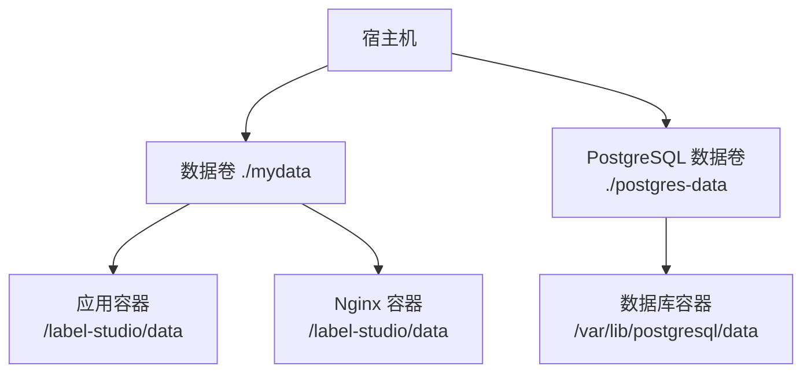
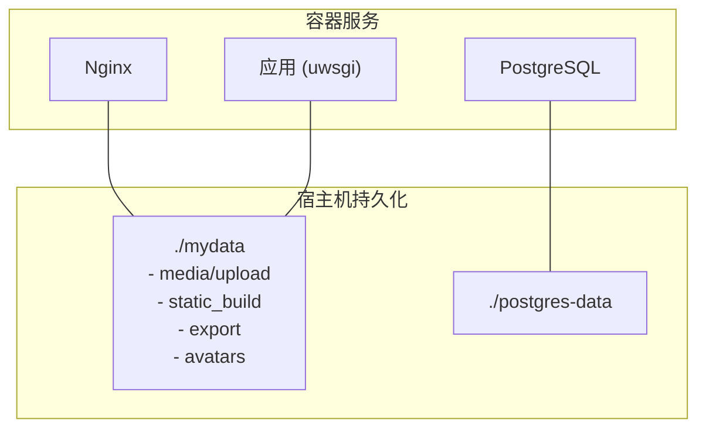
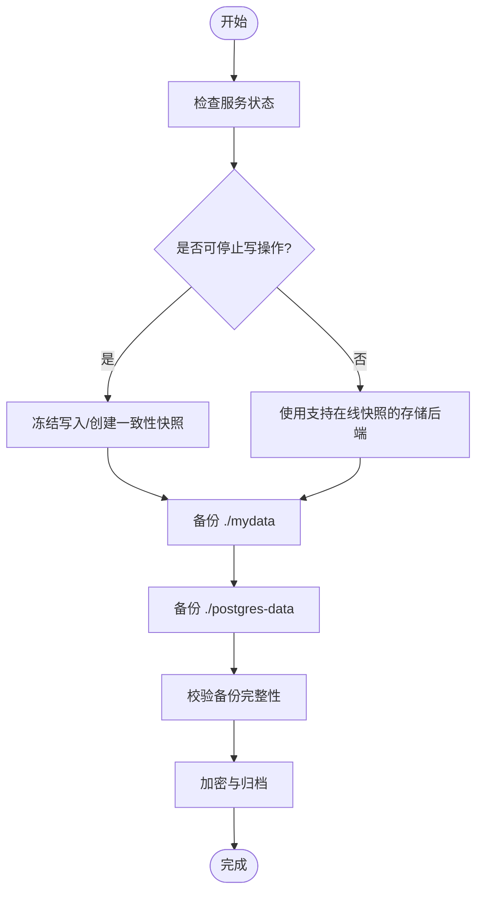
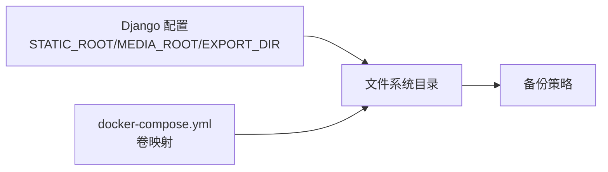

# 文件系统备份

<cite>
**本文引用的文件**   
- [README.md](file://README.md)
- [docker-compose.yml](file://docker-compose.yml)
- [Dockerfile](file://Dockerfile)
- [base.py](file://label_studio/core/settings/base.py)
- [urls.py](file://label_studio/core/urls.py)
- [backup_enterprise.md](file://docs/source/guide/backup_enterprise.md)
</cite>

## 目录
1. [简介](#简介)
2. [项目结构](#项目结构)
3. [核心组件](#核心组件)
4. [架构总览](#架构总览)
5. [详细组件分析](#详细组件分析)
6. [依赖关系分析](#依赖关系分析)
7. [性能与容量规划](#性能与容量规划)
8. [故障排查指南](#故障排查指南)
9. [结论](#结论)
10. [附录](#附录)

## 简介
本指南面向 Label Studio 的文件系统数据备份，覆盖静态资源、上传媒体、导出产物、配置文件与日志等关键目录。文档提供基于 rsync 与 tar 的实操方法、Docker 环境下的数据卷备份策略、完整性校验、增量备份与压缩优化建议，并给出备份目录结构与命名约定，帮助你在社区版与企业版环境中建立稳定可靠的备份体系。

## 项目结构
Label Studio 在容器化部署中，通过环境变量与 Django 配置确定持久化路径：
- 基础数据目录由镜像层定义，默认挂载到宿主机的 ./mydata
- 应用与 Nginx 共享同一数据卷，用于存储媒体、静态资源与导出文件
- PostgreSQL 数据目录独立映射，需单独备份

图示来源
- [docker-compose.yml:20-22](file://docker-compose.yml#L20-L22)
- [docker-compose.yml:51-52](file://docker-compose.yml#L51-L52)
- [docker-compose.yml:69-70](file://docker-compose.yml#L69-L70)

章节来源
- [README.md:41-45](file://README.md#L41-L45)
- [docker-compose.yml:1-72](file://docker-compose.yml#L1-L72)

## 核心组件
本节梳理需要纳入备份的关键目录与文件类型：
- 静态资源（STATIC_ROOT）：前端构建产物与静态文件
- 媒体与上传（MEDIA_ROOT + UPLOAD_DIR）：用户上传的图片、音频、视频等
- 导出与延迟导出（EXPORT_DIR / DELAYED_EXPORT_DIR）：任务导出产物
- 用户头像（AVATAR_PATH）：用户头像文件
- 数据库文件：SQLite 或 PostgreSQL 数据目录
- 配置文件与环境变量：Label Studio 配置、Nginx 证书、自定义脚本
- 日志文件：应用与 Nginx 日志（可选，便于问题定位）

章节来源
- [base.py:615-628](file://label_studio/core/settings/base.py#L615-L628)
- [base.py:654-660](file://label_studio/core/settings/base.py#L654-L660)
- [base.py:692-700](file://label_studio/core/settings/base.py#L692-L700)
- [urls.py:58-58](file://label_studio/core/urls.py#L58-L58)
- [Dockerfile:110-110](file://Dockerfile#L110-L110)

## 架构总览
下图展示 Label Studio 在 Docker Compose 中的典型部署与数据流向，以及备份目标位置。

图示来源
- [docker-compose.yml:20-22](file://docker-compose.yml#L20-L22)
- [docker-compose.yml:51-52](file://docker-compose.yml#L51-L52)
- [docker-compose.yml:69-70](file://docker-compose.yml#L69-L70)
- [base.py:615-628](file://label_studio/core/settings/base.py#L615-L628)
- [base.py:654-660](file://label_studio/core/settings/base.py#L654-L660)
- [base.py:692-700](file://label_studio/core/settings/base.py#L692-L700)

## 详细组件分析

### 备份范围与目录规范
- 静态资源目录
  - 路径：STATIC_ROOT（通常为 BASE_DIR/static_build）
  - 内容：前端构建产物、CSS/JS/图片等
  - 说明：collectstatic 后生成，随版本升级可能变化
- 媒体与上传目录
  - 路径：MEDIA_ROOT（BASE_DATA_DIR/media），子目录 UPLOAD_DIR（upload）、AVATAR_PATH（avatars）
  - 内容：用户上传的标注素材、头像等
- 导出目录
  - 路径：EXPORT_DIR（BASE_DATA_DIR/export），延迟导出 DELAYED_EXPORT_DIR（export）
  - 内容：批量导出任务产物
- 数据库
  - SQLite：label_studio.sqlite3（位于 BASE_DATA_DIR）
  - PostgreSQL：pgautoupgrade 数据目录（/var/lib/postgresql/data）
- 配置文件与环境变量
  - Label Studio 配置、Nginx 证书、自定义脚本、环境变量清单
- 日志文件
  - 应用日志、Nginx 错误日志（可选，便于排障）

章节来源
- [base.py:615-628](file://label_studio/core/settings/base.py#L615-L628)
- [base.py:654-660](file://label_studio/core/settings/base.py#L654-L660)
- [base.py:692-700](file://label_studio/core/settings/base.py#L692-L700)
- [README.md:41-45](file://README.md#L41-L45)
- [docker-compose.yml:69-70](file://docker-compose.yml#L69-L70)

### Docker 数据卷备份策略
- 数据卷映射
  - 应用与 Nginx 共享 ./mydata:/label-studio/data
  - PostgreSQL 使用 ./postgres-data:/var/lib/postgresql/data
- 备份要点
  - 对 ./mydata 与 ./postgres-data 分别执行一致性快照或冷备
  - 若使用外部 S3/MinIO 作为对象存储，仅备份本地元数据与静态资源，对象数据按云厂商策略备份

图示来源
- [docker-compose.yml:20-22](file://docker-compose.yml#L20-L22)
- [docker-compose.yml:51-52](file://docker-compose.yml#L51-L52)
- [docker-compose.yml:69-70](file://docker-compose.yml#L69-L70)

章节来源
- [docker-compose.yml:1-72](file://docker-compose.yml#L1-L72)

### 工具与最佳实践

#### rsync 增量同步
- 适用场景：日常增量备份，减少带宽与时间开销
- 建议参数
  - --archive：保留权限、时间戳、符号链接等
  - --delete：保持目标与源一致（谨慎使用）
  - --compress：传输时压缩（网络慢时启用）
  - --partial：断点续传
  - --progress：显示进度
- 示例命令（概念性）
  - 全量：rsync -a /path/to/mydata backup_dir/
  - 增量：rsync -a --delete /path/to/mydata backup_dir/
  - 带压缩：rsync -az /path/to/mydata backup_dir/

注意事项
- 避免在写入高峰期执行，必要时先暂停服务或使用一致性快照
- 定期清理旧增量，结合完整备份周期

#### tar 打包与压缩
- 适用场景：归档与离线保存，便于迁移与长期留存
- 常用选项
  - -c：创建归档
  - -z/-j/-J：gzip/bzip2/xz 压缩
  - -v：详细输出
  - -f：指定文件名
- 示例命令（概念性）
  - tar -czvf mydata_backup_YYYYMMDD.tar.gz ./mydata
  - tar -cjvf postgres_backup_YYYYMMDD.tar.bz2 ./postgres-data

#### 完整性校验
- 生成校验和
  - sha256sum *.tar.gz > checksums.sha256
- 验证校验和
  - sha256sum -c checksums.sha256
- 建议将校验文件与备份文件一同归档，并异地存放

#### 加密与安全
- 对敏感备份进行加密（如 gpg 或 openssl）
- 限制访问权限（chmod 600/700）
- 记录密钥管理流程与恢复演练计划

章节来源
- [backup_enterprise.md:15-32](file://docs/source/guide/backup_enterprise.md#L15-L32)

### 企业版扩展要点
- 除数据库外，还需备份文件存储、配置文件、环境变量、Docker 卷
- 记录当前版本与定制项，定期测试恢复流程
- 备份存储应安全且物理隔离，建议加密

章节来源
- [backup_enterprise.md:15-32](file://docs/source/guide/backup_enterprise.md#L15-L32)

## 依赖关系分析
- 应用与 Nginx 共享数据卷，确保两者读取一致的静态与媒体资源
- Django 配置决定静态与媒体根路径，影响备份范围
- PostgreSQL 数据目录独立于应用数据卷，需单独备份

图示来源
- [base.py:615-628](file://label_studio/core/settings/base.py#L615-L628)
- [base.py:654-660](file://label_studio/core/settings/base.py#L654-L660)
- [base.py:692-700](file://label_studio/core/settings/base.py#L692-L700)
- [docker-compose.yml:20-22](file://docker-compose.yml#L20-L22)
- [docker-compose.yml:51-52](file://docker-compose.yml#L51-L52)

章节来源
- [base.py:615-700](file://label_studio/core/settings/base.py#L615-L700)
- [docker-compose.yml:1-72](file://docker-compose.yml#L1-L72)

## 性能与容量规划
- 增量优先：日常采用 rsync 增量，降低 I/O 与网络压力
- 压缩权衡：xz 压缩率高但 CPU 消耗大；gzip 平衡速度与体积；根据备份窗口选择
- 并发控制：限制 rsync 与 tar 的并发度，避免影响业务
- 分片与并行：超大目录可分片备份，提升吞吐
- 缓存与预热：首次全量后，后续增量更快；考虑预取热点文件

[本节为通用指导，不直接分析具体文件]

## 故障排查指南
- 权限问题
  - 现象：无法读写 /label-studio/data/media
  - 排查：确认容器内用户与宿主机目录权限一致；参考启动脚本提示
- 端口与代理
  - 现象：静态资源或媒体无法访问
  - 排查：检查 Nginx 配置与 STATIC_URL/MEDIA_URL 映射
- 数据库连接
  - 现象：应用无法连接 PostgreSQL
  - 排查：核对环境变量 POSTGRE_* 与 docker-compose 服务名
- 备份不一致
  - 现象：恢复后资源缺失或损坏
  - 排查：校验 sha256sum；确认备份期间无写入；必要时冷备

章节来源
- [docker-entrypoint.d/common/05-check-data-permissions.sh:20-20](file://deploy/docker-entrypoint.d/common/05-check-data-permissions.sh#L20-L20)
- [urls.py:58-58](file://label_studio/core/urls.py#L58-L58)
- [docker-compose.yml:37-44](file://docker-compose.yml#L37-L44)

## 结论
通过明确备份范围（静态资源、媒体、导出、数据库、配置与日志），结合 rsync 增量与 tar 归档，辅以完整性校验与加密，可在 Docker 环境下实现稳定、可恢复的 Label Studio 数据保护。建议制定周期性全量+增量的备份策略，并定期进行恢复演练，确保灾难恢复能力。

[本节为总结性内容，不直接分析具体文件]

## 附录

### 备份目录结构规范与命名约定
- 目录结构
  - backups/
    - mydata/
      - media/upload/...
      - static_build/...
      - export/...
      - avatars/...
    - postgres-data/
    - configs/
      - label-studio.env
      - nginx-certs/
    - logs/（可选）
- 命名约定
  - 全量：full_mydata_YYYYMMDD_HHMMSS.tar.gz
  - 增量：incr_mydata_YYYYMMDD_HHMMSS.tar.gz
  - 校验：checksums_YYYYMMDD_HHMMSS.sha256
  - 加密：*.gpg 或 *.enc

[本节为概念性规范，不直接分析具体文件]