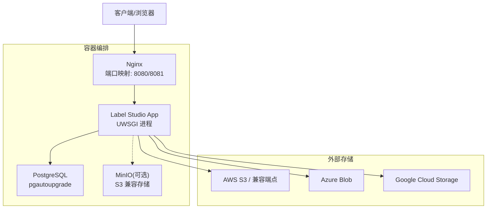
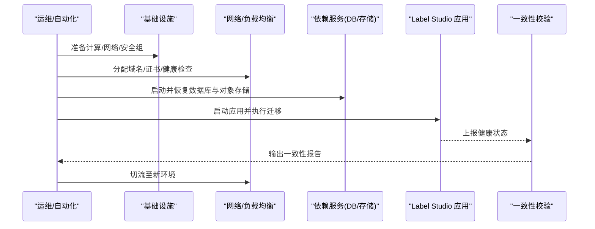
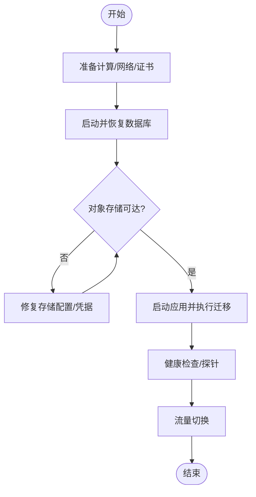
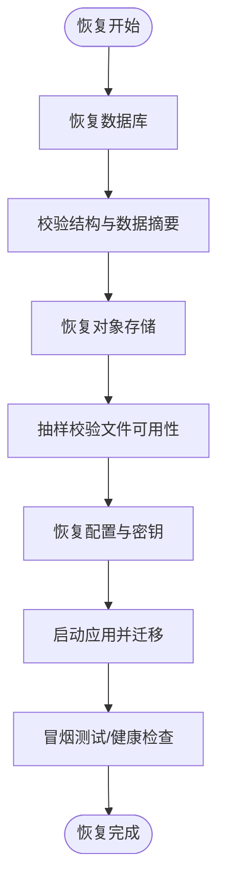
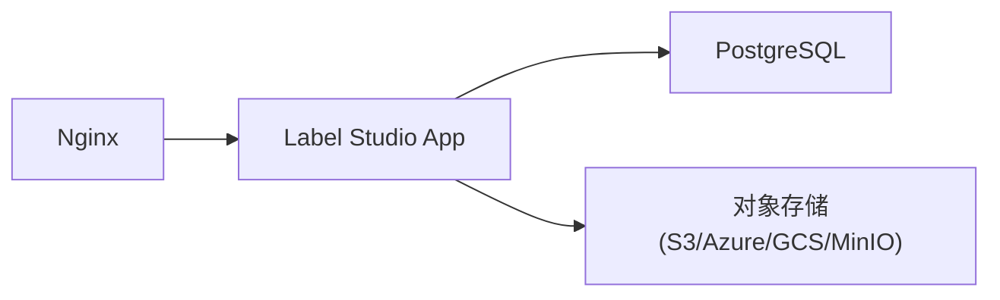

# 灾难恢复

<cite>
**本文引用的文件**   
- [README.md](file://README.md)
- [docker-compose.yml](file://docker-compose.yml)
- [backup_enterprise.md](file://docs/source/guide/backup_enterprise.md)
- [base.py](file://label_studio/core/settings/base.py)
</cite>

## 目录
1. [简介](#简介)
2. [项目结构](#项目结构)
3. [核心组件](#核心组件)
4. [架构总览](#架构总览)
5. [详细组件分析](#详细组件分析)
6. [依赖关系分析](#依赖关系分析)
7. [性能与容量规划](#性能与容量规划)
8. [故障排查指南](#故障排查指南)
9. [结论](#结论)
10. [附录](#附录)

## 简介
本文件为 Label Studio 的灾难恢复（DR）完整流程文档，覆盖服务中断后的基础设施重建、依赖服务启动顺序、数据恢复顺序、RTO/RPO 定义与实现方案、故障检测与自动切换、数据一致性验证，以及不同灾难场景的处理策略和演练计划。内容基于仓库中的部署配置、设置项与官方备份指南进行系统化整理，便于运维与平台团队落地执行。

## 项目结构
Label Studio 在仓库中提供生产就绪的 Docker Compose 编排，包含 Nginx 反向代理、应用服务与 PostgreSQL 数据库；同时支持通过环境变量接入 S3/Azure/GCS 等对象存储。备份指南明确了企业级本地部署的备份范围与注意事项。

**图示来源**
- [docker-compose.yml:1-72](file://docker-compose.yml#L1-L72)
- [base.py:958-994](file://label_studio/core/settings/base.py#L958-L994)

**章节来源**
- [README.md:59-79](file://README.md#L59-L79)
- [docker-compose.yml:1-72](file://docker-compose.yml#L1-L72)

## 核心组件
- 反向代理与静态资源：Nginx 负责对外暴露端口并转发到后端应用。
- 应用服务：Label Studio 后端（Django + UWSGI），连接数据库与对象存储。
- 数据库：PostgreSQL（推荐生产使用），持久化所有业务数据。
- 对象存储：支持本地 MinIO 或云厂商 S3/Azure/GCS，用于媒体与导出文件。
- 备份与恢复：依据企业备份指南，涵盖数据库、文件存储、配置文件与环境变量。

关键要点
- 数据库默认使用 PostgreSQL，可通过环境变量切换 MySQL/SQLite（生产建议 PostgreSQL）。
- 媒体根目录 MEDIA_ROOT 位于 BASE_DATA_DIR/media，需纳入备份。
- 对象存储类型由 STORAGE_TYPE 控制，支持 s3/azure/gcs。

**章节来源**
- [docker-compose.yml:1-72](file://docker-compose.yml#L1-L72)
- [base.py:170-208](file://label_studio/core/settings/base.py#L170-L208)
- [base.py:655-656](file://label_studio/core/settings/base.py#L655-L656)
- [base.py:958-994](file://label_studio/core/settings/base.py#L958-L994)
- [backup_enterprise.md:15-32](file://docs/source/guide/backup_enterprise.md#L15-L32)

## 架构总览
灾难恢复的总体思路是“先稳后快”：优先恢复网络与入口，再启动依赖服务，最后拉起应用并完成数据一致性校验。

[本图为概念性流程图，不直接对应具体源码文件]

## 详细组件分析

### 基础设施重建与依赖启动顺序
- 计算与网络
  - 准备主机/节点、安全组、防火墙规则、域名与 TLS 证书。
  - 若使用 Ingress/LoadBalancer，提前配置健康检查与回退策略。
- 依赖服务
  - 数据库：PostgreSQL 初始化、恢复 WAL/快照、校验版本与兼容性。
  - 对象存储：S3/Azure/GCS 或 MinIO 连通性测试与权限校验。
- 应用服务
  - 挂载数据卷（mydata）、加载环境变量、运行数据库迁移与静态资源收集。
  - 启动 UWSGI 进程并通过 Nginx 对外提供服务。

**章节来源**
- [docker-compose.yml:1-72](file://docker-compose.yml#L1-L72)
- [README.md:59-79](file://README.md#L59-L79)

### 数据恢复顺序与一致性验证
- 恢复顺序
  1) 数据库：从最新可用快照/WAL 恢复，确认版本与表结构一致。
  2) 对象存储：同步媒体与导出文件，校验桶/容器路径与访问策略。
  3) 应用配置：恢复环境变量、密钥、自定义脚本与 ML 模型。
  4) 应用启动：执行迁移、收集静态资源、启动服务。
- 一致性验证
  - 数据库：行数/摘要对比、外键完整性、索引与统计信息。
  - 对象存储：抽样校验文件可访问性与大小/ETag。
  - 应用：冒烟 API 调用、登录/项目列表/任务读取、导出下载。

**章节来源**
- [backup_enterprise.md:15-32](file://docs/source/guide/backup_enterprise.md#L15-L32)

### RTO 与 RPO 定义与实现方案
- RTO（恢复时间目标）
  - 定义：从灾难发生到服务恢复可用的最大允许时长。
  - 实现要点：预置镜像/模板、自动化编排、并行恢复依赖、快速健康检查与流量切换。
- RPO（恢复点目标）
  - 定义：允许丢失数据的最大时间窗口。
  - 实现要点：数据库连续归档（WAL）+ 定期快照；对象存储跨区复制；备份频率与保留策略对齐业务 SLA。

建议基线（可按业务调整）
- 单机房故障：RTO ≤ 15 分钟，RPO ≤ 5 分钟
- 双活/多区域：RTO ≤ 5 分钟，RPO ≈ 0（近实时复制）

[本节为通用指导，不直接分析具体文件]

### 故障检测、自动切换与数据一致性机制
- 故障检测
  - 应用层：HTTP 健康检查、API 冒烟用例、数据库连通性探测。
  - 依赖层：数据库主从延迟、对象存储连通性、磁盘/内存/CPU 阈值告警。
- 自动切换
  - 入口层：负载均衡/Ingress 健康检查失败自动摘除异常实例。
  - 数据层：数据库主从切换（如适用）、对象存储跨区域只读副本。
- 一致性保障
  - 迁移幂等与灰度：迁移脚本可重复执行，避免二次变更。
  - 校验工具：数据库摘要比对、对象存储抽样校验、端到端冒烟测试。

[本节为通用设计说明，不直接分析具体文件]

### 不同灾难场景处理策略
- 单节点故障
  - 现象：Pod/VM 宕机、进程崩溃。
  - 处置：自动重启/滚动更新；若不可用则替换节点并恢复挂载数据卷。
- 数据中心故障
  - 现象：网络分区、存储不可用。
  - 处置：切换到备用区域；优先恢复数据库与对象存储，再启动应用。
- 数据损坏
  - 现象：数据库不一致、对象存储文件缺失/损坏。
  - 处置：从最近可信快照恢复；对受影响对象进行增量补全；执行一致性校验。

[本节为通用策略说明，不直接分析具体文件]

### 恢复测试方法与演练计划
- 单元测试与集成测试
  - 使用仓库提供的测试套件验证 API、导入导出、存储读写等关键路径。
- 演练步骤
  1) 准备隔离环境，注入模拟故障（断网/删库/删对象）。
  2) 触发自动恢复流程，记录各阶段耗时。
  3) 执行一致性校验与冒烟测试，输出报告。
  4) 复盘优化：调整 RTO/RPO、优化脚本、完善告警。
- 周期建议
  - 季度演练至少一次；重大变更后立即复测。

**章节来源**
- [README.md:163-189](file://README.md#L163-L189)

## 依赖关系分析
- 应用依赖
  - 数据库：PostgreSQL（默认），也可配置 MySQL/SQLite。
  - 对象存储：S3/Azure/GCS，或通过环境变量指定自定义端点。
- 编排依赖
  - Nginx 依赖应用；应用依赖数据库；MinIO 可选。

**图示来源**
- [docker-compose.yml:1-72](file://docker-compose.yml#L1-L72)
- [base.py:170-208](file://label_studio/core/settings/base.py#L170-L208)
- [base.py:958-994](file://label_studio/core/settings/base.py#L958-L994)

**章节来源**
- [docker-compose.yml:1-72](file://docker-compose.yml#L1-L72)
- [base.py:170-208](file://label_studio/core/settings/base.py#L170-L208)
- [base.py:958-994](file://label_studio/core/settings/base.py#L958-L994)

## 性能与容量规划
- 数据库
  - 建议启用 WAL 归档与逻辑复制；根据写入峰值规划 IOPS 与连接池。
- 对象存储
  - 按媒体增长预测容量与带宽；开启生命周期策略清理临时导出文件。
- 应用
  - 水平扩展无状态实例；会话采用签名 Cookie 或外部缓存（视部署而定）。
- 监控与告警
  - 指标：CPU/内存/磁盘、数据库连接数、慢查询、对象存储请求延迟与错误率。

[本节为通用指导，不直接分析具体文件]

## 故障排查指南
- 常见问题定位
  - 数据库不可达：检查连接参数、网络策略、认证方式与 SSL 配置。
  - 对象存储不可写：核对凭据、桶名/容器名、地域/端点与权限策略。
  - 静态资源/媒体无法访问：确认 MEDIA_ROOT 挂载与 Nginx 静态资源路径。
- 日志与诊断
  - 应用日志：查看 UWSGI/Django 日志与上下文日志。
  - 数据库日志：关注连接失败、锁等待与迁移错误。
  - 对象存储日志：关注鉴权失败、超时与限流。

**章节来源**
- [base.py:655-656](file://label_studio/core/settings/base.py#L655-L656)
- [base.py:958-994](file://label_studio/core/settings/base.py#L958-L994)

## 结论
通过标准化的基础设施重建、依赖启动顺序、数据恢复流程与一致性校验，结合明确的 RTO/RPO 目标与演练机制，Label Studio 可在多种灾难场景下快速恢复并保持数据一致性。建议在生产环境中持续完善自动化编排、监控告警与演练闭环，确保 DR 能力与业务 SLA 对齐。

[本节为总结性内容，不直接分析具体文件]

## 附录
- 参考命令与清单
  - 数据库备份：pg_dump 等工具生成逻辑备份；配合 WAL 归档实现时间点恢复。
  - 对象存储备份：跨区复制/快照；定期校验可访问性与完整性。
  - 配置备份：环境变量、密钥、自定义脚本与 ML 模型。
- 恢复检查清单
  - 网络/证书/安全组
  - 数据库版本与结构
  - 对象存储连通性与权限
  - 应用迁移与静态资源
  - 冒烟测试与一致性报告

**章节来源**
- [backup_enterprise.md:15-32](file://docs/source/guide/backup_enterprise.md#L15-L32)