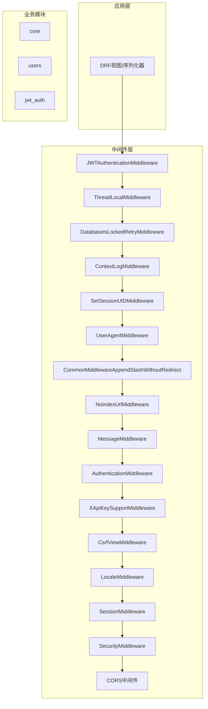
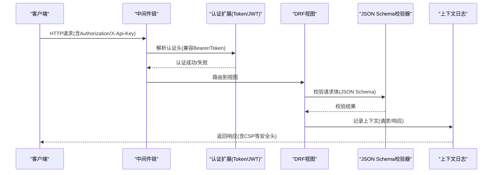
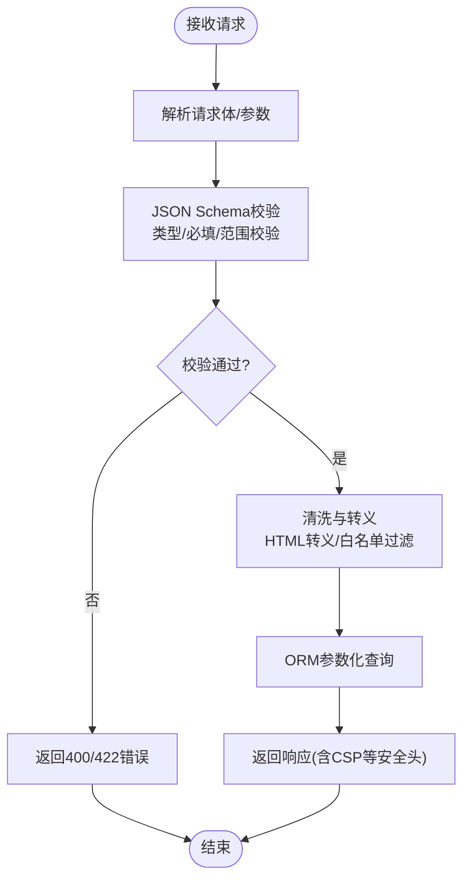
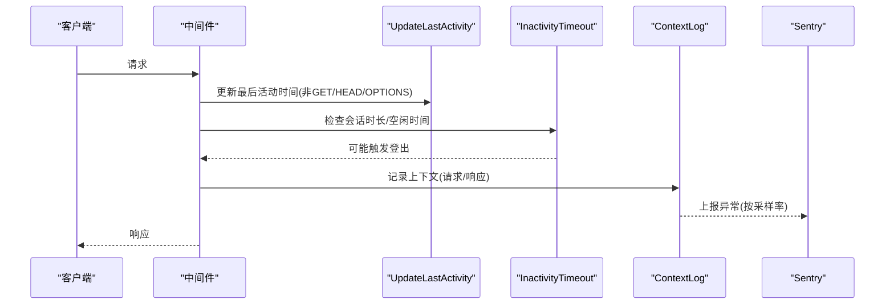
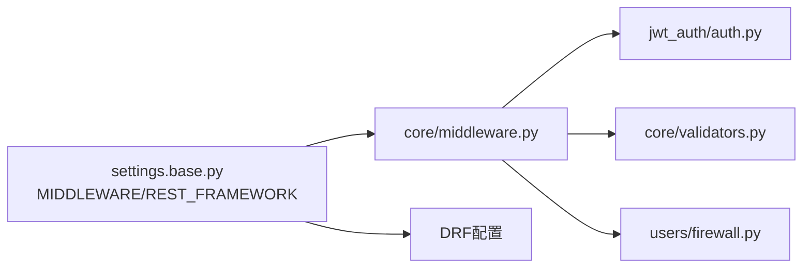

# API安全防护

<cite>
**本文引用的文件**   
- [base.py](file://label_studio/core/settings/base.py)
- [label_studio.py](file://label_studio/core/settings/label_studio.py)
- [middleware.py](file://label_studio/core/middleware.py)
- [validators.py](file://label_studio/core/validators.py)
- [firewall.py](file://label_studio/users/firewall.py)
- [auth.py](file://label_studio/jwt_auth/auth.py)
</cite>

## 目录
1. [简介](#简介)
2. [项目结构](#项目结构)
3. [核心组件](#核心组件)
4. [架构总览](#架构总览)
5. [详细组件分析](#详细组件分析)
6. [依赖关系分析](#依赖关系分析)
7. [性能与容量限制](#性能与容量限制)
8. [故障排查指南](#故障排查指南)
9. [结论](#结论)

## 简介
本文件面向Label Studio的API安全加固，围绕请求频率限制、输入验证与数据清洗、端点安全配置、敏感数据传输与存储加密、审计日志与异常检测、以及常见攻击防护策略进行系统化说明。文档基于仓库中的Django设置、中间件、认证扩展与校验器实现进行解读，并提供可操作的配置建议与可视化流程图，帮助读者快速落地生产环境的安全基线。

## 项目结构
本项目采用Django+DRF架构，安全相关能力主要分布在以下位置：
- 全局设置与安全开关：core/settings/base.py、core/settings/label_studio.py
- 请求处理中间件链：core/middleware.py
- 输入校验工具：core/validators.py
- 用户匿名化防火墙（LSO默认无感）：users/firewall.py
- 认证扩展（Token/JWT）：jwt_auth/auth.py

图示来源
- [base.py:268-286](file://label_studio/core/settings/base.py#L268-L286)
- [middleware.py:111-343](file://label_studio/core/middleware.py#L111-L343)

章节来源
- [base.py:268-286](file://label_studio/core/settings/base.py#L268-L286)
- [label_studio.py:14-17](file://label_studio/core/settings/label_studio.py#L14-L17)

## 核心组件
- 认证与鉴权
  - Token/JWT认证扩展：支持Legacy Token与JWT访问令牌，组织级可禁用Legacy Token并记录使用日志。
  - X-API-Key兼容：通过中间件将X-Api-Key转换为Authorization头，兼容Bearer/Token两种格式。
- 会话与CSRF
  - 会话Cookie安全标志、CSRF Cookie安全标志与SameSite策略可通过环境变量控制。
  - 可选启用CSRF强制检查，用于测试或特定场景。
- 输入校验
  - JSON Schema校验器：对请求体进行结构化校验，失败时抛出标准ValidationError。
- 审计与上下文日志
  - ContextLogMiddleware在请求进入与返回时记录上下文，便于追踪与审计。
- 安全响应头
  - CSP策略支持Report-Only与实际策略切换，增强XSS防护。
- 防爬与索引控制
  - NoindexUrlMiddleware为敏感路径添加noindex/nofollow指令，降低信息泄露风险。

章节来源
- [auth.py:10-66](file://label_studio/jwt_auth/auth.py#L10-L66)
- [middleware.py:236-261](file://label_studio/core/middleware.py#L236-L261)
- [base.py:631-640](file://label_studio/core/settings/base.py#L631-L640)
- [validators.py:6-12](file://label_studio/core/validators.py#L6-L12)
- [middleware.py:181-202](file://label_studio/core/middleware.py#L181-L202)
- [middleware.py:328-343](file://label_studio/core/middleware.py#L328-L343)
- [middleware.py:122-179](file://label_studio/core/middleware.py#L122-L179)

## 架构总览
下图展示一次典型API请求从进入中间件到认证、鉴权、校验与响应的关键流程，突出安全控制点。

图示来源
- [auth.py:10-66](file://label_studio/jwt_auth/auth.py#L10-L66)
- [middleware.py:236-261](file://label_studio/core/middleware.py#L236-L261)
- [validators.py:6-12](file://label_studio/core/validators.py#L6-L12)
- [middleware.py:181-202](file://label_studio/core/middleware.py#L181-L202)
- [middleware.py:328-343](file://label_studio/core/middleware.py#L328-L343)

## 详细组件分析

### 请求频率限制与速率控制
- 现状说明
  - 代码库未内置针对API的请求频率限制与速率控制中间件。
  - 建议在反向代理层（如Nginx、API网关）或部署平台（Kubernetes Ingress、Cloud WAF）实施限流策略，以抵御DDoS与暴力破解。
- 推荐实践
  - 按IP与用户维度设置请求配额（例如每秒/每分钟请求数）。
  - 对登录、注册、密码重置等敏感接口单独收紧阈值。
  - 结合WAF规则拦截异常UA、异常Referer与高频扫描行为。
  - 在Redis或内存中维护计数器，配合分布式锁保证多实例一致性。

[本节为通用安全建议，不直接分析具体文件]

### 输入验证与数据清洗
- JSON Schema校验
  - 提供JSONSchemaValidator，可对请求体进行严格的结构与类型校验，失败时抛出ValidationError，便于统一错误处理。
- SQL注入防护
  - 使用ORM与参数化查询；避免拼接SQL字符串。
  - 对查询参数进行白名单过滤与类型转换。
- XSS防护
  - 启用CSP策略，必要时将Report-Only模式切换为实际生效模式。
  - 对用户输入进行HTML转义与内容类型校验。
- 命令注入防护
  - 禁止直接使用系统命令执行用户输入；如需调用外部程序，应使用受控的参数列表与沙箱环境。
- SSRF防护
  - 启用SSRF保护与默认禁止子网，并可追加自定义黑名单子网。

图示来源
- [validators.py:6-12](file://label_studio/core/validators.py#L6-L12)
- [base.py:650-652](file://label_studio/core/settings/base.py#L650-L652)
- [middleware.py:328-343](file://label_studio/core/middleware.py#L328-L343)

章节来源
- [validators.py:6-12](file://label_studio/core/validators.py#L6-L12)
- [base.py:650-652](file://label_studio/core/settings/base.py#L650-L652)
- [middleware.py:328-343](file://label_studio/core/middleware.py#L328-L343)

### API端点安全配置
- 路径参数与查询参数
  - 使用DRF序列化器与过滤器后端进行强类型校验与白名单过滤。
  - 对分页参数设置上限，防止过度拉取导致资源耗尽。
- 请求体大小限制
  - DATA_UPLOAD_MAX_MEMORY_SIZE与DATA_UPLOAD_MAX_NUMBER_FILES控制上传大小与数量。
  - TASKS_MAX_FILE_SIZE与任务批处理大小限制可防止大对象滥用。
- Host与CORS
  - ALLOWED_HOSTS限制允许的Host头；DOMAIN_FROM_REQUEST需谨慎开启。
  - CORS_ALLOWED_ORIGINS/CORS_ALLOW_ALL_ORIGINS需明确配置，避免跨站滥用。

章节来源
- [base.py:319-335](file://label_studio/core/settings/base.py#L319-L335)
- [base.py:702-713](file://label_studio/core/settings/base.py#L702-L713)

### 敏感数据的传输加密与存储加密
- 传输加密
  - 在生产环境启用HTTPS，并通过SECURE_PROXY_SSL_HEADER正确识别上游TLS终止。
  - SESSION_COOKIE_SECURE与CSRF_COOKIE_SECURE确保Cookie仅通过HTTPS传输。
- 存储加密
  - 数据库凭据与密钥通过环境变量或密钥管理服务注入，避免硬编码。
  - SECRET_KEY由generate_secret_key_if_missing生成并持久化至BASE_DATA_DIR。
- API密钥管理
  - 支持Authorization: Bearer/JWT与Authorization: Token两种形式。
  - 组织级可禁用Legacy Token，并在认证阶段记录使用日志。

章节来源
- [base.py:125-139](file://label_studio/core/settings/base.py#L125-L139)
- [base.py:631-640](file://label_studio/core/settings/base.py#L631-L640)
- [label_studio.py:9-12](file://label_studio/core/settings/label_studio.py#L9-L12)
- [auth.py:10-66](file://label_studio/jwt_auth/auth.py#L10-L66)

### API审计日志与异常检测
- 上下文日志
  - ContextLogMiddleware在请求进入与返回时记录上下文，包含server_id与请求体（尽力解析），便于审计与排障。
- Sentry集成
  - 通过SENTRY_DSN与环境变量配置异常上报，支持采样率与环境标识。
- 会话活动与超时
  - UpdateLastActivityMiddleware更新最近活动时间；InactivitySessionTimeoutMiddleWare根据组织策略与全局配置自动登出长时间不活跃用户。

图示来源
- [middleware.py:264-326](file://label_studio/core/middleware.py#L264-L326)
- [middleware.py:181-202](file://label_studio/core/middleware.py#L181-L202)
- [base.py:570-585](file://label_studio/core/settings/base.py#L570-L585)

章节来源
- [middleware.py:264-326](file://label_studio/core/middleware.py#L264-L326)
- [middleware.py:181-202](file://label_studio/core/middleware.py#L181-L202)
- [base.py:570-585](file://label_studio/core/settings/base.py#L570-L585)

### 常见API攻击防护策略
- DDoS与暴力破解
  - 在反向代理/WAF层实施IP与用户维度的限流与封禁。
  - 对敏感接口（登录、注册、密码重置）增加验证码或二次确认。
- SQL注入
  - 坚持使用ORM与参数化查询；对查询参数进行类型与白名单校验。
- XSS
  - 启用CSP策略，必要时将Report-Only切换为实际策略；对用户输入进行转义。
- 命令注入
  - 避免直接执行系统命令；如需调用外部程序，使用受限参数与沙箱。
- SSRF
  - 启用SSRF保护与默认禁止子网，并追加自定义黑名单子网。
- 身份与权限
  - 使用ObjectPermissionBackend与HasObjectPermission进行细粒度权限控制。
  - 对Annotator/Reviewer角色启用匿名化防火墙（企业版可替换实现）。

章节来源
- [base.py:339-342](file://label_studio/core/settings/base.py#L339-L342)
- [base.py:300-304](file://label_studio/core/settings/base.py#L300-L304)
- [firewall.py:26-74](file://label_studio/users/firewall.py#L26-L74)
- [base.py:650-652](file://label_studio/core/settings/base.py#L650-L652)

## 依赖关系分析
- 中间件顺序决定安全控制生效时机，认证必须在授权之前，CSRF在视图处理前生效。
- DRF默认认证类与权限类在REST_FRAMEWORK中集中配置，便于统一管理。
- 上下文日志与CSP策略在中间件层统一注入，减少视图侧重复逻辑。

图示来源
- [base.py:268-310](file://label_studio/core/settings/base.py#L268-L310)
- [middleware.py:111-343](file://label_studio/core/middleware.py#L111-L343)
- [auth.py:10-66](file://label_studio/jwt_auth/auth.py#L10-L66)
- [validators.py:6-12](file://label_studio/core/validators.py#L6-L12)
- [firewall.py:26-74](file://label_studio/users/firewall.py#L26-L74)

章节来源
- [base.py:268-310](file://label_studio/core/settings/base.py#L268-L310)
- [middleware.py:111-343](file://label_studio/core/middleware.py#L111-L343)

## 性能与容量限制
- 上传与任务大小
  - DATA_UPLOAD_MAX_MEMORY_SIZE、DATA_UPLOAD_MAX_NUMBER_FILES、TASKS_MAX_FILE_SIZE限制请求体与任务文件大小，防止资源耗尽。
- 分页与批量处理
  - TASK_API_PAGE_SIZE_MAX限制任务API最大分页大小；IMPORT_BATCH_SIZE、REIMPORT_BATCH_SIZE、PREDICTION_IMPORT_BATCH_SIZE控制批量处理规模。
- RQ队列与失败任务TTL
  - RQ_QUEUES定义队列连接与超时；RQ_FAILED_JOB_TTL控制失败任务保留时长。

章节来源
- [base.py:702-713](file://label_studio/core/settings/base.py#L702-L713)
- [base.py:393-430](file://label_studio/core/settings/base.py#L393-L430)

## 故障排查指南
- 认证失败
  - 检查Authorization头是否为Bearer/JWT或Token；确认组织是否已禁用Legacy Token。
  - 查看认证日志输出，定位用户与组织ID。
- CSRF问题
  - 若启用USE_ENFORCE_CSRF_CHECKS，确保前端携带有效CSRF Token。
- 会话过期
  - 检查MAX_SESSION_AGE与MAX_TIME_BETWEEN_ACTIVITY配置；观察InactivitySessionTimeoutMiddleWare日志。
- 上传失败
  - 核对DATA_UPLOAD_MAX_MEMORY_SIZE与DATA_UPLOAD_MAX_NUMBER_FILES；检查文件系统权限与磁盘空间。
- 异常上报
  - 确认SENTRY_DSN与环境变量配置；检查SENTRY_RATE采样率是否过低导致漏报。

章节来源
- [auth.py:10-66](file://label_studio/jwt_auth/auth.py#L10-L66)
- [base.py:631-640](file://label_studio/core/settings/base.py#L631-L640)
- [base.py:644-648](file://label_studio/core/settings/base.py#L644-L648)
- [base.py:702-713](file://label_studio/core/settings/base.py#L702-L713)
- [base.py:570-585](file://label_studio/core/settings/base.py#L570-L585)

## 结论
Label Studio在Django/DRF基础上提供了认证扩展、中间件链、JSON Schema校验与上下文日志等基础安全能力。生产环境中建议结合反向代理/WAF实施严格的请求频率限制与速率控制，完善输入校验与数据清洗，启用传输加密与密钥管理，并通过审计日志与异常检测提升可观测性。同时，针对SQL注入、XSS、命令注入与SSRF等常见攻击面，落实参数化查询、CSP策略、受限外部调用与SSRF保护等防护措施，构建端到端的API安全防护体系。