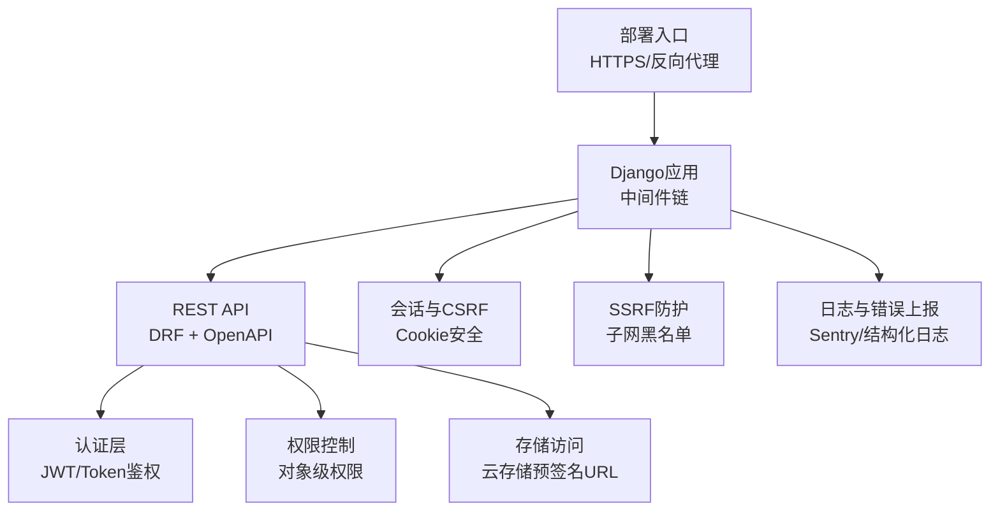
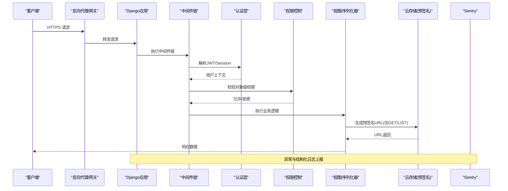
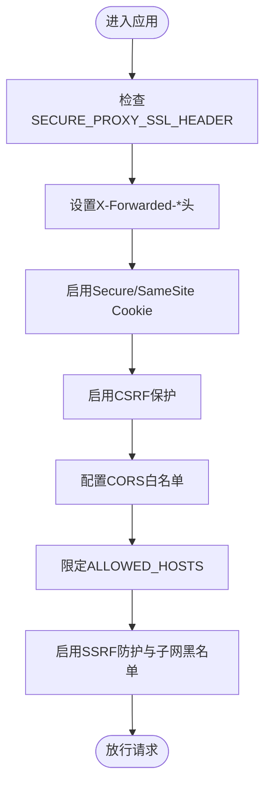
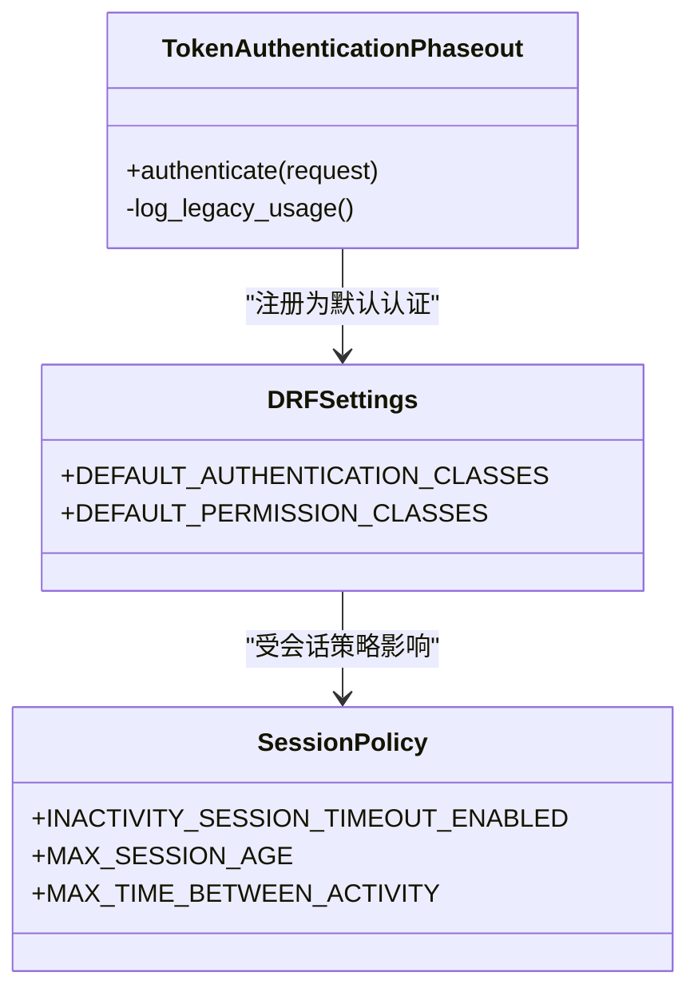
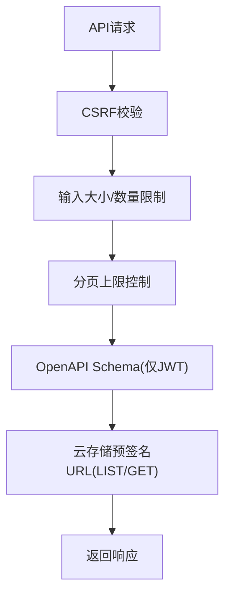
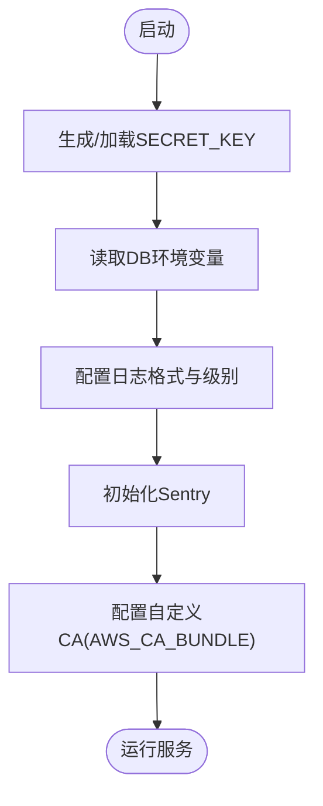
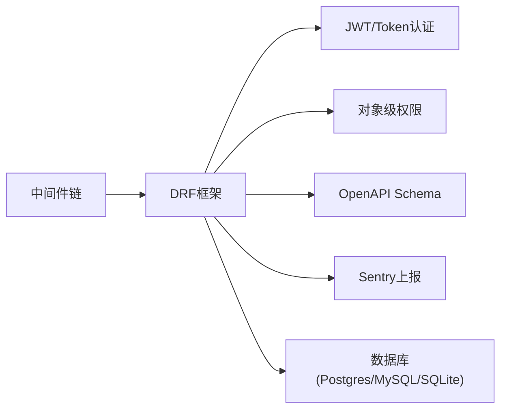

# 安全加固

<cite>
**本文引用的文件**   
- [SECURITY.md](file://SECURITY.md)
- [security.md（官方安全指南）](file://docs/source/guide/security.md)
- [base.py（基础配置）](file://label_studio/core/settings/base.py)
- [label_studio.py（应用配置）](file://label_studio/core/settings/label_studio.py)
- [auth.py（JWT/令牌认证）](file://label_studio/jwt_auth/auth.py)
- [firewall.py（标注者/审核者防火墙）](file://label_studio/users/firewall.py)
</cite>

## 目录
1. [简介](#简介)
2. [项目结构](#项目结构)
3. [核心组件](#核心组件)
4. [架构总览](#架构总览)
5. [详细组件分析](#详细组件分析)
6. [依赖分析](#依赖分析)
7. [性能与安全权衡](#性能与安全权衡)
8. [故障排查与加固清单](#故障排查与加固清单)
9. [结论](#结论)
10. [附录：环境变量与配置项速查](#附录环境变量与配置项速查)

## 简介
本指南面向Label Studio部署与运维人员，提供从网络安全、身份认证与授权、API防护、敏感信息保护到审计与漏洞扫描的端到端安全加固方案。内容基于仓库中的官方安全文档与后端代码实现进行提炼，确保可落地、可验证。

## 项目结构
围绕安全加固，以下模块最为关键：
- 安全策略与模型说明：SECURITY.md
- 官方安全指南：docs/source/guide/security.md
- 后端安全相关配置：label_studio/core/settings/base.py、label_studio/core/settings/label_studio.py
- 认证与令牌机制：label_studio/jwt_auth/auth.py
- 标注者/审核者数据隔离（开源默认无匿名化）：label_studio/users/firewall.py

图表来源
- [base.py:268-286](file://label_studio/core/settings/base.py#L268-L286)
- [base.py:294-310](file://label_studio/core/settings/base.py#L294-L310)
- [base.py:630-652](file://label_studio/core/settings/base.py#L630-L652)
- [security.md（官方安全指南）:60-93](file://docs/source/guide/security.md#L60-L93)

章节来源
- [SECURITY.md:12-44](file://SECURITY.md#L12-L44)
- [security.md（官方安全指南）:12-93](file://docs/source/guide/security.md#L12-L93)

## 核心组件
- 网络安全与传输加密
  - HTTPS强制、Secure Cookie、SameSite策略、CORS白名单、Allowed Hosts
  - SSRF防护开关与默认禁止子网
- 身份认证与授权
  - DRF默认认证类（JWT/Session）、令牌弃用过渡策略
  - 对象级权限（HasObjectPermission），开源版组织内“全等信任”模型
- API防护
  - CSRF保护、上传大小限制、分页上限、OpenAPI Schema生成
- 敏感信息保护
  - SECRET_KEY生成与持久化、数据库凭据通过环境变量注入
  - 日志级别与JSON格式化、Sentry集成
- 审计与事件响应
  - Sentry异常上报、结构化日志、企业版审计日志（文档提及）

章节来源
- [base.py:268-310](file://label_studio/core/settings/base.py#L268-L310)
- [base.py:630-652](file://label_studio/core/settings/base.py#L630-L652)
- [base.py:702-713](file://label_studio/core/settings/base.py#L702-L713)
- [label_studio.py:8-10](file://label_studio/core/settings/label_studio.py#L8-L10)
- [label_studio.py:21-31](file://label_studio/core/settings/label_studio.py#L21-L31)
- [auth.py:10-43](file://label_studio/jwt_auth/auth.py#L10-L43)
- [security.md（官方安全指南）:60-93](file://docs/source/guide/security.md#L60-L93)

## 架构总览
下图展示请求在Django中间件链中的处理路径，以及认证、权限、SSRF防护与日志上报的关键节点。

图表来源
- [base.py:268-286](file://label_studio/core/settings/base.py#L268-L286)
- [base.py:294-310](file://label_studio/core/settings/base.py#L294-L310)
- [auth.py:10-43](file://label_studio/jwt_auth/auth.py#L10-L43)
- [security.md（官方安全指南）:101-125](file://docs/source/guide/security.md#L101-L125)

## 详细组件分析

### 网络安全与传输加密
- HTTPS与反向代理
  - 建议通过反向代理终止TLS，并设置SECURE_PROXY_SSL_HEADER以识别上游协议头。
  - 使用USE_X_FORWARDED_HOST/PORT以正确还原Host/Port。
- Cookie与CSRF
  - SESSION_COOKIE_SECURE/CSRF_COOKIE_SECURE启用仅HTTPS传输；SESSION_COOKIE_SAMESITE/CSRF_COOKIE_SAMESITE设置为Strict或Lax。
  - CSRF_COOKIE_HTTPONLY开启，避免JS读取CSRF Cookie。
- CORS与Allowed Hosts
  - 生产环境务必关闭CORS_ALLOW_ALL_ORIGINS，显式配置CORS_ALLOWED_ORIGINS或CORS_ALLOWED_ORIGIN_REGEXES。
  - ALLOWED_HOSTS应限定为实际域名/IP，避免'*'。
- SSRF防护
  - 生产环境启用SSRF_PROTECTION_ENABLED，并保留USE_DEFAULT_BANNED_SUBNETS，必要时追加USER_ADDITIONAL_BANNED_SUBNETS。

图表来源
- [base.py:125-141](file://label_studio/core/settings/base.py#L125-L141)
- [base.py:319-335](file://label_studio/core/settings/base.py#L319-L335)
- [base.py:630-652](file://label_studio/core/settings/base.py#L630-L652)

章节来源
- [base.py:125-141](file://label_studio/core/settings/base.py#L125-L141)
- [base.py:319-335](file://label_studio/core/settings/base.py#L319-L335)
- [base.py:630-652](file://label_studio/core/settings/base.py#L630-L652)

### 身份认证与授权
- 认证方式
  - DRF默认认证包含自定义TokenAuthenticationPhaseout与SessionAuthentication。
  - TokenAuthenticationPhaseout支持遗留令牌弃用流程：当组织禁用legacy_api_tokens_enabled时，将返回401并记录日志。
- 授权模型
  - 默认权限类为HasObjectPermission与IsAuthenticated。
  - 开源版为单组织、扁平信任模型：同一组织内成员具备同等能力，跨租户/跨组织边界不在开源版范围内。
- 会话管理
  - 支持非活动超时与最大会话时长控制（INACTIVITY_SESSION_TIMEOUT_ENABLED、MAX_SESSION_AGE、MAX_TIME_BETWEEN_ACTIVITY）。

图表来源
- [auth.py:10-43](file://label_studio/jwt_auth/auth.py#L10-L43)
- [base.py:294-310](file://label_studio/core/settings/base.py#L294-L310)
- [base.py:643-648](file://label_studio/core/settings/base.py#L643-L648)

章节来源
- [auth.py:10-43](file://label_studio/jwt_auth/auth.py#L10-L43)
- [base.py:294-310](file://label_studio/core/settings/base.py#L294-L310)
- [base.py:643-648](file://label_studio/core/settings/base.py#L643-L648)
- [SECURITY.md:12-33](file://SECURITY.md#L12-L33)

### API安全防护
- CSRF与输入限制
  - 启用CSRF保护（USE_ENFORCE_CSRF_CHECKS默认True），限制DATA_UPLOAD_MAX_MEMORY_SIZE与DATA_UPLOAD_MAX_NUMBER_FILES。
- 分页与查询
  - TASK_API_PAGE_SIZE_MAX限制任务接口分页上限，防止大结果集滥用。
- 开放API文档
  - drf-spectacular生成OpenAPI Schema，AUTHENTICATION_WHITELIST仅暴露JWT认证类型。
- 存储访问安全
  - 云存储通过预签名URL访问，最小权限原则（LIST/GET），避免服务端下载业务数据。

图表来源
- [base.py:702-713](file://label_studio/core/settings/base.py#L702-L713)
- [base.py:432-457](file://label_studio/core/settings/base.py#L432-L457)
- [security.md（官方安全指南）:101-125](file://docs/source/guide/security.md#L101-L125)

章节来源
- [base.py:702-713](file://label_studio/core/settings/base.py#L702-L713)
- [base.py:432-457](file://label_studio/core/settings/base.py#L432-L457)
- [security.md（官方安全指南）:101-125](file://docs/source/guide/security.md#L101-L125)

### 敏感信息保护
- 密钥管理
  - SECRET_KEY由generate_secret_key_if_missing生成并持久化至BASE_DATA_DIR，生产环境需确保其安全存储与备份。
- 数据库凭据
  - 所有数据库连接参数通过环境变量注入，避免硬编码。
- 日志脱敏与上报
  - JSON_LOG启用结构化日志；SENTRY_DSN/FRONTEND_SENTRY_DSN用于异常上报；LOG_LEVEL控制日志级别。
- 证书与CA
  - 支持自定义CA证书挂载与AWS_CA_BUNDLE配置，便于私有CA环境。

图表来源
- [label_studio.py:8-10](file://label_studio/core/settings/label_studio.py#L8-L10)
- [base.py:27-77](file://label_studio/core/settings/base.py#L27-L77)
- [base.py:570-585](file://label_studio/core/settings/base.py#L570-L585)
- [security.md（官方安全指南）:171-246](file://docs/source/guide/security.md#L171-L246)

章节来源
- [label_studio.py:8-10](file://label_studio/core/settings/label_studio.py#L8-L10)
- [base.py:27-77](file://label_studio/core/settings/base.py#L27-L77)
- [base.py:570-585](file://label_studio/core/settings/base.py#L570-L585)
- [security.md（官方安全指南）:171-246](file://docs/source/guide/security.md#L171-L246)

### 审计与漏洞扫描
- 审计日志
  - 企业版自动记录用户活动（文档提及）；开源版可通过结构化日志与Sentry进行异常追踪。
- 漏洞报告与支持版本
  - SECURITY.md明确漏洞报告渠道与支持版本策略，开源版安全模型为单组织、扁平信任。
- 建议实践
  - 在生产环境启用SSRF防护；限制CORS与Allowed Hosts；定期升级至最新支持版本；对云存储采用最小权限与IP/VPC限制。

章节来源
- [SECURITY.md:1-44](file://SECURITY.md#L1-L44)
- [security.md（官方安全指南）:155-159](file://docs/source/guide/security.md#L155-L159)

## 依赖分析
- 中间件依赖
  - CORS、SecurityMiddleware、Session、Locale、CSRF、XApiKeySupport、Authentication、Message、NoindexUrl、UserAgent、SetSessionUID、ContextLog、DatabaseIsLockedRetry、ThreadLocal、JWTAuthenticationMiddleware。
- DRF依赖
  - Authentication Classes、Permission Classes、Exception Handler、Renderer、Schema Class、Page Size。
- 外部系统
  - Sentry（异常上报）、Redis（RQ队列，开源默认未启用）、PostgreSQL/MySQL/SQLite（数据库）。

图表来源
- [base.py:268-286](file://label_studio/core/settings/base.py#L268-L286)
- [base.py:294-310](file://label_studio/core/settings/base.py#L294-L310)
- [base.py:432-457](file://label_studio/core/settings/base.py#L432-L457)
- [base.py:182-208](file://label_studio/core/settings/base.py#L182-L208)

章节来源
- [base.py:268-310](file://label_studio/core/settings/base.py#L268-L310)
- [base.py:432-457](file://label_studio/core/settings/base.py#L432-L457)
- [base.py:182-208](file://label_studio/core/settings/base.py#L182-L208)

## 性能与安全权衡
- 严格的安全配置可能增加反向代理与TLS开销，建议在边缘网关集中处理TLS终止与速率限制。
- SSRF防护与子网黑名单会拦截部分内部网络访问，需在部署前评估业务需求。
- 结构化日志与Sentry上报会带来额外I/O与网络开销，建议按环境调整LOG_LEVEL与采样率。

[本节为通用指导，不直接分析具体文件]

## 故障排查与加固清单
- 常见问题
  - 无法识别HTTPS：检查SECURE_PROXY_SSL_HEADER与USE_X_FORWARDED_*。
  - CSRF失败：确认CSRF_COOKIE_SECURE/HTTPONLY与前端携带CSRF Token的策略一致。
  - CORS被拒：核对CORS_ALLOWED_ORIGINS/REGEXES与ALLOWED_HOSTS。
  - SSRF误拦截：检查USER_ADDITIONAL_BANNED_SUBNETS与目标地址是否命中默认禁止子网。
  - 令牌失效：若组织禁用legacy_api_tokens_enabled，旧令牌将被拒绝，需迁移至新认证方式。
- 加固清单
  - 强制HTTPS、启用Secure/SameSite Cookie
  - 关闭CORS_ALLOW_ALL_ORIGINS，限定Allowed Hosts
  - 启用SSRF防护与子网黑名单
  - 限制上传大小与分页上限
  - 使用环境变量注入密钥与数据库凭据
  - 启用结构化日志与Sentry异常上报
  - 云存储采用最小权限与VPC/IP限制

章节来源
- [base.py:125-141](file://label_studio/core/settings/base.py#L125-L141)
- [base.py:319-335](file://label_studio/core/settings/base.py#L319-L335)
- [base.py:630-652](file://label_studio/core/settings/base.py#L630-L652)
- [base.py:702-713](file://label_studio/core/settings/base.py#L702-L713)
- [auth.py:10-43](file://label_studio/jwt_auth/auth.py#L10-L43)

## 结论
通过对HTTPS与Cookie安全、CORS与Allowed Hosts、SSRF防护、认证与权限、API输入与分页限制、敏感信息与环境变量管理、日志与Sentry上报的系统性加固，Label Studio可在生产环境中显著降低常见安全风险。结合云存储的最小权限与VPC/IP限制，可进一步收敛攻击面。

[本节为总结性内容，不直接分析具体文件]

## 附录：环境变量与配置项速查
- 传输与代理
  - SECURE_PROXY_SSL_HEADER、USE_X_FORWARDED_HOST、USE_X_FORWARDED_PORT
- Cookie与CSRF
  - SESSION_COOKIE_SECURE、SESSION_COOKIE_SAMESITE
  - CSRF_COOKIE_SECURE、CSRF_COOKIE_HTTPONLY、CSRF_COOKIE_SAMESITE、CSRF_COOKIE_AGE
- 会话策略
  - INACTIVITY_SESSION_TIMEOUT_ENABLED、MAX_SESSION_AGE、MAX_TIME_BETWEEN_ACTIVITY
- SSRF防护
  - SSRF_PROTECTION_ENABLED、USE_DEFAULT_BANNED_SUBNETS、USER_ADDITIONAL_BANNED_SUBNETS
- CORS与主机
  - CORS_ALLOWED_ORIGINS、CORS_ALLOWED_ORIGIN_REGEXES、CORS_ALLOW_ALL_ORIGINS、ALLOWED_HOSTS
- 上传与分页
  - DATA_UPLOAD_MAX_MEMORY_SIZE、DATA_UPLOAD_MAX_NUMBER_FILES、TASK_API_PAGE_SIZE_MAX
- 日志与监控
  - LOG_LEVEL、JSON_LOG、SENTRY_DSN、FRONTEND_SENTRY_DSN
- 密钥与数据库
  - SECRET_KEY（自动生成）、POSTGRE_USER/POSTGRE_PASSWORD/POSTGRE_NAME/POSTGRE_HOST/POSTGRE_PORT、MYSQL_*、DJANGO_DB
- 证书与CA
  - CUSTOM_CA_CERTS、AWS_CA_BUNDLE

章节来源
- [base.py:125-141](file://label_studio/core/settings/base.py#L125-L141)
- [base.py:319-335](file://label_studio/core/settings/base.py#L319-L335)
- [base.py:630-652](file://label_studio/core/settings/base.py#L630-L652)
- [base.py:702-713](file://label_studio/core/settings/base.py#L702-L713)
- [base.py:27-77](file://label_studio/core/settings/base.py#L27-L77)
- [base.py:182-208](file://label_studio/core/settings/base.py#L182-L208)
- [label_studio.py:8-10](file://label_studio/core/settings/label_studio.py#L8-L10)
- [security.md（官方安全指南）:171-246](file://docs/source/guide/security.md#L171-L246)