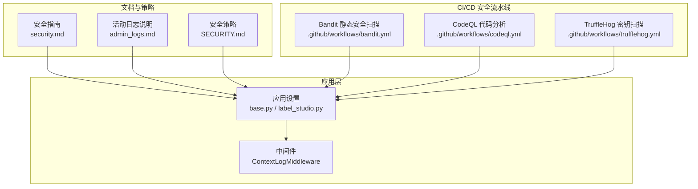
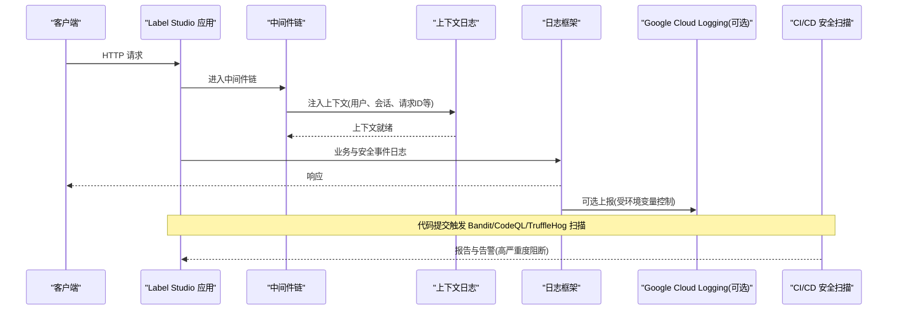
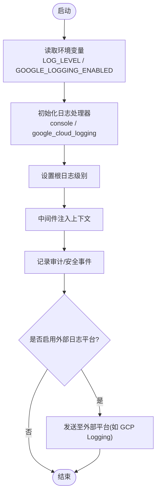
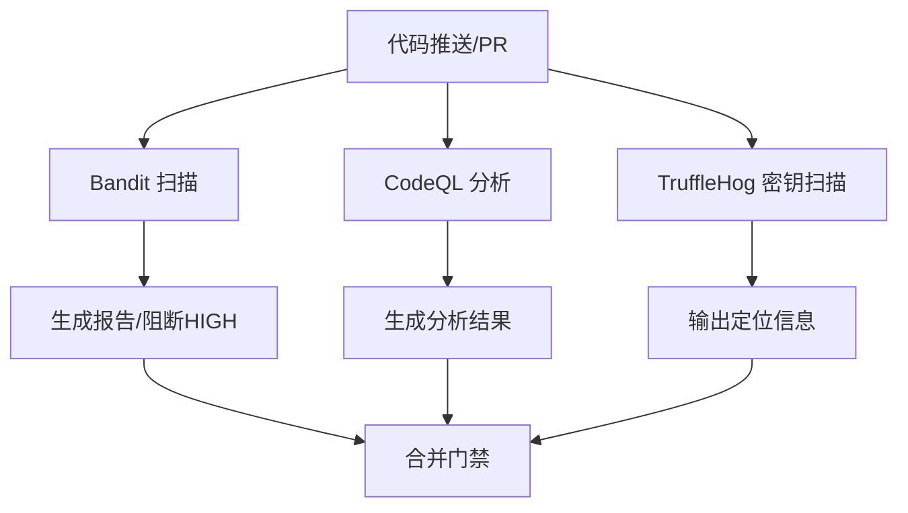
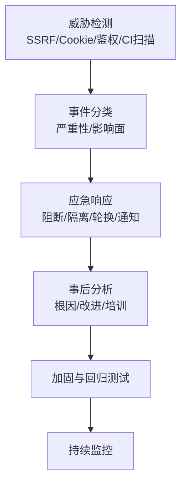
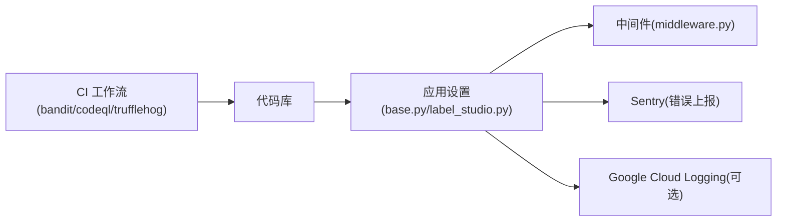

# 安全审计与漏洞管理

<cite>
**本文引用的文件**   
- [SECURITY.md](file://SECURITY.md)
- [base.py](file://label_studio/core/settings/base.py)
- [label_studio.py](file://label_studio/core/settings/label_studio.py)
- [middleware.py](file://label_studio/core/middleware.py)
- [admin_logs.md](file://docs/source/guide/admin_logs.md)
- [security.md](file://docs/source/guide/security.md)
- [bandit.yml](file://.github/workflows/bandit.yml)
- [codeql.yml](file://.github/workflows/codeql.yml)
- [trufflehog.yml](file://.github/workflows/trufflehog.yml)
</cite>

## 目录
1. [引言](#引言)
2. [项目结构](#项目结构)
3. [核心组件](#核心组件)
4. [架构总览](#架构总览)
5. [详细组件分析](#详细组件分析)
6. [依赖关系分析](#依赖关系分析)
7. [性能考虑](#性能考虑)
8. [故障排查指南](#故障排查指南)
9. [结论](#结论)
10. [附录](#附录)

## 引言
本方案面向 Label Studio 的安全审计与漏洞管理，覆盖以下目标：
- 安全审计日志的配置与管理（用户操作审计、系统事件记录、安全事件追踪）
- 漏洞扫描与代码安全检查的自动化流程（依赖包漏洞检测、代码质量检查、安全最佳实践验证）
- 安全事件的响应与处理流程（威胁检测、事件分类、应急响应、事后分析）
- 安全合规性检查与审计报告生成
- 持续安全监控配置方法
- 安全补丁管理与版本升级的安全考量

本方案基于仓库现有能力进行落地设计，确保可实施、可度量、可审计。

## 项目结构
围绕安全与合规的关键位置如下：
- 应用设置与日志：Django 基础设置与运行时设置
- 中间件：上下文日志与安全相关中间件
- 文档：安全加固指南与企业版活动日志说明
- CI/CD：Bandit、CodeQL、TruffleHog 等安全扫描工作流

图示来源
- [base.py:27-77](file://label_studio/core/settings/base.py#L27-L77)
- [label_studio.py:21-31](file://label_studio/core/settings/label_studio.py#L21-L31)
- [middleware.py:181-181](file://label_studio/core/middleware.py#L181-L181)
- [security.md:64-68](file://docs/source/guide/security.md#L64-L68)
- [admin_logs.md:14-33](file://docs/source/guide/admin_logs.md#L14-L33)
- [SECURITY.md:12-45](file://SECURITY.md#L12-L45)
- [bandit.yml:1-99](file://.github/workflows/bandit.yml#L1-L99)
- [codeql.yml:1-38](file://.github/workflows/codeql.yml#L1-L38)
- [trufflehog.yml:1-100](file://.github/workflows/trufflehog.yml#L1-L100)

章节来源
- [base.py:27-77](file://label_studio/core/settings/base.py#L27-L77)
- [label_studio.py:21-31](file://label_studio/core/settings/label_studio.py#L21-L31)
- [security.md:64-68](file://docs/source/guide/security.md#L64-L68)
- [admin_logs.md:14-33](file://docs/source/guide/admin_logs.md#L14-L33)
- [SECURITY.md:12-45](file://SECURITY.md#L12-L45)
- [bandit.yml:1-99](file://.github/workflows/bandit.yml#L1-L99)
- [codeql.yml:1-38](file://.github/workflows/codeql.yml#L1-L38)
- [trufflehog.yml:1-100](file://.github/workflows/trufflehog.yml#L1-L100)

## 核心组件
- 审计日志框架
  - Django LOGGING 配置：支持 JSON 与标准格式，控制台输出，按模块分级控制
  - Google Cloud Logging 集成开关：可按需启用并追加处理器
  - 运行级别：通过环境变量控制全局日志级别
- 上下文日志中间件
  - ContextLogMiddleware：在请求链路中注入上下文信息，便于后续审计与追踪
- 安全加固与访问控制
  - SSRF 防护开关与默认禁止子网列表
  - Cookie 安全属性（Secure、SameSite、HttpOnly）
  - 认证与权限：REST Framework 默认认证类与对象级权限后端
- 企业版活动日志
  - 组织级“活动日志”页面，支持按用户、项目、请求类型、时间范围、关键词过滤
- 安全策略边界
  - 开源单组织模型与无角色模型的边界定义，明确越权与跨租户不在开源范围内

章节来源
- [base.py:27-77](file://label_studio/core/settings/base.py#L27-L77)
- [base.py:212-228](file://label_studio/core/settings/base.py#L212-L228)
- [base.py:268-286](file://label_studio/core/settings/base.py#L268-L286)
- [base.py:294-310](file://label_studio/core/settings/base.py#L294-L310)
- [base.py:631-636](file://label_studio/core/settings/base.py#L631-L636)
- [base.py:650-652](file://label_studio/core/settings/base.py#L650-L652)
- [label_studio.py:21-31](file://label_studio/core/settings/label_studio.py#L21-L31)
- [middleware.py:181-181](file://label_studio/core/middleware.py#L181-L181)
- [admin_logs.md:14-33](file://docs/source/guide/admin_logs.md#L14-L33)
- [SECURITY.md:12-45](file://SECURITY.md#L12-L45)

## 架构总览
下图展示从请求进入、中间件处理到审计日志落盘/上报的整体流程，以及 CI/CD 中的安全扫描如何与代码库联动。

图示来源
- [base.py:27-77](file://label_studio/core/settings/base.py#L27-L77)
- [base.py:212-228](file://label_studio/core/settings/base.py#L212-L228)
- [middleware.py:181-181](file://label_studio/core/middleware.py#L181-L181)
- [bandit.yml:43-90](file://.github/workflows/bandit.yml#L43-L90)
- [codeql.yml:24-37](file://.github/workflows/codeql.yml#L24-L37)
- [trufflehog.yml:76-99](file://.github/workflows/trufflehog.yml#L76-L99)

## 详细组件分析

### 安全审计日志配置与管理
- 日志格式与处理器
  - 支持 JSON 与标准文本两种格式化器；JSON 格式化器包含用户标识字段，便于关联用户行为
  - 根处理器默认输出至控制台；可通过环境变量开启 Google Cloud Logging 处理器
  - 各模块可独立设置日志级别，避免噪声
- 运行期日志级别
  - 通过环境变量控制全局日志级别，生产建议 WARNING 或更高
- 上下文日志
  - 中间件在请求生命周期内注入上下文，为审计提供统一上下文键值
- 企业版活动日志
  - 组织级活动日志页面提供用户、项目、请求类型、时间范围、关键词过滤能力
  - 保留策略：云托管版默认 180 天；本地部署无限制

图示来源
- [base.py:27-77](file://label_studio/core/settings/base.py#L27-L77)
- [base.py:212-228](file://label_studio/core/settings/base.py#L212-L228)
- [label_studio.py:21-21](file://label_studio/core/settings/label_studio.py#L21-L21)
- [middleware.py:181-181](file://label_studio/core/middleware.py#L181-L181)
- [admin_logs.md:14-33](file://docs/source/guide/admin_logs.md#L14-L33)

章节来源
- [base.py:27-77](file://label_studio/core/settings/base.py#L27-L77)
- [base.py:212-228](file://label_studio/core/settings/base.py#L212-L228)
- [label_studio.py:21-21](file://label_studio/core/settings/label_studio.py#L21-L21)
- [admin_logs.md:14-33](file://docs/source/guide/admin_logs.md#L14-L33)

### 漏洞扫描与代码安全检查自动化
- Bandit（Python 静态安全扫描）
  - 安装自定义插件，输出 JSON 报告
  - 对 HIGH 严重性问题进行标注与失败阻断
  - 上传报告作为工件
- CodeQL（多语言 SAST）
  - 针对 Python 与 JavaScript/TypeScript 定期与推送触发分析
  - 使用自定义配置文件
- TruffleHog（密钥泄露扫描）
  - 基于 PR base/head 差异扫描历史提交
  - 不将原始密钥值上传，仅输出定位信息
  - 支持忽略规则文件

图示来源
- [bandit.yml:33-90](file://.github/workflows/bandit.yml#L33-L90)
- [codeql.yml:24-37](file://.github/workflows/codeql.yml#L24-L37)
- [trufflehog.yml:76-99](file://.github/workflows/trufflehog.yml#L76-L99)

章节来源
- [bandit.yml:1-99](file://.github/workflows/bandit.yml#L1-L99)
- [codeql.yml:1-38](file://.github/workflows/codeql.yml#L1-L38)
- [trufflehog.yml:1-100](file://.github/workflows/trufflehog.yml#L1-L100)

### 安全事件响应与处理流程
- 威胁检测
  - 应用侧：SSRF 防护、Cookie 安全、认证与权限校验
  - 代码侧：Bandit/CodeQL/TruffleHog 在 CI 中拦截高风险问题
- 事件分类
  - 依据严重程度（HIGH/MEDIUM/LOW）、影响面（数据泄露、未授权访问、XSS/CSRF 等）
- 应急响应
  - 立即阻断高危变更（CI 失败）
  - 隔离受影响服务与凭据轮换
  - 通知相关团队并建立工单
- 事后分析
  - 复盘根因、补充规则与测试用例
  - 更新安全基线与培训材料

[本图为概念流程图，无需图示来源]

### 安全合规性检查与审计报告生成
- 合规基线
  - 生产环境强制 HTTPS、安全 Cookie、SSRF 防护
  - 数据库与 Redis 连接加密（证书校验）
  - 最小权限原则（存储桶/数据库凭据）
- 审计输出
  - 应用日志（JSON 结构化，便于 SIEM 接入）
  - 企业版活动日志（组织级界面与过滤）
  - CI 安全扫描报告（Bandit/CodeQL/TruffleHog）
- 报告归档
  - CI 工件保留策略（例如 Bandit 报告保留 7 天）
  - 外部日志平台归档（如启用 GCP Logging）

章节来源
- [security.md:64-68](file://docs/source/guide/security.md#L64-L68)
- [security.md:85-97](file://docs/source/guide/security.md#L85-L97)
- [admin_logs.md:14-33](file://docs/source/guide/admin_logs.md#L14-L33)
- [bandit.yml:92-98](file://.github/workflows/bandit.yml#L92-L98)

### 持续安全监控配置方法
- 应用监控
  - 通过 Sentry 采集异常与错误（前后端 DSN 与环境变量）
  - 日志级别与采样率可调
- 基础设施监控
  - 容器非 root 运行、网络端口最小化
  - 反向代理与 TLS 终止
- 代码与依赖监控
  - 定期 CodeQL 定时任务
  - Dependabot/Dependancy 管理（结合仓库依赖管理工具）

章节来源
- [label_studio.py:31-37](file://label_studio/core/settings/label_studio.py#L31-L37)
- [base.py:570-585](file://label_studio/core/settings/base.py#L570-L585)
- [security.md:171-246](file://docs/source/guide/security.md#L171-L246)

### 安全补丁管理与版本升级的安全考虑
- 补丁来源与评估
  - 优先采用官方发布与上游安全公告
  - 结合 CI 扫描结果评估风险
- 升级策略
  - 灰度发布与回滚预案
  - 升级前执行全量安全扫描与回归测试
- 凭据与配置
  - 升级前后轮换敏感凭据
  - 校验 SSL/TLS 证书与 CA 信任链

[本节为通用指导，无需具体文件引用]

## 依赖关系分析
- 组件耦合
  - 应用设置驱动日志与中间件行为
  - 中间件为审计提供上下文
  - CI 工作流与代码库强耦合，形成门禁
- 外部依赖
  - Sentry（错误上报）
  - Google Cloud Logging（可选）
  - 第三方扫描工具（Bandit/CodeQL/TruffleHog）

图示来源
- [base.py:27-77](file://label_studio/core/settings/base.py#L27-L77)
- [label_studio.py:31-37](file://label_studio/core/settings/label_studio.py#L31-L37)
- [middleware.py:181-181](file://label_studio/core/middleware.py#L181-L181)
- [bandit.yml:1-99](file://.github/workflows/bandit.yml#L1-L99)
- [codeql.yml:1-38](file://.github/workflows/codeql.yml#L1-L38)
- [trufflehog.yml:1-100](file://.github/workflows/trufflehog.yml#L1-L100)

章节来源
- [base.py:27-77](file://label_studio/core/settings/base.py#L27-L77)
- [label_studio.py:31-37](file://label_studio/core/settings/label_studio.py#L31-L37)
- [bandit.yml:1-99](file://.github/workflows/bandit.yml#L1-L99)
- [codeql.yml:1-38](file://.github/workflows/codeql.yml#L1-L38)
- [trufflehog.yml:1-100](file://.github/workflows/trufflehog.yml#L1-L100)

## 性能考虑
- 日志写入开销
  - 生产环境建议降低日志级别，避免过度 I/O
  - 使用结构化日志（JSON）便于高效解析
- 外部日志平台
  - 按需启用，避免额外网络开销
- CI 扫描
  - 合理选择矩阵与缓存，缩短流水线时长

[本节为通用指导，无需具体文件引用]

## 故障排查指南
- 无法输出日志
  - 检查 LOG_LEVEL 与处理器配置
  - 确认 Google Cloud Logging 凭据与权限
- 活动日志不可见
  - 确认具备管理员或所有者权限
  - 检查过滤条件与时间范围
- CI 安全扫描失败
  - 查看 Bandit/CodeQL/TruffleHog 报告
  - 修复 HIGH 严重性问题后再合并

章节来源
- [base.py:27-77](file://label_studio/core/settings/base.py#L27-L77)
- [base.py:212-228](file://label_studio/core/settings/base.py#L212-L228)
- [admin_logs.md:14-33](file://docs/source/guide/admin_logs.md#L14-L33)
- [bandit.yml:43-90](file://.github/workflows/bandit.yml#L43-L90)
- [codeql.yml:24-37](file://.github/workflows/codeql.yml#L24-L37)
- [trufflehog.yml:76-99](file://.github/workflows/trufflehog.yml#L76-L99)

## 结论
通过将应用日志、中间件上下文、企业版活动日志与 CI 安全扫描整合，Label Studio 可在开源与企管场景下实现端到端的安全审计与漏洞管理。建议在生产环境中严格启用 SSRF 防护、HTTPS 与安全 Cookie，并结合外部日志平台与 SIEM 构建持续监控体系，配合严格的 CI 门禁与补丁治理流程，持续提升整体安全水位。

## 附录
- 安全策略与边界
  - 开源单组织、无角色模型下的权限边界与漏洞范围
- 安全加固清单
  - 生产环境必须项：HTTPS、安全 Cookie、SSRF 防护、最小权限凭据、TLS 证书校验

章节来源
- [SECURITY.md:12-45](file://SECURITY.md#L12-L45)
- [security.md:64-68](file://docs/source/guide/security.md#L64-L68)