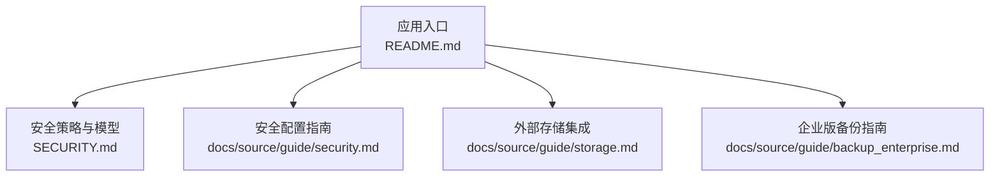
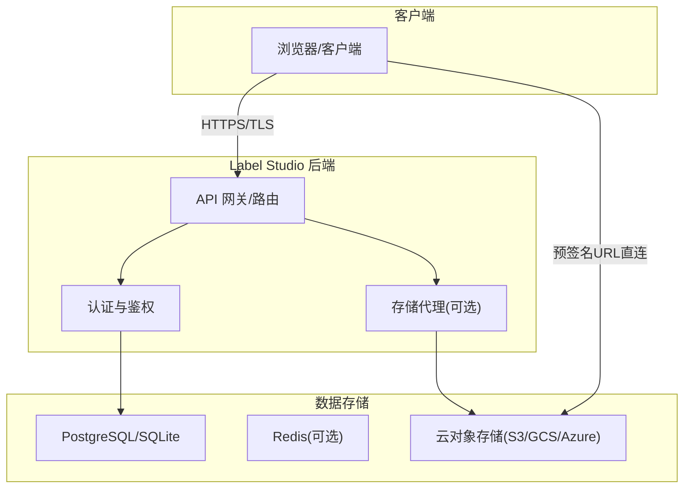
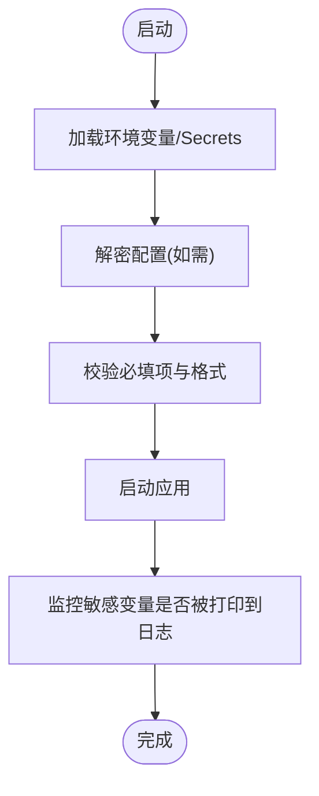
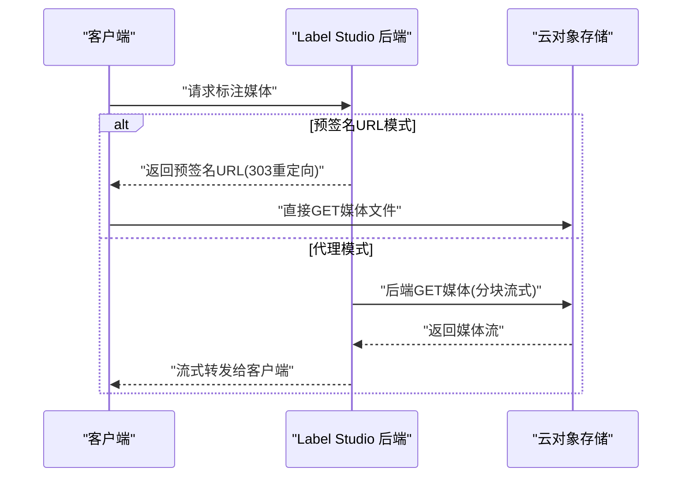
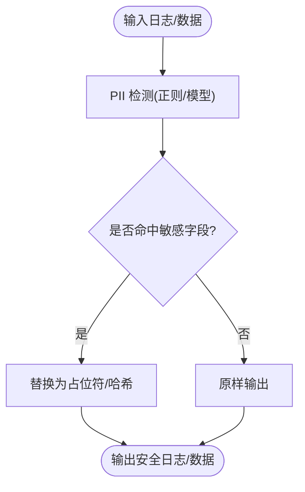
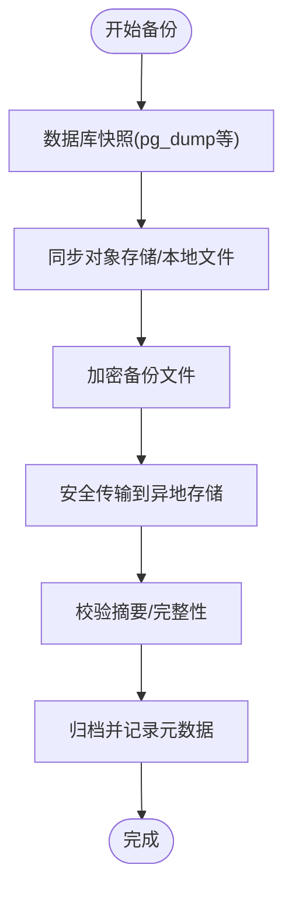
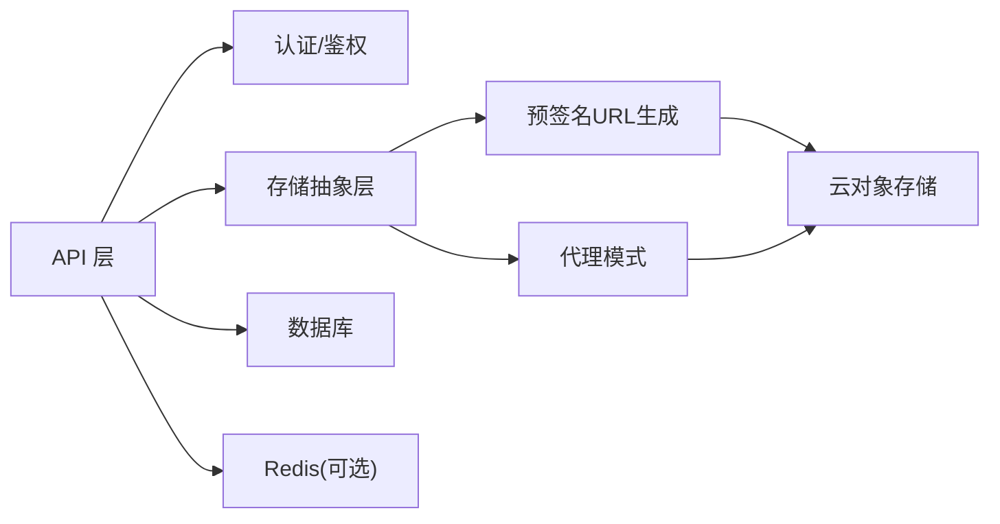

# 数据保护与隐私

<cite>
**本文引用的文件**   
- [README.md](file://README.md)
- [SECURITY.md](file://SECURITY.md)
- [security.md](file://docs/source/guide/security.md)
- [storage.md](file://docs/source/guide/storage.md)
- [backup_enterprise.md](file://docs/source/guide/backup_enterprise.md)
</cite>

## 目录
1. [简介](#简介)
2. [项目结构](#项目结构)
3. [核心组件](#核心组件)
4. [架构总览](#架构总览)
5. [详细组件分析](#详细组件分析)
6. [依赖关系分析](#依赖关系分析)
7. [性能考量](#性能考量)
8. [故障排查指南](#故障排查指南)
9. [结论](#结论)
10. [附录](#附录)

## 简介
本指南聚焦 Label Studio 的数据保护与隐私安全，覆盖敏感信息保护（密钥管理、环境变量安全、配置文件加密）、数据脱敏与匿名化（日志脱敏、调试清理、测试数据保护）、备份与恢复安全（加密备份、传输安全、访问控制）、GDPR 合规性与个人数据处理要求，以及数据泄露检测与响应机制和数据完整性验证方法。文档基于仓库中的官方安全与存储相关文档进行系统化整理，并结合通用最佳实践给出可操作建议。

## 项目结构
围绕数据安全与隐私，本项目涉及以下关键文档与模块：
- 安全策略与安全模型说明
- 安全配置与部署加固（TLS、SSRF、数据库与 Redis 安全）
- 外部存储集成与访问控制（预签名 URL 与代理模式）
- 企业版备份与恢复流程

图表来源
- [README.md:1-260](file://README.md#L1-L260)
- [SECURITY.md:1-45](file://SECURITY.md#L1-L45)
- [security.md:1-246](file://docs/source/guide/security.md#L1-L246)
- [storage.md:1-319](file://docs/source/guide/storage.md#L1-L319)
- [backup_enterprise.md:1-33](file://docs/source/guide/backup_enterprise.md#L1-L33)

章节来源
- [README.md:1-260](file://README.md#L1-L260)

## 核心组件
本节从“敏感信息保护”“数据脱敏与匿名化”“备份与恢复安全”“GDPR 合规性”“泄露检测与响应”“数据完整性验证”六个维度梳理实现要点与落地方案。

- 敏感信息保护
  - 密钥管理：通过环境变量注入敏感参数（如数据库连接、云存储凭据），避免硬编码；在容器编排中通过 Secret 或密钥管理服务集中管理。
  - 环境变量安全：生产环境禁用默认开启的本地开发开关（如 SSRF 保护需显式启用），并限制仅必要端口暴露。
  - 配置文件加密：对包含敏感信息的配置文件使用平台级加密（如 KMS、Vault），运行时解密后注入环境变量。

- 数据脱敏与匿名化
  - 日志脱敏：在日志输出前对 PII（姓名、邮箱、手机号等）进行掩码或哈希处理；对调试日志在生产环境关闭或降低级别。
  - 调试信息清理：禁止在生产构建中包含调试符号、源码路径、内部错误堆栈等敏感信息。
  - 测试数据保护：测试数据集应使用合成数据或经脱敏的真实数据；CI/CD 中不上传真实数据到制品库。

- 备份与恢复安全
  - 加密备份：对数据库与对象存储快照进行静态加密（AES-256 或等效算法）。
  - 传输安全：备份传输使用 TLS；跨地域复制采用受控通道（专线或 VPN）。
  - 访问控制：备份存储桶/卷最小权限原则，仅运维账号可读写；定期轮换密钥。
  - 恢复演练：定期执行恢复演练，验证备份可用性与 RTO/RPO 目标。

- GDPR 合规性与个人数据处理
  - 数据最小化：仅收集标注任务必需字段；关闭非必要统计上报（例如 analytics 开关）。
  - 同意与目的限定：明确数据处理目的，记录用户同意状态；提供撤回与删除能力。
  - 跨境传输：确保第三方服务符合标准合同条款或等效保障。
  - 审计与可追溯：记录访问与变更日志，支持审计查询。

- 数据泄露检测与响应
  - 检测：接入 SIEM/SOAR，监控异常下载、越权访问、大量导出等行为；对 S3/GCS/Azure 访问日志设置告警规则。
  - 响应：自动阻断可疑 IP、撤销临时令牌、隔离受影响资源；通知合规与法务团队。
  - 复盘：根因分析、修复漏洞、更新策略与培训。

- 数据完整性验证
  - 静态校验：为对象存储文件生成并保存 SHA-256 摘要；导入时校验一致性。
  - 传输校验：启用 HTTPS/TLS，必要时启用端到端校验（如客户端计算摘要并与服务端比对）。
  - 数据库校验：定期运行一致性检查与索引重建；对关键表启用事务与约束。

章节来源
- [security.md:60-151](file://docs/source/guide/security.md#L60-L151)
- [storage.md:185-280](file://docs/source/guide/storage.md#L185-L280)
- [SECURITY.md:12-45](file://SECURITY.md#L12-L45)

## 架构总览
Label Studio 的安全架构围绕“传输加密、身份认证、访问控制、存储安全、审计与合规”展开。下图展示典型部署下的数据流与安全边界。

图表来源
- [security.md:14-93](file://docs/source/guide/security.md#L14-L93)
- [storage.md:185-280](file://docs/source/guide/storage.md#L185-L280)

## 详细组件分析

### 组件A：敏感信息与密钥管理
- 环境变量与密钥注入
  - 将数据库密码、云存储密钥、JWT 密钥等通过环境变量注入，避免写入代码与镜像。
  - 在 Docker/Kubernetes 中使用 Secret 或外部密钥管理服务（KMS/Vault）动态注入。
- 配置项加密
  - 对包含敏感信息的配置文件进行加密存储，启动时由可信进程解密并注入环境变量。
- 最小权限与隔离
  - 为不同环境（开发/测试/生产）使用独立凭据与命名空间，防止凭据交叉泄漏。

图表来源
- [security.md:171-246](file://docs/source/guide/security.md#L171-L246)

章节来源
- [security.md:171-246](file://docs/source/guide/security.md#L171-L246)

### 组件B：数据传输与访问控制
- 传输加密
  - 全链路强制 HTTPS/TLS；证书管理与信任链配置见自签证书与 CA 信任配置。
- SSRF 防护
  - 生产环境启用 SSRF 保护环境变量，限制出站请求至受信网络。
- 数据库与缓存安全
  - PostgreSQL 启用 SSL 模式并要求有效证书；Redis 支持 TLS/SSL 与认证。
- 外部存储访问
  - 预签名 URL：浏览器直连云存储，减少后端负载与数据驻留风险。
  - 代理模式：后端拉取并流式转发，适合内网单点出口与细粒度权限控制。

图表来源
- [storage.md:185-280](file://docs/source/guide/storage.md#L185-L280)
- [security.md:85-151](file://docs/source/guide/security.md#L85-L151)

章节来源
- [security.md:60-151](file://docs/source/guide/security.md#L60-L151)
- [storage.md:185-280](file://docs/source/guide/storage.md#L185-L280)

### 组件C：数据脱敏与匿名化
- 日志脱敏
  - 在日志框架中增加脱敏过滤器，对常见 PII 字段进行掩码或不可逆哈希。
  - 生产环境关闭 DEBUG 级别日志，避免泄露内部结构与敏感上下文。
- 调试信息清理
  - 构建产物不包含源码路径、调试符号、内部错误详情；对外错误统一模板化。
- 测试数据保护
  - 使用合成数据或经脱敏的数据集；在 CI 中扫描并拒绝提交含真实 PII 的文件。

[无图表来源：该图为概念流程图，不直接映射具体源码文件]

### 组件D：备份与恢复安全
- 备份范围
  - 数据库、对象存储同步目录、配置文件与环境变量、Docker 卷。
- 加密与传输
  - 备份文件静态加密；传输走 TLS；跨地域使用受控通道。
- 访问控制
  - 备份存储桶/卷最小权限；仅运维角色可读写；定期轮换密钥。
- 恢复演练
  - 定期演练恢复流程，验证 RTO/RPO；记录版本与依赖清单以便回滚。

图表来源
- [backup_enterprise.md:15-33](file://docs/source/guide/backup_enterprise.md#L15-L33)

章节来源
- [backup_enterprise.md:15-33](file://docs/source/guide/backup_enterprise.md#L15-L33)

### 组件E：GDPR 合规与个人数据处理
- 数据最小化与目的限定
  - 仅收集标注所需字段；关闭非必要的统计上报（例如 analytics 开关）。
- 同意与权利
  - 记录用户同意；提供访问、更正、删除与导出接口；支持撤回同意。
- 跨境传输
  - 选择具备合规保障的云服务；签署标准合同条款或使用等效保障措施。
- 审计与可追溯
  - 记录关键操作日志；支持按主体检索其数据处理轨迹。

章节来源
- [security.md:161-169](file://docs/source/guide/security.md#L161-L169)

### 组件F：数据泄露检测与响应
- 检测
  - 对云存储访问日志、API 调用日志、数据库审计日志建立告警规则（异常下载、批量导出、越权访问）。
- 响应
  - 自动阻断可疑 IP、撤销临时令牌、隔离受影响资源；通知合规与法务团队。
- 复盘
  - 根因分析、修复漏洞、更新策略与培训。

[无图表来源：该部分为流程性指导，未直接映射具体源码文件]

### 组件G：数据完整性验证
- 静态校验
  - 为对象存储文件生成并保存 SHA-256 摘要；导入时校验一致性。
- 传输校验
  - 启用 HTTPS/TLS；必要时客户端与服务端双向校验摘要。
- 数据库校验
  - 定期运行一致性检查与索引重建；对关键表启用事务与约束。

[无图表来源：该部分为通用技术实践，未直接映射具体源码文件]

## 依赖关系分析
- 组件耦合
  - 后端 API 与认证模块强耦合；存储访问通过抽象层（预签名 URL 或代理）解耦。
- 外部依赖
  - 云存储 SDK（S3/GCS/Azure）、数据库驱动（PostgreSQL/SQLite）、缓存（Redis）。
- 潜在循环依赖
  - 存储解析器与代理模块应避免互相引用，保持单向依赖。

图表来源
- [storage.md:185-280](file://docs/source/guide/storage.md#L185-L280)
- [security.md:85-151](file://docs/source/guide/security.md#L85-L151)

章节来源
- [storage.md:185-280](file://docs/source/guide/storage.md#L185-L280)
- [security.md:85-151](file://docs/source/guide/security.md#L85-L151)

## 性能考量
- 代理模式的带宽与延迟
  - 大文件分块传输会增加后端请求次数与内存占用；可通过调整分块大小与超时参数优化。
- 预签名 URL 的优势
  - 减轻后端负载，提升并发读取性能；但需要云存储侧 CORS 与权限正确配置。
- 缓存策略
  - 合理使用 CDN/边缘缓存加速静态媒体；注意缓存失效与权限一致性。

章节来源
- [storage.md:274-280](file://docs/source/guide/storage.md#L274-L280)

## 故障排查指南
- 外部存储连接问题
  - 确认 IAM/角色权限（LIST/GET/PUT/DELETE）与区域匹配；检查 VPC/IP 白名单与 VPN 路由。
- 预签名 URL 无法访问
  - 检查浏览器 CORS 设置与云存储桶策略；确认时间戳与签名有效期。
- 代理模式卡顿
  - 调整分块大小与超时参数；检查后端 CPU/内存与网络带宽瓶颈。
- 数据库连接失败
  - 检查 SSL 证书与连接字符串；确认防火墙与端口开放。

章节来源
- [storage.md:298-319](file://docs/source/guide/storage.md#L298-L319)
- [security.md:85-151](file://docs/source/guide/security.md#L85-L151)

## 结论
Label Studio 的安全与隐私能力以传输加密、身份认证、存储访问控制为核心，结合预签名 URL 与代理模式满足不同场景的安全与性能需求。通过环境变量与密钥管理、日志脱敏、备份加密与恢复演练、GDPR 合规配置以及泄露检测与完整性校验，可构建端到端的数据保护体系。建议在生产环境中严格遵循最小权限、加密传输与审计可追溯原则，并定期进行安全评估与演练。

## 附录
- 参考文档
  - 安全策略与安全模型：[SECURITY.md](file://SECURITY.md)
  - 安全配置与部署加固：[docs/source/guide/security.md](file://docs/source/guide/security.md)
  - 外部存储集成与访问控制：[docs/source/guide/storage.md](file://docs/source/guide/storage.md)
  - 企业版备份与恢复：[docs/source/guide/backup_enterprise.md](file://docs/source/guide/backup_enterprise.md)
  - 项目概览与安装指引：[README.md](file://README.md)