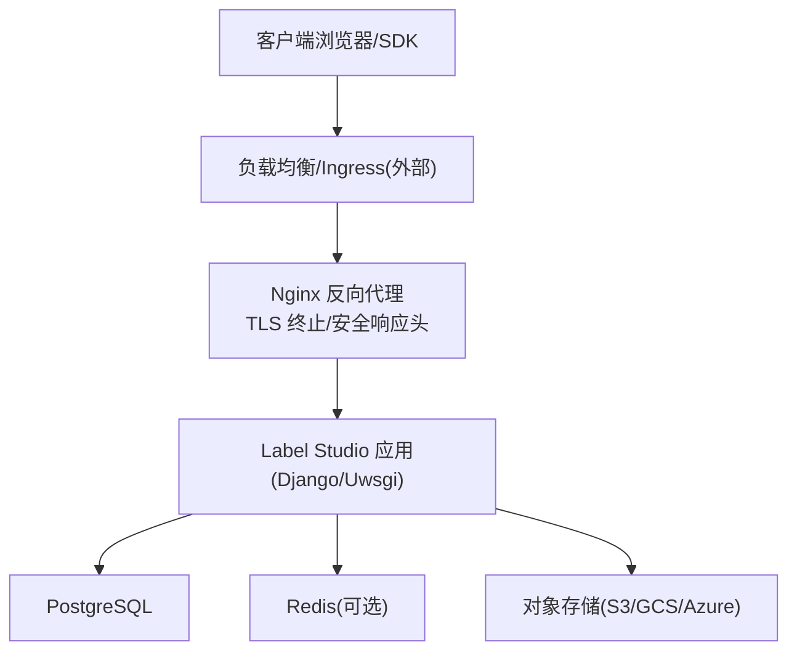
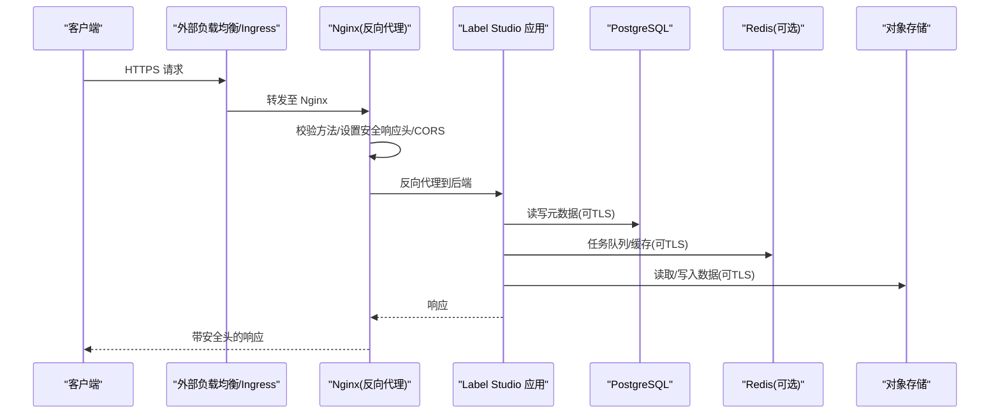
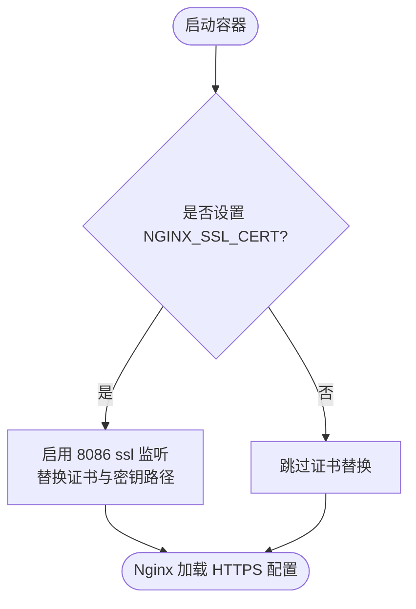
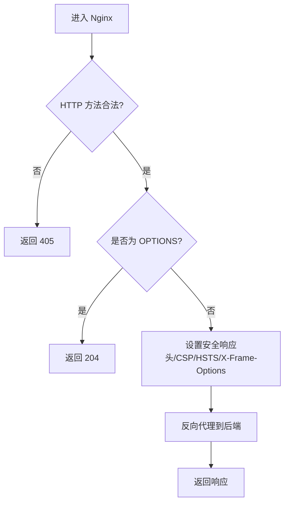
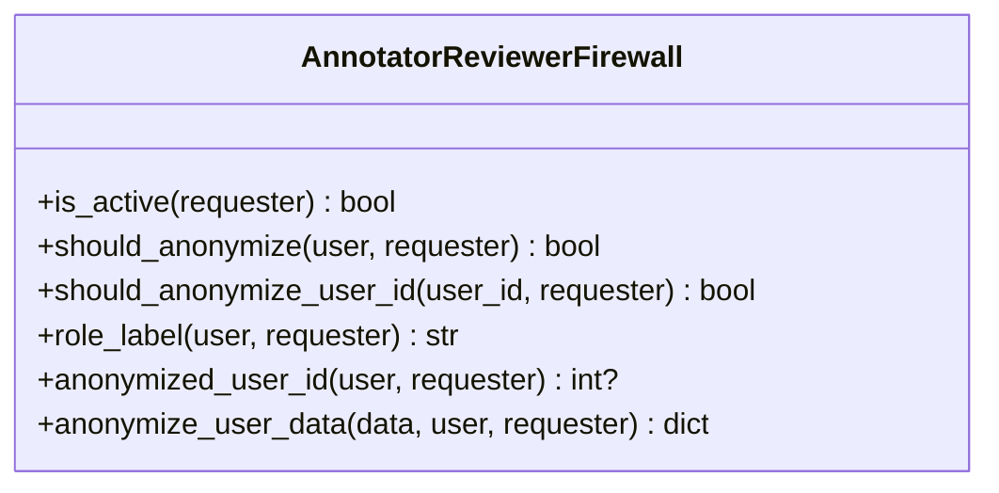
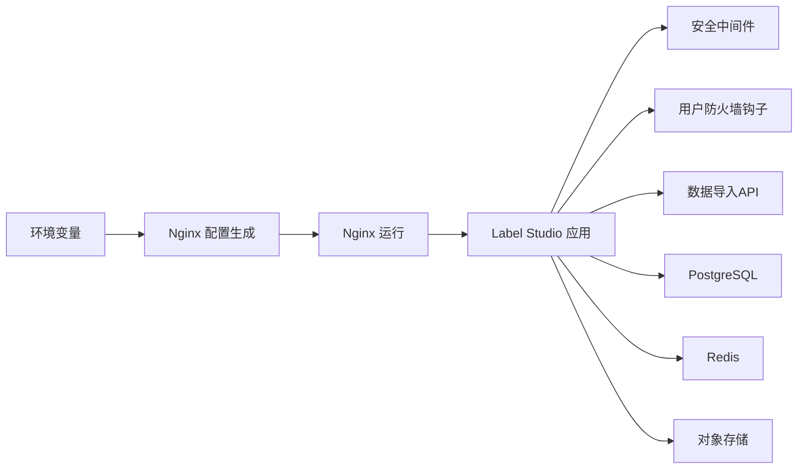

# 网络安全配置

<cite>
**本文引用的文件**   
- [deploy/default.conf](file://deploy/default.conf)
- [deploy/docker-entrypoint.d/common/10-configure-nginx.sh](file://deploy/docker-entrypoint.d/common/10-configure-nginx.sh)
- [label_studio/users/firewall.py](file://label_studio/users/firewall.py)
- [label_studio/core/middleware.py](file://label_studio/core/middleware.py)
- [label_studio/data_import/api.py](file://label_studio/data_import/api.py)
- [docker-compose.yml](file://docker-compose.yml)
- [docs/source/guide/security.md](file://docs/source/guide/security.md)
- [docs/source/guide/storage_azure.md](file://docs/source/guide/storage_azure.md)
- [docs/source/guide/persistent_storage.md](file://docs/source/guide/persistent_storage.md)
- [docs/source/guide/email_setup.md](file://docs/source/guide/email_setup.md)
- [docs/source/guide/auth_ldap.md](file://docs/source/guide/auth_ldap.md)
- [docs/source/guide/ingress_config.md](file://docs/source/guide/ingress_config.md)
</cite>

## 目录
1. [简介](#简介)
2. [项目结构](#项目结构)
3. [核心组件](#核心组件)
4. [架构总览](#架构总览)
5. [详细组件分析](#详细组件分析)
6. [依赖关系分析](#依赖关系分析)
7. [性能与容量规划](#性能与容量规划)
8. [故障排查指南](#故障排查指南)
9. [结论](#结论)
10. [附录：安全清单与最佳实践](#附录安全清单与最佳实践)

## 简介
本文件面向在私有或企业环境中部署 Label Studio 的安全工程师、运维与平台团队，聚焦“网络安全配置”。内容覆盖：
- 防火墙规则（入站/出站）与网络分段
- SSL/TLS 证书与 HTTPS 强制
- Nginx 反向代理安全配置（请求头过滤、CORS、安全响应头）
- 数据库、缓存、对象存储的网络访问控制
- 网络监控与日志记录
- 常见网络攻击防护建议

说明：Label Studio 的开源版本默认不内置系统级防火墙策略；安全边界通常由容器编排平台、云厂商网络策略或外部网关承担。本文所有实现细节均基于仓库内提供的 Nginx 配置、入口脚本与安全文档。

## 项目结构
与网络安全直接相关的代码与配置主要位于以下位置：
- Nginx 反向代理与 TLS 终止：deploy/default.conf
- Nginx 动态配置与证书注入：deploy/docker-entrypoint.d/common/10-configure-nginx.sh
- 应用层用户匿名化“防火墙”钩子：label_studio/users/firewall.py
- 安全相关中间件（如 CSP 处理）：label_studio/core/middleware.py
- 数据导入时的安全响应头设置：label_studio/data_import/api.py
- 组件间通信与可选 TLS（PostgreSQL、Redis）：docker-compose.yml
- 官方安全与存储/CORS 指南：docs/source/guide/*

图表来源
- [deploy/default.conf:111-224](file://deploy/default.conf#L111-L224)
- [docker-compose.yml:59-70](file://docker-compose.yml#L59-L70)

章节来源
- [deploy/default.conf:1-226](file://deploy/default.conf#L1-L226)
- [deploy/docker-entrypoint.d/common/10-configure-nginx.sh:1-71](file://deploy/docker-entrypoint.d/common/10-configure-nginx.sh#L1-L71)

## 核心组件
- Nginx 反向代理：提供静态资源、前端路由、文件下载代理、安全响应头、CORS、TLS 终止与日志格式。
- 入口脚本：根据环境变量动态启用 HTTPS、替换证书路径、调整后端主机与子路径。
- 应用层“防火墙”：开源版为无操作实现，企业版可替换为按角色匿名化的策略。
- 安全中间件：统一处理 Content-Security-Policy 等响应头。
- 数据导入 API：对特定上传类型返回沙箱 CSP。
- 组件间通信：PostgreSQL、Redis、对象存储可通过 TLS 加密。

章节来源
- [deploy/default.conf:81-130](file://deploy/default.conf#L81-L130)
- [deploy/docker-entrypoint.d/common/10-configure-nginx.sh:42-50](file://deploy/docker-entrypoint.d/common/10-configure-nginx.sh#L42-L50)
- [label_studio/users/firewall.py:1-74](file://label_studio/users/firewall.py#L1-L74)
- [label_studio/core/middleware.py:338-340](file://label_studio/core/middleware.py#L338-L340)
- [label_studio/data_import/api.py:1125-1125](file://label_studio/data_import/api.py#L1125-L1125)

## 架构总览
下图展示从外部到内部服务的典型流量路径与安全控制点：

图表来源
- [deploy/default.conf:111-224](file://deploy/default.conf#L111-L224)
- [docker-compose.yml:59-70](file://docker-compose.yml#L59-L70)

## 详细组件分析

### 防火墙规则与网络分段
- 系统级防火墙：仓库未包含 iptables/ufw/nftables 规则。生产环境建议在容器编排层或云网络层实施最小权限原则。
- 入站流量：仅暴露 Nginx 对外端口（例如 80/443），由外部负载均衡或 Ingress 终止 TLS。
- 出站流量：Label Studio 需要访问数据库、缓存、对象存储以及可能的第三方服务（邮件、LDAP、模型推理等）。应通过 VPC 子网、安全组/网络 ACL 限制目标 IP/端口。
- 网络分段：将 Web 层（Nginx/App）、数据层（PostgreSQL/Redis）、存储层（S3/GCS/Azure）划分到不同子网，并仅开放必要端口。

章节来源
- [docs/source/guide/security.md:91-91](file://docs/source/guide/security.md#L91-L91)
- [docker-compose.yml:59-70](file://docker-compose.yml#L59-L70)

### SSL/TLS 证书与 HTTPS 强制
- Nginx TLS 协议与套件：默认启用 TLSv1.2/TLSv1.3，并限定强密码套件。
- HTTPS 监听与证书：默认注释掉 8086 的 SSL 监听与证书路径，通过入口脚本根据环境变量启用并替换证书路径。
- HSTS：已添加 Strict-Transport-Security 头以强制浏览器使用 HTTPS。
- 自签名与企业 CA：
  - 自签名证书：可用于测试环境，但需确保客户端信任该根证书或通过 Ingress/网关统一终止。
  - 企业 CA：将证书链与私钥挂载到容器，并通过环境变量注入到 Nginx。
- 组件间 TLS：
  - PostgreSQL：可在 compose 中启用 TLS（参考 compose 注释）。
  - Redis：企业特性支持 TLS 与客户端证书认证。
  - LDAP：支持通过环境变量配置 TLS 与自定义 CA。
  - 邮件：支持 EMAIL_USE_TLS。

图表来源
- [deploy/default.conf:117-119](file://deploy/default.conf#L117-L119)
- [deploy/docker-entrypoint.d/common/10-configure-nginx.sh:42-50](file://deploy/docker-entrypoint.d/common/10-configure-nginx.sh#L42-L50)

章节来源
- [deploy/default.conf:84-85](file://deploy/default.conf#L84-L85)
- [deploy/default.conf:129-130](file://deploy/default.conf#L129-L130)
- [deploy/docker-entrypoint.d/common/10-configure-nginx.sh:42-50](file://deploy/docker-entrypoint.d/common/10-configure-nginx.sh#L42-L50)
- [docker-compose.yml:59-70](file://docker-compose.yml#L59-L70)
- [docs/source/guide/auth_ldap.md:113-121](file://docs/source/guide/auth_ldap.md#L113-L121)
- [docs/source/guide/email_setup.md:45-45](file://docs/source/guide/email_setup.md#L45-L45)
- [docs/source/guide/enterprise_features.md:144-158](file://docs/source/guide/enterprise_features.md#L144-L158)

### Nginx 反向代理安全配置
- 请求方法与 CORS：
  - 仅允许常用 HTTP 方法，其他返回 405。
  - 预检 OPTIONS 快速返回 204。
  - 默认 Access-Control-Allow-Origin 为 *，适合开发；生产建议收紧为具体域名白名单。
- 安全响应头：
  - Strict-Transport-Security：启用 HSTS。
  - X-Frame-Options：SAMEORIGIN，防点击劫持。
  - Content-Security-Policy：针对上传的可执行文档类型启用 sandbox。
- 请求头过滤与隐私：
  - 隐藏上游敏感头（GCS/AWS 元数据）。
  - 代理时移除 Authorization 与 Cookie，避免泄露。
  - 传递 X-Real-IP、X-Forwarded-For、Host、X-Request-ID。
- 超时与体大小：
  - 合理设置连接/发送/读取/发送超时与 client_max_body_size。
- 健康检查：
  - /nginx_health 返回 200，便于探针检测。

图表来源
- [deploy/default.conf:121-136](file://deploy/default.conf#L121-L136)
- [deploy/default.conf:125-130](file://deploy/default.conf#L125-L130)
- [deploy/default.conf:156-197](file://deploy/default.conf#L156-L197)

章节来源
- [deploy/default.conf:121-136](file://deploy/default.conf#L121-L136)
- [deploy/default.conf:125-130](file://deploy/default.conf#L125-L130)
- [deploy/default.conf:156-197](file://deploy/default.conf#L156-L197)

### 应用层“防火墙”（标注者/评审者隔离）
- 开源版默认是无操作实现，不会匿名化任何用户信息。
- 企业版可通过 settings.ANNOTATOR_REVIEWER_FIREWALL 替换为企业实现，实现对非当前请求者的用户信息进行匿名化（保留稳定负数 id 与角色标签）。
- 该机制用于防止标注者/评审者在 API 响应中看到其他用户的身份信息。

图表来源
- [label_studio/users/firewall.py:26-74](file://label_studio/users/firewall.py#L26-L74)

章节来源
- [label_studio/users/firewall.py:1-74](file://label_studio/users/firewall.py#L1-L74)

### 安全中间件与 CSP
- 中间件会将响应中的 Content-Security-Policy-Report-Only 转换为正式 CSP 头，便于调试后上线。
- 数据导入 API 对特定上传类型返回 sandbox CSP，降低执行风险。

章节来源
- [label_studio/core/middleware.py:338-340](file://label_studio/core/middleware.py#L338-L340)
- [label_studio/data_import/api.py:1125-1125](file://label_studio/data_import/api.py#L1125-L1125)

### 对象存储与 CORS
- S3/GCS/Azure 对象存储需单独配置 CORS，以便浏览器直连或跨域访问。
- Azure Blob 存储明确需要提供 CORS 配置以支持预签名 URL 场景。
- 仓库文档提供了各云厂商的 CORS 配置示例与命令。

章节来源
- [docs/source/guide/storage_azure.md:17-26](file://docs/source/guide/storage_azure.md#L17-L26)
- [docs/source/guide/persistent_storage.md:58-63](file://docs/source/guide/persistent_storage.md#L58-L63)
- [docs/source/guide/persistent_storage.md:359-376](file://docs/source/guide/persistent_storage.md#L359-L376)
- [docs/source/guide/persistent_storage.md:528-533](file://docs/source/guide/persistent_storage.md#L528-L533)

### Kubernetes Ingress 与外部 TLS
- 推荐使用 Ingress 控制器管理外部 HTTPS 路由，并在负载均衡处终止 TLS。
- 文档提供了在 Azure Application Gateway 等场景中生成自签名证书的步骤与负载均衡 TLS 终止说明。

章节来源
- [docs/source/guide/ingress_config.md:15-22](file://docs/source/guide/ingress_config.md#L15-L22)
- [docs/source/guide/ingress_config.md:99-99](file://docs/source/guide/ingress_config.md#L99-L99)
- [docs/source/guide/ingress_config.md:123-123](file://docs/source/guide/ingress_config.md#L123-L123)

## 依赖关系分析
- Nginx 依赖：
  - 环境变量：NGINX_SSL_CERT、NGINX_SSL_CERT_KEY、APP_HOST、LABEL_STUDIO_HOST_SUBPATH、NGINX_ERROR_LOG_LEVEL。
  - 运行时：/etc/resolv.conf（解析器）、/tmp 临时目录、静态资源路径。
- 应用依赖：
  - Django 中间件（CSP 处理）。
  - 数据导入模块（CSP 设置）。
  - 用户模块（防火墙钩子）。
- 外部依赖：
  - 数据库（PostgreSQL）、缓存（Redis）、对象存储（S3/GCS/Azure）、邮件服务器、LDAP/AD、第三方模型服务。

图表来源
- [deploy/docker-entrypoint.d/common/10-configure-nginx.sh:1-71](file://deploy/docker-entrypoint.d/common/10-configure-nginx.sh#L1-L71)
- [label_studio/core/middleware.py:338-340](file://label_studio/core/middleware.py#L338-L340)
- [label_studio/users/firewall.py:1-74](file://label_studio/users/firewall.py#L1-L74)
- [label_studio/data_import/api.py:1125-1125](file://label_studio/data_import/api.py#L1125-L1125)

章节来源
- [deploy/docker-entrypoint.d/common/10-configure-nginx.sh:1-71](file://deploy/docker-entrypoint.d/common/10-configure-nginx.sh#L1-L71)
- [label_studio/core/middleware.py:338-340](file://label_studio/core/middleware.py#L338-L340)
- [label_studio/users/firewall.py:1-74](file://label_studio/users/firewall.py#L1-L74)
- [label_studio/data_import/api.py:1125-1125](file://label_studio/data_import/api.py#L1125-L1125)

## 性能与容量规划
- Nginx worker 与连接数：worker_processes 与 worker_connections 可按 CPU 核数与并发规模调整。
- Gzip 压缩：已开启，注意对大体积二进制文件的影响。
- 超时参数：proxy_connect_timeout/send_timeout/read_timeout/send_timeout 建议根据业务延迟与网络质量调优。
- 上传体大小：client_max_body_size 需结合业务最大文件大小调整。
- 日志级别：通过 NGINX_ERROR_LOG_LEVEL 控制错误日志级别，避免过度 I/O。

[本节为通用指导，无需引用具体文件]

## 故障排查指南
- HTTPS 无法启用：
  - 检查是否设置了 NGINX_SSL_CERT 与 NGINX_SSL_CERT_KEY，且路径正确。
  - 确认证书链完整，私钥权限正确。
- CORS 报错：
  - 若浏览器直连对象存储，需在对应存储桶配置 CORS。
  - 若通过 Nginx 代理，确认 Access-Control-Allow-Origin 与 Allow-Headers 满足需求。
- CSP 导致页面功能异常：
  - 检查中间件是否正确转换 Report-Only 为正式 CSP。
  - 对于上传的可执行文档类型，确认 sandbox 策略是否符合预期。
- 用户身份泄露：
  - 开源版默认不匿名化，如需标注者/评审者隔离，请切换企业版实现。
- 组件间连接失败：
  - 检查 PostgreSQL/Redis 是否启用 TLS，证书与 CA 配置是否正确。
  - 检查邮件与 LDAP 的 TLS 选项与环境变量。

章节来源
- [deploy/docker-entrypoint.d/common/10-configure-nginx.sh:42-50](file://deploy/docker-entrypoint.d/common/10-configure-nginx.sh#L42-L50)
- [docs/source/guide/storage_azure.md:17-26](file://docs/source/guide/storage_azure.md#L17-L26)
- [label_studio/core/middleware.py:338-340](file://label_studio/core/middleware.py#L338-L340)
- [label_studio/users/firewall.py:1-74](file://label_studio/users/firewall.py#L1-L74)
- [docs/source/guide/auth_ldap.md:113-121](file://docs/source/guide/auth_ldap.md#L113-L121)
- [docs/source/guide/email_setup.md:45-45](file://docs/source/guide/email_setup.md#L45-L45)

## 结论
Label Studio 的网络安全能力由多层组成：Nginx 反向代理负责 TLS 终止、安全响应头与基础请求过滤；应用层提供 CSP 与可选的用户匿名化防火墙；组件间通信支持 TLS；对象存储需单独配置 CORS。生产环境建议：
- 在外部负载均衡或 Ingress 终止 TLS，并使用企业 CA 证书。
- 严格限制 CORS 与请求方法，收紧 Access-Control-Allow-Origin。
- 通过 VPC/安全组进行网络分段，最小化入站/出站规则。
- 启用 HSTS、X-Frame-Options、CSP 等安全响应头。
- 对数据库、缓存、对象存储启用 TLS，并限制访问源。
- 建立统一的日志与监控体系，集中采集 Nginx 与应用日志。

[本节为总结性内容，无需引用具体文件]

## 附录：安全清单与最佳实践
- 防火墙与网络分段
  - 仅暴露 Nginx 对外端口，内部服务不直接暴露。
  - 数据库、缓存、对象存储仅在应用子网可达。
  - 出站访问第三方服务需白名单控制。
- TLS 与证书
  - 使用 TLSv1.2/1.3，禁用弱密码套件。
  - 生产环境使用企业 CA 证书，定期轮换。
  - 组件间通信启用 TLS（PostgreSQL/Redis/LDAP/邮件）。
- Nginx 安全
  - 限制 HTTP 方法，OPTIONS 预检快速返回。
  - 设置 HSTS、X-Frame-Options、CSP。
  - 隐藏上游敏感头，移除 Authorization/Cookie。
  - 合理设置超时与上传体大小。
- CORS
  - 对象存储桶单独配置 CORS，限制来源与方法。
  - 谨慎使用通配符 *，生产环境指定可信域名。
- 监控与日志
  - 启用 Nginx JSON 详细日志，集中收集与分析。
  - 应用层开启审计日志，记录关键操作。
  - 对异常状态码与慢请求进行告警。
- 常见攻击防护
  - XSS/点击劫持：CSP、X-Frame-Options、HSTS。
  - CSRF：使用同源策略与安全的 Cookie 属性（由框架保障）。
  - 越权访问：RBAC 与项目/组织级权限控制。
  - 数据泄露：最小化响应字段，隐藏上游敏感头。
  - 拒绝服务：限制请求体大小、速率限制（由网关/负载均衡实现）。

[本节为通用指导，无需引用具体文件]