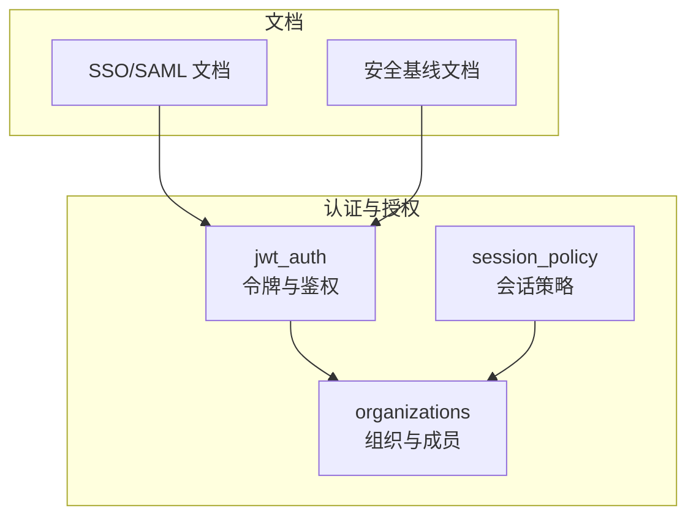
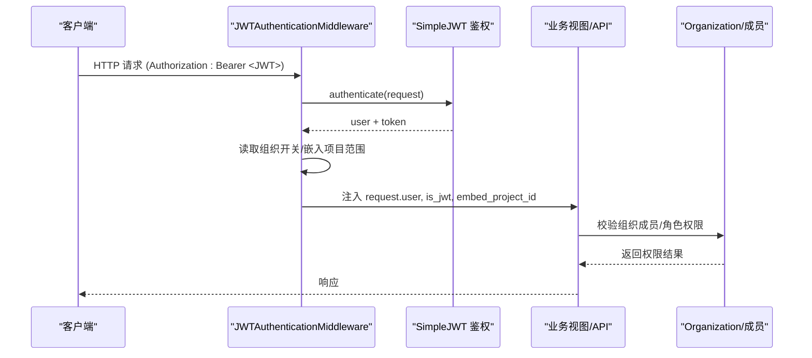
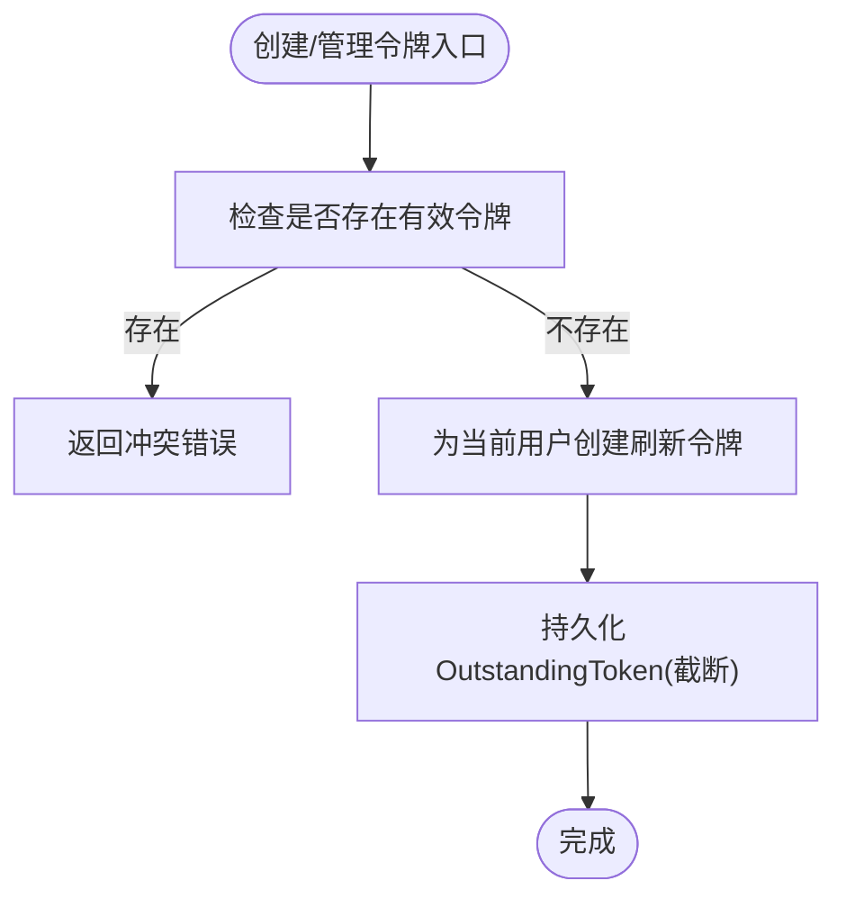
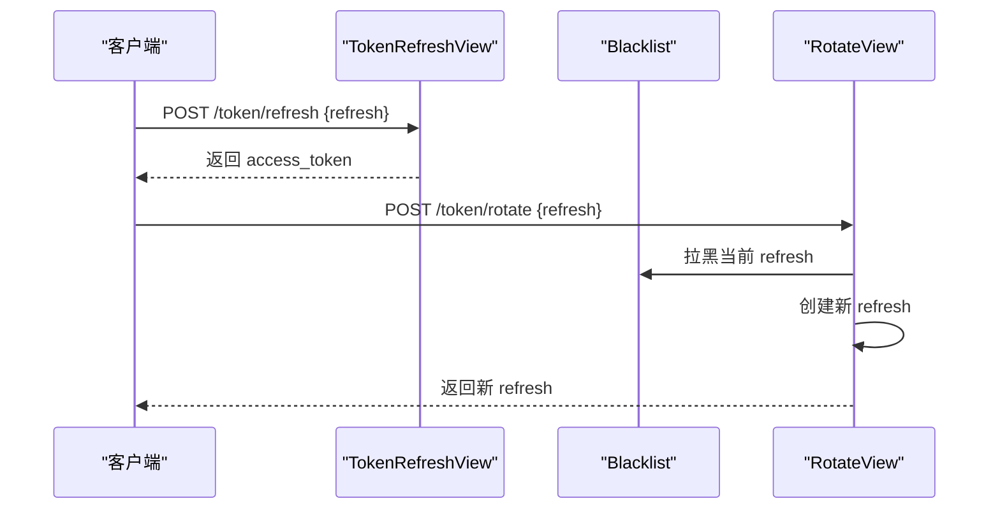
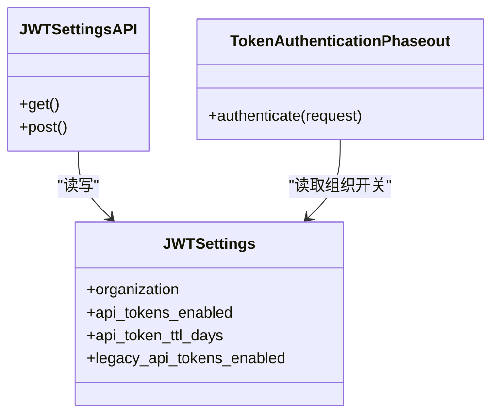
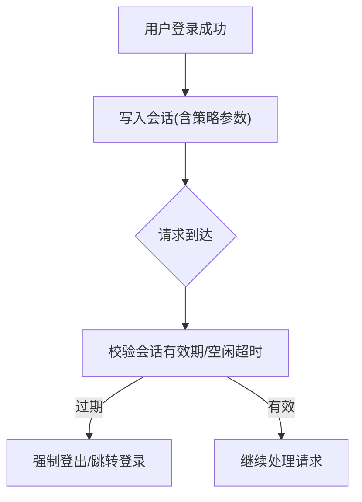
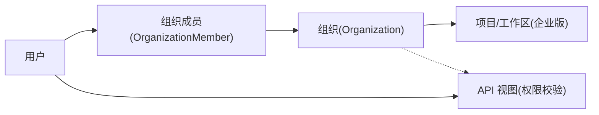
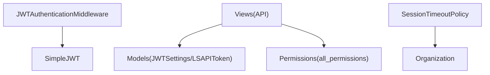

# 身份认证与授权

<cite>
**本文引用的文件**   
- [auth_setup.md](file://docs/source/guide/auth_setup.md)
- [security.md](file://docs/source/guide/security.md)
- [jwt_auth/auth.py](file://label_studio/jwt_auth/auth.py)
- [jwt_auth/middleware.py](file://label_studio/jwt_auth/middleware.py)
- [jwt_auth/models.py](file://label_studio/jwt_auth/models.py)
- [jwt_auth/views.py](file://label_studio/jwt_auth/views.py)
- [session_policy/models.py](file://label_studio/session_policy/models.py)
- [organizations/models.py](file://label_studio/organizations/models.py)
</cite>

## 目录
1. [简介](#简介)
2. [项目结构](#项目结构)
3. [核心组件](#核心组件)
4. [架构总览](#架构总览)
5. [详细组件分析](#详细组件分析)
6. [依赖关系分析](#依赖关系分析)
7. [性能考虑](#性能考虑)
8. [故障排查指南](#故障排查指南)
9. [结论](#结论)
10. [附录](#附录)

## 简介
本指南聚焦 Label Studio 的身份认证与授权，覆盖以下关键主题：
- JWT 令牌安全配置：生命周期管理、刷新机制、密钥轮换与组织级开关
- 用户会话安全管理：会话超时、并发控制、会话劫持防护
- 权限控制系统：基于角色的访问控制（RBAC）、资源级权限、API 级权限校验
- 多组织环境下的权限隔离与用户数据匿名化
- 第三方认证集成（SAML/OAuth/LDAP）的安全配置
- 认证审计与日志记录

## 项目结构
围绕认证与授权的核心代码分布在以下模块：
- jwt_auth：JWT 令牌模型、中间件、视图与鉴权扩展
- session_policy：会话策略（超时等）
- organizations：组织与成员模型，承载 RBAC 与权限边界
- docs/source/guide：官方安全与 SSO 文档

图表来源
- [jwt_auth/models.py:14-36](file://label_studio/jwt_auth/models.py#L14-L36)
- [jwt_auth/middleware.py:12-61](file://label_studio/jwt_auth/middleware.py#L12-L61)
- [jwt_auth/views.py:63-84](file://label_studio/jwt_auth/views.py#L63-L84)
- [session_policy/models.py:8-33](file://label_studio/session_policy/models.py#L8-L33)
- [organizations/models.py:107-185](file://label_studio/organizations/models.py#L107-L185)
- [auth_setup.md:23-122](file://docs/source/guide/auth_setup.md#L23-L122)
- [security.md:60-93](file://docs/source/guide/security.md#L60-L93)

章节来源
- [auth_setup.md:23-122](file://docs/source/guide/auth_setup.md#L23-L122)
- [security.md:60-93](file://docs/source/guide/security.md#L60-L93)

## 核心组件
- JWT 令牌后端与令牌类
  - LSTokenBackend：自定义后端，支持生成“截断”令牌（仅 header+payload），避免前端持有签名
  - LSAPIToken/TruncatedLSAPIToken：组织级 TTL 的 Refresh Token，支持黑名单与旋转
- 组织级 JWT 设置
  - JWTSettings：按组织启用/禁用 API Token、设置 TTL、是否允许旧版 Token
- JWT 中间件
  - JWTAuthenticationMiddleware：识别 Bearer JWT，调用 SimpleJWT 鉴权，注入 request.user 与 embed_project_id
- 令牌管理 API
  - LSAPITokenView：列出/创建用户令牌（限制每个用户仅一个有效令牌）
  - LSTokenBlacklistView：将刷新令牌加入黑名单
  - LSAPITokenRotateView：旋转刷新令牌（旧令牌失效，颁发新令牌）
  - JWTSettingsAPI：获取/更新当前组织的 JWT 设置
- 会话策略
  - SessionTimeoutPolicy：组织级最大会话时长与活动间隔
- 组织与成员
  - Organization/OrganizationMember：组织边界、成员关系、软删除与会话清理

章节来源
- [jwt_auth/models.py:14-131](file://label_studio/jwt_auth/models.py#L14-L131)
- [jwt_auth/middleware.py:12-61](file://label_studio/jwt_auth/middleware.py#L12-L61)
- [jwt_auth/views.py:63-270](file://label_studio/jwt_auth/views.py#L63-L270)
- [session_policy/models.py:8-33](file://label_studio/session_policy/models.py#L8-L33)
- [organizations/models.py:34-95](file://label_studio/organizations/models.py#L34-L95)

## 架构总览
下图展示从请求进入、JWT 鉴权到组织权限检查的关键流程。

图表来源
- [jwt_auth/middleware.py:12-61](file://label_studio/jwt_auth/middleware.py#L12-L61)
- [jwt_auth/views.py:63-84](file://label_studio/jwt_auth/views.py#L63-L84)
- [organizations/models.py:107-185](file://label_studio/organizations/models.py#L107-L185)

## 详细组件分析

### JWT 令牌与生命周期管理
- 令牌类型与存储
  - LSTokenBackend.encode 返回截断令牌（不含签名），降低泄露风险；encode_full 用于服务端签发完整令牌
  - TruncatedLSAPIToken 在解析时补齐占位签名以兼容库要求
- 生命周期与过期
  - LSAPIToken.lifetime 默认极长（200年），实际由组织设置 JWTSettings.api_token_ttl_days 控制
  - 列表接口过滤未过期且未被拉黑的令牌
- 令牌管理
  - 创建：同一用户仅允许存在一个有效令牌，重复创建会冲突
  - 黑名单：支持显式拉黑刷新令牌
  - 旋转：将旧刷新令牌拉黑并颁发新刷新令牌

图表来源
- [jwt_auth/views.py:137-191](file://label_studio/jwt_auth/views.py#L137-L191)
- [jwt_auth/models.py:41-131](file://label_studio/jwt_auth/models.py#L41-L131)

章节来源
- [jwt_auth/models.py:41-131](file://label_studio/jwt_auth/models.py#L41-L131)
- [jwt_auth/views.py:137-191](file://label_studio/jwt_auth/views.py#L137-L191)

### 令牌刷新与轮换
- 刷新
  - DecoratedTokenRefreshView 继承 SimpleJWT 刷新逻辑，提供 OpenAPI 注解
- 轮换
  - LSAPITokenRotateView 先对当前刷新令牌执行黑名单，再为用户创建新的刷新令牌

图表来源
- [jwt_auth/views.py:87-102](file://label_studio/jwt_auth/views.py#L87-L102)
- [jwt_auth/views.py:226-270](file://label_studio/jwt_auth/views.py#L226-L270)

章节来源
- [jwt_auth/views.py:87-102](file://label_studio/jwt_auth/views.py#L87-L102)
- [jwt_auth/views.py:226-270](file://label_studio/jwt_auth/views.py#L226-L270)

### 组织级 JWT 设置与旧版令牌过渡
- JWTSettingsAPI 暴露获取/更新组织 JWT 设置的接口
- TokenAuthenticationPhaseout 在 Legacy Token 场景下：
  - 若组织已禁用旧版 API Token，则拒绝认证并记录日志
  - 记录使用统计以便迁移监控

图表来源
- [jwt_auth/models.py:14-36](file://label_studio/jwt_auth/models.py#L14-L36)
- [jwt_auth/auth.py:10-43](file://label_studio/jwt_auth/auth.py#L10-L43)
- [jwt_auth/views.py:63-84](file://label_studio/jwt_auth/views.py#L63-L84)

章节来源
- [jwt_auth/models.py:14-36](file://label_studio/jwt_auth/models.py#L14-L36)
- [jwt_auth/auth.py:10-43](file://label_studio/jwt_auth/auth.py#L10-L43)
- [jwt_auth/views.py:63-84](file://label_studio/jwt_auth/views.py#L63-L84)

### 用户会话安全管理
- 会话策略模型
  - max_session_age：会话最大存活时间（分钟）
  - max_time_between_activity：无活动保持活跃的最大间隔（分钟）
- 建议实践
  - 结合反向代理或 WSGI 层强制 HTTPS、Secure Cookie、SameSite
  - 通过 Redis 实现会话集中存储与并发控制（如单设备登录、踢出旧会话）
  - 检测 User-Agent/IP 变化，触发重新认证或二次验证

图表来源
- [session_policy/models.py:8-33](file://label_studio/session_policy/models.py#L8-L33)

章节来源
- [session_policy/models.py:8-33](file://label_studio/session_policy/models.py#L8-L33)

### 权限控制系统（RBAC、资源级、API 级）
- 组织与成员
  - Organization/OrganizationMember 定义组织边界与成员关系，支持软删除与会话清理
- 角色与工作区/项目
  - 企业版支持基于角色的访问控制，并通过 SAML 组映射工作区与项目角色
- API 级权限
  - 各视图通过 permission_required/all_permissions 进行细粒度控制
  - 令牌鉴权与组织上下文共同决定可访问资源

图表来源
- [organizations/models.py:34-95](file://label_studio/organizations/models.py#L34-L95)
- [organizations/models.py:107-185](file://label_studio/organizations/models.py#L107-L185)
- [auth_setup.md:101-120](file://docs/source/guide/auth_setup.md#L101-L120)

章节来源
- [organizations/models.py:34-95](file://label_studio/organizations/models.py#L34-L95)
- [organizations/models.py:107-185](file://label_studio/organizations/models.py#L107-L185)
- [auth_setup.md:101-120](file://docs/source/guide/auth_setup.md#L101-L120)

### 多组织权限隔离与用户数据匿名化
- 权限隔离
  - 通过 Organization 与 OrganizationMember 建立强隔离边界；用户只能访问其所属组织内的资源
  - 项目/工作区层面的角色继承与映射进一步细化权限
- 用户数据匿名化
  - 当用户在组织中软删除时，系统会清理任务锁等资源；头像等关联数据可按需清理
  - 建议在导出/审计日志中对敏感字段做脱敏处理（例如邮箱、姓名）

章节来源
- [organizations/models.py:78-95](file://label_studio/organizations/models.py#L78-L95)
- [organizations/models.py:187-215](file://label_studio/organizations/models.py#L187-L215)

### 第三方认证集成（SAML/OAuth/LDAP）
- SAML SSO
  - 企业版支持 SAML，可在组织级别配置 IdP 元数据、属性映射与组映射
  - 支持 Okta、Google、PingOne、Entra ID、Auth0 等常见 IdP
- OAuth/LDAP
  - 可通过企业版能力或外部 IdP 对接；建议统一通过 SAML/OIDC 接入，减少密码直连风险
- 安全建议
  - 强制使用 HTTPS
  - 严格校验 IdP 签名与证书
  - 最小化属性映射，仅传输必要字段

章节来源
- [auth_setup.md:23-122](file://docs/source/guide/auth_setup.md#L23-L122)

### 认证审计与日志记录
- 旧版令牌使用审计
  - TokenAuthenticationPhaseout 在检测到旧版令牌使用时记录结构化日志（用户、组织、端点）
- 通用安全建议
  - 生产环境开启 SSRF 保护
  - 数据库连接启用 SSL
  - 云存储通过预签名 URL 访问，限制 IP/VPC

章节来源
- [jwt_auth/auth.py:27-43](file://label_studio/jwt_auth/auth.py#L27-L43)
- [security.md:64-93](file://docs/source/guide/security.md#L64-L93)

## 依赖关系分析
- 组件耦合
  - jwt_auth.middleware 依赖 SimpleJWT 与组织特性开关
  - jwt_auth.views 依赖 jwt_auth.models 与 DRF 权限体系
  - session_policy 与 organizations 通过组织维度解耦
- 外部依赖
  - SimpleJWT（令牌签发/校验/黑名单）
  - Django ORM（组织、成员、策略）
  - 可选 Redis（会话/缓存/队列）

图表来源
- [jwt_auth/middleware.py:12-61](file://label_studio/jwt_auth/middleware.py#L12-L61)
- [jwt_auth/views.py:63-270](file://label_studio/jwt_auth/views.py#L63-L270)
- [jwt_auth/models.py:14-131](file://label_studio/jwt_auth/models.py#L14-L131)
- [session_policy/models.py:8-33](file://label_studio/session_policy/models.py#L8-L33)

章节来源
- [jwt_auth/middleware.py:12-61](file://label_studio/jwt_auth/middleware.py#L12-L61)
- [jwt_auth/views.py:63-270](file://label_studio/jwt_auth/views.py#L63-L270)
- [jwt_auth/models.py:14-131](file://label_studio/jwt_auth/models.py#L14-L131)
- [session_policy/models.py:8-33](file://label_studio/session_policy/models.py#L8-L33)

## 性能考虑
- 令牌列表查询
  - 当前实现会在内存中过滤刷新令牌类型，若黑名单条目增长可能影响性能；建议定期清理过期黑名单
- 会话策略
  - 将会话存储于 Redis 可降低数据库压力，提升并发处理能力
- 云存储访问
  - 使用预签名 URL 直接下载媒体，减轻后端带宽压力

[本节为通用指导，不直接分析具体文件]

## 故障排查指南
- 无法使用旧版 API Token
  - 现象：返回 401，提示组织已禁用旧版令牌
  - 排查：确认组织 JWTSettings.legacy_api_tokens_enabled 状态；迁移至 JWT API Token
- 刷新令牌无效或已被拉黑
  - 现象：刷新失败或旋转失败
  - 排查：检查令牌是否在黑名单；必要时调用旋转接口获取新令牌
- 用户无活动组织导致 JWT 鉴权失败
  - 现象：返回 401，提示用户未找到
  - 排查：确保用户已加入并激活组织
- 会话频繁过期
  - 现象：登录后很快被登出
  - 排查：调整 SessionTimeoutPolicy 的 max_session_age 与 max_time_between_activity

章节来源
- [jwt_auth/auth.py:27-43](file://label_studio/jwt_auth/auth.py#L27-L43)
- [jwt_auth/middleware.py:42-61](file://label_studio/jwt_auth/middleware.py#L42-L61)
- [jwt_auth/views.py:193-270](file://label_studio/jwt_auth/views.py#L193-L270)
- [session_policy/models.py:8-33](file://label_studio/session_policy/models.py#L8-L33)

## 结论
Label Studio 在企业版与社区版均提供了完善的认证与授权能力。通过组织维度的 JWT 设置、会话策略与 RBAC，可实现细粒度的权限控制与安全的令牌生命周期管理。在生产环境中，应结合 HTTPS、SSRF 保护、SSL 数据库连接与云存储安全策略，构建端到端的安全体系。

[本节为总结性内容，不直接分析具体文件]

## 附录
- 最佳实践清单
  - 启用组织级 JWT API Token，禁用旧版令牌
  - 合理设置令牌 TTL，并定期轮换
  - 使用 SAML/OIDC 统一身份源，最小化属性映射
  - 开启 SSRF 保护，数据库启用 SSL
  - 使用预签名 URL 访问云存储，限制 IP/VPC
  - 审计日志保留与脱敏策略

[本节为补充信息，不直接分析具体文件]