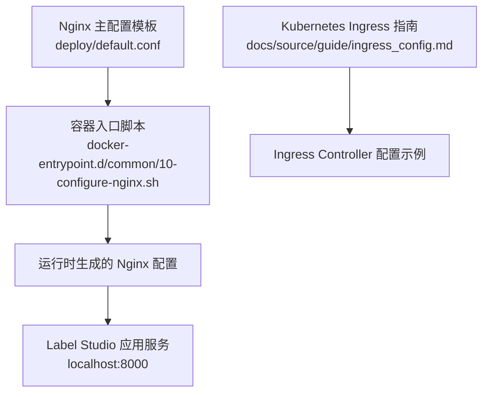
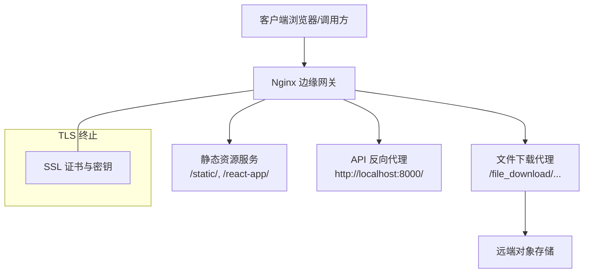
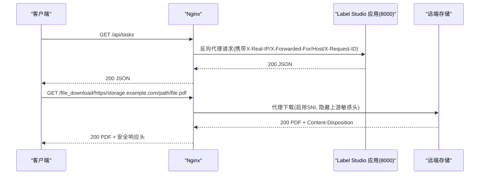
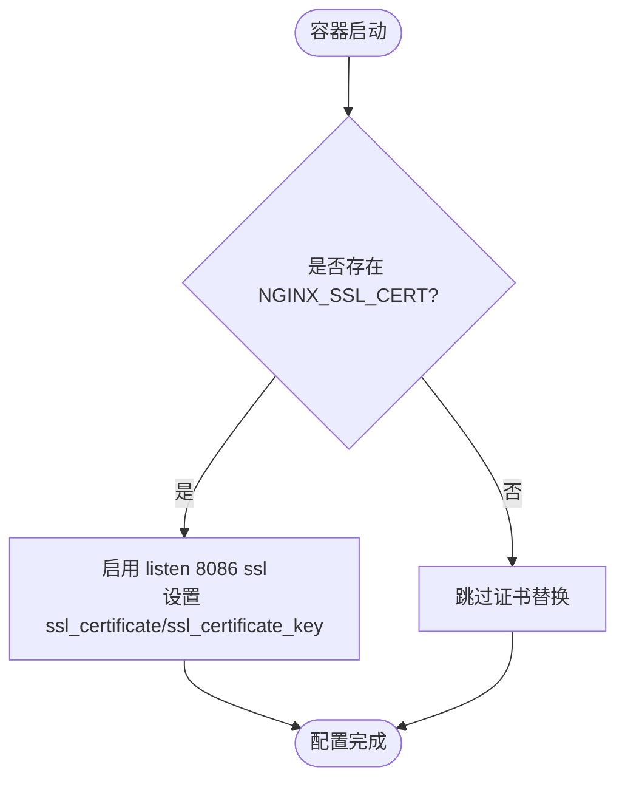
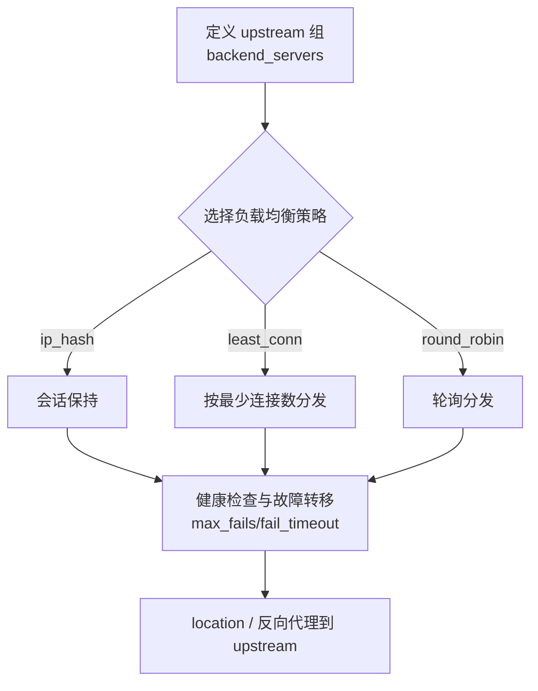
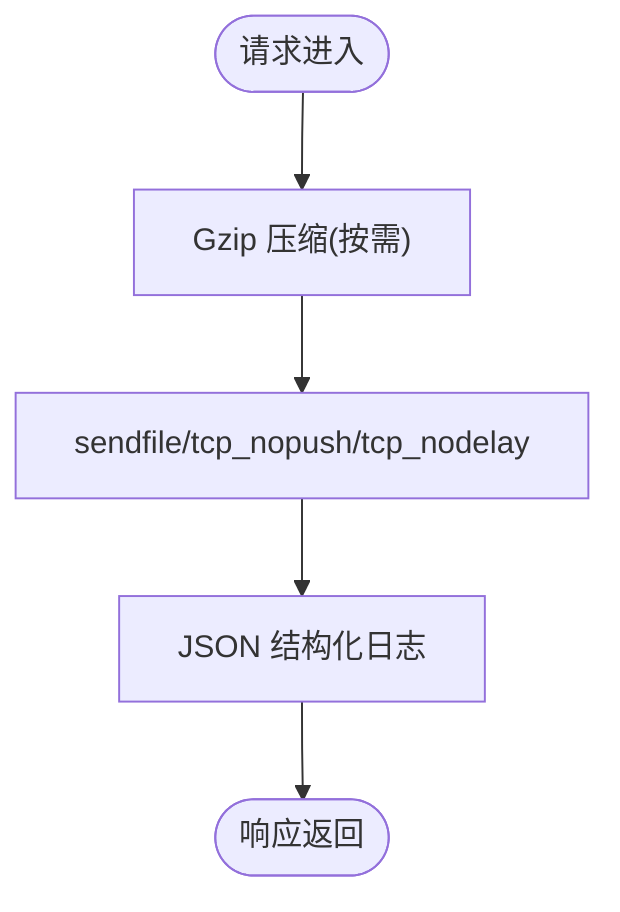
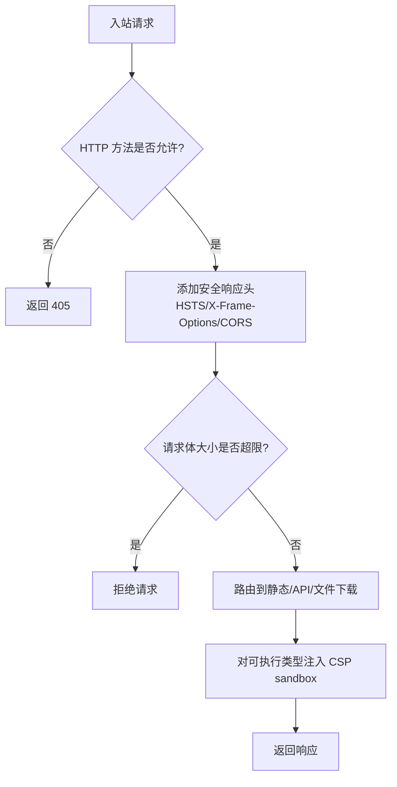
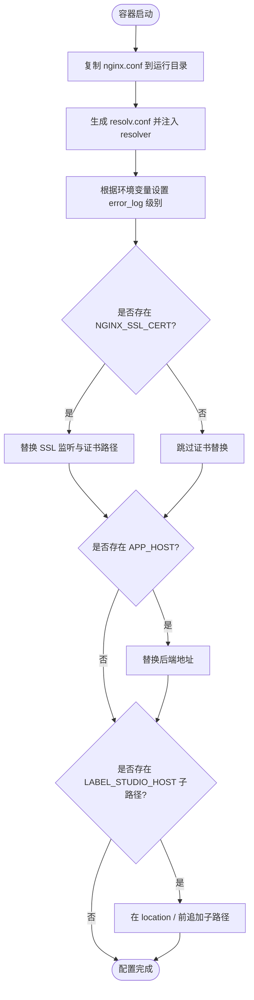
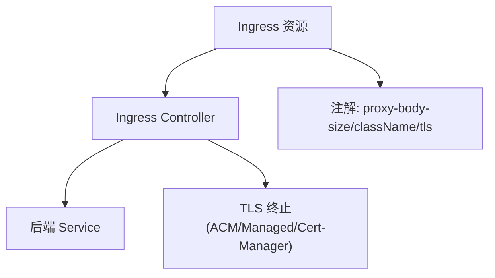
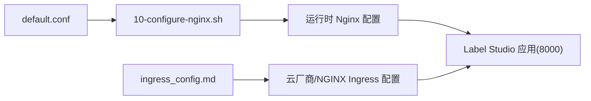

# Web服务器配置

<cite>
**本文引用的文件**   
- [default.conf](file://deploy/default.conf)
- [10-configure-nginx.sh](file://deploy/docker-entrypoint.d/common/10-configure-nginx.sh)
- [ingress_config.md](file://docs/source/guide/ingress_config.md)
</cite>

## 目录
1. [简介](#简介)
2. [项目结构](#项目结构)
3. [核心组件](#核心组件)
4. [架构总览](#架构总览)
5. [详细组件分析](#详细组件分析)
6. [依赖关系分析](#依赖关系分析)
7. [性能优化建议](#性能优化建议)
8. [故障排查指南](#故障排查指南)
9. [结论](#结论)

## 简介
本文件面向在 Label Studio 生产环境中部署 Nginx Web 服务器的运维与开发人员，系统说明反向代理、静态资源服务、API 转发、WebSocket 支持、SSL/TLS 证书配置（含自签名与 Let’s Encrypt）、负载均衡与健康检查、会话保持、性能优化与安全加固等关键主题。文档中的配置示例与行为均以仓库内提供的 Nginx 模板与入口脚本为依据，并结合 Kubernetes Ingress 官方指南进行扩展说明。

## 项目结构
Label Studio 的 Nginx 相关配置主要包含：
- Nginx 主配置文件模板：用于容器内启动时生成最终配置
- 容器入口脚本：根据环境变量动态替换证书、后端地址与子路径
- Kubernetes Ingress 指南：提供云厂商与通用 NGINX Ingress Controller 的配置参考

**图表来源**
- [default.conf:1-226](file://deploy/default.conf#L1-L226)
- [10-configure-nginx.sh:1-71](file://deploy/docker-entrypoint.d/common/10-configure-nginx.sh#L1-L71)
- [ingress_config.md:1-154](file://docs/source/guide/ingress_config.md#L1-L154)

**章节来源**
- [default.conf:1-226](file://deploy/default.conf#L1-L226)
- [10-configure-nginx.sh:1-71](file://deploy/docker-entrypoint.d/common/10-configure-nginx.sh#L1-L71)
- [ingress_config.md:1-154](file://docs/source/guide/ingress_config.md#L1-L154)

## 核心组件
- Nginx 主配置模板：定义 worker 进程、事件模型、日志格式、MIME 类型、SSL/TLS 参数、Gzip 压缩、安全响应头、静态资源映射、文件下载代理、API 反向代理等。
- 容器入口脚本：复制并修改 Nginx 配置，注入 DNS resolver、错误日志级别、SSL 证书路径、后端主机名与可选子路径。
- Kubernetes Ingress 指南：提供 AWS/GKE/Azure/NGINX Ingress Controller 的 Ingress 配置示例与 TLS 终止方案。

**章节来源**
- [default.conf:1-226](file://deploy/default.conf#L1-L226)
- [10-configure-nginx.sh:1-71](file://deploy/docker-entrypoint.d/common/10-configure-nginx.sh#L1-L71)
- [ingress_config.md:1-154](file://docs/source/guide/ingress_config.md#L1-L154)

## 架构总览
Label Studio 的典型部署中，Nginx 作为边缘网关，承担以下职责：
- 对外暴露 HTTP/HTTPS 端口
- 静态资源直接返回
- API 请求反向代理到后端应用
- 文件下载通过内部 location 代理到远端存储
- 统一的安全响应头与访问控制策略
- 可选地启用 SSL/TLS 终止

**图表来源**
- [default.conf:111-217](file://deploy/default.conf#L111-L217)
- [default.conf:138-146](file://deploy/default.conf#L138-L146)
- [default.conf:156-202](file://deploy/default.conf#L156-L202)
- [default.conf:204-217](file://deploy/default.conf#L204-L217)

## 详细组件分析

### 反向代理与静态文件服务
- 静态资源
  - /static/ 指向构建产物目录
  - /react-app/ 指向前端应用目录
- API 反向代理
  - 根路径 / 将请求转发至 http://localhost:8000/
  - 设置 X-Real-IP、X-Forwarded-For、Host、X-Request-ID 等头部
  - 超时与连接参数：connect/send/read/send_timeout 均为 90s
- 文件下载代理
  - 内部 location /file_download/(protocol)/(host)/(path) 解析并代理到远端 URL
  - 隐藏敏感上游响应头（如 GCS/AWS 元数据）
  - 保留 Content-Disposition，并基于内容类型注入 CSP sandbox
  - 启用 TLS SNI（proxy_ssl_server_name/proxy_ssl_name）
  - 处理 3xx 重定向，避免本地磁盘落盘（proxy_max_temp_file_size=0）

**图表来源**
- [default.conf:138-146](file://deploy/default.conf#L138-L146)
- [default.conf:156-202](file://deploy/default.conf#L156-L202)
- [default.conf:204-217](file://deploy/default.conf#L204-L217)

**章节来源**
- [default.conf:138-146](file://deploy/default.conf#L138-L146)
- [default.conf:156-202](file://deploy/default.conf#L156-L202)
- [default.conf:204-217](file://deploy/default.conf#L204-L217)

### WebSocket 支持
- 当前 Nginx 模板未显式配置 WebSocket 升级头（Upgrade、Connection）。若业务需要 WebSocket（例如实时标注协作），建议在 server 或 location 块中添加：
  - proxy_set_header Upgrade $http_upgrade;
  - proxy_set_header Connection "upgrade";
- 同时确保后端应用监听并正确处理 WebSocket 协议。

[本节为概念性补充，不直接分析具体文件]

### SSL/TLS 证书配置
- 默认模板预留了 SSL 监听与证书占位符，由入口脚本根据环境变量替换：
  - 当存在 NGINX_SSL_CERT 与 NGINX_SSL_CERT_KEY 时，启用 listen 8086 ssl 并设置证书路径
  - 模板中已启用 TLSv1.2/TLSv1.3 与强加密套件
- 自签名证书
  - 准备证书与私钥文件，挂载到容器内指定路径
  - 设置环境变量 NGINX_SSL_CERT 与 NGINX_SSL_CERT_KEY 指向证书路径
- Let’s Encrypt 集成
  - 使用 cert-manager 自动签发与续期证书
  - 在 Kubernetes 中通过 Ingress 的 tls.secretName 引用证书 Secret
  - 参考 Ingress 指南中的 NGINX Ingress Controller 配置示例

**图表来源**
- [default.conf:117-119](file://deploy/default.conf#L117-L119)
- [default.conf:84-86](file://deploy/default.conf#L84-L86)
- [10-configure-nginx.sh:42-50](file://deploy/docker-entrypoint.d/common/10-configure-nginx.sh#L42-L50)
- [ingress_config.md:103-121](file://docs/source/guide/ingress_config.md#L103-L121)

**章节来源**
- [default.conf:84-86](file://deploy/default.conf#L84-L86)
- [default.conf:117-119](file://deploy/default.conf#L117-L119)
- [10-configure-nginx.sh:42-50](file://deploy/docker-entrypoint.d/common/10-configure-nginx.sh#L42-L50)
- [ingress_config.md:103-121](file://docs/source/guide/ingress_config.md#L103-L121)

### 负载均衡、健康检查与会话保持
- 单实例模式
  - 模板默认将 / 反向代理到 http://localhost:8000/
- 多实例模式（upstream）
  - 可在 http 块定义 upstream 组，包含多个后端实例
  - 使用 ip_hash 实现会话保持；使用 least_conn 或轮询实现负载分发
  - 使用 max_fails/fail_timeout 实现故障转移
  - 使用 health_check（需第三方模块）或外部探针（如 K8s readiness/liveness）
- 健康检查
  - 模板提供 /nginx_health 返回 200，可用于简单存活探测
  - 在生产环境建议使用更完善的主动健康检查机制

[本节为概念性补充，不直接分析具体文件]

### 性能优化
- Gzip 压缩
  - 已启用 gzip on/vary/proxied，压缩级别 6，覆盖常见文本与媒体类型
- 传输优化
  - sendfile/tcp_nopush/tcp_nodelay 开启以提升网络吞吐
- 日志与可观测性
  - JSON 结构化日志输出到 stdout/stderr，便于集中采集
- 上传大小限制
  - client_max_body_size 设置为 200m，适配大文件导入场景
- 缓存策略
  - 对静态资源可结合 CDN 或 Nginx 缓存层（add_header Cache-Control、expires）
  - 注意避免对动态 API 启用缓存

**图表来源**
- [default.conf:22-26](file://deploy/default.conf#L22-L26)
- [default.conf:33-70](file://deploy/default.conf#L33-L70)
- [default.conf:90-94](file://deploy/default.conf#L90-L94)
- [default.conf:132](file://deploy/default.conf#L132)

**章节来源**
- [default.conf:22-26](file://deploy/default.conf#L22-L26)
- [default.conf:33-70](file://deploy/default.conf#L33-L70)
- [default.conf:90-94](file://deploy/default.conf#L90-L94)
- [default.conf:132](file://deploy/default.conf#L132)

### 安全加固
- 安全响应头
  - Strict-Transport-Security、X-Frame-Options、Access-Control-Allow-Origin/Headers/Expose-Headers
- 方法白名单
  - 仅允许 GET/POST/PUT/PATCH/DELETE/HEAD/CONNECT/OPTIONS，其他返回 405
- CORS
  - 允许跨域并设置预检响应
- 上传文件沙箱
  - 针对 text/html/svg/xml 等类型注入 Content-Security-Policy sandbox，降低执行风险
- 请求体大小
  - client_max_body_size 200m，防止过大请求导致资源耗尽
- 敏感头过滤
  - 文件下载代理隐藏上游敏感响应头，并清空 Authorization/Cookie

**图表来源**
- [default.conf:121-136](file://deploy/default.conf#L121-L136)
- [default.conf:101-107](file://deploy/default.conf#L101-L107)
- [default.conf:164-184](file://deploy/default.conf#L164-L184)

**章节来源**
- [default.conf:101-107](file://deploy/default.conf#L101-L107)
- [default.conf:121-136](file://deploy/default.conf#L121-L136)
- [default.conf:164-184](file://deploy/default.conf#L164-L184)

### 入口脚本与动态配置
- 复制 Nginx 配置并生成 resolv.conf，确保 DNS 解析正确
- 根据 NGINX_ERROR_LOG_LEVEL 调整错误日志级别
- 根据 NGINX_SSL_CERT/KEY 启用 SSL 并替换证书路径
- 根据 APP_HOST 替换后端地址（默认 localhost）
- 根据 LABEL_STUDIO_HOST 的子路径动态插入 location 前缀

**图表来源**
- [10-configure-nginx.sh:1-71](file://deploy/docker-entrypoint.d/common/10-configure-nginx.sh#L1-L71)

**章节来源**
- [10-configure-nginx.sh:1-71](file://deploy/docker-entrypoint.d/common/10-configure-nginx.sh#L1-L71)

### Kubernetes Ingress 与 TLS 终止
- 云厂商 Ingress
  - AWS EKS：使用 ALB Ingress Controller，ACM 证书
  - GKE：使用 gce 类，支持托管证书
  - AKS：使用 Application Gateway Ingress Controller，支持自签名证书
- 通用 NGINX Ingress Controller
  - 安装 cert-manager 与 ExternalDNS
  - 通过 Ingress 的 tls.secretName 绑定证书
- 大文件上传
  - 通过 ingress 注解设置 proxy-body-size（例如 200m）

**图表来源**
- [ingress_config.md:29-54](file://docs/source/guide/ingress_config.md#L29-L54)
- [ingress_config.md:56-82](file://docs/source/guide/ingress_config.md#L56-L82)
- [ingress_config.md:84-101](file://docs/source/guide/ingress_config.md#L84-L101)
- [ingress_config.md:103-121](file://docs/source/guide/ingress_config.md#L103-L121)
- [ingress_config.md:135-154](file://docs/source/guide/ingress_config.md#L135-L154)

**章节来源**
- [ingress_config.md:29-54](file://docs/source/guide/ingress_config.md#L29-L54)
- [ingress_config.md:56-82](file://docs/source/guide/ingress_config.md#L56-L82)
- [ingress_config.md:84-101](file://docs/source/guide/ingress_config.md#L84-L101)
- [ingress_config.md:103-121](file://docs/source/guide/ingress_config.md#L103-L121)
- [ingress_config.md:135-154](file://docs/source/guide/ingress_config.md#L135-L154)

## 依赖关系分析
- Nginx 主配置模板定义了静态资源、API 反向代理与文件下载代理的路由规则
- 入口脚本负责在容器启动时根据环境变量动态修改配置，包括：
  - DNS resolver
  - 错误日志级别
  - SSL 证书路径
  - 后端主机名
  - 子路径前缀
- Kubernetes Ingress 指南提供了在不同云平台与 NGINX Ingress Controller 下的 TLS 终止与大文件上传配置参考

**图表来源**
- [default.conf:1-226](file://deploy/default.conf#L1-L226)
- [10-configure-nginx.sh:1-71](file://deploy/docker-entrypoint.d/common/10-configure-nginx.sh#L1-L71)
- [ingress_config.md:1-154](file://docs/source/guide/ingress_config.md#L1-L154)

**章节来源**
- [default.conf:1-226](file://deploy/default.conf#L1-L226)
- [10-configure-nginx.sh:1-71](file://deploy/docker-entrypoint.d/common/10-configure-nginx.sh#L1-L71)
- [ingress_config.md:1-154](file://docs/source/guide/ingress_config.md#L1-L154)

## 性能优化建议
- 并发与连接
  - 合理设置 worker_processes 与 worker_connections，依据 CPU 核数与内存容量调优
- 传输优化
  - 保持 sendfile/tcp_nopush/tcp_nodelay 开启
- 压缩
  - 启用 Gzip，并根据带宽与 CPU 平衡压缩级别
- 缓存
  - 对静态资源设置合适的 Cache-Control 与 expires，结合 CDN 提升命中率
- 日志
  - 使用 JSON 结构化日志，配合 ELK/Fluentd 等收集与分析
- 上传
  - 根据业务需求调整 client_max_body_size，并在 Ingress 层同步设置 proxy-body-size

[本节为通用指导，不直接分析具体文件]

## 故障排查指南
- 无法访问 HTTPS
  - 检查 NGINX_SSL_CERT/NGINX_SSL_CERT_KEY 是否正确挂载与替换
  - 确认 listen 8086 ssl 已启用
- 后端不可达
  - 检查 APP_HOST 是否被正确替换为实际后端地址
  - 确认 Label Studio 应用在 8000 端口正常监听
- 子路径访问异常
  - 检查 LABEL_STUDIO_HOST 是否包含子路径，且入口脚本已插入 location 前缀
- 大文件上传失败
  - 检查 Nginx 的 client_max_body_size 与 Ingress 的 proxy-body-size 注解
- 静态资源 404
  - 确认 /static/ 与 /react-app/ 的 alias 路径存在且可读
- 文件下载异常
  - 检查 /file_download/ 路由与上游存储可达性
  - 关注上游敏感头是否被正确隐藏

**章节来源**
- [default.conf:117-119](file://deploy/default.conf#L117-L119)
- [default.conf:138-146](file://deploy/default.conf#L138-L146)
- [default.conf:156-202](file://deploy/default.conf#L156-L202)
- [10-configure-nginx.sh:42-70](file://deploy/docker-entrypoint.d/common/10-configure-nginx.sh#L42-L70)
- [ingress_config.md:135-154](file://docs/source/guide/ingress_config.md#L135-L154)

## 结论
Label Studio 的 Nginx 配置模板提供了生产可用的基础能力：静态资源服务、API 反向代理、文件下载代理、安全响应头与 Gzip 压缩。通过入口脚本，可以在容器化环境中灵活注入证书、后端地址与子路径。结合 Kubernetes Ingress 指南，可实现多云平台的 TLS 终止与大文件上传支持。对于高可用与高性能场景，建议引入 upstream 负载均衡、健康检查与会话保持，并结合 CDN 与缓存策略进一步优化用户体验。