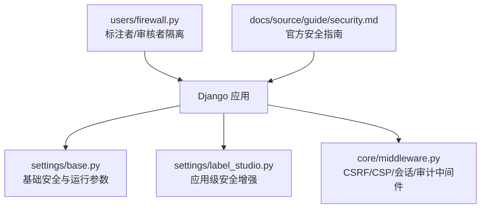
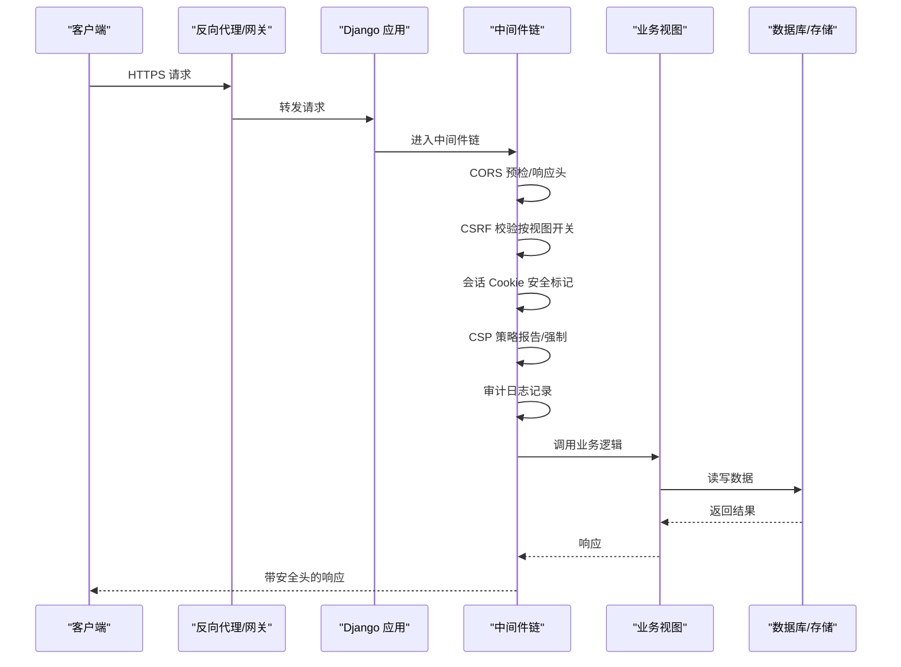
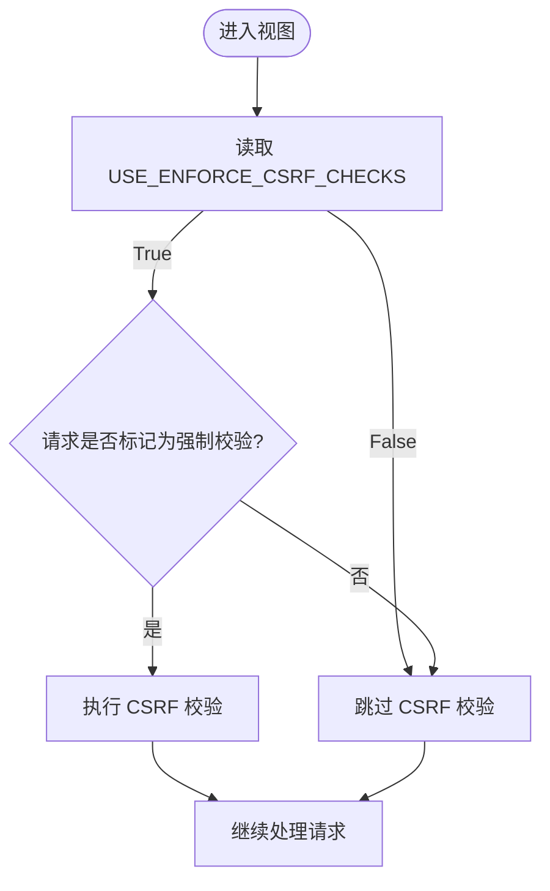
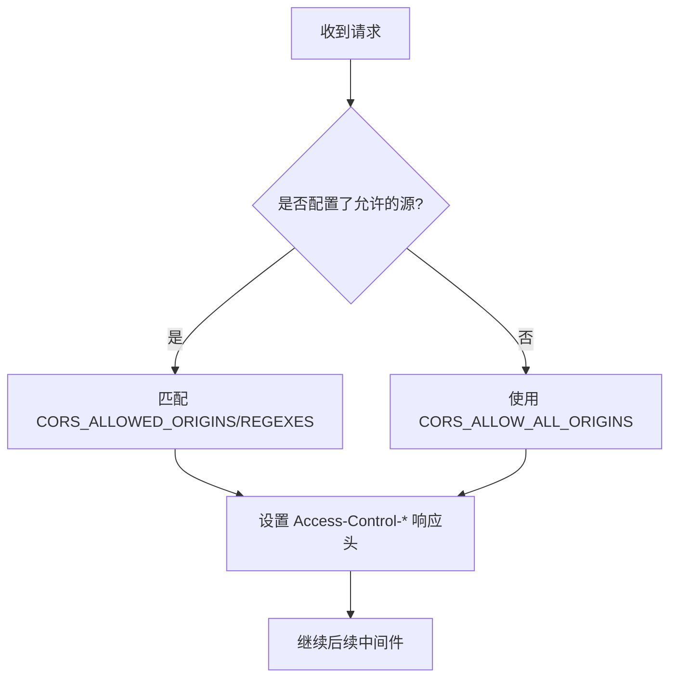
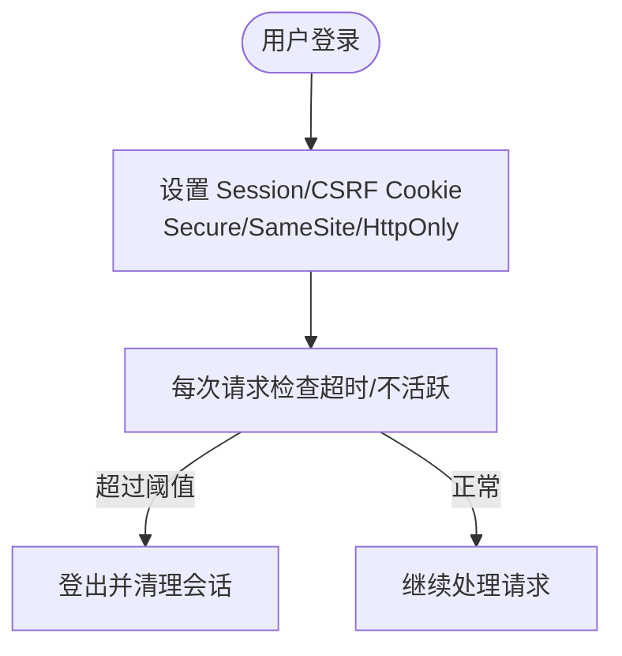
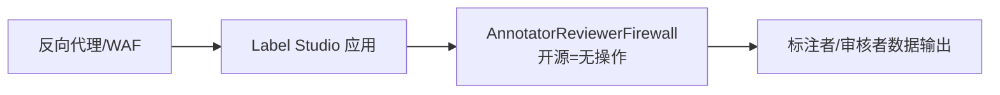
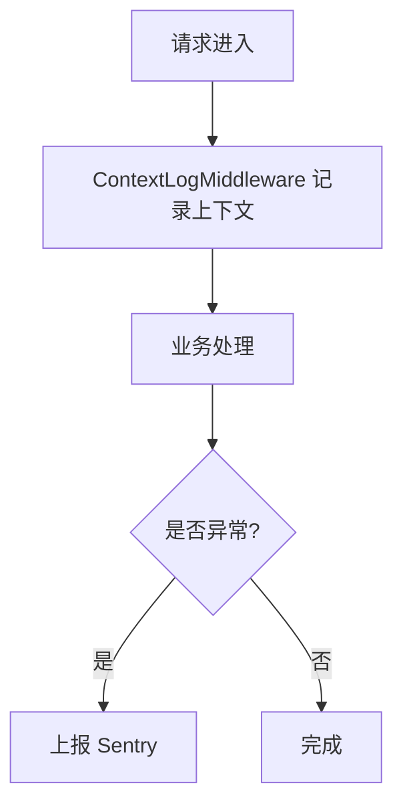

# 安全配置

<cite>
**本文引用的文件**   
- [base.py](file://label_studio/core/settings/base.py)
- [label_studio.py](file://label_studio/core/settings/label_studio.py)
- [middleware.py](file://label_studio/core/middleware.py)
- [security.md](file://docs/source/guide/security.md)
- [firewall.py](file://label_studio/users/firewall.py)
</cite>

## 目录
1. [引言](#引言)
2. [项目结构](#项目结构)
3. [核心组件](#核心组件)
4. [架构总览](#架构总览)
5. [详细组件分析](#详细组件分析)
6. [依赖关系分析](#依赖关系分析)
7. [性能与安全权衡](#性能与安全权衡)
8. [故障排查指南](#故障排查指南)
9. [结论](#结论)
10. [附录：生产环境检查清单](#附录生产环境检查清单)

## 引言
本指南聚焦 Label Studio 在生产环境的安全配置，覆盖以下关键领域：
- CSRF 保护与跨站请求伪造防护
- CORS 跨域资源共享策略与安全响应头
- 会话 Cookie 安全选项、超时与不活跃退出
- 防火墙规则（应用层访问控制）
- 安全审计（访问日志、异常检测、安全事件监控）

说明：仓库中未包含传统“网络防火墙”或“IP 白名单/频率限制”的内置实现；相关能力通常由反向代理、网关或云厂商 WAF 提供。本文会明确区分“应用内可配置项”和“外部系统需提供的能力”。

## 项目结构
与生产安全直接相关的代码主要位于后端 Django 设置与中间件：
- 基础安全与运行参数：`label_studio/core/settings/base.py`
- 应用级安全增强与默认值：`label_studio/core/settings/label_studio.py`
- 请求处理中间件（CSRF、CSP、会话、审计等）：`label_studio/core/middleware.py`
- 官方安全文档与部署建议：`docs/source/guide/security.md`
- 标注者/审核者隔离（应用层“防火墙”钩子）：`label_studio/users/firewall.py`

**图示来源**
- [base.py:268-335](file://label_studio/core/settings/base.py#L268-L335)
- [label_studio.py:14-29](file://label_studio/core/settings/label_studio.py#L14-L29)
- [middleware.py:25-48](file://label_studio/core/middleware.py#L25-L48)
- [firewall.py:1-38](file://label_studio/users/firewall.py#L1-L38)

**章节来源**
- [base.py:268-335](file://label_studio/core/settings/base.py#L268-L335)
- [label_studio.py:14-29](file://label_studio/core/settings/label_studio.py#L14-L29)
- [middleware.py:25-48](file://label_studio/core/middleware.py#L25-L48)
- [security.md:12-31](file://docs/source/guide/security.md#L12-L31)

## 核心组件
- CSRF 保护开关与视图级强制校验
- CORS 允许源与方法、Host 白名单
- 会话 Cookie 安全标志（Secure/SameSite/HttpOnly）、Cookie 生命周期
- 会话超时与不活跃退出
- CSP（内容安全策略）报告模式与强制模式切换
- 审计日志与上下文记录中间件
- SSRF 防护与受禁止网段控制
- 应用层“防火墙”（标注者/审核者数据隔离）

**章节来源**
- [base.py:313-335](file://label_studio/core/settings/base.py#L313-L335)
- [base.py:630-652](file://label_studio/core/settings/base.py#L630-L652)
- [label_studio.py:21-29](file://label_studio/core/settings/label_studio.py#L21-L29)
- [middleware.py:25-48](file://label_studio/core/middleware.py#L25-L48)
- [middleware.py:181-202](file://label_studio/core/middleware.py#L181-L202)
- [middleware.py:328-342](file://label_studio/core/middleware.py#L328-L342)

## 架构总览
下图展示一个典型请求在 Django 中间件链中的安全处理流程，包括 CORS、CSRF、会话、CSP 与审计日志。

**图示来源**
- [base.py:268-335](file://label_studio/core/settings/base.py#L268-L335)
- [middleware.py:25-48](file://label_studio/core/middleware.py#L25-L48)
- [middleware.py:181-202](file://label_studio/core/middleware.py#L181-L202)
- [middleware.py:328-342](file://label_studio/core/middleware.py#L328-L342)

## 详细组件分析

### CSRF 保护配置
- 全局开关：通过 `USE_ENFORCE_CSRF_CHECKS` 控制是否对视图启用 CSRF 校验。生产环境应开启。
- 视图级强制：装饰器/中间件会将 `_dont_enforce_csrf_checks` 标记写入请求对象，从而决定具体视图是否跳过 CSRF 校验。
- API 行为：默认中间件会对非特定标记的请求禁用 CSRF，便于无状态 API 使用 Token 认证；若需要 CSRF，可通过装饰器或查询参数显式启用。

生产建议：
- 保持 `USE_ENFORCE_CSRF_CHECKS=True`。
- 对表单提交类接口启用 CSRF；对纯 JSON API 使用 Token/JWT 认证并避免浏览器端发送 CSRF Cookie。
- 确保前端在跨域场景下正确携带凭证与 CSRF Token。

**图示来源**
- [middleware.py:25-48](file://label_studio/core/middleware.py#L25-L48)
- [base.py:769-769](file://label_studio/core/settings/base.py#L769-L769)

**章节来源**
- [middleware.py:25-48](file://label_studio/core/middleware.py#L25-L48)
- [base.py:769-769](file://label_studio/core/settings/base.py#L769-L769)

### CORS 跨域资源共享与安全头
- 允许源：支持 `CORS_ALLOWED_ORIGINS` 精确列表或 `CORS_ALLOWED_ORIGIN_REGEXES` 正则列表；否则回退到 `CORS_ALLOW_ALL_ORIGINS`。
- 允许方法：默认允许常见 HTTP 方法。
- Host 白名单：`ALLOWED_HOSTS` 用于限制 Host 头，防止 Host 注入攻击。

生产建议：
- 明确配置 `CORS_ALLOWED_ORIGINS`，不要在生产使用通配所有来源。
- 仅暴露必要的 HTTP 方法。
- 将 `ALLOWED_HOSTS` 设置为实际域名，避免 `*`。
- 配合反向代理统一设置安全响应头（如 HSTS、X-Frame-Options、Referrer-Policy）。

**图示来源**
- [base.py:313-335](file://label_studio/core/settings/base.py#L313-L335)

**章节来源**
- [base.py:313-335](file://label_studio/core/settings/base.py#L313-L335)

### 会话 Cookie 安全与超时管理
- Cookie 安全标志：
  - `SESSION_COOKIE_SECURE`：仅 HTTPS 传输。
  - `SESSION_COOKIE_SAMESITE`：SameSite 策略（默认 Lax）。
  - `CSRF_COOKIE_SECURE` / `CSRF_COOKIE_HTTPONLY` / `CSRF_COOKIE_SAMESITE`：CSRF Cookie 安全属性。
- Cookie 生命周期：`CSRF_COOKIE_AGE` 控制 CSRF Cookie 过期时间。
- 会话超时：
  - `MAX_SESSION_AGE`：登录最长存活时间。
  - `MAX_TIME_BETWEEN_ACTIVITY`：最大不活跃间隔。
  - `INACTIVITY_SESSION_TIMEOUT_ENABLED`：启用不活跃会话超时中间件。
- 应用级覆盖：`label_studio.py` 中设置 `SESSION_COOKIE_SECURE` 与 `SESSION_ENGINE`。

生产建议：
- 开启 `SESSION_COOKIE_SECURE=True`，并确保全站 HTTPS。
- 根据前端跨域需求选择 `SESSION_COOKIE_SAMESITE`（Strict/Lax）。
- 合理设置 `MAX_SESSION_AGE` 与 `MAX_TIME_BETWEEN_ACTIVITY`，平衡安全与体验。
- 使用签名 Cookie 引擎时注意密钥安全（`SECRET_KEY`）。

**图示来源**
- [base.py:630-652](file://label_studio/core/settings/base.py#L630-L652)
- [label_studio.py:27-29](file://label_studio/core/settings/label_studio.py#L27-L29)
- [middleware.py:271-325](file://label_studio/core/middleware.py#L271-L325)

**章节来源**
- [base.py:630-652](file://label_studio/core/settings/base.py#L630-L652)
- [label_studio.py:27-29](file://label_studio/core/settings/label_studio.py#L27-L29)
- [middleware.py:271-325](file://label_studio/core/middleware.py#L271-L325)

### 防火墙规则（应用层访问控制）
- 应用内“防火墙”：`users.firewall.AnnotatorReviewerFirewall` 提供标注者/审核者数据隔离钩子。开源版本默认是无操作实现，企业版可实现更严格的匿名化与角色折叠。
- IP 白名单/频率限制：仓库未内置此类功能，需在反向代理（Nginx/HAProxy）、API 网关或云 WAF 上实现。

生产建议：
- 在反向代理层实施 IP 白名单、地理限制、速率限制、Bot 识别与威胁情报。
- 结合组织/工作区/项目的权限模型进行细粒度访问控制。
- 如需隐藏敏感身份字段，可在企业版启用相应的防火墙策略。

**图示来源**
- [base.py:802-802](file://label_studio/core/settings/base.py#L802-L802)
- [firewall.py:1-38](file://label_studio/users/firewall.py#L1-L38)

**章节来源**
- [base.py:802-802](file://label_studio/core/settings/base.py#L802-L802)
- [firewall.py:1-38](file://label_studio/users/firewall.py#L1-L38)

### 安全审计与监控
- 访问日志：通过 `LOGGING` 配置控制台输出，支持 JSON 格式；日志级别由 `LOG_LEVEL` 控制。
- 上下文审计：`ContextLogMiddleware` 记录请求/响应上下文，便于追踪问题。
- 异常上报：集成 Sentry（后端与前端），可配置 DSN、采样率与环境名。
- 官方安全文档：强调 TLS、HTTPS、安全 Cookie、SSRF 防护、数据库与云存储安全。

生产建议：
- 将 `LOG_LEVEL` 调整为生产级别（如 WARNING/INFO），并接入集中式日志系统。
- 启用 Sentry 并设置合理的采样率与环境标识。
- 遵循官方安全指南，启用 SSRF 防护与最小权限原则。

**图示来源**
- [base.py:27-77](file://label_studio/core/settings/base.py#L27-L77)
- [base.py:570-585](file://label_studio/core/settings/base.py#L570-L585)
- [middleware.py:181-202](file://label_studio/core/middleware.py#L181-L202)
- [security.md:64-94](file://docs/source/guide/security.md#L64-L94)

**章节来源**
- [base.py:27-77](file://label_studio/core/settings/base.py#L27-L77)
- [base.py:570-585](file://label_studio/core/settings/base.py#L570-L585)
- [middleware.py:181-202](file://label_studio/core/middleware.py#L181-L202)
- [security.md:64-94](file://docs/source/guide/security.md#L64-L94)

### CSP（内容安全策略）
- 应用扩展了 CSP 中间件，支持将“仅报告”模式切换为“强制”模式，便于逐步上线 CSP 策略。

生产建议：
- 先在报告模式下观察违规，再切换到强制模式。
- 严格限制脚本、样式、媒体与连接来源，减少 XSS 风险。

**章节来源**
- [middleware.py:328-342](file://label_studio/core/middleware.py#L328-L342)

### SSRF 防护
- 通过环境变量启用 SSRF 防护，并可配置默认禁止网段与自定义额外禁止网段。

生产建议：
- 始终启用 SSRF 防护。
- 定期审查 `USER_ADDITIONAL_BANNED_SUBNETS`，确保内部网络不被外发访问。

**章节来源**
- [base.py:650-652](file://label_studio/core/settings/base.py#L650-L652)

## 依赖关系分析
- 中间件顺序：CORS → Security → Session → Locale → DisableCSRF → CsrfViewMiddleware → XApiKeySupport → Authentication → Messages → NoindexUrl → CommonAppendSlash → UserAgent → SetSessionUID → ContextLog → DatabaseIsLockedRetry → ThreadLocal → JWTAuthentication。
- 该顺序确保：
  - CORS 预检优先处理
  - CSRF 校验在认证之前生效
  - 会话与审计在请求处理前后被记录
  - JWT 认证在中间件链后段生效

```mermaid
graph LR
M1["CorsMiddleware"] --> M2["SecurityMiddleware"]
M2 --> M3["SessionMiddleware"]
M3 --> M4["DisableCSRF"]
M4 --> M5["CsrfViewMiddleware"]
M5 --> M6["XApiKeySupportMiddleware"]
M6 --> M7["AuthenticationMiddleware"]
M7 --> M8["MessagesMiddleware"]
M8 --> M9["NoindexUrlMiddleware"]
M9 --> M10["CommonAppendSlashWithoutRedirect"]
M10 --> M11["UserAgentMiddleware"]
M11 --> M12["SetSessionUIDMiddleware"]
M12 --> M13["ContextLogMiddleware"]
M13 --> M14["DatabaseIsLockedRetryMiddleware"]
M14 --> M15["ThreadLocalMiddleware"]
M15 --> M16["JWTAuthenticationMiddleware"]
```

**图示来源**
- [base.py:268-286](file://label_studio/core/settings/base.py#L268-L286)

**章节来源**
- [base.py:268-286](file://label_studio/core/settings/base.py#L268-L286)

## 性能与安全权衡
- 开启 CSRF 校验会增加请求开销，但对安全性至关重要。
- 长 Cookie 生命周期（如 CSRF Cookie Age）提升用户体验但增加泄露风险，需结合 HTTPS 与 SameSite 策略。
- 频繁会话刷新可能影响并发性能，建议合理设置不活跃超时。
- 审计日志与 Sentry 上报会带来 I/O 与网络开销，应调整日志级别与采样率。

[本节为通用指导，无需引用具体文件]

## 故障排查指南
- CSRF 失败：
  - 确认 `USE_ENFORCE_CSRF_CHECKS=True`。
  - 检查前端是否正确携带 CSRF Token 与 Cookie。
  - 查看视图是否被标记为强制校验。
- CORS 错误：
  - 核对 `CORS_ALLOWED_ORIGINS` 与实际前端域名一致。
  - 检查 `ALLOWED_HOSTS` 是否包含目标 Host。
- 会话过期：
  - 检查 `SESSION_COOKIE_SECURE`、`SESSION_COOKIE_SAMESITE` 与 HTTPS 一致性。
  - 调整 `MAX_SESSION_AGE` 与 `MAX_TIME_BETWEEN_ACTIVITY`。
- 审计缺失：
  - 检查 `LOG_LEVEL` 与日志处理器配置。
  - 确认 Sentry DSN 与环境变量已正确设置。

**章节来源**
- [middleware.py:25-48](file://label_studio/core/middleware.py#L25-L48)
- [base.py:313-335](file://label_studio/core/settings/base.py#L313-L335)
- [base.py:630-652](file://label_studio/core/settings/base.py#L630-L652)
- [base.py:27-77](file://label_studio/core/settings/base.py#L27-L77)
- [base.py:570-585](file://label_studio/core/settings/base.py#L570-L585)

## 结论
Label Studio 在生产环境的安全配置应以“最小权限、纵深防御、可观测性”为核心原则：
- 启用 CSRF 与 CSP，严格 CORS 与 Host 白名单。
- 强化会话 Cookie 安全与超时策略。
- 在反向代理层实现 IP 白名单与频率限制。
- 启用审计日志与异常上报，持续监控安全事件。
- 遵循官方安全指南，启用 SSRF 防护与加密传输。

[本节为总结，无需引用具体文件]

## 附录：生产环境检查清单
- CSRF
  - [ ] `USE_ENFORCE_CSRF_CHECKS=True`
  - [ ] 表单接口启用 CSRF，API 使用 Token/JWT
- CORS
  - [ ] `CORS_ALLOWED_ORIGINS` 精确配置
  - [ ] `ALLOWED_HOSTS` 不为 `*`
- 会话
  - [ ] `SESSION_COOKIE_SECURE=True`
  - [ ] `SESSION_COOKIE_SAMESITE` 符合前端跨域需求
  - [ ] `MAX_SESSION_AGE` 与 `MAX_TIME_BETWEEN_ACTIVITY` 合理
- 防火墙
  - [ ] 反向代理启用 IP 白名单与速率限制
  - [ ] 企业版按需启用标注者/审核者隔离
- 审计与监控
  - [ ] `LOG_LEVEL` 设置为生产级别
  - [ ] Sentry DSN 与环境名配置正确
  - [ ] 启用 SSRF 防护与默认禁止网段

[本节为清单，无需引用具体文件]