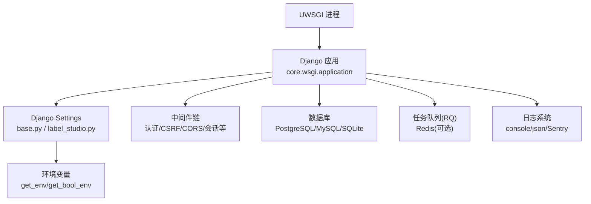
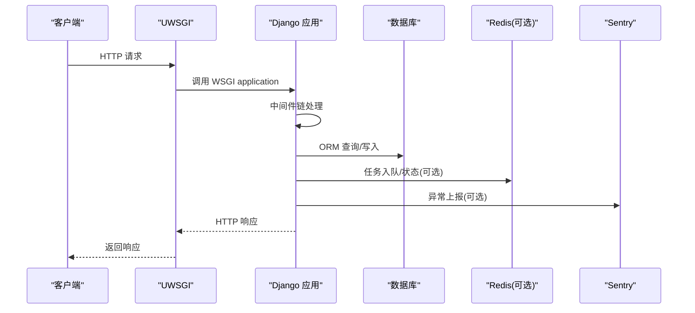
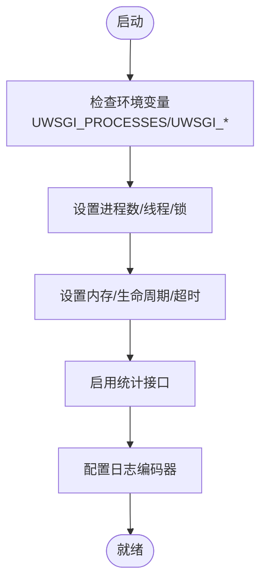
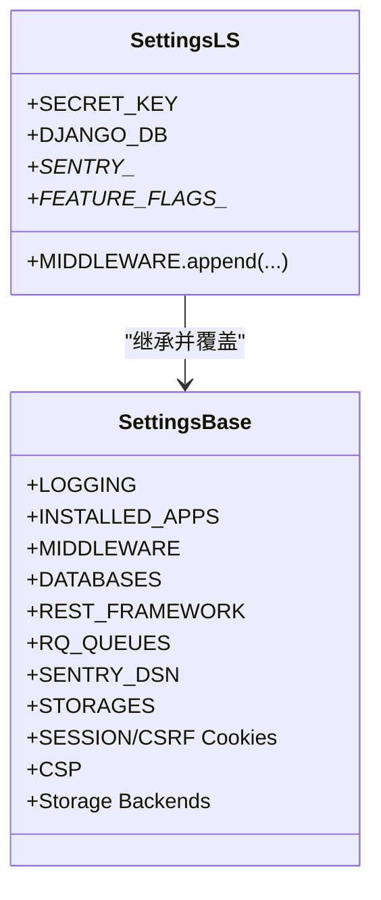
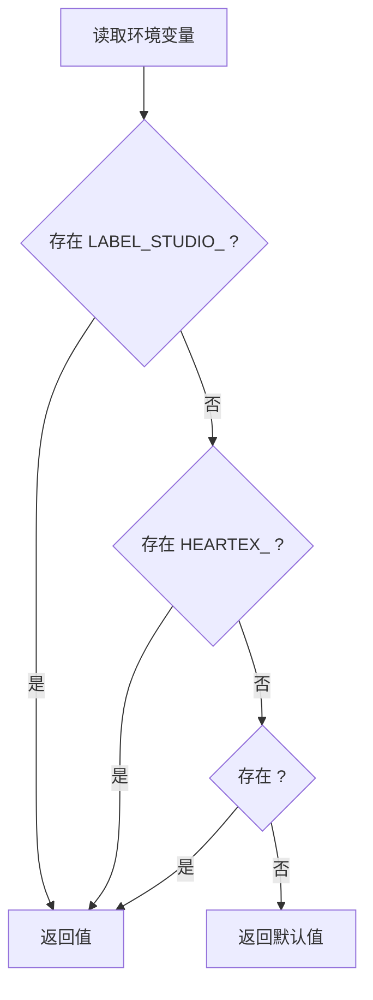
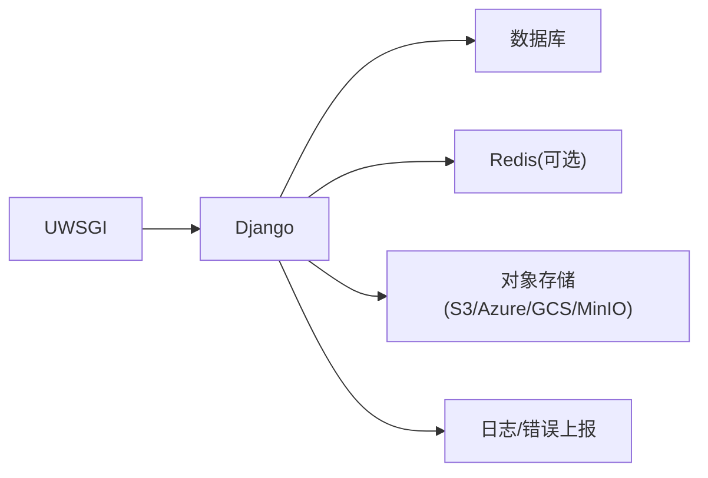
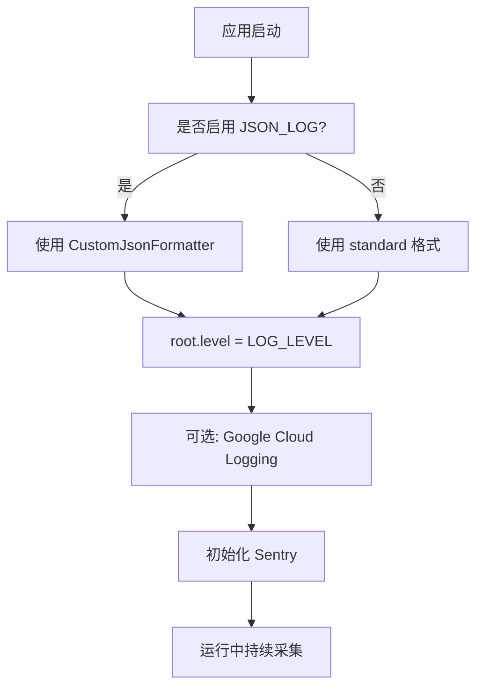

# 应用服务器配置

<cite>
**本文引用的文件**   
- [deploy/uwsgi.ini](file://deploy/uwsgi.ini)
- [label_studio/core/settings/base.py](file://label_studio/core/settings/base.py)
- [label_studio/core/settings/label_studio.py](file://label_studio/core/settings/label_studio.py)
- [label_studio/core/utils/params.py](file://label_studio/core/utils/params.py)
- [label_studio/core/wsgi.py](file://label_studio/core/wsgi.py)
</cite>

## 目录
1. [简介](#简介)
2. [项目结构](#项目结构)
3. [核心组件](#核心组件)
4. [架构总览](#架构总览)
5. [详细组件分析](#详细组件分析)
6. [依赖关系分析](#依赖关系分析)
7. [性能调优建议](#性能调优建议)
8. [监控与日志配置](#监控与日志配置)
9. [故障排查指南](#故障排查指南)
10. [结论](#结论)

## 简介
本指南面向在生产环境部署 Label Studio 的应用服务器，重点覆盖：
- UWSGI 服务器配置（进程管理、内存限制、信号处理、线程与锁）
- Django 生产环境配置（数据库、中间件、缓存/RQ、安全与Cookie、CSP等）
- 环境变量体系（敏感信息管理、配置优先级）
- 性能参数（工作进程数、线程、超时、回收策略）
- 监控与日志（结构化日志、Sentry、uWSGI stats）

## 项目结构
Label Studio 的运行时由以下关键部分构成：
- uWSGI 作为 WSGI 服务器，加载 Django 应用
- Django 应用通过 settings 模块进行生产环境配置
- 环境变量统一通过工具函数读取，支持多前缀与布尔解析
- WSGI 入口设置 DJANGO_SETTINGS_MODULE

**图示来源**
- [deploy/uwsgi.ini:1-104](file://deploy/uwsgi.ini#L1-L104)
- [label_studio/core/wsgi.py:1-10](file://label_studio/core/wsgi.py#L1-L10)
- [label_studio/core/settings/base.py:230-310](file://label_studio/core/settings/base.py#L230-L310)
- [label_studio/core/settings/base.py:174-208](file://label_studio/core/settings/base.py#L174-L208)
- [label_studio/core/settings/base.py:392-427](file://label_studio/core/settings/base.py#L392-L427)
- [label_studio/core/settings/base.py:27-77](file://label_studio/core/settings/base.py#L27-L77)

**章节来源**
- [deploy/uwsgi.ini:1-104](file://deploy/uwsgi.ini#L1-L104)
- [label_studio/core/wsgi.py:1-10](file://label_studio/core/wsgi.py#L1-L10)
- [label_studio/core/settings/base.py:27-77](file://label_studio/core/settings/base.py#L27-L77)
- [label_studio/core/settings/base.py:174-208](file://label_studio/core/settings/base.py#L174-L208)
- [label_studio/core/settings/base.py:230-310](file://label_studio/core/settings/base.py#L230-L310)
- [label_studio/core/settings/base.py:392-427](file://label_studio/core/settings/base.py#L392-L427)

## 核心组件
- UWSGI 服务器：负责进程模型、HTTP 监听、统计接口、日志输出、请求超时与 worker 回收。
- Django 应用：提供 Web API、中间件、ORM、RQ 任务队列、静态资源与存储后端。
- 环境变量系统：统一从环境变量读取配置，支持 LABEL_STUDIO_、HEARTEX_ 与前缀为空的多级回退，并提供布尔值转换。
- 日志与错误上报：控制台 JSON/标准格式，可选 Google Cloud Logging；Sentry 集成用于错误追踪。

**章节来源**
- [deploy/uwsgi.ini:1-104](file://deploy/uwsgi.ini#L1-L104)
- [label_studio/core/settings/base.py:27-77](file://label_studio/core/settings/base.py#L27-L77)
- [label_studio/core/utils/params.py:114-141](file://label_studio/core/utils/params.py#L114-L141)

## 架构总览
下图展示了请求从 uWSGI 到 Django 应用的调用路径，以及关键的外部依赖。

**图示来源**
- [deploy/uwsgi.ini:1-104](file://deploy/uwsgi.ini#L1-L104)
- [label_studio/core/wsgi.py:1-10](file://label_studio/core/wsgi.py#L1-L10)
- [label_studio/core/settings/base.py:230-310](file://label_studio/core/settings/base.py#L230-L310)
- [label_studio/core/settings/base.py:392-427](file://label_studio/core/settings/base.py#L392-L427)
- [label_studio/core/settings/base.py:570-585](file://label_studio/core/settings/base.py#L570-L585)

## 详细组件分析

### UWSGI 服务器配置
- 进程与解释器
  - master=true：启用主进程
  - single-interpreter=true：单解释器模式
  - processes：默认 4，可通过环境变量 UWSGI_PROCESSES 覆盖
  - cheaper=true：按需扩展空闲 worker
- 线程与并发
  - enable-threads=True：允许线程
  - thunder-lock=True：避免惊群效应
  - lazy-apps=True：延迟加载应用，避免文件描述符共享
- 内存与回收
  - reload-on-rss：默认 1024 MB，可通过 UWSGI_WORKER_RELOAD_ON_RSS 覆盖
  - max-worker-lifetime：默认 1200 秒，可通过 UWSGI_WORKER_MAX_LIFETIME 覆盖
  - max-worker-lifetime-delta：抖动 60 秒，可通过 UWSGI_WORKER_MAX_LIFETIME_DELTA 覆盖
  - harakiri=91 秒：请求超时保护，harakiri-verbose=true
  - reload-mercy / worker-reload-mercy：优雅关闭等待时间
- 网络与缓冲
  - http=:8000：监听端口
  - buffer-size=65535：请求缓冲大小
  - http-timeout=300：连接超时
  - post-buffering=4096：POST 缓冲
- 日志与统计
  - logger=default stdio + log-route/log-encoder：JSON 格式输出
  - disable-logging=True：禁用默认请求日志
  - stats=:1717 + stats-http=true：暴露统计接口
  - memory-report=true：内存报告
- 信号与健壮性
  - die-on-term=true：收到终止信号直接退出
  - ignore-sigpipe/ignore-write-errors/disable-write-exception：忽略写端错误
  - pidfile=/tmp/%n.pid：进程 PID 文件
  - env APP_WEBSERVER=uwsgi：标记当前 Web 服务器类型

**图示来源**
- [deploy/uwsgi.ini:1-104](file://deploy/uwsgi.ini#L1-L104)

**章节来源**
- [deploy/uwsgi.ini:1-104](file://deploy/uwsgi.ini#L1-L104)

### Django 生产环境配置
- 应用入口
  - WSGI_APPLICATION='core.wsgi.application'
  - core/wsgi.py 设置 DJANGO_SETTINGS_MODULE='core.settings'
- 数据库
  - 默认 PostgreSQL，支持 MySQL/SQLite
  - 通过 DJANGO_DB 切换引擎，DATABASES_ALL 定义各引擎连接参数
  - 连接参数来自环境变量 POSTGRE_USER/PASSWORD/NAME/HOST/PORT 或 MYSQL_*
- 中间件
  - 包含 CORS、Security、Session、Locale、CSRF、认证、消息、UA、会话UID、上下文日志、数据库锁重试、JWT 认证等
  - 生产模式下追加 DummyGetSessionMiddleware、UpdateLastActivityMiddleware、InactivitySessionTimeoutMiddleWare（条件）
- 缓存与任务队列
  - 使用 django-rq 与 Redis（默认 localhost:6379），分 critical/high/default/low 队列
  - RQ_SHOW_ADMIN_LINK=False，COMMIT_MODE='auto'，失败作业 TTL 可配
- 安全与 Cookie
  - SESSION_COOKIE_SECURE/CSRF_COOKIE_SECURE/HTTPONLY/SAMESITE/AGE 可配
  - ALLOWED_HOSTS、CORS_ALLOWED_ORIGINS/REGEXES、SECURE_PROXY_SSL_HEADER、USE_X_FORWARDED_*
  - CSP 开关 ENABLE_CSP，可配置 report-only 与白名单域名
- 存储与上传
  - 支持本地、MinIO(S3)、AWS S3、Azure Blob、GCS
  - 上传大小、数量限制，导出/导入批大小、流式处理参数
- 其他
  - 国际化、静态资源、媒体根目录、版本与特性开关、Webhook 超时与批量大小等

**图示来源**
- [label_studio/core/settings/base.py:27-77](file://label_studio/core/settings/base.py#L27-L77)
- [label_studio/core/settings/base.py:174-208](file://label_studio/core/settings/base.py#L174-L208)
- [label_studio/core/settings/base.py:230-310](file://label_studio/core/settings/base.py#L230-L310)
- [label_studio/core/settings/base.py:392-427](file://label_studio/core/settings/base.py#L392-L427)
- [label_studio/core/settings/base.py:621-628](file://label_studio/core/settings/base.py#L621-L628)
- [label_studio/core/settings/base.py:945-994](file://label_studio/core/settings/base.py#L945-L994)
- [label_studio/core/settings/label_studio.py:1-66](file://label_studio/core/settings/label_studio.py#L1-L66)
- [label_studio/core/wsgi.py:1-10](file://label_studio/core/wsgi.py#L1-L10)

**章节来源**
- [label_studio/core/settings/base.py:27-77](file://label_studio/core/settings/base.py#L27-L77)
- [label_studio/core/settings/base.py:174-208](file://label_studio/core/settings/base.py#L174-L208)
- [label_studio/core/settings/base.py:230-310](file://label_studio/core/settings/base.py#L230-L310)
- [label_studio/core/settings/base.py:392-427](file://label_studio/core/settings/base.py#L392-L427)
- [label_studio/core/settings/base.py:621-628](file://label_studio/core/settings/base.py#L621-L628)
- [label_studio/core/settings/base.py:945-994](file://label_studio/core/settings/base.py#L945-L994)
- [label_studio/core/settings/label_studio.py:1-66](file://label_studio/core/settings/label_studio.py#L1-L66)
- [label_studio/core/wsgi.py:1-10](file://label_studio/core/wsgi.py#L1-L10)

### 环境变量配置与敏感信息管理
- 读取机制
  - get_env(name, default=None) 按顺序查找 LABEL_STUDIO_<name>、HEARTEX_<name>、<name>
  - get_bool_env(key, default) 将字符串转为布尔值
  - get_env_list(key, default, value_transform) 支持逗号分隔列表
- 敏感信息
  - SECRET_KEY：若缺失则自动生成并持久化到 BASE_DATA_DIR/.env（测试用例验证）
  - 数据库凭据：POSTGRE_USER/PASSWORD/NAME/HOST/PORT 或 MYSQL_*
  - 云存储凭据：MINIO_STORAGE_ACCESS_KEY/SECRET_KEY 或 STORAGE_AWS_* / AZURE/GCS 相关变量
  - Sentry DSN：SENTRY_DSN、FRONTEND_SENTRY_DSN
- 配置优先级
  - 显式环境变量 > 默认值
  - 布尔型通过 cast_bool_from_str 标准化 true/false/yes/no/1/0
  - 列表型通过逗号分隔，支持自定义转换函数

**图示来源**
- [label_studio/core/utils/params.py:114-141](file://label_studio/core/utils/params.py#L114-L141)
- [label_studio/core/utils/params.py:147-165](file://label_studio/core/utils/params.py#L147-L165)

**章节来源**
- [label_studio/core/utils/params.py:114-141](file://label_studio/core/utils/params.py#L114-L141)
- [label_studio/core/utils/params.py:147-165](file://label_studio/core/utils/params.py#L147-L165)
- [label_studio/core/settings/base.py:945-994](file://label_studio/core/settings/base.py#L945-L994)
- [label_studio/core/settings/label_studio.py:1-66](file://label_studio/core/settings/label_studio.py#L1-L66)

## 依赖关系分析
- uWSGI 依赖 Django WSGI 应用
- Django 依赖数据库、Redis（可选）、外部存储（S3/Azure/GCS/MinIO）
- 日志与错误上报依赖 console/Sentry/Google Cloud Logging（可选）
- 中间件链依赖多个内置与自定义中间件

**图示来源**
- [deploy/uwsgi.ini:1-104](file://deploy/uwsgi.ini#L1-L104)
- [label_studio/core/settings/base.py:174-208](file://label_studio/core/settings/base.py#L174-L208)
- [label_studio/core/settings/base.py:392-427](file://label_studio/core/settings/base.py#L392-L427)
- [label_studio/core/settings/base.py:945-994](file://label_studio/core/settings/base.py#L945-L994)
- [label_studio/core/settings/base.py:27-77](file://label_studio/core/settings/base.py#L27-L77)

**章节来源**
- [deploy/uwsgi.ini:1-104](file://deploy/uwsgi.ini#L1-L104)
- [label_studio/core/settings/base.py:174-208](file://label_studio/core/settings/base.py#L174-L208)
- [label_studio/core/settings/base.py:392-427](file://label_studio/core/settings/base.py#L392-L427)
- [label_studio/core/settings/base.py:945-994](file://label_studio/core/settings/base.py#L945-L994)
- [label_studio/core/settings/base.py:27-77](file://label_studio/core/settings/base.py#L27-L77)

## 性能调优建议
- 工作进程与线程
  - 根据 CPU 核数设置 UWSGI_PROCESSES（默认 4）
  - 保持 enable-threads=True，结合业务 I/O 特征调整
- 内存与回收
  - 设置 UWSGI_WORKER_RELOAD_ON_RSS 为预期峰值 RSS（默认 1024 MB）
  - 合理设置 UWSGI_WORKER_MAX_LIFETIME 与 delta，避免长驻内存泄漏
  - harakiri 设置为略大于最长业务请求耗时（默认 91 秒）
- 网络与缓冲
  - buffer-size 与 http-timeout 根据负载与上游代理调整
- Django 层
  - 数据库连接池：建议使用 PgBouncer/ProxySQL 等外部连接池
  - RQ 队列：根据任务量调整队列数与 DEFAULT_TIMEOUT
  - 上传与导出：DATA_UPLOAD_MAX_MEMORY_SIZE、TASKS_MAX_FILE_SIZE、IMPORT_BATCH_SIZE、REIMPORT_BATCH_SIZE、MAX_TASK_BATCH_SIZE、TASK_DATA_PER_BATCH
  - CSP 与安全：ENABLE_CSP 开启，必要时配置 REPORT_ONLY 与白名单
- 缓存
  - 如启用 Redis，调整 USER_ACTIVITY_* 相关参数以平衡吞吐与延迟

**章节来源**
- [deploy/uwsgi.ini:1-104](file://deploy/uwsgi.ini#L1-L104)
- [label_studio/core/settings/base.py:392-427](file://label_studio/core/settings/base.py#L392-L427)
- [label_studio/core/settings/base.py:702-752](file://label_studio/core/settings/base.py#L702-L752)
- [label_studio/core/settings/base.py:1047-1091](file://label_studio/core/settings/base.py#L1047-L1091)
- [label_studio/core/settings/base.py:1137-1141](file://label_studio/core/settings/base.py#L1137-L1141)

## 监控与日志配置
- uWSGI 指标
  - stats=:1717 + stats-http=true：暴露统计接口，便于 Prometheus 抓取
  - memory-report=true：输出内存报告
- Django 日志
  - JSON_LOG=true 时启用 JSON 格式化，否则标准格式
  - root level 由 LOG_LEVEL 控制
  - 可选 Google Cloud Logging handler（GOOGLE_LOGGING_ENABLED）
- 错误追踪
  - Sentry：SENTRY_DSN、SENTRY_RATE、SENTRY_ENVIRONMENT
  - 前端 Sentry：FRONTEND_SENTRY_DSN、FRONTEND_SENTRY_RATE、FRONTEND_SENTRY_ENVIRONMENT
  - 忽略特定异常：SENTRY_IGNORED_EXCEPTIONS

**图示来源**
- [label_studio/core/settings/base.py:27-77](file://label_studio/core/settings/base.py#L27-L77)
- [label_studio/core/settings/base.py:212-228](file://label_studio/core/settings/base.py#L212-L228)
- [label_studio/core/settings/base.py:570-585](file://label_studio/core/settings/base.py#L570-L585)
- [label_studio/core/settings/label_studio.py:31-44](file://label_studio/core/settings/label_studio.py#L31-L44)

**章节来源**
- [label_studio/core/settings/base.py:27-77](file://label_studio/core/settings/base.py#L27-L77)
- [label_studio/core/settings/base.py:212-228](file://label_studio/core/settings/base.py#L212-L228)
- [label_studio/core/settings/base.py:570-585](file://label_studio/core/settings/base.py#L570-L585)
- [label_studio/core/settings/label_studio.py:31-44](file://label_studio/core/settings/label_studio.py#L31-L44)

## 故障排查指南
- 无法启动或端口冲突
  - 检查 http=:8000 是否被占用
  - 确认 APP_WEBSERVER=uwsgi 已设置
- Worker 频繁重启
  - 检查 UWSGI_WORKER_RELOAD_ON_RSS 是否过低
  - 查看 harakiri 是否触发（请求过长）
- 数据库连接失败
  - 校验 POSTGRE_* 或 MYSQL_* 环境变量
  - 确认 DJANGO_DB 选择正确
- 上传/导出失败
  - 检查 DATA_UPLOAD_MAX_MEMORY_SIZE/TASKS_MAX_FILE_SIZE
  - 检查对象存储凭据与桶名/区域/签名版本
- 日志未输出或格式不正确
  - 确认 JSON_LOG 与 LOG_LEVEL
  - 检查 uWSGI 的 log-route/log-encoder 配置
- Sentry 未上报
  - 校验 SENTRY_DSN/FRONTEND_SENTRY_DSN 与环境名
  - 检查 SENTRY_RATE 采样率

**章节来源**
- [deploy/uwsgi.ini:1-104](file://deploy/uwsgi.ini#L1-L104)
- [label_studio/core/settings/base.py:174-208](file://label_studio/core/settings/base.py#L174-L208)
- [label_studio/core/settings/base.py:702-752](file://label_studio/core/settings/base.py#L702-L752)
- [label_studio/core/settings/base.py:945-994](file://label_studio/core/settings/base.py#L945-L994)
- [label_studio/core/settings/base.py:27-77](file://label_studio/core/settings/base.py#L27-L77)
- [label_studio/core/settings/base.py:570-585](file://label_studio/core/settings/base.py#L570-L585)

## 结论
通过合理配置 uWSGI 与 Django 生产环境，并结合环境变量统一管理敏感信息与行为开关，可以在保证稳定性的同时获得良好的性能与可观测性。建议在生产环境中：
- 明确设置工作进程数、内存上限与超时
- 使用外部连接池与对象存储
- 开启结构化日志与错误追踪
- 通过环境变量集中管理配置，遵循优先级规则