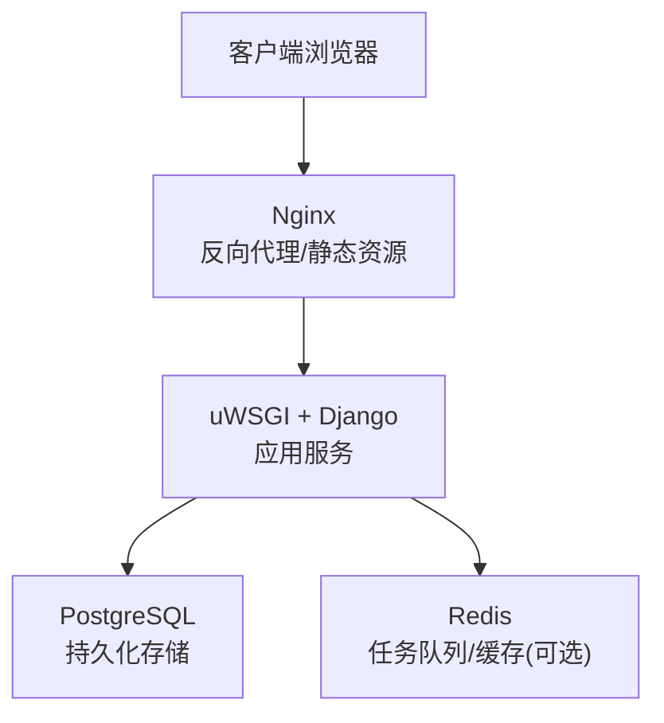
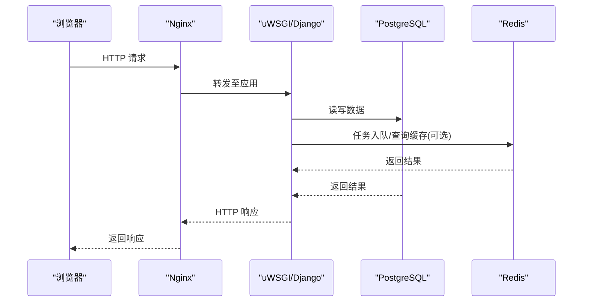
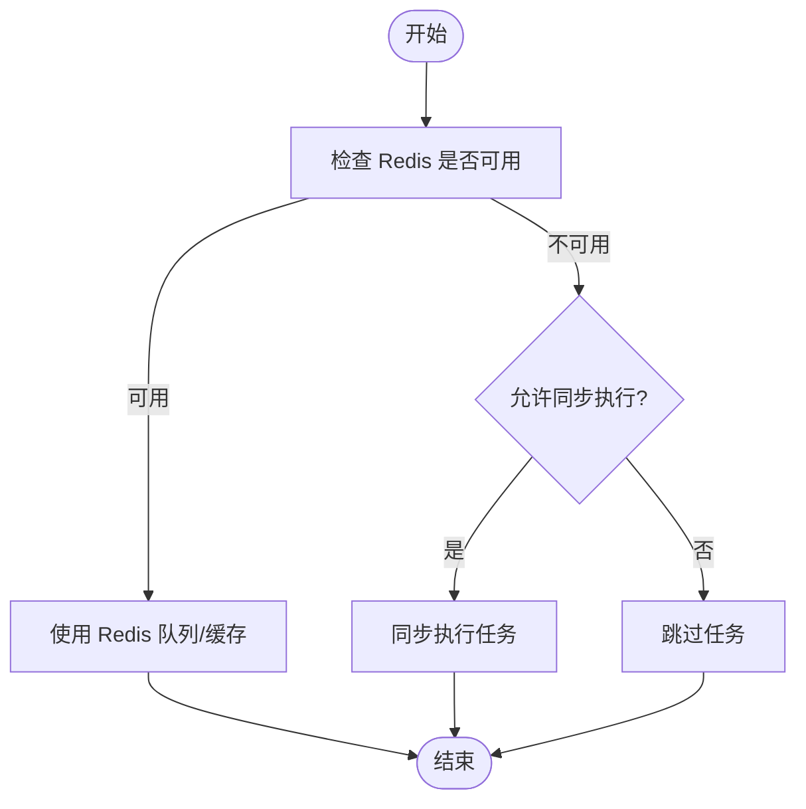
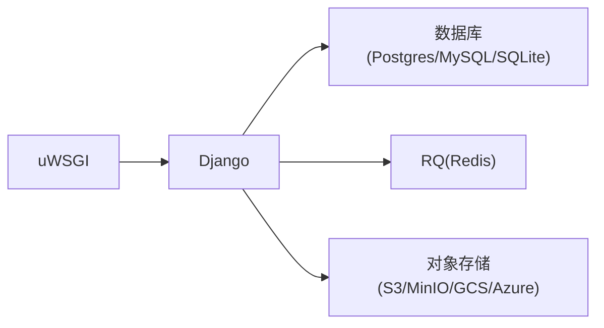

# 性能优化配置

<cite>
**本文引用的文件**   
- [README.md](file://README.md)
- [docker-compose.yml](file://docker-compose.yml)
- [uwsgi.ini](file://deploy/uwsgi.ini)
- [base.py](file://label_studio/core/settings/base.py)
- [redis.py](file://label_studio/core/redis.py)
</cite>

## 目录
1. [简介](#简介)
2. [项目结构](#项目结构)
3. [核心组件](#核心组件)
4. [架构总览](#架构总览)
5. [详细组件分析](#详细组件分析)
6. [依赖关系分析](#依赖关系分析)
7. [性能考量](#性能考量)
8. [故障排查指南](#故障排查指南)
9. [结论](#结论)
10. [附录](#附录)

## 简介
本指南面向 Label Studio 生产环境的性能优化，围绕数据库、缓存、静态资源、应用层与监控五大维度提供可落地的配置建议。内容基于仓库中的部署与配置源码进行解读，帮助你在不改动业务逻辑的前提下，通过环境变量与配置文件提升系统吞吐、降低延迟并增强稳定性。

## 项目结构
Label Studio 的生产栈通常由 Nginx（反向代理与静态资源）、Django + uWSGI（应用服务）与 PostgreSQL（数据库）组成；Redis 用于任务队列与可选的缓存能力。

图示来源
- [docker-compose.yml:1-72](file://docker-compose.yml#L1-L72)
- [uwsgi.ini:1-104](file://deploy/uwsgi.ini#L1-L104)
- [base.py:174-208](file://label_studio/core/settings/base.py#L174-L208)

章节来源
- [README.md:59-79](file://README.md#L59-L79)
- [docker-compose.yml:1-72](file://docker-compose.yml#L1-L72)

## 核心组件
- 数据库：默认使用 PostgreSQL，支持 MySQL/SQLite（生产推荐 PostgreSQL）。连接参数通过环境变量注入。
- Web 服务器：uWSGI 作为 WSGI 容器，提供进程管理、内存回收、超时控制等。
- 缓存与任务：RQ（基于 Redis）提供异步任务队列；Redis 在 LSE 中可作为缓存后端，LSO 默认关闭。
- 静态资源：Django 静态文件收集到 STATIC_ROOT，配合 Nginx 对外提供服务。

章节来源
- [base.py:174-208](file://label_studio/core/settings/base.py#L174-L208)
- [uwsgi.ini:1-104](file://deploy/uwsgi.ini#L1-L104)
- [base.py:608-628](file://label_studio/core/settings/base.py#L608-L628)

## 架构总览
下图展示请求从浏览器经 Nginx 进入 uWSGI/Django，再访问数据库与 Redis 的典型路径。

图示来源
- [docker-compose.yml:1-72](file://docker-compose.yml#L1-L72)
- [uwsgi.ini:1-104](file://deploy/uwsgi.ini#L1-L104)
- [base.py:174-208](file://label_studio/core/settings/base.py#L174-L208)
- [redis.py:264-358](file://label_studio/core/redis.py#L264-L358)

## 详细组件分析

### 数据库性能优化（连接池、查询优化、索引策略）
- 连接与引擎
  - 生产环境建议使用 PostgreSQL，连接参数通过环境变量 POSTGRE_* 注入。
  - SQLite 仅适合开发或轻量场景；MySQL 也可用但需额外配置。
- 连接池与并发
  - Django ORM 未内置连接池，实际连接复用由底层驱动与 uWSGI 进程模型共同决定。
  - 通过 uWSGI 进程数与环境变量 UWSGI_PROCESSES 控制并发度，避免过多连接导致数据库压力。
- 查询优化
  - 合理分页与批量操作：DRF 默认 PAGE_SIZE=100，可通过环境变量调整；大批量更新/导入使用批量接口与分批处理。
  - 使用数据库视图/物化视图、只读副本分担查询负载（外部基础设施层面）。
- 索引策略
  - 为高频过滤字段建立索引；对 JSONB 字段使用 GIN 索引（PostgreSQL）。
  - 定期执行 EXPLAIN ANALYZE 分析慢查询，结合业务热点调整索引。

章节来源
- [base.py:174-208](file://label_studio/core/settings/base.py#L174-L208)
- [uwsgi.ini:9-14](file://deploy/uwsgi.ini#L9-L14)
- [base.py:294-310](file://label_studio/core/settings/base.py#L294-L310)

### 缓存配置（Redis 缓存、页面缓存、数据缓存）
- Redis 开关与连接
  - OSS 版本默认 REDIS_ENABLED=False；LSE 启用后可作为缓存与任务队列后端。
  - 支持 SSL 连接参数 REDIS_SSL_SETTINGS，便于安全接入托管 Redis。
- 任务队列（RQ）
  - 多队列 critical/high/default/low，统一 HOST/PORT/DB 配置；失败作业 TTL 可配置。
  - start_job_async_or_sync 在 Redis 不可用时可选择同步回退或跳过。
- FSM 状态缓存
  - FSM_CACHE_TTL 控制状态缓存过期时间；FSM 缓存键前缀 fsm:current。
- 解析器代理缓存
  - RESOLVER_PROXY_ENABLE_ETAG_CACHE 与 RESOLVER_PROXY_CACHE_TIMEOUT 控制 ETag 与缓存时长。
- 用户活动缓存
  - USER_ACTIVITY_REDIS_KEY_PREFIX/BATCH_SIZE/SYNC_THRESHOLD/TTL 控制用户行为写入 Redis 的批量化与过期策略。

图示来源
- [base.py:389-430](file://label_studio/core/settings/base.py#L389-L430)
- [base.py:1100-1106](file://label_studio/core/settings/base.py#L1100-L1106)
- [base.py:1131-1141](file://label_studio/core/settings/base.py#L1131-L1141)
- [redis.py:80-111](file://label_studio/core/redis.py#L80-L111)
- [redis.py:264-370](file://label_studio/core/redis.py#L264-L370)

章节来源
- [base.py:389-430](file://label_studio/core/settings/base.py#L389-L430)
- [base.py:1100-1106](file://label_studio/core/settings/base.py#L1100-L1106)
- [base.py:1131-1141](file://label_studio/core/settings/base.py#L1131-L1141)
- [redis.py:80-111](file://label_studio/core/redis.py#L80-L111)
- [redis.py:264-370](file://label_studio/core/redis.py#L264-L370)

### 静态资源优化（CDN、压缩、浏览器缓存）
- 静态文件收集
  - STATIC_ROOT 指向构建产物目录，STATIC_URL 暴露路径；STORAGES.staticfiles 使用自定义存储以跳过缺失清单警告。
- Nginx 角色
  - Nginx 作为反向代理与静态资源服务器，可将 /static 与 /data 等资源交由其高效分发。
- CDN 与缓存
  - 将 STATIC_URL 与 MEDIA_URL 指向 CDN 域名，开启 gzip/brotli 压缩与长期缓存头（Cache-Control/ETag）。
  - 利用 RESOLVER_PROXY_ENABLE_ETAG_CACHE 与 RESOLVER_PROXY_CACHE_TIMEOUT 控制代理侧缓存。

章节来源
- [base.py:608-628](file://label_studio/core/settings/base.py#L608-L628)
- [base.py:1131-1132](file://label_studio/core/settings/base.py#L1131-L1132)
- [docker-compose.yml:1-25](file://docker-compose.yml#L1-L25)

### 应用层优化（代码、内存、GC）
- uWSGI 进程与线程
  - master/cheaper/single-interpreter 减少启动开销；enable-threads 开启线程；thunder-lock 防止惊群。
- 内存与回收
  - reload-on-rss 按 RSS 阈值重启 worker；max-worker-lifetime/delta 控制生命周期抖动；harakiri 限制长任务。
- 日志与可观测性
  - JSON_LOG 输出结构化日志；uWSGI stats 端口暴露统计信息；Sentry 集成用于异常上报。

章节来源
- [uwsgi.ini:1-104](file://deploy/uwsgi.ini#L1-L104)
- [base.py:23-77](file://label_studio/core/settings/base.py#L23-L77)
- [base.py:570-585](file://label_studio/core/settings/base.py#L570-L585)

### 监控与分析工具（性能监控、瓶颈识别、容量规划）
- 指标与日志
  - uWSGI stats-http 暴露统计；JSON_LOG 输出结构化日志便于采集。
- 错误追踪
  - Sentry DSN、采样率与环境标识；前端 Sentry 独立配置。
- 任务队列监控
  - django-rq 管理后台（默认隐藏链接），结合 Redis 监控队列长度、失败作业与 Worker 状态。
- 容量规划
  - 根据 QPS、CPU/内存占用与数据库连接数，逐步调优 uWSGI 进程数、worker 生命周期与数据库连接上限。

章节来源
- [uwsgi.ini:21-23](file://deploy/uwsgi.ini#L21-L23)
- [base.py:23-77](file://label_studio/core/settings/base.py#L23-L77)
- [base.py:570-585](file://label_studio/core/settings/base.py#L570-L585)
- [base.py:420-427](file://label_studio/core/settings/base.py#L420-L427)

## 依赖关系分析
- 组件耦合
  - uWSGI 承载 Django 应用；Django 通过 settings.base 配置数据库、缓存、RQ 等；Redis 同时支撑任务队列与可选缓存。
- 外部依赖
  - PostgreSQL/MySQL/SQLite 三选一；MinIO/AWS S3/GCS/Azure 对象存储通过 STORAGES 切换。
- 潜在循环依赖
  - 无直接循环依赖；注意在 LSE/LYO 扩展点处保持模块边界清晰。

图示来源
- [uwsgi.ini:1-104](file://deploy/uwsgi.ini#L1-L104)
- [base.py:174-208](file://label_studio/core/settings/base.py#L174-L208)
- [base.py:945-994](file://label_studio/core/settings/base.py#L945-L994)

章节来源
- [base.py:174-208](file://label_studio/core/settings/base.py#L174-L208)
- [base.py:945-994](file://label_studio/core/settings/base.py#L945-L994)

## 性能考量
- 数据库
  - 优先使用 PostgreSQL；合理设置连接数与连接复用；对热点查询加索引；使用只读副本分担读负载。
- 缓存
  - 启用 Redis 后，优先将频繁读取且变化少的数据放入缓存；合理设置 TTL 与键空间隔离。
- 静态资源
  - 使用 CDN 分发静态与媒体资源；开启压缩与强缓存；合理使用 ETag 与 Range 请求。
- 应用层
  - 根据 CPU 核数与内存设定 uWSGI 进程数；设置合理的 worker 生命周期与 harakiri 保护；开启线程以提升 IO 密集型任务吞吐。
- 监控
  - 采集 uWSGI 统计、应用日志与 Sentry 异常；结合 Redis 与数据库慢查询日志定位瓶颈。

[本节为通用指导，无需列出具体文件来源]

## 故障排查指南
- Redis 不可用
  - 现象：任务无法入队或缓存失效；健康检查失败。
  - 排查：检查 REDIS_ENABLED、REDIS_SSL_SETTINGS 与网络连通；查看 redis_healthcheck 日志。
- 任务长时间运行
  - 现象：Worker 被 harakiri 杀死或任务堆积。
  - 排查：调整 harakiri、max-worker-lifetime 与队列优先级；拆分大任务为子任务。
- 内存增长
  - 现象：Worker RSS 持续增长触发重载。
  - 排查：确认是否存在内存泄漏；调整 reload-on-rss 与 max-worker-lifetime；观察 GC 行为。
- 数据库锁与超时
  - 现象：高并发下出现锁等待或超时。
  - 排查：优化事务粒度与索引；降低并发连接数；使用重试中间件与批量更新。

章节来源
- [redis.py:80-111](file://label_studio/core/redis.py#L80-L111)
- [uwsgi.ini:66-104](file://deploy/uwsgi.ini#L66-L104)
- [base.py:268-286](file://label_studio/core/settings/base.py#L268-L286)

## 结论
通过合理配置数据库连接与索引、启用 Redis 缓存与任务队列、借助 Nginx/CDN 优化静态资源、调优 uWSGI 与应用内存策略，并结合监控与日志体系，可在不侵入业务代码的前提下显著提升 Label Studio 在生产环境的性能与稳定性。建议在灰度环境中逐步验证各项变更，结合压测与线上指标持续迭代优化。

[本节为总结性内容，无需列出具体文件来源]

## 附录
- 常用环境变量速查
  - 数据库：DJANGO_DB、POSTGRE_USER/NAME/PASSWORD/HOST/PORT
  - Redis：REDIS_ENABLED、REDIS_SSL_CERTS_REQS/CA_CERTS/KEYFILE/CERTFILE
  - uWSGI：UWSGI_PROCESSES、UWSGI_WORKER_RELOAD_ON_RSS、UWSGI_WORKER_MAX_LIFETIME、UWSGI_WORKER_HARAKIRI
  - 静态资源：STATIC_URL、USE_NGINX_FOR_UPLOADS、USE_NGINX_FOR_EXPORT_DOWNLOADS
  - 代理缓存：RESOLVER_PROXY_ENABLE_ETAG_CACHE、RESOLVER_PROXY_CACHE_TIMEOUT
  - 用户活动：USER_ACTIVITY_REDIS_KEY_PREFIX/BATCH_SIZE/SYNC_THRESHOLD/TTL

章节来源
- [base.py:174-208](file://label_studio/core/settings/base.py#L174-L208)
- [base.py:1100-1141](file://label_studio/core/settings/base.py#L1100-L1141)
- [uwsgi.ini:9-14](file://deploy/uwsgi.ini#L9-L14)
- [uwsgi.ini:66-104](file://deploy/uwsgi.ini#L66-L104)
- [base.py:942-943](file://label_studio/core/settings/base.py#L942-L943)
- [base.py:1131-1132](file://label_studio/core/settings/base.py#L1131-L1132)