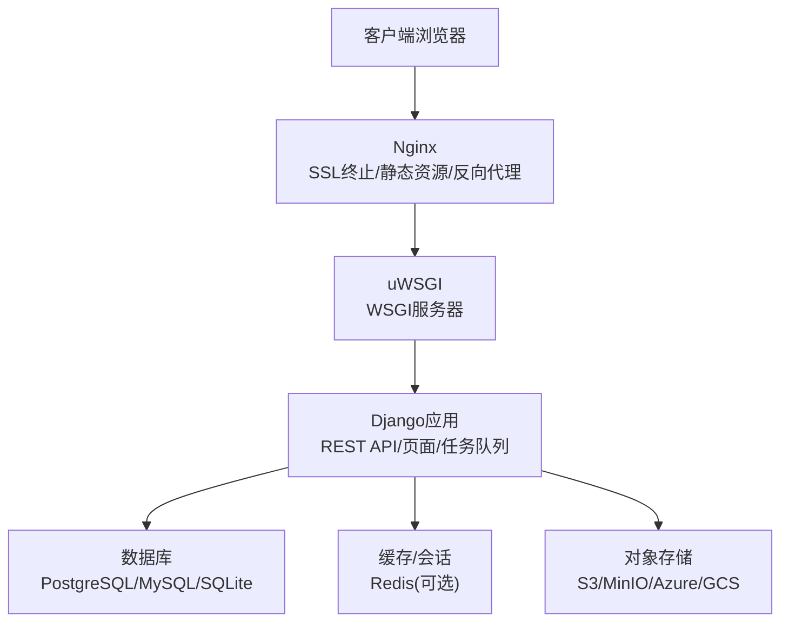
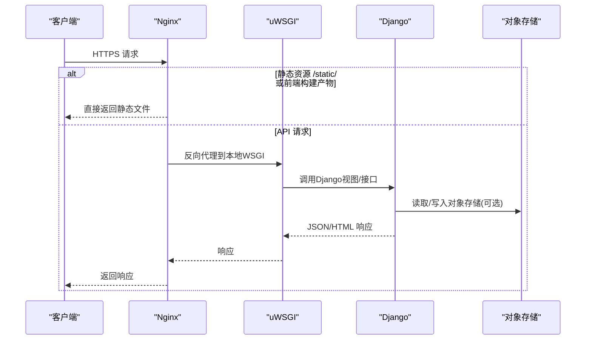
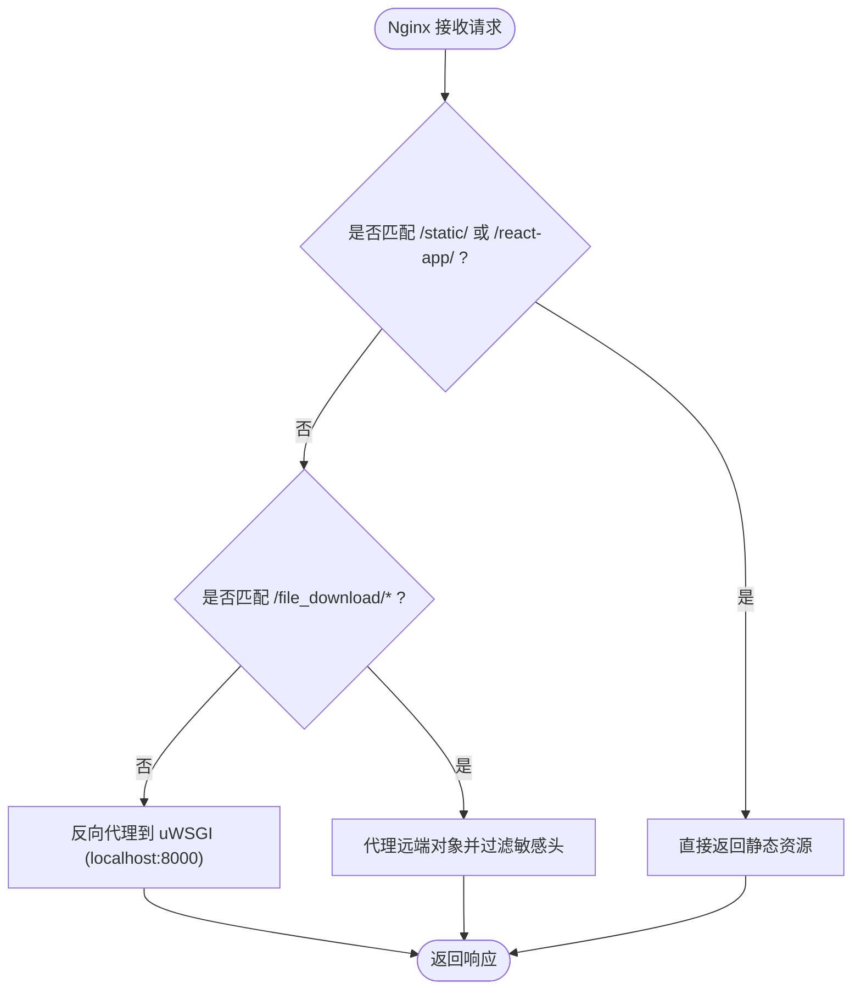
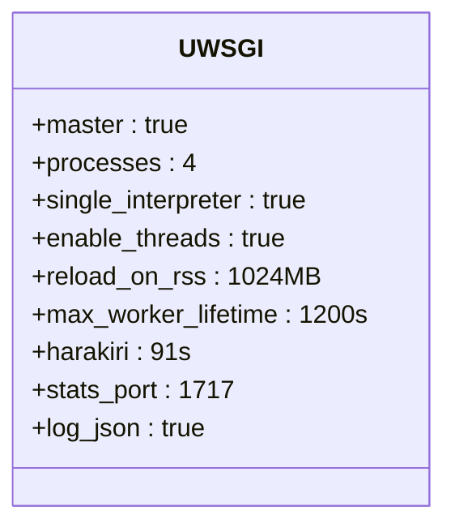
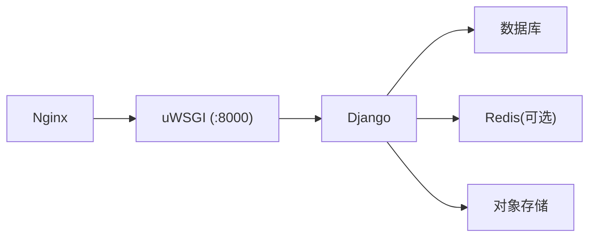

# 生产环境配置

<cite>
**本文引用的文件**   
- [uwsgi.ini](file://deploy/uwsgi.ini)
- [default.conf](file://deploy/default.conf)
- [base.py](file://label_studio/core/settings/base.py)
- [10-configure-nginx.sh](file://deploy/docker-entrypoint.d/common/10-configure-nginx.sh)
</cite>

## 目录
1. [简介](#简介)
2. [项目结构](#项目结构)
3. [核心组件](#核心组件)
4. [架构总览](#架构总览)
5. [详细组件分析](#详细组件分析)
6. [依赖关系分析](#依赖关系分析)
7. [性能优化建议](#性能优化建议)
8. [故障排查指南](#故障排查指南)
9. [结论](#结论)

## 简介
本指南面向在生产环境中部署 Label Studio 的运维与平台工程团队，聚焦以下目标：
- Django 应用的生产环境配置要点（数据库、缓存、静态文件、安全与中间件）。
- Nginx 反向代理配置（SSL 终止、请求头处理、静态资源与下载代理、CSP/安全头等）。
- uWSGI 服务器配置（进程管理、性能调优、信号与日志）。
- 安全加固（CSRF、CORS、安全头、SSRF 防护等）。
- 性能优化（Gzip、缓存策略、连接池与超时、并发模型）。

## 项目结构
Label Studio 的生产部署通常由四层组成：
- Nginx：对外暴露 HTTP/HTTPS，负责 SSL 终止、静态资源、反向代理到后端。
- uWSGI：作为 WSGI 服务器承载 Django 应用。
- Django：业务逻辑、API、模板、静态文件收集路径。
- 外部依赖：PostgreSQL/MySQL、Redis（可选）、对象存储（S3/MinIO/Azure/GCS）等。

图表来源
- [default.conf:1-226](file://deploy/default.conf#L1-L226)
- [uwsgi.ini:1-104](file://deploy/uwsgi.ini#L1-L104)
- [base.py:174-208](file://label_studio/core/settings/base.py#L174-L208)
- [base.py:608-628](file://label_studio/core/settings/base.py#L608-L628)
- [base.py:945-994](file://label_studio/core/settings/base.py#L945-L994)

章节来源
- [default.conf:1-226](file://deploy/default.conf#L1-L226)
- [uwsgi.ini:1-104](file://deploy/uwsgi.ini#L1-L104)
- [base.py:174-208](file://label_studio/core/settings/base.py#L174-L208)
- [base.py:608-628](file://label_studio/core/settings/base.py#L608-L628)
- [base.py:945-994](file://label_studio/core/settings/base.py#L945-L994)

## 核心组件
本节从生产视角梳理关键配置项与行为：
- Django 基础设置与安全
  - 主机名、子路径、X-Forwarded-* 支持、CSRF/CORS、Session Cookie 安全属性、CSP。
  - 静态文件路径与 STORAGES 配置。
  - 数据库连接（默认 PostgreSQL，可切换 MySQL/SQLite）。
  - RQ 队列与 Redis 相关设置（OSS 默认未启用 Redis）。
  - 云存储后端（S3/MinIO/Azure/GCS）动态切换。
- Nginx 反向代理
  - SSL/TLS 协议与密码套件、Gzip 压缩、MIME 类型修正。
  - 安全响应头（HSTS、X-Frame-Options、CSP 映射）。
  - 上传/下载代理、重定向处理、内部路由。
  - 通过入口脚本注入证书、上游地址与子路径。
- uWSGI 服务器
  - 进程/线程模型、统计端口、内存报告、worker 回收策略、harakiri 超时。
  - 日志输出格式（JSON/标准）、禁用默认请求日志。
  - 环境变量驱动的配置开关。

章节来源
- [base.py:125-142](file://label_studio/core/settings/base.py#L125-L142)
- [base.py:268-286](file://label_studio/core/settings/base.py#L268-L286)
- [base.py:313-335](file://label_studio/core/settings/base.py#L313-L335)
- [base.py:608-628](file://label_studio/core/settings/base.py#L608-L628)
- [base.py:630-640](file://label_studio/core/settings/base.py#L630-L640)
- [base.py:945-994](file://label_studio/core/settings/base.py#L945-L994)
- [default.conf:82-107](file://deploy/default.conf#L82-L107)
- [default.conf:111-136](file://deploy/default.conf#L111-L136)
- [default.conf:138-217](file://deploy/default.conf#L138-L217)
- [uwsgi.ini:1-104](file://deploy/uwsgi.ini#L1-L104)

## 架构总览
下图展示生产环境下请求的典型流转路径，包括静态资源、API 与文件下载代理。

图表来源
- [default.conf:138-146](file://deploy/default.conf#L138-L146)
- [default.conf:204-217](file://deploy/default.conf#L204-L217)
- [uwsgi.ini:1-10](file://deploy/uwsgi.ini#L1-L10)
- [base.py:608-628](file://label_studio/core/settings/base.py#L608-L628)
- [base.py:945-994](file://label_studio/core/settings/base.py#L945-L994)

## 详细组件分析

### Django 应用生产环境配置
- 主机名与子路径
  - 通过 HOSTNAME 控制站点根 URL；当 DOMAIN_FROM_REQUEST 为真时，HOSTNAME 只能为子路径。
  - FORCE_SCRIPT_NAME 自动解析出子路径前缀，用于 Django URL 解析。
- X-Forwarded 与 SSL
  - SECURE_PROXY_SSL_HEADER 可从自定义头部识别 HTTPS。
  - USE_X_FORWARDED_HOST/PORT 允许从代理传递 Host/Port。
- CSRF 与 Session Cookie
  - SESSION_COOKIE_SECURE/CSRF_COOKIE_SECURE/HTTPONLY/SAMESITE/AGE 均可通过环境变量覆盖。
  - CSRF_TRUSTED_ORIGINS 支持逗号分隔的受信任来源列表。
- CORS
  - 优先使用 CORS_ALLOWED_ORIGINS/CORS_ALLOWED_ORIGIN_REGEXES；否则回退到 CORS_ALLOW_ALL_ORIGINS。
  - ALLOWED_METHODS 包含常见 REST 方法。
- 静态文件与媒体
  - STATIC_URL 指向 /static/，STATIC_ROOT 指向 static_build。
  - STORAGES.default 默认使用文件系统；可通过 MinIO/S3/Azure/GCS 环境变量切换为云存储后端。
- 数据库
  - 默认 PostgreSQL，也可切换到 MySQL 或 SQLite；连接参数通过 POSTGRE_*/MYSQL_* 环境变量配置。
  - 注意：代码中未显式开启连接池；生产建议使用外部连接池（如 PgBouncer/Pgpool）或在数据库侧进行连接数限制。
- 缓存与会话
  - OSS 默认未启用 Redis（REDIS_ENABLED=False），RQ 队列也默认指向本地 Redis。
  - 若需启用 Redis 缓存/会话，需在部署层提供 Redis 并修改相关设置（见“扩展与集成点”）。
- 安全中间件与 CSP
  - 已启用 SecurityMiddleware、CsrfViewMiddleware、CorsMiddleware。
  - 可通过 ENABLE_CSP 启用 Content-Security-Policy 中间件与默认策略。
- SSRF 防护
  - SSRF_PROTECTION_ENABLED 与 USE_DEFAULT_BANNED_SUBNETS 默认开启，可追加 USER_ADDITIONAL_BANNED_SUBNETS。

章节来源
- [base.py:92-123](file://label_studio/core/settings/base.py#L92-L123)
- [base.py:125-142](file://label_studio/core/settings/base.py#L125-L142)
- [base.py:313-335](file://label_studio/core/settings/base.py#L313-L335)
- [base.py:608-628](file://label_studio/core/settings/base.py#L608-L628)
- [base.py:630-640](file://label_studio/core/settings/base.py#L630-L640)
- [base.py:174-208](file://label_studio/core/settings/base.py#L174-L208)
- [base.py:389-427](file://label_studio/core/settings/base.py#L389-L427)
- [base.py:268-286](file://label_studio/core/settings/base.py#L268-L286)
- [base.py:1047-1092](file://label_studio/core/settings/base.py#L1047-L1092)
- [base.py:650-652](file://label_studio/core/settings/base.py#L650-L652)

### Nginx 反向代理配置
- SSL/TLS
  - 仅启用 TLSv1.2/TLSv1.3，并限定强密码套件。
  - 证书与私钥通过入口脚本替换占位符，监听 8086 端口（注释示例）。
- Gzip 压缩
  - 启用 gzip，压缩级别 6，对文本、JS、JSON、SVG 等类型进行压缩。
- 安全响应头
  - HSTS、X-Frame-Options、CORS 头、Access-Control-Expose-Headers/Allow-Headers。
  - 针对上传文件内容类型动态添加 Content-Security-Policy sandbox。
- 静态资源与前端
  - /static/ 指向 Django 收集的静态构建目录。
  - /react-app/ 指向前端构建产物目录。
- 文件下载代理
  - /file_download/* 内部路由，将远端对象流式转发给客户端，隐藏云厂商敏感响应头，强制 TLS SNI，禁止落盘临时文件。
  - 处理 3xx 重定向，避免二次跳转泄露凭据。
- 反向代理到 uWSGI
  - 将 / 下所有请求转发至 http://localhost:8000/，设置 X-Real-IP/X-Forwarded-For/Host/X-Request-ID。
- 入口脚本增强
  - 根据环境变量替换证书、上游地址 APP_HOST、以及子路径 LABEL_STUDIO_HOST_SUBPATH。

图表来源
- [default.conf:88-94](file://deploy/default.conf#L88-L94)
- [default.conf:101-107](file://deploy/default.conf#L101-L107)
- [default.conf:138-146](file://deploy/default.conf#L138-L146)
- [default.conf:156-202](file://deploy/default.conf#L156-L202)
- [default.conf:204-217](file://deploy/default.conf#L204-L217)
- [10-configure-nginx.sh:42-70](file://deploy/docker-entrypoint.d/common/10-configure-nginx.sh#L42-L70)

章节来源
- [default.conf:1-226](file://deploy/default.conf#L1-L226)
- [10-configure-nginx.sh:1-71](file://deploy/docker-entrypoint.d/common/10-configure-nginx.sh#L1-L71)

### uWSGI 服务器配置
- 进程与线程
  - master=true，单解释器 single-interpreter=true，enable-threads=True。
  - processes 默认 4，可通过 UWSGI_PROCESSES 覆盖。
- Worker 回收与超时
  - reload-on-rss 默认 1024MB，max-worker-lifetime 默认 1200s，delta 60s。
  - harakiri 默认 91s，verbose 开启，reload-mercy/worker-reload-mercy=3。
- 日志与监控
  - 应用日志与 uWSGI 日志分别输出到 stdio，采用 JSON 编码器。
  - stats 端口 1717，stats-http=true，memory-report=true。
- 稳定性
  - thunder-lock=true 防止惊群效应，lazy-apps=true 避免 FD 共享。
  - ignore-sigpipe/ignore-write-errors/disable-write-exception 提升健壮性。

图表来源
- [uwsgi.ini:1-104](file://deploy/uwsgi.ini#L1-L104)

章节来源
- [uwsgi.ini:1-104](file://deploy/uwsgi.ini#L1-L104)

### 安全加固配置
- CSRF 保护
  - 启用 CsrfViewMiddleware，SESSION_COOKIE_SECURE/CSRF_COOKIE_SECURE/HTTPONLY/SAMESITE/AGE 可按需调整。
  - CSRF_TRUSTED_ORIGINS 支持多来源白名单。
- CORS
  - 明确允许的 Origin/Regex，或关闭全量放行；ALLOWED_METHODS 限定方法集。
- 安全头
  - HSTS、X-Frame-Options、CSP（可通过 ENABLE_CSP 启用）。
- SSRF 防护
  - SSRF_PROTECTION_ENABLED 与默认屏蔽网段启用，支持追加用户自定义屏蔽网段。
- 上传文件沙箱
  - Nginx 对特定上传文件类型（HTML/SVG/XML）附加 CSP sandbox，降低执行风险。

章节来源
- [base.py:630-640](file://label_studio/core/settings/base.py#L630-L640)
- [base.py:313-335](file://label_studio/core/settings/base.py#L313-L335)
- [base.py:1047-1092](file://label_studio/core/settings/base.py#L1047-L1092)
- [base.py:650-652](file://label_studio/core/settings/base.py#L650-L652)
- [default.conf:101-107](file://deploy/default.conf#L101-L107)

### 性能优化建议
- Gzip 压缩
  - Nginx 已启用 gzip，压缩级别 6，覆盖常用文本与 JS/JSON/SVG。
- 静态资源
  - 使用 Nginx 直接提供 /static/ 与前端构建产物，减少 Django 负载。
- 连接与超时
  - Nginx proxy_connect/send/read_timeout 与 send_timeout 设置为 90s。
  - uWSGI http-timeout=300s，buffer-size=65535，post-buffering=4096。
- 并发模型
  - uWSGI processes=4（可调），enable-threads=true；结合 CPU 核数与内存上限调整。
- 缓存策略
  - 当前 OSS 默认未启用 Redis 缓存；如需加速，可在部署层引入 Redis 并修改 Django 缓存与会话后端（见“扩展与集成点”）。
- 数据库连接
  - 未内置连接池；建议在数据库侧使用 PgBouncer/Pgpool 或云托管数据库的连接池能力。

章节来源
- [default.conf:88-94](file://deploy/default.conf#L88-L94)
- [default.conf:204-217](file://deploy/default.conf#L204-L217)
- [uwsgi.ini:19-23](file://deploy/uwsgi.ini#L19-L23)
- [uwsgi.ini:9-14](file://deploy/uwsgi.ini#L9-L14)
- [base.py:389-427](file://label_studio/core/settings/base.py#L389-L427)

## 依赖关系分析
- Nginx 依赖
  - 通过入口脚本 10-configure-nginx.sh 动态注入 resolv.conf、证书、APP_HOST 与子路径。
- uWSGI 依赖
  - 加载 core.wsgi:application，运行在 :8000 端口。
- Django 依赖
  - 数据库（PostgreSQL/MySQL/SQLite）、可选 Redis（RQ/缓存）、对象存储（S3/MinIO/Azure/GCS）。
- 中间件链
  - CORS -> Security -> Session -> Locale -> CSRF -> XApiKeySupport -> Auth -> Messages -> NoindexUrl -> CommonAppendSlash -> UserAgent -> SetSessionUID -> ContextLog -> DatabaseIsLockedRetry -> ThreadLocal -> JWTAuthentication。

图表来源
- [default.conf:204-217](file://deploy/default.conf#L204-L217)
- [uwsgi.ini:1-10](file://deploy/uwsgi.ini#L1-L10)
- [base.py:268-286](file://label_studio/core/settings/base.py#L268-L286)
- [base.py:174-208](file://label_studio/core/settings/base.py#L174-L208)
- [base.py:389-427](file://label_studio/core/settings/base.py#L389-L427)
- [base.py:945-994](file://label_studio/core/settings/base.py#L945-L994)

章节来源
- [10-configure-nginx.sh:1-71](file://deploy/docker-entrypoint.d/common/10-configure-nginx.sh#L1-L71)
- [default.conf:204-217](file://deploy/default.conf#L204-L217)
- [uwsgi.ini:1-10](file://deploy/uwsgi.ini#L1-L10)
- [base.py:268-286](file://label_studio/core/settings/base.py#L268-L286)
- [base.py:174-208](file://label_studio/core/settings/base.py#L174-L208)
- [base.py:389-427](file://label_studio/core/settings/base.py#L389-L427)
- [base.py:945-994](file://label_studio/core/settings/base.py#L945-L994)

## 性能优化建议
- 网络与传输
  - 保持 Nginx gzip 开启，合理设置 gzip_types 与 gzip_comp_level。
  - 使用 keepalive 与合理的 worker_connections（当前默认 1024）。
- 静态资源
  - 确保 /static/ 与 /react-app/ 由 Nginx 直接提供，避免经过 Django。
- 后端并发
  - 根据 CPU 核数与内存上限调整 UWSGI_PROCESSES；必要时开启 enable-threads。
  - 使用 harakiri 与 worker 生命周期回收，避免内存泄漏累积。
- 缓存与会话
  - 引入 Redis 作为缓存与会话后端，显著提升高并发场景下的性能。
- 数据库
  - 使用连接池（PgBouncer/Pgpool）或云托管数据库连接池，限制最大连接数。
- 对象存储
  - 合理设置预签名 TTL 与分块大小，减少大文件导出时的延迟与内存占用。

[本节为通用指导，不直接分析具体文件]

## 故障排查指南
- Nginx 无法加载证书
  - 检查环境变量 NGINX_SSL_CERT/NGINX_SSL_CERT_KEY 是否正确传入，确认 10-configure-nginx.sh 已替换占位符。
- 访问被拒绝或跨域失败
  - 检查 CORS_ALLOWED_ORIGINS/ALLOWED_HOSTS/CSRF_TRUSTED_ORIGINS 是否包含实际域名。
  - 确认 Nginx 已添加 Access-Control-Allow-Origin/Headers 且 OPTIONS 预检返回 204。
- 静态资源 404
  - 确认 /static/ 与 /react-app/ 路径正确，静态文件已收集到对应目录。
- 大文件上传/下载失败
  - 检查 client_max_body_size、uWSGI buffer-size/post-buffering、proxy_read/send_timeout。
  - 下载代理路径 /file_download/* 是否正确，远端是否返回 3xx 重定向。
- 应用超时或卡顿
  - 调整 uWSGI harakiri、max-worker-lifetime、reload-on-rss；观察 memory-report 与 stats 端口。
- 数据库连接问题
  - 校验 POSTGRE_*/MYSQL_* 环境变量；若使用连接池，确认连接池服务健康。

章节来源
- [10-configure-nginx.sh:42-70](file://deploy/docker-entrypoint.d/common/10-configure-nginx.sh#L42-L70)
- [default.conf:121-136](file://deploy/default.conf#L121-L136)
- [default.conf:138-146](file://deploy/default.conf#L138-L146)
- [default.conf:156-202](file://deploy/default.conf#L156-L202)
- [uwsgi.ini:19-23](file://deploy/uwsgi.ini#L19-L23)
- [uwsgi.ini:66-104](file://deploy/uwsgi.ini#L66-L104)
- [base.py:174-208](file://label_studio/core/settings/base.py#L174-L208)

## 结论
- Nginx 承担 SSL 终止、静态资源与反向代理职责，并通过入口脚本实现证书与上游的动态注入。
- uWSGI 以多进程+线程模型承载 Django，具备 worker 回收、harakiri 与 JSON 日志等生产特性。
- Django 生产配置强调 CSRF/CORS/安全头与 SSRF 防护；静态文件由 Nginx 提供，对象存储可动态切换。
- 性能方面建议启用 Redis 缓存、使用数据库连接池，并结合 Nginx/gzip/超时参数进行整体优化。

[本节为总结性内容，不直接分析具体文件]