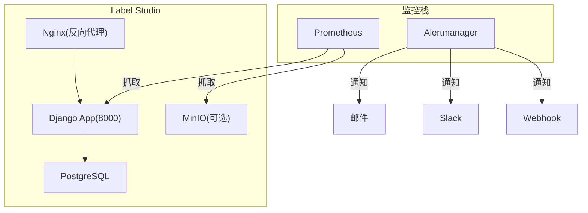
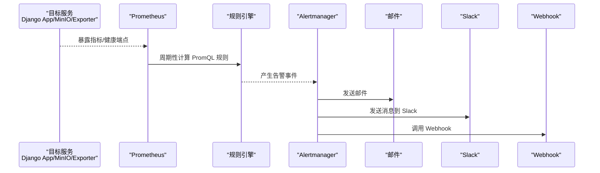
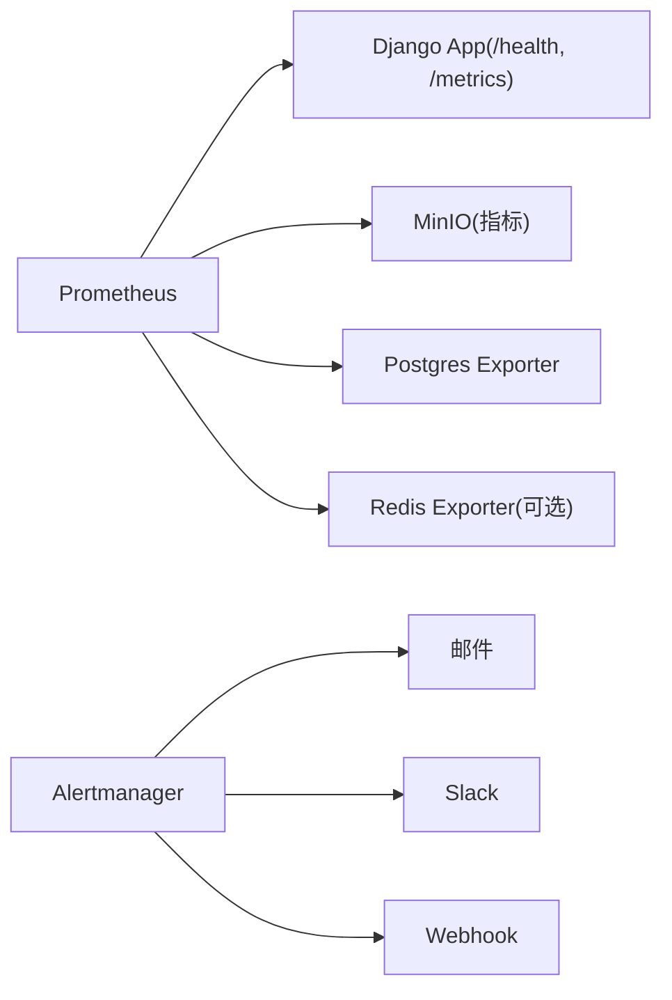

# 告警规则

<cite>
**本文引用的文件**   
- [prometheus.yml](file://prometheus/minio/prometheus.yml)
- [views.py](file://label_studio/core/views.py)
- [urls.py](file://label_studio/core/urls.py)
- [docker-compose.yml](file://docker-compose.yml)
</cite>

## 目录
1. [简介](#简介)
2. [项目结构](#项目结构)
3. [核心组件](#核心组件)
4. [架构总览](#架构总览)
5. [详细组件分析](#详细组件分析)
6. [依赖关系分析](#依赖关系分析)
7. [性能考虑](#性能考虑)
8. [故障排查指南](#故障排查指南)
9. [结论](#结论)
10. [附录](#附录)

## 简介
本指南面向在 Label Studio 环境中部署 Prometheus + Alertmanager 的运维与平台工程团队，提供从采集、指标暴露到告警规则与通知渠道的完整配置说明。内容覆盖：
- Prometheus 抓取配置（含 MinIO 示例）
- 系统健康检查端点与可用性探测
- 资源使用率、数据库连接等阈值告警建议
- 业务指标告警建议（任务积压、标注质量、用户增长异常）
- 异常检测告警（错误率突增、响应时间异常、数据一致性）
- 通知渠道（邮件、Slack、Webhook）
- 去重、抑制与升级策略

注意：仓库内未包含 Alertmanager 配置文件与 Prometheus 规则文件；本节基于仓库现有能力给出可落地的配置模板与最佳实践，便于直接落地。

## 项目结构
与告警相关的仓库资产主要包括：
- Prometheus 抓取示例（MinIO）
- Django 应用暴露的健康与指标相关端点
- Docker Compose 服务编排（用于定位端口与依赖）

图表来源
- [prometheus.yml:1-7](file://prometheus/minio/prometheus.yml#L1-L7)
- [views.py:70-78](file://label_studio/core/views.py#L70-L78)
- [docker-compose.yml:1-72](file://docker-compose.yml#L1-L72)

章节来源
- [prometheus.yml:1-7](file://prometheus/minio/prometheus.yml#L1-L7)
- [views.py:70-78](file://label_studio/core/views.py#L70-L78)
- [docker-compose.yml:1-72](file://docker-compose.yml#L1-L72)

## 核心组件
- Prometheus 抓取配置
  - 仓库提供了 MinIO 集群指标的抓取样例，可作为扩展至其他目标（如 Node Exporter、Postgres Exporter、Redis Exporter 等）的参考。
- 健康与指标端点
  - /health：返回系统健康状态，适合存活/就绪探针与可用性告警。
  - /metrics：预留的空页面，用于评估 Prometheus 抓取连通性。
  - /__lsa/collect_metrics：轻量级前端埋点收集接口（受开关控制）。
- 服务编排
  - docker-compose.yml 定义了 Nginx、App、DB 等服务的端口与环境变量，有助于确定抓取目标地址与端口。

章节来源
- [prometheus.yml:1-7](file://prometheus/minio/prometheus.yml#L1-L7)
- [views.py:70-78](file://label_studio/core/views.py#L70-L78)
- [views.py:214-218](file://label_studio/core/views.py#L214-L218)
- [urls.py:74-103](file://label_studio/core/urls.py#L74-L103)
- [docker-compose.yml:1-72](file://docker-compose.yml#L1-L72)

## 架构总览
下图展示从抓取到告警分发的端到端流程，以及常见通知渠道。

图表来源
- [views.py:70-78](file://label_studio/core/views.py#L70-L78)
- [prometheus.yml:1-7](file://prometheus/minio/prometheus.yml#L1-L7)

## 详细组件分析

### Prometheus 抓取配置
- MinIO 抓取示例
  - job_name: minio-job
  - metrics_path: /minio/v2/metrics/cluster
  - scheme: http
  - targets: ['minio:9000']
- 扩展建议
  - 为 Django App 添加标准指标导出（如 django-prometheus），并在 Prometheus 中新增 job 抓取 /metrics。
  - 为 PostgreSQL 添加 postgres_exporter，并配置相应 job。
  - 为 Redis 添加 redis_exporter（若使用 Redis 作为缓存/队列）。

章节来源
- [prometheus.yml:1-7](file://prometheus/minio/prometheus.yml#L1-L7)

### 系统健康检查告警
- 可用性与存活探测
  - 使用 /health 端点进行存活/就绪探测，结合 Prometheus 或 K8s Liveness/Readiness Probe。
  - 建议告警：当连续多次探测失败时触发“服务不可用”。
- 指标端点连通性
  - 通过 /metrics 空页面验证抓取链路是否可达。
- 外部依赖健康
  - 数据库连接：通过 Postgres Exporter 暴露连接数、慢查询、锁等待等指标，设置阈值告警。
  - 对象存储：通过 MinIO Exporter 暴露容量、IOPS、错误率等指标，设置阈值告警。

章节来源
- [views.py:70-78](file://label_studio/core/views.py#L70-L78)
- [views.py:76-78](file://label_studio/core/views.py#L76-L78)

### 业务指标告警（建议）
以下为建议的告警类别与指标方向（需结合具体业务实现指标采集后定义 PromQL）：
- 任务积压
  - 指标方向：待处理任务数、队列长度、消费速率 vs 生产速率。
  - 告警：积压超过阈值且持续一段时间。
- 标注质量下降
  - 指标方向：复核通过率、回退率、重复标注率、人工修正率。
  - 告警：质量指标低于阈值或出现显著下降趋势。
- 用户增长异常
  - 指标方向：注册量、活跃用户数、登录成功率。
  - 告警：增长率异常波动或登录失败率升高。

说明：以上为通用业务告警设计思路，需在应用中暴露对应指标后，在 Prometheus 规则中定义具体 PromQL 与阈值。

### 异常检测告警（建议）
- 错误率突增
  - 指标方向：HTTP 5xx 比例、API 错误率、异常抛出次数。
  - 告警：短窗口内错误率显著上升。
- 响应时间异常
  - 指标方向：P95/P99 延迟、平均延迟、超时率。
  - 告警：延迟超过基线或出现尖峰。
- 数据一致性
  - 指标方向：导入/导出失败率、校验失败计数、主从延迟（若有）。
  - 告警：一致性指标异常或延迟过高。

说明：异常检测类告警通常结合滑动窗口、同比/环比、SLO 基线进行判定，建议在 Prometheus 规则中使用 rate()/increase() 与 histogram_quantile() 等函数组合实现。

### 告警通知渠道配置（Alertmanager）
- 邮件
  - 配置 SMTP 服务器、发件人、收件人列表与主题模板。
- Slack
  - 配置 Incoming Webhook URL 与频道，支持按环境/严重级别路由。
- Webhook
  - 配置自定义回调地址，用于对接内部工单系统或自动化平台。
- 路由与分组
  - 按标签（如 environment、team、service）进行路由分流。
  - 对相似告警进行分组聚合，减少噪音。
- 去重与抑制
  - 去重：对相同 key 的告警合并，避免重复通知。
  - 抑制：当上游服务不可用时，抑制下游衍生告警。
- 升级策略
  - 长时间未恢复的告警自动升级到更高级别通道（如电话/短信）。

说明：Alertmanager 的具体 YAML 配置不在仓库中，可按上述策略编写独立配置文件并挂载到 Alertmanager 容器。

## 依赖关系分析
- 组件耦合
  - Prometheus 依赖各目标服务暴露指标与健康端点。
  - Alertmanager 依赖通知渠道可达性。
- 外部依赖
  - 数据库（PostgreSQL）、对象存储（MinIO/S3）、缓存（Redis，可选）。
- 潜在循环依赖
  - 无直接代码级循环依赖；主要依赖为运行时网络与服务发现。

图表来源
- [views.py:70-78](file://label_studio/core/views.py#L70-L78)
- [prometheus.yml:1-7](file://prometheus/minio/prometheus.yml#L1-L7)

章节来源
- [views.py:70-78](file://label_studio/core/views.py#L70-L78)
- [prometheus.yml:1-7](file://prometheus/minio/prometheus.yml#L1-L7)

## 性能考虑
- 抓取频率与保留周期
  - 合理设置 scrape_interval 与 retention，避免指标风暴与存储压力。
- 指标维度控制
  - 控制高基数标签数量，避免 PromQL 查询变慢。
- 规则复杂度
  - 将复杂逻辑拆分为中间指标，降低单次规则计算开销。
- 通知节流
  - 在 Alertmanager 中启用 inhibit_rules 与 group_by，减少重复与抖动。

## 故障排查指南
- 无法抓取 /health
  - 确认 Django 服务已启动且端口可达；检查 Nginx 转发与防火墙策略。
- /metrics 为空
  - 该端点为预留空页面，仅用于连通性测试；如需真实指标，请集成指标库并暴露标准指标。
- MinIO 指标抓取失败
  - 核对 prometheus.yml 中的 target 与端口；确认 MinIO 服务可达且路径正确。
- 告警未送达
  - 检查 Alertmanager 配置与通知渠道凭据；查看 Alertmanager 日志与路由匹配结果。

章节来源
- [views.py:70-78](file://label_studio/core/views.py#L70-L78)
- [views.py:76-78](file://label_studio/core/views.py#L76-L78)
- [prometheus.yml:1-7](file://prometheus/minio/prometheus.yml#L1-L7)

## 结论
通过在本仓库基础上补充 Prometheus 规则与 Alertmanager 配置，即可构建完整的监控告警体系。建议优先保障系统健康与关键依赖的可用性告警，再逐步完善业务与异常检测类告警，并通过去重、抑制与升级策略提升告警信噪比与处置效率。

## 附录
- 常用端点
  - /health：系统健康
  - /metrics：指标连通性（空页面）
  - /__lsa/collect_metrics：前端埋点收集（受开关控制）
- 服务端口（默认）
  - Nginx：8080/8081
  - Django App：8000（内部暴露）
  - PostgreSQL：5432
  - MinIO：9000（对象存储）

章节来源
- [views.py:70-78](file://label_studio/core/views.py#L70-L78)
- [views.py:214-218](file://label_studio/core/views.py#L214-L218)
- [urls.py:74-103](file://label_studio/core/urls.py#L74-L103)
- [docker-compose.yml:1-72](file://docker-compose.yml#L1-L72)