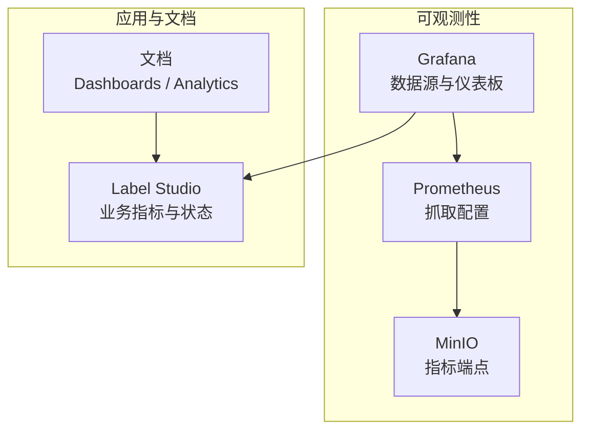
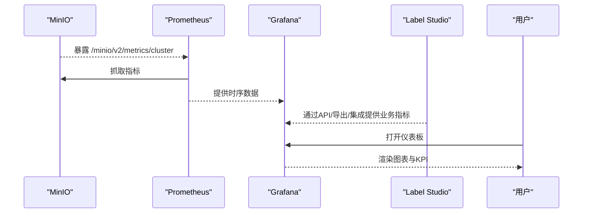
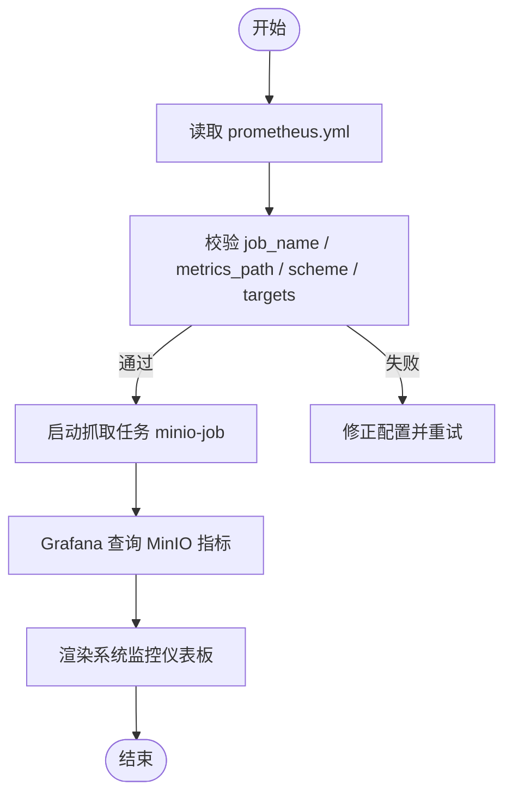
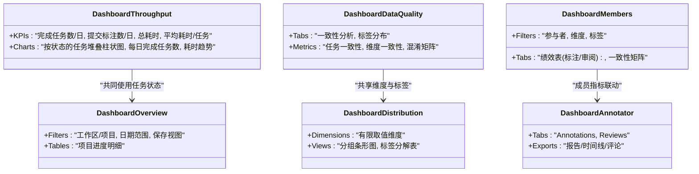
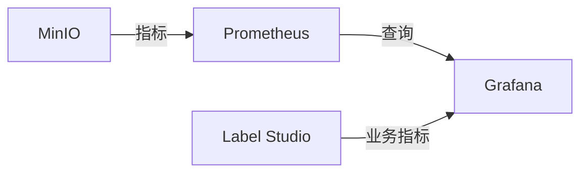

# Grafana仪表板

<cite>
**本文引用的文件**   
- [prometheus.yml](file://prometheus/minio/prometheus.yml)
- [dashboards.md](file://docs/source/guide/dashboards.md)
- [dashboard_throughput.md](file://docs/source/guide/dashboard_throughput.md)
- [dashboard_data_quality.md](file://docs/source/guide/dashboard_data_quality.md)
- [dashboard_members.md](file://docs/source/guide/dashboard_members.md)
- [dashboard_overview.md](file://docs/source/guide/dashboard_overview.md)
- [dashboard_distribution.md](file://docs/source/guide/dashboard_distribution.md)
- [dashboard_annotator.md](file://docs/source/guide/dashboard_annotator.md)
</cite>

## 目录
1. [简介](#简介)
2. [项目结构](#项目结构)
3. [核心组件](#核心组件)
4. [架构总览](#架构总览)
5. [详细组件分析](#详细组件分析)
6. [依赖关系分析](#依赖关系分析)
7. [性能与可观测性建议](#性能与可观测性建议)
8. [故障排查指南](#故障排查指南)
9. [结论](#结论)
10. [附录：图表配置与查询示例（概念）](#附录图表配置与查询示例概念)

## 简介
本指南面向在 Label Studio 环境中搭建和使用 Grafana 仪表板的工程师与数据/运营人员。文档聚焦以下目标：
- 安装部署与基础配置：Prometheus 抓取、Grafana 数据源连接、用户权限管理要点
- 核心仪表板配置：系统监控、业务指标、性能分析等
- 可视化组件用法：折线图、柱状图、仪表盘等
- 查询语句编写：PromQL 语法、聚合函数、过滤条件
- 布局设计原则与最佳实践，并提供可复用模板思路

说明：仓库中未包含 Grafana 或 Prometheus 的完整部署脚本，但提供了 Prometheus 抓取 MinIO 指标的配置文件，可作为数据源接入的基础参考。

## 项目结构
围绕可观测性与仪表板的关键文件分布如下：
- prometheus/minio/prometheus.yml：定义对 MinIO 集群指标的抓取任务
- docs/source/guide/*：Label Studio 内置仪表板与数据分析文档，用于理解业务指标来源与展示逻辑

图示来源
- [prometheus.yml:1-7](file://prometheus/minio/prometheus.yml#L1-L7)

章节来源
- [prometheus.yml:1-7](file://prometheus/minio/prometheus.yml#L1-L7)

## 核心组件
- Prometheus 抓取配置
  - job_name：minio-job
  - metrics_path：/minio/v2/metrics/cluster
  - scheme：http
  - targets：minio:9000
- Grafana 数据源
  - 添加 Prometheus 数据源，指向 Prometheus 服务地址
  - 验证连接并保存
- 仪表板
  - 系统监控：基于 Prometheus 指标（如 MinIO 集群指标）
  - 业务指标：结合 Label Studio 的任务状态、标注/审阅进度、质量指标
  - 性能分析：成员绩效、时间消耗、通过率等

章节来源
- [prometheus.yml:1-7](file://prometheus/minio/prometheus.yml#L1-L7)

## 架构总览
下图展示了从数据采集到可视化的端到端流程，以及 Label Studio 业务指标如何融入仪表板。

图示来源
- [prometheus.yml:1-7](file://prometheus/minio/prometheus.yml#L1-L7)

## 详细组件分析

### 组件A：Prometheus 抓取 MinIO 指标
- 抓取目标：minio:9000
- 指标路径：/minio/v2/metrics/cluster
- 协议：http
- 用途：为 Grafana 提供存储层可用性、容量、请求延迟等系统级指标

图示来源
- [prometheus.yml:1-7](file://prometheus/minio/prometheus.yml#L1-L7)

章节来源
- [prometheus.yml:1-7](file://prometheus/minio/prometheus.yml#L1-L7)

### 组件B：Label Studio 项目与分析仪表板
- 项目级仪表板
  - Throughput（吞吐量）：跟踪任务完成速度、剩余工作量、标注/审阅耗时
  - Data Quality（数据质量）：一致性、混淆矩阵、维度级质量
  - Members（成员）：标注者/审阅者绩效、一致性矩阵
- 分析级仪表板
  - Projects Overview（项目概览）：跨项目/工作区进度汇总
  - Label Distribution（标签分布）：标注与预测值分布对比
  - Member Performance（成员绩效）：个人标注/审阅活动与时间线

图示来源
- [dashboard_throughput.md:1-52](file://docs/source/guide/dashboard_throughput.md#L1-L52)
- [dashboard_data_quality.md:1-77](file://docs/source/guide/dashboard_data_quality.md#L1-L77)
- [dashboard_members.md:1-149](file://docs/source/guide/dashboard_members.md#L1-L149)
- [dashboard_overview.md:1-124](file://docs/source/guide/dashboard_overview.md#L1-L124)
- [dashboard_distribution.md:1-67](file://docs/source/guide/dashboard_distribution.md#L1-L67)
- [dashboard_annotator.md:1-197](file://docs/source/guide/dashboard_annotator.md#L1-L197)

章节来源
- [dashboards.md:1-52](file://docs/source/guide/dashboards.md#L1-L52)
- [dashboard_throughput.md:1-52](file://docs/source/guide/dashboard_throughput.md#L1-L52)
- [dashboard_data_quality.md:1-77](file://docs/source/guide/dashboard_data_quality.md#L1-L77)
- [dashboard_members.md:1-149](file://docs/source/guide/dashboard_members.md#L1-L149)
- [dashboard_overview.md:1-124](file://docs/source/guide/dashboard_overview.md#L1-L124)
- [dashboard_distribution.md:1-67](file://docs/source/guide/dashboard_distribution.md#L1-L67)
- [dashboard_annotator.md:1-197](file://docs/source/guide/dashboard_annotator.md#L1-L197)

### 组件C：仪表板访问与权限
- 项目级 Dashboards：适用于 Owner/Admin/Manager；Annotator/Reviewer 通常不直接使用
- 分析级 Dashboards：根据角色限制可见范围（所有工作区/项目 vs 仅本人或所在工作区/项目）
- 成员绩效仪表板：支持从组织页、首页、项目成员页等多入口访问

章节来源
- [dashboards.md:31-41](file://docs/source/guide/dashboards.md#L31-L41)
- [dashboard_overview.md:18-24](file://docs/source/guide/dashboard_overview.md#L18-L24)
- [dashboard_distribution.md:18-24](file://docs/source/guide/dashboard_distribution.md#L18-L24)
- [dashboard_annotator.md:43-49](file://docs/source/guide/dashboard_annotator.md#L43-L49)

## 依赖关系分析
- Prometheus 与 MinIO：通过静态配置建立抓取关系
- Grafana 与 Prometheus：通过数据源连接获取时序数据
- Grafana 与 Label Studio：通过业务指标（任务状态、标注/审阅事件、质量指标）构建业务仪表板

图示来源
- [prometheus.yml:1-7](file://prometheus/minio/prometheus.yml#L1-L7)

章节来源
- [prometheus.yml:1-7](file://prometheus/minio/prometheus.yml#L1-L7)

## 性能与可观测性建议
- 采集侧
  - 合理设置 scrape_interval，避免过高频率导致负载
  - 对 MinIO 指标进行必要的 relabeling，减少无用标签
- 查询侧
  - 优先使用预聚合函数（如 rate、sum by、avg_over_time）降低查询压力
  - 使用合理的 time range 与 downsample，避免全量扫描
- 展示侧
  - 控制面板变量数量，避免过多联动造成重绘
  - 将高频刷新与低频刷新面板分离，提升交互体验

[本节为通用指导，无需具体文件引用]

## 故障排查指南
- Prometheus 无法抓取 MinIO 指标
  - 检查 prometheus.yml 中的 targets、metrics_path、scheme 是否正确
  - 确认网络连通性与端口可达
  - 查看 Prometheus 日志与目标健康状态
- Grafana 数据源连接失败
  - 核对 Prometheus 服务地址与认证信息
  - 测试连接并查看错误提示
- 指标缺失或为空
  - 确认 MinIO 已正确暴露指标端点
  - 检查 Prometheus 抓取是否成功
  - 在 Explore 中直接执行查询验证

章节来源
- [prometheus.yml:1-7](file://prometheus/minio/prometheus.yml#L1-L7)

## 结论
通过将 Prometheus 抓取 MinIO 指标与 Grafana 可视化相结合，并融合 Label Studio 的业务指标（任务状态、标注/审阅进度、质量与成员绩效），可以构建覆盖“系统—业务—性能”的全景仪表板体系。建议在实施过程中遵循“先系统后业务、先关键后扩展”的原则，逐步完善指标采集、查询优化与可视化呈现。

[本节为总结性内容，无需具体文件引用]

## 附录：图表配置与查询示例（概念）
以下为常见可视化组件的配置思路与 PromQL 查询范式（概念性示例，非代码片段）：
- 折线图（趋势）
  - 场景：MinIO 请求延迟随时间变化
  - PromQL 思路：rate(minio_http_requests_total[5m]) 并按实例/接口聚合
- 柱状图（对比）
  - 场景：各节点 MinIO 对象数量对比
  - PromQL 思路：sum by (node) (minio_bucket_objects_total)
- 仪表盘（单值KPI）
  - 场景：当前可用 MinIO 节点数
  - PromQL 思路：count(up{job="minio-job"})
- 热力图（混淆矩阵）
  - 场景：标注者与审阅者的一致性
  - 数据来源：Label Studio 质量指标（通过 API/导出/集成进入 Grafana）
- 表格（明细）
  - 场景：项目进度明细（来自 Label Studio 项目状态统计）

[本节为概念性说明，无需具体文件引用]