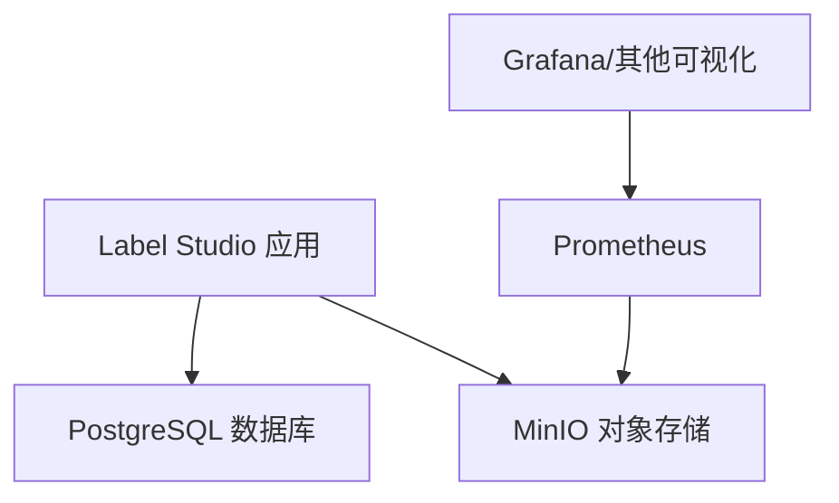
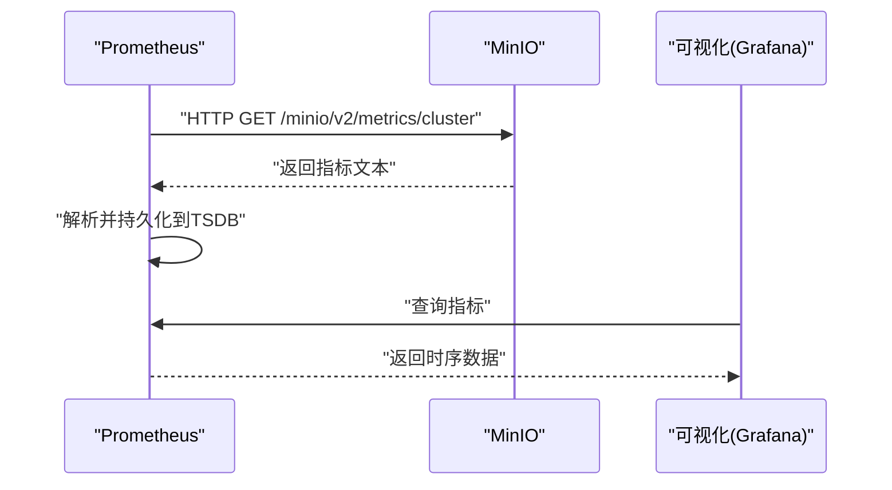
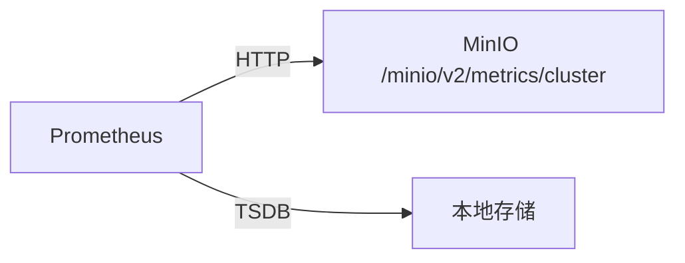

# Prometheus配置

<cite>
**本文引用的文件**   
- [prometheus.yml](file://prometheus/minio/prometheus.yml)
- [docker-compose.yml](file://docker-compose.yml)
- [Dockerfile](file://Dockerfile)
</cite>

## 目录
1. [简介](#简介)
2. [项目结构](#项目结构)
3. [核心组件](#核心组件)
4. [架构总览](#架构总览)
5. [详细组件分析](#详细组件分析)
6. [依赖关系分析](#依赖关系分析)
7. [性能与存储调优](#性能与存储调优)
8. [安全配置](#安全配置)
9. [故障排查指南](#故障排查指南)
10. [结论](#结论)
11. [附录：完整示例与最佳实践](#附录完整示例与最佳实践)

## 简介
本文件面向在 Label Studio 仓库中集成 Prometheus 监控的读者，聚焦以下目标：
- 说明 Prometheus 服务的基础配置项（服务器参数、存储设置、性能调优）。
- 详解抓取配置 scrape_configs，包括目标发现机制、抓取间隔、超时等。
- 提供 MinIO 指标采集的配置示例与说明。
- 说明静态目标与动态服务发现的用法。
- 给出认证与 TLS 等安全配置建议。
- 提供完整的配置文件示例与落地最佳实践。

## 项目结构
仓库中与 Prometheus 直接相关的资源位于 prometheus/minio 目录，包含一个最小化的抓取配置；同时 docker-compose.yml 定义了应用运行环境，Dockerfile 描述了容器构建过程。

图表来源
- [docker-compose.yml:1-72](file://docker-compose.yml#L1-L72)

章节来源
- [docker-compose.yml:1-72](file://docker-compose.yml#L1-L72)

## 核心组件
- Prometheus 抓取配置：用于定义如何从 MinIO 暴露的指标端点拉取数据。
- MinIO 指标端点：通过 HTTP 暴露集群级指标，供 Prometheus 抓取。
- 部署编排：docker-compose.yml 负责启动 Label Studio、数据库等组件；Prometheus 通常作为独立服务或 Sidecar 部署。

章节来源
- [prometheus.yml:1-7](file://prometheus/minio/prometheus.yml#L1-L7)
- [docker-compose.yml:1-72](file://docker-compose.yml#L1-L72)

## 架构总览
下图展示了 Prometheus 抓取 MinIO 指标的典型流程：Prometheus 根据 scrape_configs 中的 job 配置，周期性访问 MinIO 的 /minio/v2/metrics/cluster 端点，将时序数据写入本地 TSDB。

图表来源
- [prometheus.yml:1-7](file://prometheus/minio/prometheus.yml#L1-L7)

## 详细组件分析

### 抓取配置 scrape_configs
当前仓库提供的 MinIO 抓取配置包含以下要点：
- job_name：定义抓取任务名称，便于区分不同目标组。
- metrics_path：指定指标路径为 /minio/v2/metrics/cluster，表示采集 MinIO 集群级指标。
- scheme：使用 http 协议访问指标端点。
- static_configs：使用静态目标列表，指向 minio:9000。

该配置适合在 Docker Compose 环境中使用，其中 minio 是网络内可解析的服务名。

章节来源
- [prometheus.yml:1-7](file://prometheus/minio/prometheus.yml#L1-L7)

#### 抓取间隔与超时
- 抓取间隔：可通过全局 global.scrape_interval 或每个 job 的 scrape_interval 控制。
- 抓取超时：可通过 job 级别的 scrape_timeout 覆盖默认值。
- 抓取标签：可使用 relabel_configs 对目标进行重命名、过滤、添加标签等。

说明：这些字段未在仓库现有配置中出现，但属于 Prometheus 抓取模型的标准能力，可按需扩展。

### 目标发现机制
- 静态目标：当前配置使用 static_configs 列出 minio:9000，适用于固定数量的目标。
- 动态服务发现：Prometheus 支持 Kubernetes、Consul、DNS、File 等多种 SD 方式。例如在 K8s 中可通过 kubernetes_sd_configs 自动发现 Pod/Service 的指标端点。

适用场景：
- 静态目标：小规模、稳定拓扑。
- 动态发现：大规模、频繁扩缩容的环境。

### MinIO 监控配置示例
仓库已提供一个最小可用的 MinIO 抓取配置，可直接复用：
- 指标路径：/minio/v2/metrics/cluster
- 协议：http
- 目标：minio:9000

如需采集更多维度（如节点级指标），可在同一 job 下增加多个 metrics_path，或使用不同的 job 分别采集。

章节来源
- [prometheus.yml:1-7](file://prometheus/minio/prometheus.yml#L1-L7)

### 服务发现配置
- 静态目标：适用于 Compose/Docker 环境，直接使用 service name 解析。
- 动态服务发现：
  - Kubernetes：kubernetes_sd_configs，基于 Namespace/Role/Selector 自动发现。
  - Consul：consul_sd_configs，基于服务注册表。
  - DNS：dns_sd_configs，基于 DNS SRV/A 记录。
  - File：file_sd_configs，基于 JSON/YAML 文件描述目标。

注意：当使用动态发现时，应结合 relabel_configs 对目标进行过滤和标签规范化，避免指标爆炸。

### 安全配置
- 认证：
  - 基础认证：可通过反向代理（Nginx/Ingress）统一鉴权，或在 Prometheus Web API 前加网关。
  - Token 认证：通过 Authorization 头传递 token，配合网关或中间件校验。
- TLS：
  - 若 MinIO 启用 HTTPS，需在 Prometheus 的 scheme 设置为 https，并在需要时配置 tls_config（CA、证书、客户端证书等）。
  - 若 Prometheus 对外暴露 UI/API，建议启用 TLS 并通过 Ingress/Nginx 终止。
- 网络隔离：
  - 仅允许受信任网段访问 Prometheus 的 /metrics 与 API 端点。
  - 使用防火墙策略限制跨网络访问。

说明：仓库未内置 Prometheus 的安全配置，建议在部署层（容器编排、网关、Ingress）实现。

## 依赖关系分析
Prometheus 抓取 MinIO 指标的关键依赖如下：
- MinIO 必须暴露 /minio/v2/metrics/cluster 端点。
- Prometheus 能够通过网络访问 MinIO 的目标地址（Compose 中使用服务名 minio）。
- 若启用 TLS，则需正确配置 CA/证书链。

图表来源
- [prometheus.yml:1-7](file://prometheus/minio/prometheus.yml#L1-L7)

章节来源
- [prometheus.yml:1-7](file://prometheus/minio/prometheus.yml#L1-L7)

## 性能与存储调优
- 抓取频率：
  - 合理设置 global.scrape_interval 与 job.scrape_interval，避免过高的抓取频率导致 I/O 压力。
  - 对高基数指标（如大量标签）谨慎采集，必要时通过 relabel_configs 丢弃不需要的标签。
- 存储容量：
  - 调整 storage.tsdb.* 相关参数（如 retention.time、storage.tsdb.wal-compression）以平衡保留周期与磁盘占用。
  - 使用远端存储（如 Thanos/Cortex）做长期归档与查询加速。
- 资源分配：
  - 为 Prometheus 分配足够的 CPU/内存，尤其是高 QPS 与多 job 场景。
  - 使用 SSD 提升 TSDB 读写性能。
- 压缩与 WAL：
  - 开启 WAL 压缩以减少磁盘占用。
  - 合理设置 checkpoint 与 compaction 参数，降低 GC 压力。

说明：上述为通用调优建议，具体参数需依据实际负载与硬件条件评估。

## 安全配置
- 传输加密：
  - 若 MinIO 使用 HTTPS，Prometheus 侧 scheme=https，并按需配置 tls_config（ca_file、cert_file、key_file）。
  - 若 Prometheus 对外暴露，建议通过 Ingress/Nginx 启用 TLS 并强制 HTTPS。
- 访问控制：
  - 使用网关或反向代理实现基础认证或 JWT 校验。
  - 限制 /metrics 与 API 端点的访问来源 IP。
- 密钥管理：
  - 将证书与密钥放入只读卷，避免硬编码在镜像中。
  - 使用 Secret 管理工具（K8s Secrets、Vault）注入敏感信息。

说明：仓库未内置 Prometheus 安全配置，建议在部署层实现。

## 故障排查指南
- 无法连接 MinIO：
  - 检查网络连通性与服务名解析（Compose 环境下确认 minio 服务名可达）。
  - 验证端口是否正确（默认 9000）。
- 指标为空或报错：
  - 确认 MinIO 已启用指标端点且路径正确（/minio/v2/metrics/cluster）。
  - 检查 Prometheus 日志中的抓取错误（如 404/5xx）。
- TLS 问题：
  - 校验证书链是否完整，CA 是否可信。
  - 检查客户端证书与私钥权限。
- 性能问题：
  - 观察 Prometheus 的 TSDB 写入延迟与 GC 时间。
  - 检查抓取超时与目标数量是否过高。

章节来源
- [prometheus.yml:1-7](file://prometheus/minio/prometheus.yml#L1-L7)

## 结论
仓库提供了一个最小可用的 MinIO 抓取配置，可作为起点快速接入 Prometheus 监控。在此基础上，可根据实际环境扩展抓取间隔、超时、服务发现与安全策略，并结合存储与性能调优获得稳定的监控体系。

## 附录：完整示例与最佳实践

### 完整 Prometheus 配置示例（概念性）
以下为概念性示例，展示常见配置项的组织方式（不包含具体代码内容）：
- global：定义抓取间隔、抓取超时、默认标签等。
- scrape_configs：
  - job_name：minio-job
    - metrics_path：/minio/v2/metrics/cluster
    - scheme：http 或 https
    - static_configs：targets 列表
    - scrape_interval：按 job 覆盖全局间隔
    - scrape_timeout：按 job 覆盖全局超时
    - relabel_configs：目标过滤与标签规范化
- storage：
  - tsdb.retention.time：数据保留时长
  - wal_compression：WAL 压缩开关
- security：
  - 通过外部网关实现认证与 TLS 终止
  - 若直连 MinIO HTTPS，则在 job 中配置 tls_config

说明：以上为通用模板，请根据实际部署环境调整。

### 最佳实践清单
- 明确指标边界：仅采集必要指标，避免高基数标签爆炸。
- 分层采集：将系统、应用、基础设施指标分 job 管理。
- 统一标签规范：通过 relabel_configs 标准化 instance、job、env 等标签。
- 灰度发布：先小范围启用 Prometheus 抓取，逐步扩大范围。
- 监控告警：为关键指标（如 MinIO 可用率、延迟、错误率）配置告警规则。
- 备份与恢复：定期备份 TSDB 或迁移至远端存储。
- 文档化：维护配置变更与指标字典，便于团队协作。