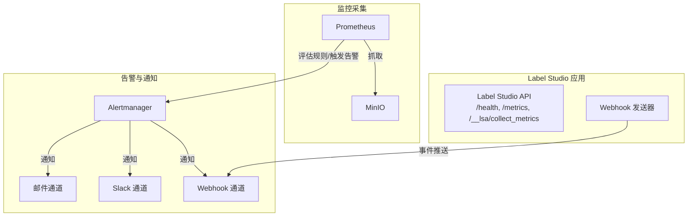
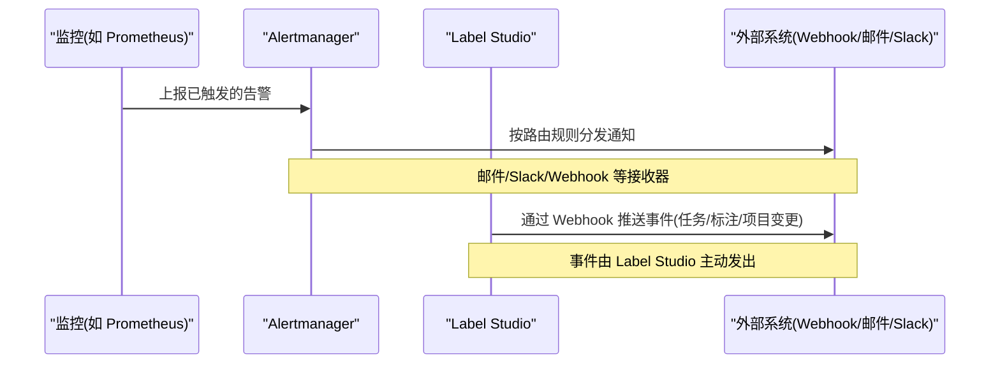
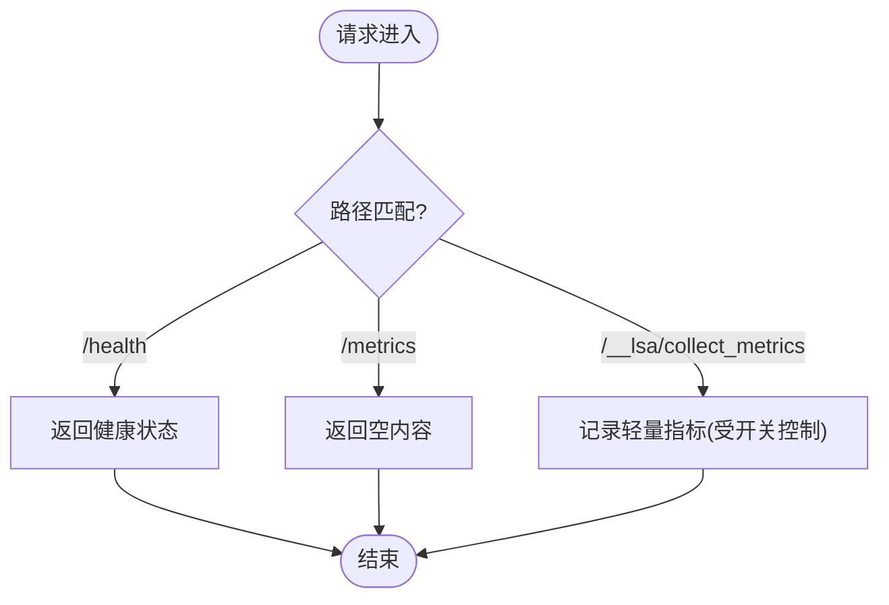
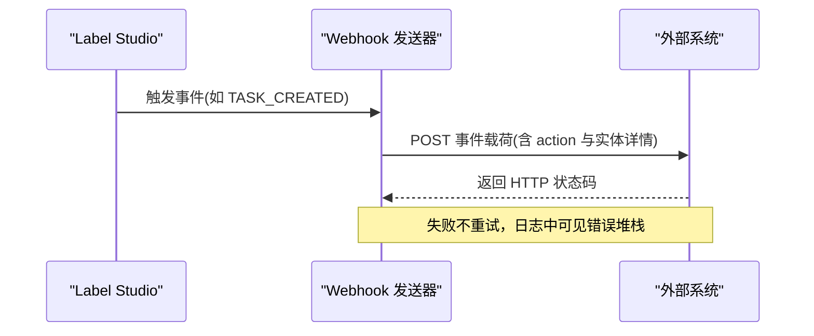
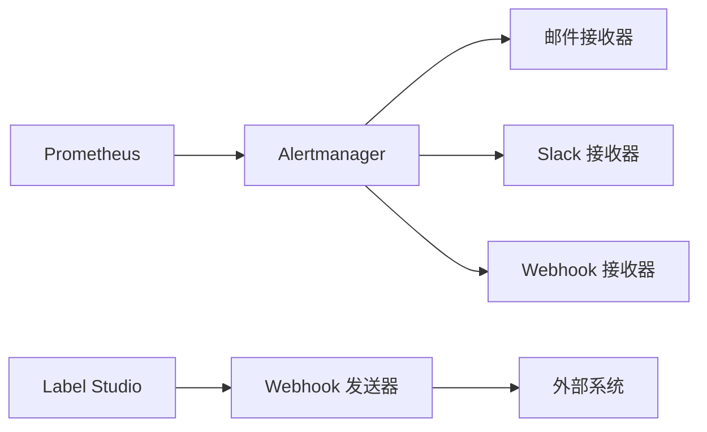

# 告警规则

<cite>
**本文引用的文件**   
- [prometheus.yml](file://prometheus/minio/prometheus.yml)
- [views.py](file://label_studio/core/views.py)
- [webhooks.md](file://docs/source/guide/webhooks.md)
- [webhook_reference.md](file://docs/source/guide/webhook_reference.md)
</cite>

## 目录
1. [简介](#简介)
2. [项目结构](#项目结构)
3. [核心组件](#核心组件)
4. [架构总览](#架构总览)
5. [详细组件分析](#详细组件分析)
6. [依赖关系分析](#依赖关系分析)
7. [性能与容量规划](#性能与容量规划)
8. [故障排查指南](#故障排查指南)
9. [结论](#结论)
10. [附录：告警规则与通知策略模板](#附录：告警规则与通知策略模板)

## 简介
本文件面向在 Label Studio 环境中落地“告警规则与通知机制”的运维与平台工程团队，目标是：
- 说明如何部署 Alertmanager 并完成基础配置（路由、接收器）
- 定义关键告警规则（系统资源、业务异常、性能瓶颈等）
- 明确告警级别划分与通知策略（邮件、Slack、Webhook 等）
- 提供抑制与静默规则，避免告警风暴
- 给出告警历史查看与故障排查流程，并覆盖常见告警场景的处理方案

需要特别说明的是：当前仓库未内置 Alertmanager 或 Prometheus 的完整告警规则集。Prometheus 侧仅包含对 MinIO 的抓取配置；Label Studio 应用侧暴露了健康检查与轻量指标采集端点，并通过 Webhook 能力对外输出事件。因此，本文既提供基于仓库现有能力的集成方案，也给出可落地的通用告警规则与通知策略模板，便于直接接入企业监控体系。

## 项目结构
围绕告警与通知，仓库中与监控/集成相关的要点如下：
- Prometheus 抓取示例：用于采集 MinIO 指标
- Label Studio 应用端点：健康检查、空指标页、轻量指标收集
- Webhook 文档：事件类型、载荷格式、超时与限制

图表来源
- [prometheus.yml:1-7](file://prometheus/minio/prometheus.yml#L1-L7)
- [views.py:70-78](file://label_studio/core/views.py#L70-L78)
- [views.py:214-218](file://label_studio/core/views.py#L214-L218)
- [webhooks.md:130-142](file://docs/source/guide/webhooks.md#L130-L142)

章节来源
- [prometheus.yml:1-7](file://prometheus/minio/prometheus.yml#L1-L7)
- [views.py:70-78](file://label_studio/core/views.py#L70-L78)
- [views.py:214-218](file://label_studio/core/views.py#L214-L218)
- [webhooks.md:130-142](file://docs/source/guide/webhooks.md#L130-L142)

## 核心组件
- Prometheus 抓取配置：定义了针对 MinIO 的抓取任务与指标路径
- Label Studio 应用端点：
  - /health：健康检查
  - /metrics：占位指标页
  - /__lsa/collect_metrics：轻量前端指标收集入口（受 COLLECT_ANALYTICS 控制）
- Webhook 能力：支持多种事件（任务、标注、项目等），默认 1 秒超时，可通过环境变量调整

章节来源
- [prometheus.yml:1-7](file://prometheus/minio/prometheus.yml#L1-L7)
- [views.py:70-78](file://label_studio/core/views.py#L70-L78)
- [views.py:214-218](file://label_studio/core/views.py#L214-L218)
- [webhooks.md:130-142](file://docs/source/guide/webhooks.md#L130-L142)

## 架构总览
下图展示从指标采集到告警分发的端到端流程，以及 Label Studio Webhook 作为外部事件源参与通知链路的集成方式。

图表来源
- [webhooks.md:14-37](file://docs/source/guide/webhooks.md#L14-L37)
- [webhooks.md:130-142](file://docs/source/guide/webhooks.md#L130-L142)

## 详细组件分析

### 1) Alertmanager 安装与基础配置
- 部署建议
  - 使用容器化部署（Docker/Kubernetes），暴露 HTTP API
  - 持久化配置与状态（config.yaml、静默/抑制规则）
- 基础配置要点
  - global：SMTP/Slack/Webhook 全局参数
  - route：根路由与子路由（按 severity、team、project 等标签分流）
  - receivers：邮件、Slack、Webhook 等接收器
  - inhibit_rules：抑制规则（例如同一实例的高可用节点同时告警时只保留一条）
  - silence：静默规则（临时屏蔽某类告警）

提示：Alertmanager 的配置不在仓库中，需自行维护。

章节来源
- [webhooks.md:130-142](file://docs/source/guide/webhooks.md#L130-L142)

### 2) Prometheus 抓取与告警规则
- 抓取目标
  - MinIO：通过 prometheus.yml 定义的 job 抓取集群指标
- 告警规则
  - 建议在 Prometheus 中定义规则组，将系统资源、业务异常、性能瓶颈三类告警集中管理
  - 规则应携带必要标签（severity、instance、job、project 等），以便 Alertmanager 路由与抑制

章节来源
- [prometheus.yml:1-7](file://prometheus/minio/prometheus.yml#L1-L7)

### 3) Label Studio 应用端点与健康检查
- /health：返回 UP/DOWN 状态，适合存活探针与可用性告警
- /metrics：占位响应，可用于探测服务可达性
- /__lsa/collect_metrics：轻量指标收集端点（受 COLLECT_ANALYTICS 控制）

图表来源
- [views.py:70-78](file://label_studio/core/views.py#L70-L78)
- [views.py:214-218](file://label_studio/core/views.py#L214-L218)

章节来源
- [views.py:70-78](file://label_studio/core/views.py#L70-L78)
- [views.py:214-218](file://label_studio/core/views.py#L214-L218)

### 4) Webhook 事件与通知扩展
- 事件类型：任务创建/删除、标注创建/更新/删除、项目创建/更新/删除等
- 载荷字段：action、task/project/annotation 详情、时间戳等
- 超时与限制：默认 1 秒超时，可通过 WEBHOOK_TIMEOUT 调整；SaaS 环境有额外限制

图表来源
- [webhook_reference.md:37-55](file://docs/source/guide/webhook_reference.md#L37-L55)
- [webhooks.md:130-142](file://docs/source/guide/webhooks.md#L130-L142)

章节来源
- [webhook_reference.md:37-55](file://docs/source/guide/webhook_reference.md#L37-L55)
- [webhooks.md:130-142](file://docs/source/guide/webhooks.md#L130-L142)

## 依赖关系分析
- Prometheus 与 MinIO：通过静态配置抓取 MinIO 指标
- Alertmanager 与接收器：通过路由规则将告警分发至邮件、Slack、Webhook
- Label Studio 与外部系统：通过 Webhook 主动推送事件，可作为告警补充或自动化触发源

图表来源
- [prometheus.yml:1-7](file://prometheus/minio/prometheus.yml#L1-L7)
- [webhooks.md:130-142](file://docs/source/guide/webhooks.md#L130-L142)

章节来源
- [prometheus.yml:1-7](file://prometheus/minio/prometheus.yml#L1-L7)
- [webhooks.md:130-142](file://docs/source/guide/webhooks.md#L130-L142)

## 性能与容量规划
- 指标采集
  - 合理设置 scrape_interval 与 evaluation_interval，避免过度采样
  - 对高基数标签进行治理，降低存储与查询压力
- 告警风暴防护
  - 使用抑制规则收敛重复告警（如同机房/同实例的多条告警）
  - 使用静默规则进行计划内维护窗口屏蔽
- Webhook 吞吐
  - 根据外部系统处理能力调整并发与队列
  - 注意默认 1 秒超时，必要时调大 WEBHOOK_TIMEOUT

[本节为通用指导，无需代码引用]

## 故障排查指南
- 健康检查
  - 调用 /health 验证服务是否存活
  - 若持续 DOWN，检查进程状态、依赖数据库/缓存/对象存储连通性
- 指标采集
  - 确认 Prometheus 能访问 /metrics 与 /__lsa/collect_metrics
  - 检查 COLLECT_ANALYTICS 开关是否开启（影响 collect_metrics 行为）
- Webhook 投递
  - 检查外部系统 URL 可达性与鉴权头
  - 观察日志中的错误堆栈；默认不重试，失败即丢弃
  - 如需更长处理时间，调整 WEBHOOK_TIMEOUT
- 告警历史与定位
  - 在 Alertmanager UI 查看告警历史、抑制/静默状态
  - 结合 Prometheus 规则面板与 Label Studio 日志定位根因

章节来源
- [views.py:70-78](file://label_studio/core/views.py#L70-L78)
- [views.py:214-218](file://label_studio/core/views.py#L214-L218)
- [webhooks.md:130-142](file://docs/source/guide/webhooks.md#L130-L142)

## 结论
- 仓库提供了最小化的监控抓取示例与应用端点，但未内置完整的 Alertmanager/Prometheus 告警规则
- 建议以仓库现有能力为基础，结合企业监控体系补齐告警规则与通知渠道
- 通过 Webhook 可将 Label Studio 的业务事件纳入统一通知与自动化流程

[本节为总结性内容，无需代码引用]

## 附录：告警规则与通知策略模板

### A. 告警级别划分
- critical：直接影响可用性/数据一致性（如服务不可用、主库宕机）
- warning：潜在风险或性能退化（如磁盘使用率偏高、延迟升高）
- info：信息性告警（如任务批量导入完成、模型训练启动）

### B. 关键告警规则（示例类别）
- 系统资源
  - CPU/内存/磁盘使用率超过阈值
  - 连接数/句柄数接近上限
- 业务异常
  - /health 连续失败
  - 任务/标注写入失败或积压增长
- 性能瓶颈
  - 接口 P95/P99 延迟突增
  - 队列消费速率低于生产速率

### C. 通知策略（接收器）
- 邮件：critical/warning 分别发送至不同邮箱组
- Slack：按 team/channel 分流，critical 加入紧急频道
- Webhook：对接内部工单/IM/自动化平台

### D. 抑制与静默规则
- 抑制规则
  - 同一 instance 的多个告警只保留最高严重级
  - 上游依赖不可用时抑制下游衍生告警
- 静默规则
  - 计划内维护窗口期间屏蔽非关键告警
  - 已知问题临时屏蔽，直至修复上线

### E. 告警历史查看与排障流程
- 查看 Alertmanager 历史告警与抑制/静默状态
- 回溯 Prometheus 规则评估结果与指标曲线
- 结合 Label Studio 日志与 Webhook 投递日志定位问题
- 常见场景处理
  - 服务不可用：优先恢复服务，再清理衍生告警
  - 性能退化：扩容/限流/优化慢查询
  - Webhook 失败：校验鉴权/网络/超时，必要时降级为异步队列

[本节为模板与通用实践，无需代码引用]