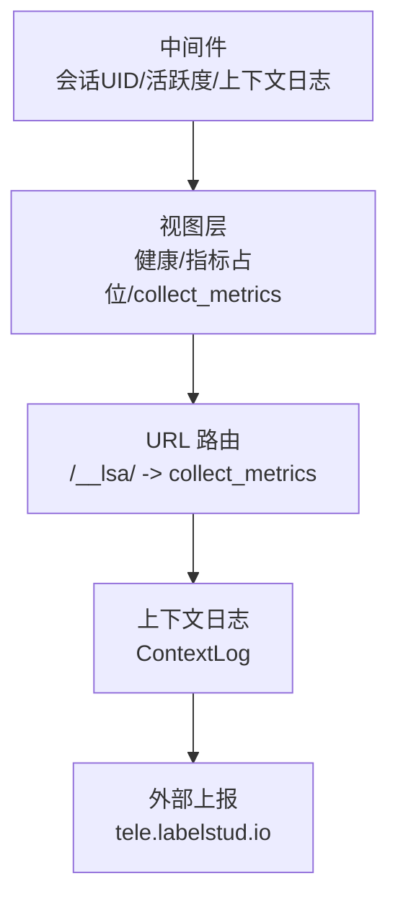
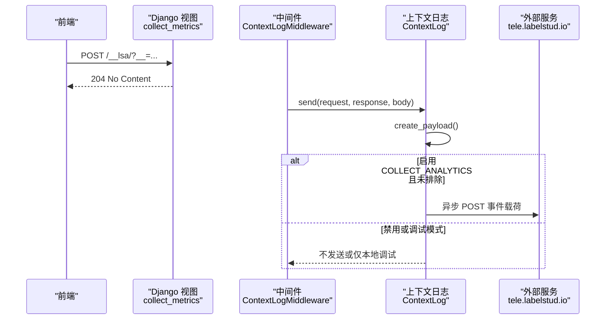
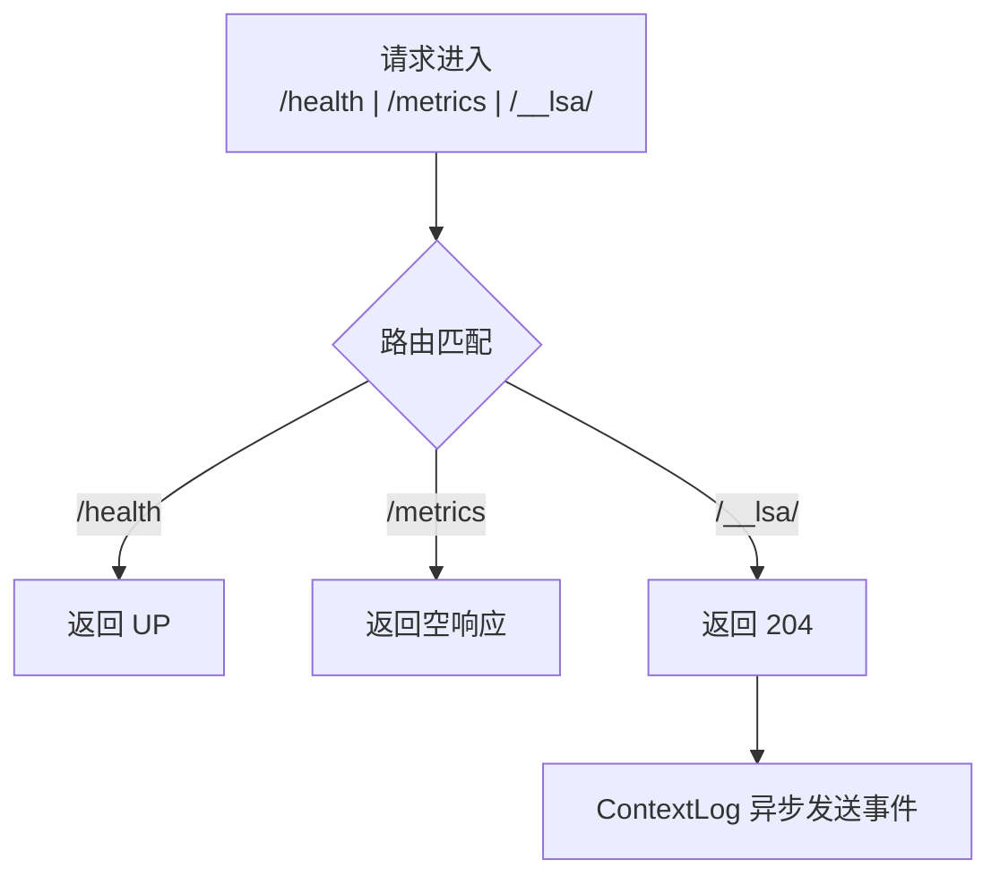
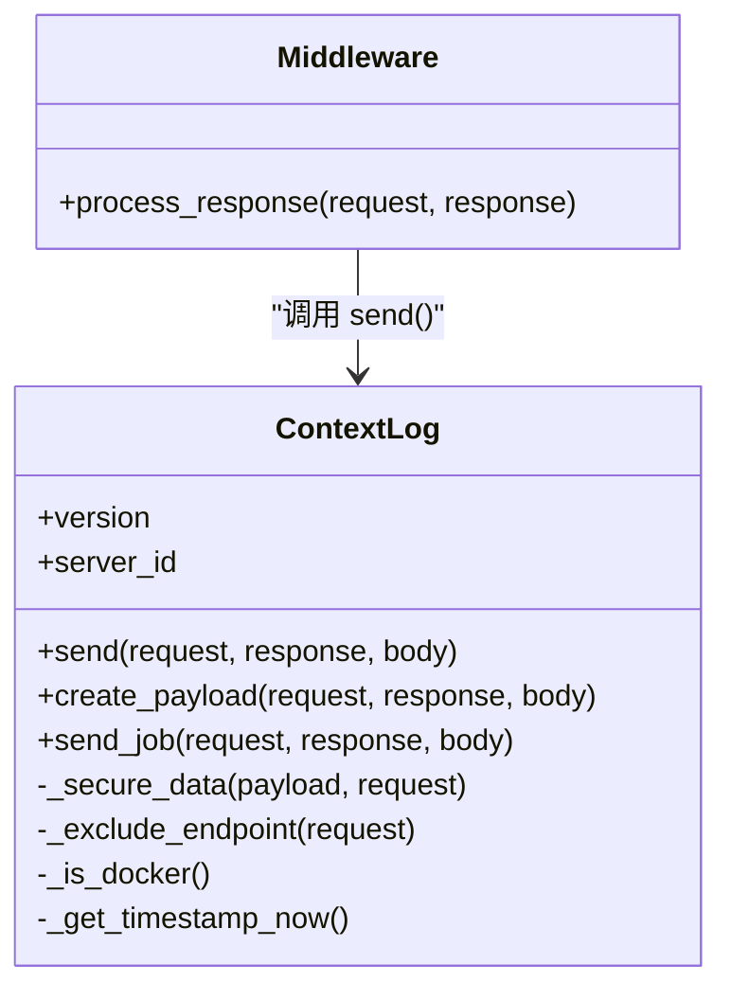
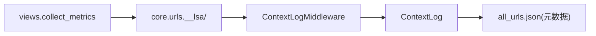

# 指标定义

<cite>
**本文引用的文件**   
- [label_studio/core/middleware.py](file://label_studio/core/middleware.py)
- [label_studio/core/views.py](file://label_studio/core/views.py)
- [label_studio/core/urls.py](file://label_studio/core/urls.py)
- [label_studio/core/utils/contextlog.py](file://label_studio/core/utils/contextlog.py)
- [label_studio/core/all_urls.json](file://label_studio/core/all_urls.json)
</cite>

## 目录
1. [引言](#引言)
2. [项目结构](#项目结构)
3. [核心组件](#核心组件)
4. [架构总览](#架构总览)
5. [详细组件分析](#详细组件分析)
6. [依赖关系分析](#依赖关系分析)
7. [性能考量](#性能考量)
8. [故障排查指南](#故障排查指南)
9. [结论](#结论)
10. [附录](#附录)

## 引言
本文件为 Label Studio 的“指标定义”文档，目标是建立一套可观测性指标体系，覆盖系统级、应用级、数据库与存储等维度，并给出自定义指标采集的实现方案。在现有代码基础上，我们梳理了用于健康检查、轻量指标收集、上下文日志与前端埋点上报的关键路径，作为后续扩展 Prometheus/Grafana、APM 与业务看板的基础。

## 项目结构
围绕指标相关能力，本项目涉及以下关键位置：
- 中间件层：会话 UID 注入、用户活跃度更新、上下文日志记录
- 视图层：健康检查、空指标占位、轻量指标收集端点
- URL 路由：将 /__lsa/ 映射到 collect_metrics
- 上下文日志：统一构建请求/响应事件载荷，支持安全脱敏与异步发送

图表来源
- [label_studio/core/middleware.py:111-206](file://label_studio/core/middleware.py#L111-L206)
- [label_studio/core/views.py:70-78](file://label_studio/core/views.py#L70-L78)
- [label_studio/core/views.py:214-218](file://label_studio/core/views.py#L214-L218)
- [label_studio/core/urls.py:103](file://label_studio/core/urls.py#L103)
- [label_studio/core/utils/contextlog.py:208-336](file://label_studio/core/utils/contextlog.py#L208-L336)

章节来源
- [label_studio/core/middleware.py:111-206](file://label_studio/core/middleware.py#L111-L206)
- [label_studio/core/views.py:70-78](file://label_studio/core/views.py#L70-L78)
- [label_studio/core/views.py:214-218](file://label_studio/core/views.py#L214-L218)
- [label_studio/core/urls.py:103](file://label_studio/core/urls.py#L103)
- [label_studio/core/utils/contextlog.py:208-336](file://label_studio/core/utils/contextlog.py#L208-L336)

## 核心组件
- 健康检查与健康探针
  - /health：返回系统状态，适合 K8s Liveness/Readiness 探针
  - /metrics：当前为空占位，便于接入第三方监控（如 Prometheus）
- 轻量指标收集端点
  - /__lsa/：接收前端埋点，仅当启用 COLLECT_ANALYTICS 时处理；默认返回 204
- 上下文日志与事件载荷
  - ContextLog：统一构造请求/响应事件，支持安全脱敏、字段裁剪、异步发送
  - 通过 all_urls.json 控制哪些视图需要记录载荷及字段白名单

章节来源
- [label_studio/core/views.py:70-78](file://label_studio/core/views.py#L70-L78)
- [label_studio/core/views.py:214-218](file://label_studio/core/views.py#L214-L218)
- [label_studio/core/utils/contextlog.py:23-37](file://label_studio/core/utils/contextlog.py#L23-L37)
- [label_studio/core/utils/contextlog.py:238-324](file://label_studio/core/utils/contextlog.py#L238-L324)
- [label_studio/core/all_urls.json:2062-2063](file://label_studio/core/all_urls.json#L2062-L2063)

## 架构总览
下图展示从浏览器发起指标上报到后端处理的端到端流程，以及上下文日志如何参与事件构建与发送。

图表来源
- [label_studio/core/views.py:214-218](file://label_studio/core/views.py#L214-L218)
- [label_studio/core/middleware.py:181-202](file://label_studio/core/middleware.py#L181-L202)
- [label_studio/core/utils/contextlog.py:208-336](file://label_studio/core/utils/contextlog.py#L208-L336)

## 详细组件分析

### 指标端点与路由
- /health：返回 {"status": "UP"}，用于基础设施健康探测
- /metrics：空响应，预留 Prometheus 抓取或其他监控集成
- /__lsa/：轻量指标收集入口，默认返回 204；实际事件由 ContextLog 异步发送

图表来源
- [label_studio/core/views.py:70-78](file://label_studio/core/views.py#L70-L78)
- [label_studio/core/views.py:214-218](file://label_studio/core/views.py#L214-L218)
- [label_studio/core/urls.py:103](file://label_studio/core/urls.py#L103)

章节来源
- [label_studio/core/views.py:70-78](file://label_studio/core/views.py#L70-L78)
- [label_studio/core/views.py:214-218](file://label_studio/core/views.py#L214-L218)
- [label_studio/core/urls.py:103](file://label_studio/core/urls.py#L103)

### 上下文日志与事件载荷
- 触发时机：ContextLogMiddleware 在每个请求后调用 ContextLog.send
- 载荷构建：create_payload 聚合 URL、方法、状态码、客户端信息、语言、内容长度、JSON 体、高级 JSON、会话 UID 等
- 安全脱敏：对敏感视图与错误响应进行字段裁剪与清空
- 发送策略：根据 COLLECT_ANALYTICS、DEBUG_CONTEXTLOG、CONTEXTLOG_SYNC 决定异步线程发送或仅本地调试

图表来源
- [label_studio/core/utils/contextlog.py:40-336](file://label_studio/core/utils/contextlog.py#L40-L336)
- [label_studio/core/middleware.py:181-202](file://label_studio/core/middleware.py#L181-L202)

章节来源
- [label_studio/core/utils/contextlog.py:23-37](file://label_studio/core/utils/contextlog.py#L23-L37)
- [label_studio/core/utils/contextlog.py:95-194](file://label_studio/core/utils/contextlog.py#L95-L194)
- [label_studio/core/utils/contextlog.py:208-336](file://label_studio/core/utils/contextlog.py#L208-L336)
- [label_studio/core/middleware.py:181-202](file://label_studio/core/middleware.py#L181-L202)

### 用户活跃度与会话标识
- 会话 UID：SetSessionUIDMiddleware 为携带 Session Cookie 的请求注入 uid，便于关联同一会话的多条事件
- 用户活跃度：UpdateLastActivityMiddleware 在非安全方法下更新已认证用户的最后活动时间，可用于统计活跃用户数

章节来源
- [label_studio/core/middleware.py:111-120](file://label_studio/core/middleware.py#L111-L120)
- [label_studio/core/middleware.py:264-269](file://label_studio/core/middleware.py#L264-L269)

## 依赖关系分析
- 视图与路由
  - views.collect_metrics 被 core.urls 以 __lsa/ 暴露
  - all_urls.json 中注册 collect_metrics 的元数据，供上下文日志使用
- 中间件与日志
  - ContextLogMiddleware 依赖 settings 中的 COLLECT_ANALYTICS、DEBUG_CONTEXTLOG、CONTEXTLOG_SYNC 等开关
  - ContextLog 依赖 common.get_app_version、get_client_ip 等工具函数

图表来源
- [label_studio/core/views.py:214-218](file://label_studio/core/views.py#L214-L218)
- [label_studio/core/urls.py:103](file://label_studio/core/urls.py#L103)
- [label_studio/core/middleware.py:181-202](file://label_studio/core/middleware.py#L181-L202)
- [label_studio/core/utils/contextlog.py:23-37](file://label_studio/core/utils/contextlog.py#L23-L37)
- [label_studio/core/all_urls.json:2062-2063](file://label_studio/core/all_urls.json#L2062-L2063)

章节来源
- [label_studio/core/views.py:214-218](file://label_studio/core/views.py#L214-L218)
- [label_studio/core/urls.py:103](file://label_studio/core/urls.py#L103)
- [label_studio/core/all_urls.json:2062-2063](file://label_studio/core/all_urls.json#L2062-L2063)

## 性能考量
- 指标上报非阻塞：ContextLog 默认使用线程异步发送，避免影响主请求链路
- 负载裁剪：对大对象与敏感字段进行裁剪与脱敏，降低网络与存储开销
- 条件启用：通过 COLLECT_ANALYTICS 控制是否上报，生产环境建议按需开启
- 健康检查轻量化：/health 与 /metrics 均为轻量接口，适合高频探测

[本节为通用指导，不涉及具体文件分析]

## 故障排查指南
- 指标未上报
  - 检查 COLLECT_ANALYTICS 是否启用
  - 确认 DEBUG_CONTEXTLOG 未处于仅本地调试模式
  - 核对 CONTEXTLOG_SYNC 是否为同步发送导致阻塞
- 事件字段缺失
  - 查看 all_urls.json 中对应视图的 log_payloads 配置
  - 检查 _secure_data 的脱敏逻辑是否裁剪了必要字段
- 健康检查失败
  - 确认 /health 返回 {"status": "UP"}
  - 检查反向代理与负载均衡的健康探针配置

章节来源
- [label_studio/core/utils/contextlog.py:208-336](file://label_studio/core/utils/contextlog.py#L208-L336)
- [label_studio/core/utils/contextlog.py:23-37](file://label_studio/core/utils/contextlog.py#L23-L37)
- [label_studio/core/views.py:70-78](file://label_studio/core/views.py#L70-L78)

## 结论
Label Studio 当前提供了健康检查、轻量指标收集与上下文日志三大基础能力。基于此，可扩展出完整的系统级与应用级指标体系，并通过 Prometheus、APM 与业务看板实现可视化与告警。建议在部署侧补齐基础设施指标（CPU、内存、磁盘 I/O），在应用侧补充任务处理量、标注完成数、用户活跃度与 API 响应时间等业务指标，并在数据库与对象存储侧引入连接数、慢查询、请求次数与错误率等关键指标。

[本节为总结性内容，不涉及具体文件分析]

## 附录

### 指标分类与定义建议
- 系统级指标（基础设施）
  - CPU 使用率、内存占用、磁盘 I/O、网络吞吐、进程存活
  - 采集方式：主机/容器监控（Node Exporter、cAdvisor、云厂商监控）
- 应用级指标（业务）
  - 任务处理量、标注完成数、用户活跃度、API 响应时间、错误率
  - 采集方式：APM（如 OpenTelemetry）、Prometheus 自定义指标、ContextLog 事件聚合
- 数据库指标
  - 查询延迟、连接数、慢查询统计、锁等待、复制延迟
  - 采集方式：数据库导出器（PostgreSQL Exporter、MySQL Exporter）
- 存储系统指标
  - 对象存储使用量、请求次数、错误率、带宽
  - 采集方式：S3/MinIO/GCS/Azure Blob 自带指标或 Exporter

[本节为概念性说明，不涉及具体文件分析]

### 自定义指标采集实现方案
- Python SDK 集成
  - 使用 requests 或 httpx 向 /__lsa/ 发送指标事件，参数通过 GET 的 __ 字段传递 JSON 字符串
  - 示例路径参考：[label_studio/core/views.py:214-218](file://label_studio/core/views.py#L214-L218)、[label_studio/core/urls.py:103](file://label_studio/core/urls.py#L103)
- 指标导出格式
  - 事件载荷字段参考：url、server_id、user_id、session_id、client_ip、method、status_code、values、json、advanced_json、language、content_type、content_length、view_name、namespace
  - 参考实现：[label_studio/core/utils/contextlog.py:238-324](file://label_studio/core/utils/contextlog.py#L238-L324)
- 安全与合规
  - 敏感视图与错误响应自动脱敏
  - 可通过 ADDITIONAL_CONTEXTLOG_SECURED_VIEWS 扩展受保护视图列表
  - 参考实现：[label_studio/core/utils/contextlog.py:95-107](file://label_studio/core/utils/contextlog.py#L95-L107)

章节来源
- [label_studio/core/views.py:214-218](file://label_studio/core/views.py#L214-L218)
- [label_studio/core/urls.py:103](file://label_studio/core/urls.py#L103)
- [label_studio/core/utils/contextlog.py:238-324](file://label_studio/core/utils/contextlog.py#L238-L324)
- [label_studio/core/utils/contextlog.py:95-107](file://label_studio/core/utils/contextlog.py#L95-L107)