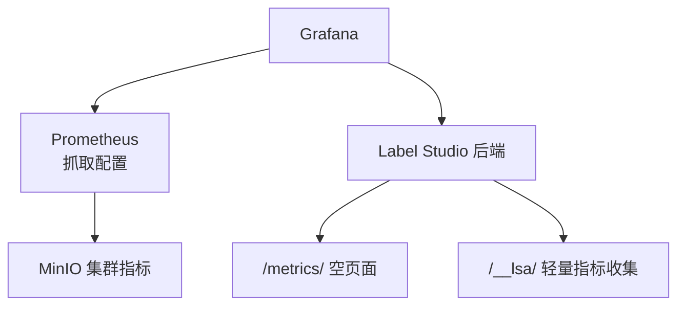
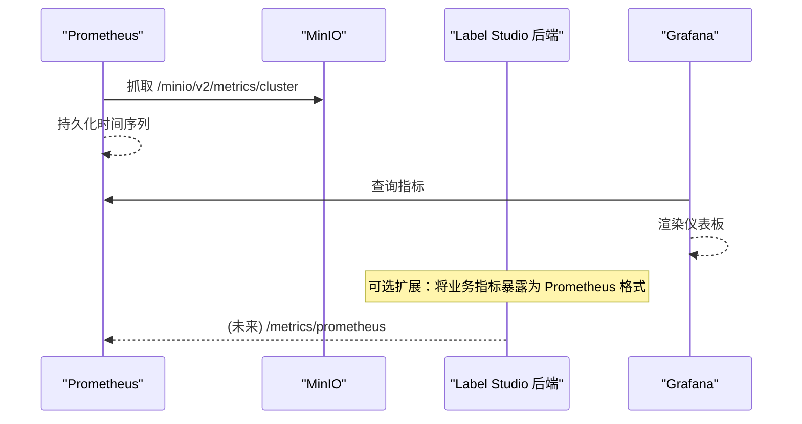
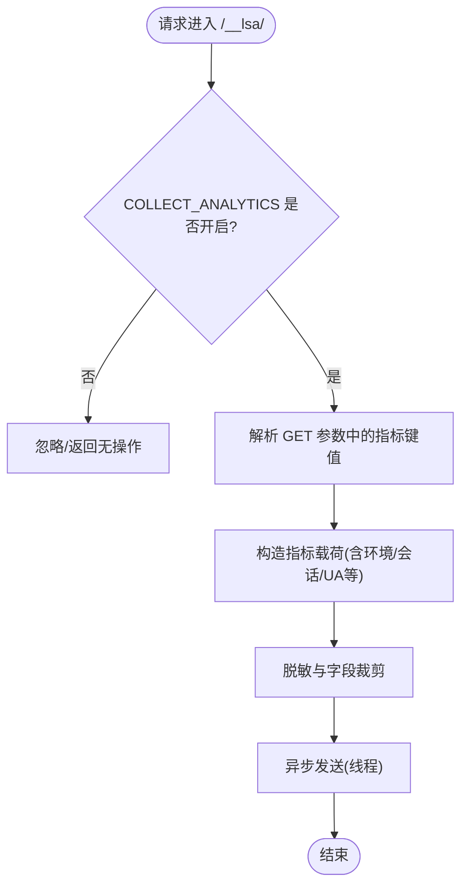
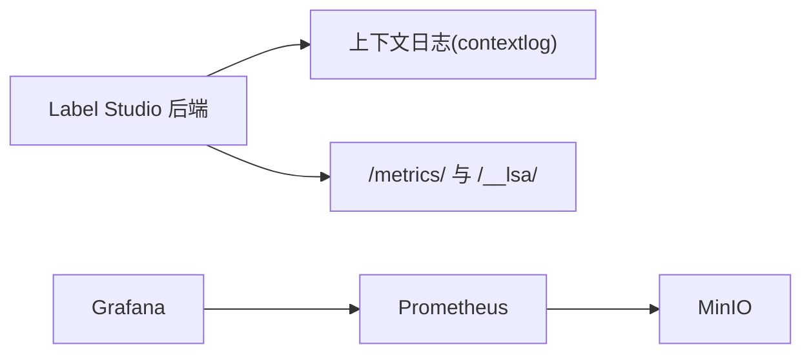

# 指标监控

<cite>
**本文引用的文件**   
- [prometheus.yml](file://prometheus/minio/prometheus.yml)
- [urls.py](file://label_studio/core/urls.py)
- [views.py](file://label_studio/core/views.py)
- [contextlog.py](file://label_studio/core/utils/contextlog.py)
- [base.py](file://label_studio/core/settings/base.py)
- [docker-compose.yml](file://docker-compose.yml)
</cite>

## 目录
1. [简介](#简介)
2. [项目结构](#项目结构)
3. [核心组件](#核心组件)
4. [架构总览](#架构总览)
5. [详细组件分析](#详细组件分析)
6. [依赖关系分析](#依赖关系分析)
7. [性能考虑](#性能考虑)
8. [故障排查指南](#故障排查指南)
9. [结论](#结论)
10. [附录](#附录)

## 简介
本指南面向在 Label Studio 上构建 Prometheus + Grafana 指标监控体系的用户，覆盖以下主题：
- Prometheus 配置与部署：服务发现、抓取配置、存储策略
- 关键业务指标定义：任务处理量、标注完成数、用户活跃度等
- Grafana 仪表板搭建：图表配置、查询语句、面板布局
- 自定义指标采集方案：应用指标暴露、数据库性能、存储系统指标
- 告警规则与通知机制

说明：仓库内已包含一个用于 MinIO 的 Prometheus 抓取示例；Label Studio 后端提供轻量级指标收集端点与上下文日志能力，可用于扩展为可观测性数据源。

## 项目结构
围绕监控相关的关键位置如下：
- prometheus/minio/prometheus.yml：MinIO 指标的抓取示例
- label_studio/core/urls.py：路由定义，包含 /metrics/ 与 __lsa/ 等路径
- label_studio/core/views.py：视图实现，包含 metrics() 与 collect_metrics()
- label_studio/core/utils/contextlog.py：上下文日志与指标载荷构造逻辑
- label_studio/core/settings/base.py：COLLECT_ANALYTICS 开关及相关设置
- docker-compose.yml：应用与数据库编排（可作为扩展监控服务的参考）

图示来源
- [prometheus.yml:1-7](file://prometheus/minio/prometheus.yml#L1-L7)
- [urls.py:74-103](file://label_studio/core/urls.py#L74-L103)
- [views.py:76-78](file://label_studio/core/views.py#L76-L78)
- [views.py:216-218](file://label_studio/core/views.py#L216-L218)

章节来源
- [prometheus.yml:1-7](file://prometheus/minio/prometheus.yml#L1-L7)
- [urls.py:74-103](file://label_studio/core/urls.py#L74-L103)
- [views.py:76-78](file://label_studio/core/views.py#L76-L78)
- [views.py:216-218](file://label_studio/core/views.py#L216-L218)

## 核心组件
- Prometheus 抓取配置：仓库提供了针对 MinIO 的抓取样例，展示 job_name、metrics_path、scheme、static_configs.targets 的基本用法。
- Label Studio 指标端点：
  - /metrics/：当前返回空响应，便于外部健康检查或占位。
  - /__lsa/：轻量级指标收集端点，受 COLLECT_ANALYTICS 控制，前端可通过该接口上报使用事件。
- 上下文日志与指标载荷：contextlog 模块负责构造指标载荷、脱敏、异步发送等逻辑，并支持通过 GET 参数传递自定义指标键值对。
- 配置开关：COLLECT_ANALYTICS 决定是否启用指标/遥测上报。

章节来源
- [prometheus.yml:1-7](file://prometheus/minio/prometheus.yml#L1-L7)
- [urls.py:74-103](file://label_studio/core/urls.py#L74-L103)
- [views.py:76-78](file://label_studio/core/views.py#L76-L78)
- [views.py:216-218](file://label_studio/core/views.py#L216-L218)
- [contextlog.py:205-227](file://label_studio/core/utils/contextlog.py#L205-L227)
- [contextlog.py:238-324](file://label_studio/core/utils/contextlog.py#L238-L324)
- [base.py:904-905](file://label_studio/core/settings/base.py#L904-L905)

## 架构总览
下图展示了 Prometheus、Label Studio 与 Grafana 之间的典型交互关系，以及 MinIO 作为被监控对象的角色。

图示来源
- [prometheus.yml:1-7](file://prometheus/minio/prometheus.yml#L1-L7)

## 详细组件分析

### Prometheus 抓取与存储策略
- 抓取目标：示例中抓取 MinIO 集群指标，端口 9000，路径 /minio/v2/metrics/cluster。
- 抓取方式：HTTP scheme，静态目标列表 static_configs。
- 可扩展点：
  - 增加 Label Studio 自身指标抓取（需在后端暴露 /metrics/prometheus）。
  - 增加数据库（PostgreSQL）、Redis、Nginx 等组件的 exporter 抓取。
- 存储策略建议：
  - 保留期：根据数据规模与合规要求设置 retention.time-series-*。
  - 压缩与远端归档：结合 TSDB 远端写入（如 Thanos/Cortex）做长期归档。
  - 分片与副本：多实例部署时注意去重与高可用。

章节来源
- [prometheus.yml:1-7](file://prometheus/minio/prometheus.yml#L1-L7)

### Label Studio 指标端点与上下文日志
- /metrics/：当前为空响应，适合用作存活探针或占位。
- /__lsa/：轻量级指标收集入口，当 COLLECT_ANALYTICS 开启时允许前端上报事件。
- 上下文日志 contextlog：
  - 构造统一载荷，包含 URL、用户信息、浏览器/设备信息、语言、状态码、内容类型等。
  - 支持从 GET 参数读取自定义指标键值对，并在 view_name 为 collect_metrics 时以 event:* 命名空间记录。
  - 默认异步线程发送，可在测试或调试模式下调整行为。

图示来源
- [views.py:216-218](file://label_studio/core/views.py#L216-L218)
- [contextlog.py:205-227](file://label_studio/core/utils/contextlog.py#L205-L227)
- [contextlog.py:238-324](file://label_studio/core/utils/contextlog.py#L238-L324)
- [base.py:904-905](file://label_studio/core/settings/base.py#L904-L905)

章节来源
- [urls.py:74-103](file://label_studio/core/urls.py#L74-L103)
- [views.py:76-78](file://label_studio/core/views.py#L76-L78)
- [views.py:216-218](file://label_studio/core/views.py#L216-L218)
- [contextlog.py:205-227](file://label_studio/core/utils/contextlog.py#L205-L227)
- [contextlog.py:238-324](file://label_studio/core/utils/contextlog.py#L238-L324)
- [base.py:904-905](file://label_studio/core/settings/base.py#L904-L905)

### 关键业务指标定义（建议）
以下为面向标注平台的通用指标建议，可在后端扩展为 Prometheus 指标或通过 /__lsa/ 上报后由 Sidecar/Collector 转换为时序指标：
- 任务处理量
  - 任务创建速率（tasks_created_per_second）
  - 任务分配速率（tasks_assigned_per_second）
  - 任务队列长度（task_queue_length）
- 标注完成数
  - 标注提交速率（annotations_submitted_per_second）
  - 标注通过率/拒绝率（annotation_approval_rate）
  - 平均标注时长（annotation_lead_time_seconds）
- 用户活跃度
  - 活跃用户数（active_users_count，按窗口聚合）
  - 会话数量（sessions_count）
  - 页面访问速率（page_views_per_second）
- 系统与资源
  - CPU/内存/磁盘/网络（主机或容器维度）
  - 数据库连接池使用率、慢查询比例
  - 对象存储读写吞吐与错误率

说明：上述指标为设计建议，需在 Label Studio 后端或 Sidecar 中实现采集与暴露。

### Grafana 仪表板搭建
- 数据源
  - 添加 Prometheus 数据源，指向 Prometheus 服务地址。
  - 如需可视化 /__lsa/ 上报的事件，可将事件流接入日志系统（如 Loki），或在 Collector 侧转为时序指标后由 Prometheus 抓取。
- 常用图表
  - 任务处理量：Rate 曲线、累计计数、分项目/组织维度聚合。
  - 标注完成数：分类型/标签维度的完成率、耗时分布。
  - 用户活跃度：日活/周活、会话时长分布、Top 用户/项目。
- 查询语句编写要点
  - 使用 rate()/irate() 计算瞬时速率。
  - 使用 sum by()/avg by() 进行多维聚合。
  - 使用 histogram_quantile() 观察延迟分位。
- 面板布局
  - 概览页：KPI 卡片 + 趋势图 + Top N 排行。
  - 深度分析页：按项目/组织/用户维度下钻。
  - 运维页：系统资源、数据库、对象存储健康度。

### 自定义指标采集方案
- 应用指标暴露
  - 推荐在后端新增 /metrics/prometheus，使用 Python Prometheus Client 暴露计数器、直方图、仪表盘等。
  - 将现有 /__lsa/ 事件经 Collector 转换为 Prometheus 指标（例如：ls_event_total{event="..."}）。
- 数据库性能指标
  - PostgreSQL：使用 postgres_exporter 暴露连接数、锁等待、慢查询、缓存命中率等。
  - Redis：使用 redis_exporter 暴露内存、命令统计、持久化状态等。
- 存储系统指标
  - MinIO：使用仓库提供的抓取配置，关注容量、IOPS、错误率、节点健康。
  - 本地文件系统：通过 node_exporter 暴露磁盘 I/O、inode、挂载点状态。

### 告警规则与通知机制
- 告警规则（Prometheus Rules）
  - 任务积压：task_queue_length > 阈值持续 N 分钟。
  - 标注失败率：annotation_failure_rate > 阈值。
  - 用户活跃度下降：active_users_count 环比下降超过阈值。
  - 系统健康：CPU/内存/磁盘使用率、数据库连接耗尽、对象存储错误率。
- 通知渠道
  - 集成 Alertmanager，对接邮件、企业微信、钉钉、Slack 等。
  - 分级告警：P0/P1/P2，不同级别对应不同通知与升级策略。
- 规则管理
  - 将规则纳入版本管理，配合 CI/CD 校验语法与影响面。
  - 定期复盘误报与漏报，优化阈值与聚合维度。

## 依赖关系分析
- 组件耦合
  - Prometheus 与 MinIO：通过静态目标抓取指标。
  - Label Studio 后端与上下文日志：collect_metrics 视图与 contextlog 模块协作，受 COLLECT_ANALYTICS 控制。
  - Grafana 与 Prometheus：通过数据源拉取时序数据进行可视化。
- 外部依赖
  - 若引入更多 exporter（postgres_exporter、redis_exporter、node_exporter），需确保网络可达与权限正确。
- 潜在循环依赖
  - 当前监控链路为单向（Exporter -> Prometheus -> Grafana），不存在循环依赖。

图示来源
- [urls.py:74-103](file://label_studio/core/urls.py#L74-L103)
- [views.py:76-78](file://label_studio/core/views.py#L76-L78)
- [views.py:216-218](file://label_studio/core/views.py#L216-L218)
- [contextlog.py:205-227](file://label_studio/core/utils/contextlog.py#L205-L227)
- [prometheus.yml:1-7](file://prometheus/minio/prometheus.yml#L1-L7)

章节来源
- [urls.py:74-103](file://label_studio/core/urls.py#L74-L103)
- [views.py:76-78](file://label_studio/core/views.py#L76-L78)
- [views.py:216-218](file://label_studio/core/views.py#L216-L218)
- [contextlog.py:205-227](file://label_studio/core/utils/contextlog.py#L205-L227)
- [prometheus.yml:1-7](file://prometheus/minio/prometheus.yml#L1-L7)

## 性能考虑
- 指标粒度与采样间隔
  - 合理设置 scrape_interval 与评估周期，避免高频采样导致存储压力。
- 聚合与降采样
  - 使用 PromQL 聚合减少查询负载；历史数据采用降采样策略。
- 异步与背压
  - 指标上报应异步化，避免阻塞主请求路径；必要时加入限流与重试退避。
- 资源隔离
  - Prometheus 与业务服务分离部署，避免相互影响。

## 故障排查指南
- /metrics/ 返回空响应
  - 确认路由是否正确映射到 views.metrics。
  - 若期望返回 Prometheus 文本格式，需在后端实现相应导出器。
- /__lsa/ 未生效
  - 检查 COLLECT_ANALYTICS 是否开启。
  - 确认前端是否正确携带指标参数，且未被安全策略拦截。
- MinIO 指标不可用
  - 核对 Prometheus 抓取配置的目标地址与端口。
  - 检查网络连通性与认证配置（如有）。
- 指标缺失或延迟
  - 查看 Prometheus 目标状态与抓取日志。
  - 检查后端指标暴露端点与 Collector 链路。

章节来源
- [urls.py:74-103](file://label_studio/core/urls.py#L74-L103)
- [views.py:76-78](file://label_studio/core/views.py#L76-L78)
- [views.py:216-218](file://label_studio/core/views.py#L216-L218)
- [prometheus.yml:1-7](file://prometheus/minio/prometheus.yml#L1-L7)

## 结论
- 仓库已提供 MinIO 的 Prometheus 抓取示例，可作为扩展至全栈监控的基础。
- Label Studio 后端提供 /metrics/ 与 /__lsa/ 两个关键端点，结合 COLLECT_ANALYTICS 开关与上下文日志能力，可逐步演进为完整的指标采集体系。
- 建议在后续迭代中在后端暴露标准 Prometheus 指标，完善业务指标定义，并通过 Grafana 构建分层仪表板与告警规则，形成闭环的可观测性体系。

## 附录
- 部署参考
  - 可基于 docker-compose.yml 扩展 Prometheus、Grafana、Alertmanager 等服务，并与现有 app/db 服务协同运行。
- 环境变量与配置
  - COLLECT_ANALYTICS：控制是否启用指标/遥测上报。
  - 其他监控相关变量可按需扩展（如 PROMETHEUS_*、ALERTMANAGER_*）。

章节来源
- [docker-compose.yml:1-72](file://docker-compose.yml#L1-L72)
- [base.py:904-905](file://label_studio/core/settings/base.py#L904-L905)