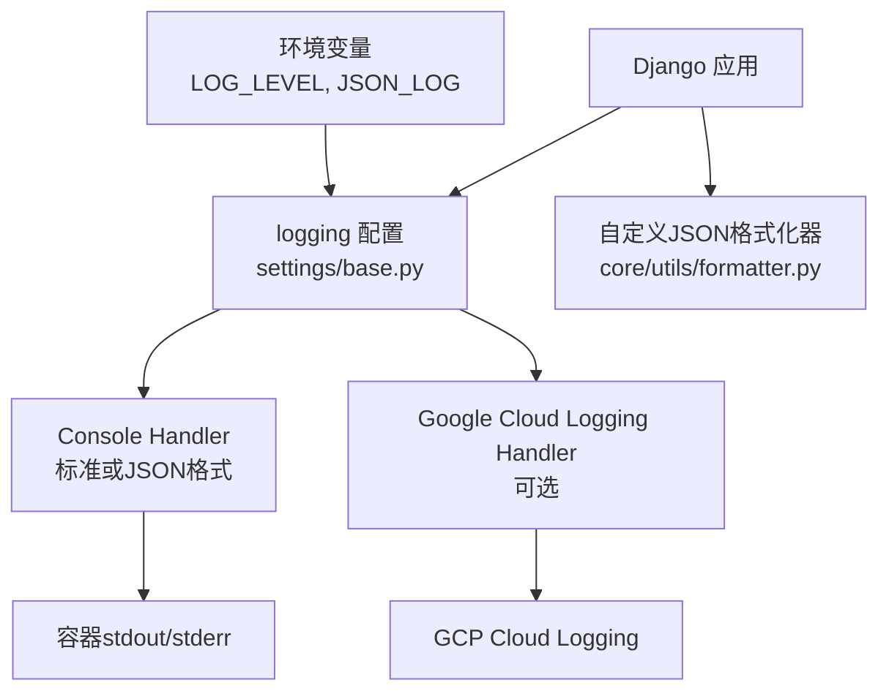
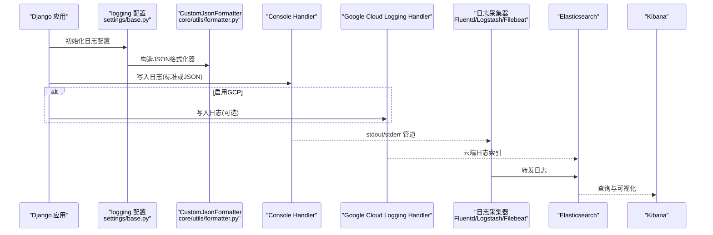
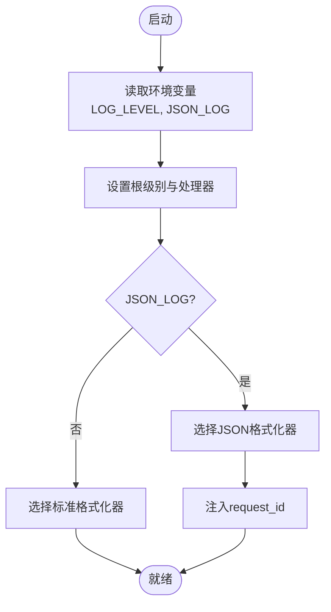
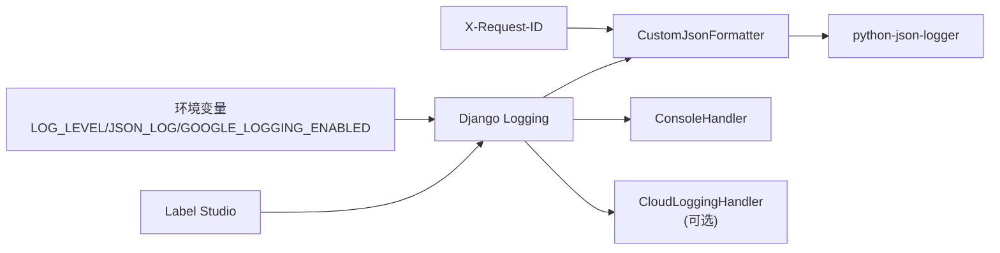

# 日志管理

<cite>
**本文引用的文件**   
- [base.py](file://label_studio/core/settings/base.py)
- [label_studio.py](file://label_studio/core/settings/label_studio.py)
- [formatter.py](file://label_studio/core/utils/formatter.py)
- [admin_logs.md](file://docs/source/guide/admin_logs.md)
</cite>

## 目录
1. [简介](#简介)
2. [项目结构](#项目结构)
3. [核心组件](#核心组件)
4. [架构总览](#架构总览)
5. [详细组件分析](#详细组件分析)
6. [依赖关系分析](#依赖关系分析)
7. [性能考虑](#性能考虑)
8. [故障排查指南](#故障排查指南)
9. [结论](#结论)
10. [附录](#附录)

## 简介
本文件面向 Label Studio 的日志管理与审计，覆盖以下主题：
- 结构化日志配置：日志格式、级别设置、输出目标
- 日志聚合方案：与 ELK 栈、Fluentd、Logstash 等工具的集成建议
- 日志分析工具使用指南：搜索语法、过滤条件、统计分析
- 日志轮转与保留策略：运维侧最佳实践
- 安全日志审计与合规性要求
- 日志性能优化与常见故障排查

## 项目结构
Label Studio 后端基于 Django，日志系统由 Django Logging 驱动，并通过环境变量进行开关与级别控制。关键位置如下：
- 日志基础配置：位于 settings/base.py
- 应用级日志级别覆盖：位于 settings/label_studio.py
- JSON 格式化器扩展：位于 core/utils/formatter.py
- 企业版活动日志文档：docs/source/guide/admin_logs.md

图表来源
- [base.py:27-77](file://label_studio/core/settings/base.py#L27-L77)
- [base.py:212-228](file://label_studio/core/settings/base.py#L212-L228)
- [formatter.py:1-14](file://label_studio/core/utils/formatter.py#L1-L14)

章节来源
- [base.py:27-77](file://label_studio/core/settings/base.py#L27-L77)
- [label_studio.py:21-23](file://label_studio/core/settings/label_studio.py#L21-L23)
- [formatter.py:1-14](file://label_studio/core/utils/formatter.py#L1-L14)

## 核心组件
- 日志根处理器与级别
  - 根处理器默认输出到控制台（console），级别由环境变量 LOG_LEVEL 控制，默认 DEBUG（开发）或 WARNING（生产）。
- 格式化器
  - 支持两种格式：standard（文本）与 json（结构化）。当启用 JSON_LOG 时自动切换为 JSON 格式。
  - JSON 格式化器继承 pythonjsonlogger.JsonFormatter，并注入 request_id（来自请求头 X-Request-ID）。
- 第三方日志集成
  - 可选启用 Google Cloud Logging handler，通过 GOOGLE_LOGGING_ENABLED 环境变量开启。
- 应用级覆盖
  - label_studio.py 将 root 级别默认设置为 WARNING，便于生产环境降低噪音。

章节来源
- [base.py:22-49](file://label_studio/core/settings/base.py#L22-L49)
- [base.py:212-228](file://label_studio/core/settings/base.py#L212-L228)
- [label_studio.py:21-23](file://label_studio/core/settings/label_studio.py#L21-L23)
- [formatter.py:1-14](file://label_studio/core/utils/formatter.py#L1-L14)

## 架构总览
下图展示 Label Studio 日志从生成到输出的完整链路，包括结构化字段注入与外部集成点。

图表来源
- [base.py:27-77](file://label_studio/core/settings/base.py#L27-L77)
- [base.py:212-228](file://label_studio/core/settings/base.py#L212-L228)
- [formatter.py:1-14](file://label_studio/core/utils/formatter.py#L1-L14)

## 详细组件分析

### 结构化日志配置
- 日志格式
  - standard：包含时间、模块、函数、行号、级别与消息。
  - json：在 standard 基础上以 JSON 对象输出，便于下游解析；额外字段 request_id 来自请求头 X-Request-ID。
- 级别设置
  - 根级别：LOG_LEVEL 环境变量控制，默认 DEBUG（开发）、WARNING（生产）。
  - 子 logger：如 rq.worker、django_auth_ldap、ddtrace、ldclient.util、faker 等分别设置不同级别。
- 输出目标
  - console：始终启用，输出到 stdout/stderr。
  - google_cloud_logging：可选，需安装 google-cloud-logging 并配置认证。

图表来源
- [base.py:22-49](file://label_studio/core/settings/base.py#L22-L49)
- [formatter.py:1-14](file://label_studio/core/utils/formatter.py#L1-L14)

章节来源
- [base.py:22-77](file://label_studio/core/settings/base.py#L22-L77)
- [formatter.py:1-14](file://label_studio/core/utils/formatter.py#L1-L14)

### 日志聚合方案（ELK/Fluentd/Logstash）
- 容器化部署建议
  - 将 console handler 的输出（stdout/stderr）交由 Fluent Bit/Fluentd 或 Filebeat 采集，统一转发至 Elasticsearch。
  - 若启用 Google Cloud Logging handler，可直接对接 GCP 日志服务，再由 GCP 导出到 BigQuery 或第三方存储。
- 结构化日志优势
  - JSON 格式便于按字段检索与聚合统计（如 user_id、request_id、level、name）。
  - 建议在网关/反向代理层透传 X-Request-ID，以便跨服务追踪。
- 典型拓扑
  - Label Studio -> stdout/stderr -> Fluentd/Filebeat -> Elasticsearch -> Kibana
  - Label Studio -> Google Cloud Logging -> GCP Logs Explorer / Export to BigQuery

[本节为概念性说明，不直接分析具体代码文件]

### 日志分析工具使用指南
- 搜索语法与过滤条件
  - 基于 JSON 字段进行精确匹配与范围查询，例如：
    - level: ERROR
    - name: "rq.worker"
    - request_id: "xxx-uuid"
    - time range: 最近1小时/今天/自定义区间
  - 结合 Kibana Discover/Visualize 构建仪表盘，监控错误率、慢请求、任务队列状态等。
- 统计分析
  - 按用户、项目、动作类型（GET/POST/PATCH/DELETE）聚合统计调用量与错误分布。
  - 对 rq.worker 日志进行失败任务统计与重试趋势分析。

[本节为概念性说明，不直接分析具体代码文件]

### 日志轮转与保留策略
- 应用内未实现文件轮转
  - 当前 logging 配置仅包含 console handler，无 file handler，因此不涉及应用内日志文件轮转。
- 运维侧建议
  - 使用容器平台日志驱动或 sidecar（如 Fluent Bit）进行日志收集与轮转。
  - 在 Elasticsearch 中设置索引生命周期管理（ILM），按天/周滚动，设定冷热分层与过期清理策略。
  - 针对敏感数据（如密码）避免记录，必要时在业务层脱敏。

[本节为概念性说明，不直接分析具体代码文件]

### 安全日志审计与合规性
- 企业版活动日志
  - 提供“组织 > 活动日志”页面，可筛选用户、项目、请求类型、日期范围与关键词。
  - 日志包含用户 ID、IP、时间戳与 API 动作详情；部分请求因含敏感信息可能无法展开详情。
- 合规建议
  - 在生产环境关闭 DEBUG，限制 LOG_LEVEL 为 WARNING 或更高。
  - 对访问令牌、密码等敏感字段进行脱敏或禁止记录。
  - 结合 RBAC 与审计策略，确保只有管理员/所有者可访问活动日志。

章节来源
- [admin_logs.md:14-33](file://docs/source/guide/admin_logs.md#L14-L33)

## 依赖关系分析
- 运行时依赖
  - python-json-logger：用于 JSON 格式化器。
  - google-cloud-logging：可选，用于接入 GCP 日志服务。
- 配置依赖
  - LOG_LEVEL：控制日志级别。
  - JSON_LOG：切换 JSON 格式。
  - GOOGLE_LOGGING_ENABLED：启用 GCP handler。
  - X-Request-ID：请求头，注入到日志中作为 request_id。

图表来源
- [base.py:27-77](file://label_studio/core/settings/base.py#L27-L77)
- [base.py:212-228](file://label_studio/core/settings/base.py#L212-L228)
- [formatter.py:1-14](file://label_studio/core/utils/formatter.py#L1-L14)

章节来源
- [base.py:27-77](file://label_studio/core/settings/base.py#L27-L77)
- [base.py:212-228](file://label_studio/core/settings/base.py#L212-L228)
- [formatter.py:1-14](file://label_studio/core/utils/formatter.py#L1-L14)

## 性能考虑
- 日志级别
  - 生产环境建议使用 WARNING 或 ERROR，减少 I/O 压力。
- JSON 格式开销
  - JSON 序列化有额外 CPU 开销，高吞吐场景可评估是否降级为标准文本格式。
- 异步任务日志
  - rq.worker 单独设置 INFO 级别，有助于监控后台任务而不影响主流程。
- 外部集成
  - 启用 Google Cloud Logging handler 会增加网络 I/O，仅在需要云端审计时开启。

[本节为通用指导，不直接分析具体代码文件]

## 故障排查指南
- 无法看到日志
  - 检查容器 stdout/stderr 是否被正确采集。
  - 确认 LOG_LEVEL 未被误设为 CRITICAL。
- 缺少 request_id
  - 确认上游网关/代理已注入 X-Request-ID 请求头。
- 无法启用 GCP 日志
  - 检查 GOOGLE_LOGGING_ENABLED 与认证配置是否正确。
- 活动日志不可用
  - 确认具备管理员/所有者权限，且企业版功能已启用。

章节来源
- [base.py:212-228](file://label_studio/core/settings/base.py#L212-L228)
- [formatter.py:1-14](file://label_studio/core/utils/formatter.py#L1-L14)
- [admin_logs.md:14-33](file://docs/source/guide/admin_logs.md#L14-L33)

## 结论
Label Studio 的日志系统以 Django Logging 为核心，提供标准与 JSON 两种格式，支持控制台输出与可选的 Google Cloud Logging 集成。通过环境变量灵活控制级别与格式，并结合外部采集器与 ELK 栈可实现完整的日志采集、分析与审计能力。在企业版中还提供可视化的活动日志界面，满足合规与审计需求。

[本节为总结性内容，不直接分析具体代码文件]

## 附录
- 环境变量速查
  - LOG_LEVEL：日志级别（DEBUG/INFO/WARNING/ERROR/CRITICAL）
  - JSON_LOG：启用 JSON 格式（true/false）
  - GOOGLE_LOGGING_ENABLED：启用 GCP 日志（true/false）
  - X-Request-ID：请求唯一标识（由网关注入）

[本节为补充信息，不直接分析具体代码文件]