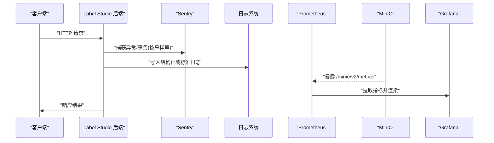
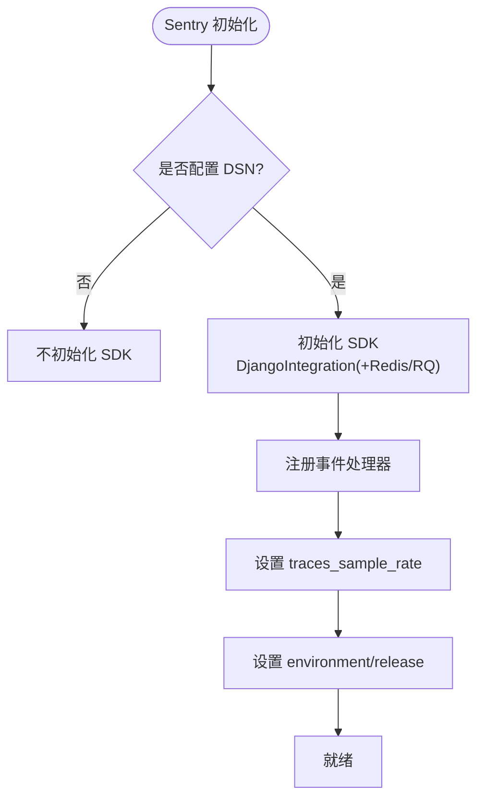
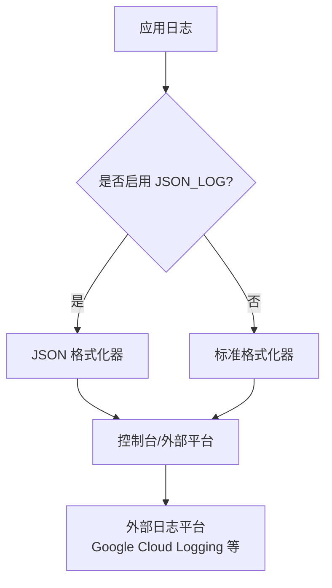
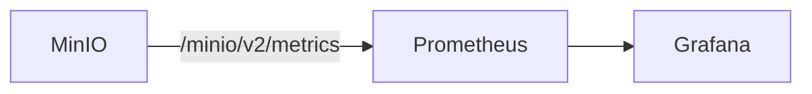
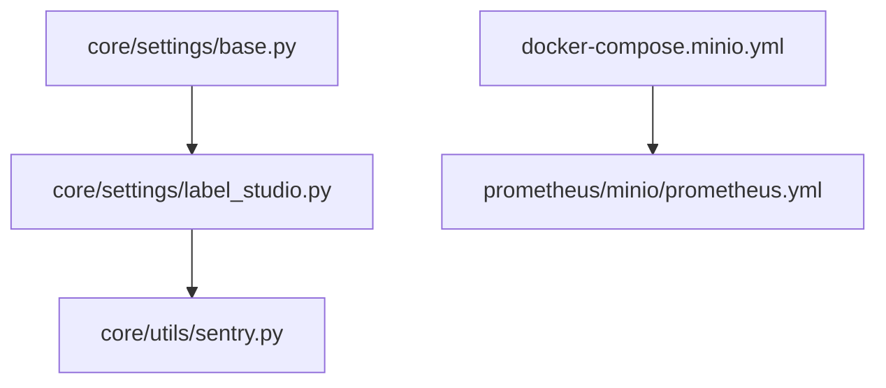

# 监控告警

<cite>
**本文引用的文件**   
- [README.md](file://README.md)
- [admin_logs.md](file://docs/source/guide/admin_logs.md)
- [base.py](file://label_studio/core/settings/base.py)
- [label_studio.py](file://label_studio/core/settings/label_studio.py)
- [sentry.py](file://label_studio/core/utils/sentry.py)
- [docker-compose.minio.yml](file://docker-compose.minio.yml)
- [prometheus.yml](file://prometheus/minio/prometheus.yml)
</cite>

## 目录
1. [简介](#简介)
2. [项目结构](#项目结构)
3. [核心组件](#核心组件)
4. [架构总览](#架构总览)
5. [详细组件分析](#详细组件分析)
6. [依赖关系分析](#依赖关系分析)
7. [性能与可观测性建议](#性能与可观测性建议)
8. [故障排查指南](#故障排查指南)
9. [结论](#结论)
10. [附录](#附录)

## 简介
本指南面向在 Label Studio 上构建“监控与告警”体系的用户，覆盖以下主题：
- 集成 Sentry 进行错误追踪与性能监控（SDK 配置、错误分类、性能采样）
- Prometheus 指标采集与 Grafana 可视化仪表板搭建（关键指标、查询语句、图表配置）
- 日志收集与分析方案（结构化日志、聚合、搜索分析）
- 告警规则配置（系统健康检查、业务指标阈值、异常检测）
- 监控数据保留策略与备份方案

## 项目结构
Label Studio 后端基于 Django，监控相关能力主要分布在以下位置：
- 应用设置与初始化：core/settings/base.py、core/settings/label_studio.py
- Sentry 集成工具：core/utils/sentry.py
- 文档与运维说明：docs/source/guide/admin_logs.md
- 容器编排与 Prometheus 示例：docker-compose.minio.yml、prometheus/minio/prometheus.yml
- 项目概览与安装指引：README.md

```mermaid
graph TB
A["Label Studio 后端<br/>Django 应用"] --> B["Sentry SDK<br/>错误与性能事件"]
A --> C["日志输出<br/>标准/JSON 格式"]
D["Prometheus<br/>指标采集"] --> E["MinIO 指标端点"]
F["Grafana<br/>可视化仪表板"] --> D
G["外部日志平台<br/>Google Cloud Logging / 其他"] <- --> C
```

图示来源
- [base.py:27-77](file://label_studio/core/settings/base.py#L27-L77)
- [label_studio.py:31-44](file://label_studio/core/settings/label_studio.py#L31-L44)
- [sentry.py:64-87](file://label_studio/core/utils/sentry.py#L64-L87)
- [docker-compose.minio.yml:25-40](file://docker-compose.minio.yml#L25-L40)

章节来源
- [README.md:24-79](file://README.md#L24-L79)
- [base.py:27-77](file://label_studio/core/settings/base.py#L27-L77)
- [label_studio.py:31-44](file://label_studio/core/settings/label_studio.py#L31-L44)
- [docker-compose.minio.yml:25-40](file://docker-compose.minio.yml#L25-L40)

## 核心组件
- Sentry 集成
  - 通过环境变量注入 DSN、采样率与环境名，并在启动时初始化 SDK。
  - 提供事件处理器以过滤噪声、忽略特定异常类型与 URL 事务。
- 日志系统
  - 支持标准与 JSON 两种格式化器；可通过环境变量切换为结构化日志。
  - 可选接入 Google Cloud Logging。
- Prometheus 与 MinIO
  - 提供 MinIO 的 Prometheus 指标暴露与采集配置示例。
- 活动日志
  - 企业版提供用户活动日志查看与筛选能力。

章节来源
- [label_studio.py:31-44](file://label_studio/core/settings/label_studio.py#L31-L44)
- [sentry.py:4-61](file://label_studio/core/utils/sentry.py#L4-L61)
- [base.py:27-77](file://label_studio/core/settings/base.py#L27-L77)
- [admin_logs.md:14-33](file://docs/source/guide/admin_logs.md#L14-L33)

## 架构总览
下图展示 Label Studio 在后端侧的错误追踪、性能监控、日志与指标采集的整体流程。



图示来源
- [sentry.py:64-87](file://label_studio/core/utils/sentry.py#L64-L87)
- [base.py:27-77](file://label_studio/core/settings/base.py#L27-L77)
- [docker-compose.minio.yml:25-40](file://docker-compose.minio.yml#L25-L40)

## 详细组件分析

### Sentry 集成与配置
- 初始化入口
  - 在应用设置中调用初始化函数，传入 release_name 与 release_version，自动启用 Django 集成，并按需启用 Redis/RQ 集成。
- 事件过滤与降噪
  - 通过全局事件处理器跳过无异常的纯事务、忽略特定异常类型（如数据库连接类错误）、忽略静态资源与健康检查等 URL 事务。
  - 支持通过 logger.error(..., extra={'sentry_force': True}) 强制上报，或通过 extra={'sentry_skip': True} 跳过上报。
- 性能采样
  - 使用 traces_sample_rate 控制性能事务采样比例。
- 环境隔离
  - 通过 SENTRY_ENVIRONMENT 区分不同部署环境。



图示来源
- [label_studio.py:41-44](file://label_studio/core/settings/label_studio.py#L41-L44)
- [sentry.py:64-87](file://label_studio/core/utils/sentry.py#L64-L87)

章节来源
- [label_studio.py:31-44](file://label_studio/core/settings/label_studio.py#L31-L44)
- [sentry.py:4-61](file://label_studio/core/utils/sentry.py#L4-L61)
- [sentry.py:64-87](file://label_studio/core/utils/sentry.py#L64-L87)

### 日志系统与结构化日志
- 日志格式化
  - 默认标准格式；当启用 JSON_LOG 时切换为自定义 JSON 格式化器，便于下游聚合与检索。
- 日志级别
  - root 级别由 LOG_LEVEL 控制；各子 logger 可按需调整。
- 外部日志平台
  - 可选启用 Google Cloud Logging handler，将日志推送到云端日志服务。



图示来源
- [base.py:27-77](file://label_studio/core/settings/base.py#L27-L77)

章节来源
- [base.py:27-77](file://label_studio/core/settings/base.py#L27-L77)

### Prometheus 指标与 Grafana 仪表板
- MinIO 指标暴露
  - 通过 docker-compose.minio.yml 暴露 MinIO 的 Prometheus 指标端点，并配置 MINIO_PROMETHEUS_URL 与认证方式。
- Prometheus 抓取
  - 参考 prometheus/minio/prometheus.yml 中的 job 定义，抓取 MinIO 指标。
- Grafana 可视化
  - 在 Grafana 中添加 Prometheus 数据源，创建仪表板面板，常用指标包括：
    - MinIO 对象存储：请求数、错误数、容量使用率、节点状态
    - 系统资源：CPU、内存、磁盘 I/O、网络 I/O
    - 应用层：API 延迟、错误率、队列积压（结合 RQ 指标）



图示来源
- [docker-compose.minio.yml:25-40](file://docker-compose.minio.yml#L25-L40)
- [prometheus.yml](file://prometheus/minio/prometheus.yml)

章节来源
- [docker-compose.minio.yml:25-40](file://docker-compose.minio.yml#L25-L40)
- [prometheus.yml](file://prometheus/minio/prometheus.yml)

### 活动日志与审计
- 企业版提供“组织 > 活动日志”页面，记录用户 ID、IP、时间戳与操作类型，支持按用户、项目、请求方法、日期范围与关键词筛选。
- 云托管版本活动日志保留期为 180 天；自托管版本无保留期限制。

章节来源
- [admin_logs.md:14-33](file://docs/source/guide/admin_logs.md#L14-L33)

## 依赖关系分析
- 后端设置与 Sentry
  - label_studio.py 导入 base.py 的设置，并在初始化阶段调用 sentry.init_sentry。
- Sentry 事件处理
  - sentry.py 读取 settings.SENTRY_* 配置，注册事件处理器，控制采样与过滤。
- Prometheus 与 MinIO
  - docker-compose.minio.yml 声明 MinIO 与 Prometheus 服务，并通过环境变量与配置文件关联。



图示来源
- [base.py:27-77](file://label_studio/core/settings/base.py#L27-L77)
- [label_studio.py:31-44](file://label_studio/core/settings/label_studio.py#L31-L44)
- [sentry.py:64-87](file://label_studio/core/utils/sentry.py#L64-L87)
- [docker-compose.minio.yml:25-40](file://docker-compose.minio.yml#L25-L40)

章节来源
- [base.py:27-77](file://label_studio/core/settings/base.py#L27-L77)
- [label_studio.py:31-44](file://label_studio/core/settings/label_studio.py#L31-L44)
- [sentry.py:64-87](file://label_studio/core/utils/sentry.py#L64-L87)
- [docker-compose.minio.yml:25-40](file://docker-compose.minio.yml#L25-L40)

## 性能与可观测性建议
- Sentry 性能采样
  - 根据流量规模调整 traces_sample_rate，避免过度采样导致成本上升。
- 日志结构化
  - 在生产环境启用 JSON_LOG，统一字段命名，便于 ELK/Loki 等平台解析。
- 指标分层
  - 基础设施（CPU/内存/磁盘/网络）、中间件（Redis/RQ）、应用（API 延迟/错误率）、业务（任务标注量/通过率）。
- 告警分级
  - P0（服务不可用/数据丢失）、P1（严重错误率升高）、P2（性能退化）、P3（容量预警）。
- 成本优化
  - 对高频低价值日志做采样或丢弃；对非关键事务降低 Sentry 采样率。

[本节为通用指导，无需代码引用]

## 故障排查指南
- Sentry 未上报
  - 检查 SENTRY_DSN 是否正确配置；确认初始化已执行；核对事件处理器是否过滤了目标异常或 URL。
- 日志缺失或格式异常
  - 确认 JSON_LOG 开关与 LOG_LEVEL；检查外部日志平台（如 Google Cloud Logging）鉴权与权限。
- Prometheus 无法抓取 MinIO 指标
  - 检查 MINIO_PROMETHEUS_URL 与认证类型；确认 Prometheus 配置文件中 job 正确指向 MinIO 指标端点。
- 活动日志不可见
  - 确认角色权限（管理员/所有者）；在企业云版本注意 180 天保留期。

章节来源
- [sentry.py:4-61](file://label_studio/core/utils/sentry.py#L4-L61)
- [base.py:27-77](file://label_studio/core/settings/base.py#L27-L77)
- [docker-compose.minio.yml:25-40](file://docker-compose.minio.yml#L25-L40)
- [admin_logs.md:14-33](file://docs/source/guide/admin_logs.md#L14-L33)

## 结论
通过在 Label Studio 中启用 Sentry、结构化日志、Prometheus/Grafana 与企业活动日志，可以构建覆盖错误追踪、性能监控、指标可视化与审计的全栈可观测性体系。建议在生产环境中严格配置环境变量、合理设置采样与保留策略，并结合业务指标制定分级告警规则，确保系统的稳定性与可维护性。

[本节为总结性内容，无需代码引用]

## 附录

### 环境变量与配置清单（与监控相关）
- Sentry
  - SENTRY_DSN：Sentry 数据源地址
  - SENTRY_RATE：性能事务采样率
  - SENTRY_ENVIRONMENT：运行环境标识
  - FRONTEND_SENTRY_DSN：前端 Sentry DSN
  - FRONTEND_SENTRY_RATE：前端采样率
  - FRONTEND_SENTRY_ENVIRONMENT：前端环境标识
- 日志
  - JSON_LOG：是否启用 JSON 结构化日志
  - LOG_LEVEL：日志级别
  - GOOGLE_LOGGING_ENABLED：是否启用 Google Cloud Logging
- Prometheus/MinIO
  - MINIO_PROMETHEUS_URL：MinIO 指标上报地址
  - MINIO_PROMETHEUS_AUTH_TYPE：指标访问认证类型

章节来源
- [base.py:27-77](file://label_studio/core/settings/base.py#L27-L77)
- [label_studio.py:31-44](file://label_studio/core/settings/label_studio.py#L31-L44)
- [docker-compose.minio.yml:25-40](file://docker-compose.minio.yml#L25-L40)