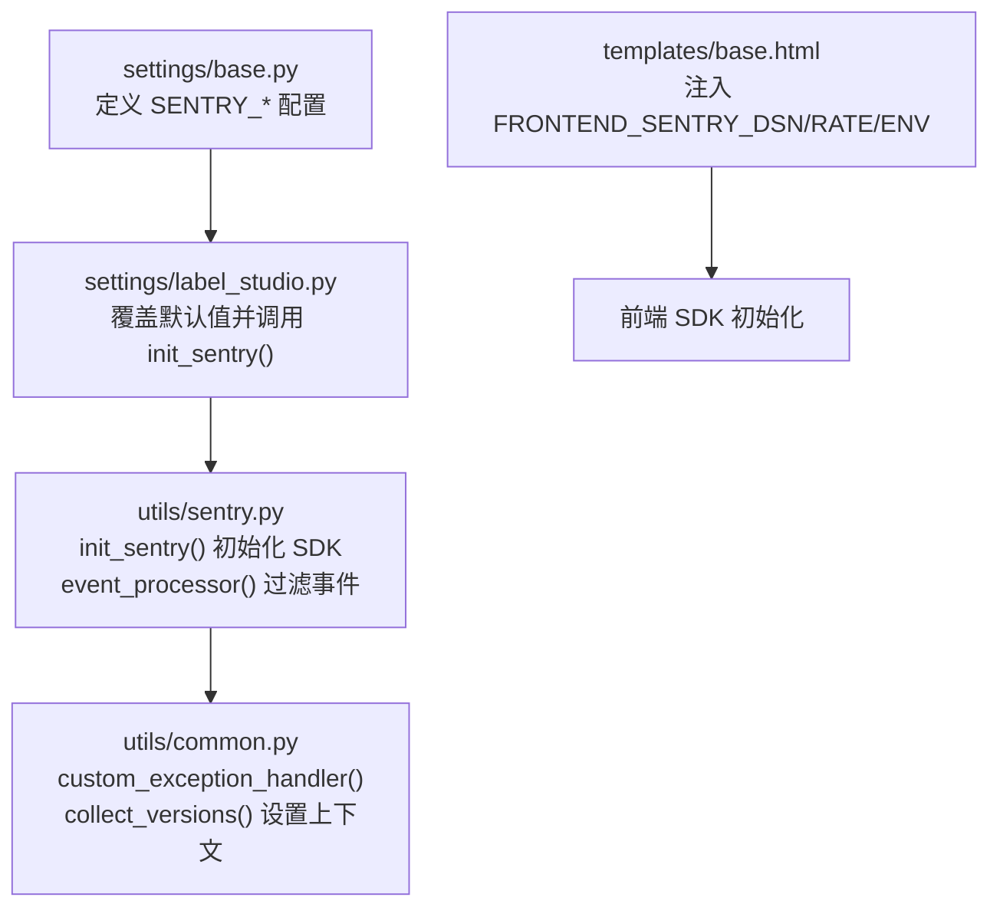
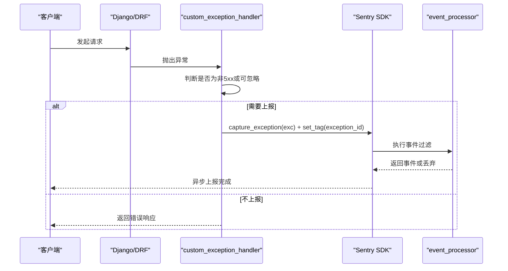
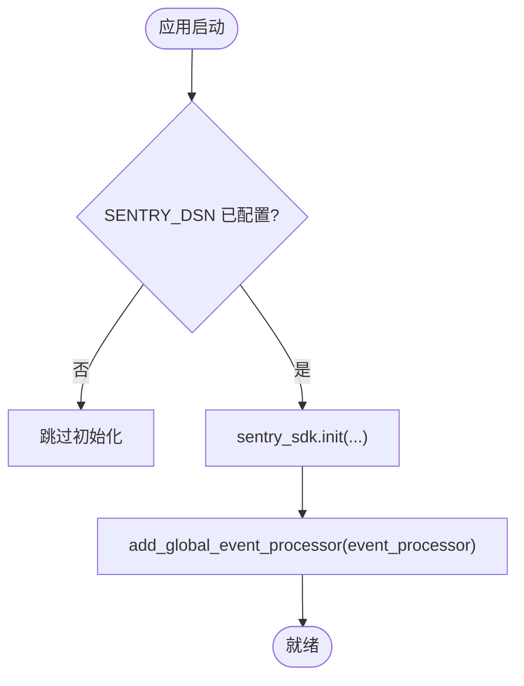
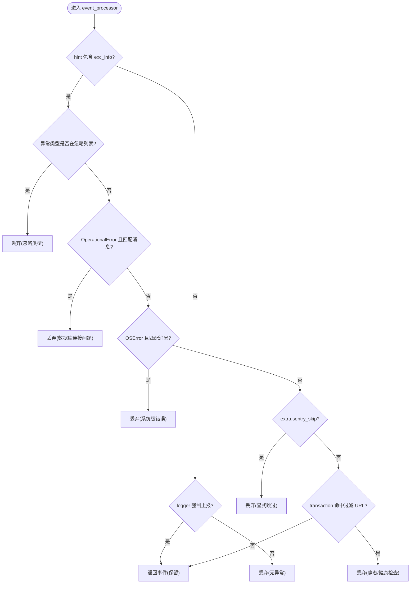
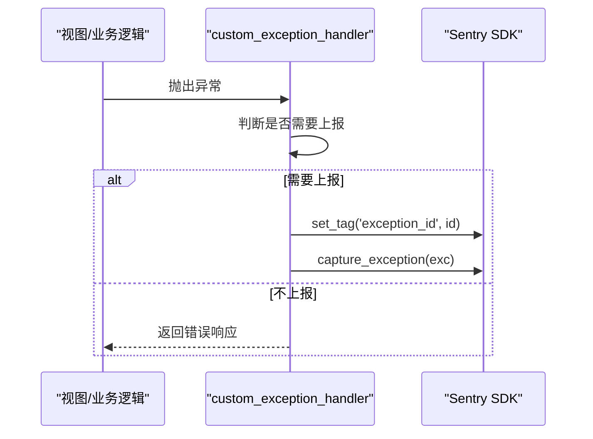
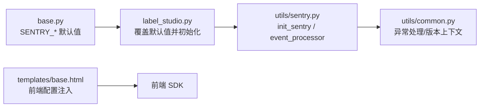

# 错误追踪

<cite>
**本文引用的文件**   
- [label_studio/core/utils/sentry.py](file://label_studio/core/utils/sentry.py)
- [label_studio/core/settings/base.py](file://label_studio/core/settings/base.py)
- [label_studio/core/settings/label_studio.py](file://label_studio/core/settings/label_studio.py)
- [label_studio/core/utils/common.py](file://label_studio/core/utils/common.py)
- [label_studio/templates/base.html](file://label_studio/templates/base.html)
</cite>

## 目录
1. [简介](#简介)
2. [项目结构](#项目结构)
3. [核心组件](#核心组件)
4. [架构总览](#架构总览)
5. [详细组件分析](#详细组件分析)
6. [依赖关系分析](#依赖关系分析)
7. [性能考虑](#性能考虑)
8. [故障排查指南](#故障排查指南)
9. [结论](#结论)
10. [附录](#附录)

## 简介
本文件面向 Label Studio 后端的错误追踪与性能监控体系，重点说明 Sentry 集成配置、事件处理器实现原理（异常过滤、URL 过滤等）、自定义错误捕获与上报逻辑、以及前端 SENTRY DSN 的注入方式。同时提供采样率、事务跟踪、版本管理与常见问题的排查方法与最佳实践建议。

## 项目结构
围绕错误追踪的关键代码分布在以下位置：
- 后端 Sentry 初始化与事件处理器：core/utils/sentry.py
- 后端 Sentry 相关配置项：core/settings/base.py、core/settings/label_studio.py
- 自定义 DRF 异常处理与手动上报：core/utils/common.py
- 前端 Sentry 配置注入：templates/base.html

图表来源
- [label_studio/core/settings/base.py:570-576](file://label_studio/core/settings/base.py#L570-L576)
- [label_studio/core/settings/label_studio.py:31-44](file://label_studio/core/settings/label_studio.py#L31-L44)
- [label_studio/core/utils/sentry.py:64-87](file://label_studio/core/utils/sentry.py#L64-L87)
- [label_studio/core/utils/common.py:83-160](file://label_studio/core/utils/common.py#L83-L160)
- [label_studio/templates/base.html:118-120](file://label_studio/templates/base.html#L118-L120)

章节来源
- [label_studio/core/settings/base.py:570-576](file://label_studio/core/settings/base.py#L570-L576)
- [label_studio/core/settings/label_studio.py:31-44](file://label_studio/core/settings/label_studio.py#L31-L44)
- [label_studio/core/utils/sentry.py:64-87](file://label_studio/core/utils/sentry.py#L64-L87)
- [label_studio/core/utils/common.py:83-160](file://label_studio/core/utils/common.py#L83-L160)
- [label_studio/templates/base.html:118-120](file://label_studio/templates/base.html#L118-L120)

## 核心组件
- 后端 Sentry 初始化与集成
  - 通过 settings/label_studio.py 在应用启动时调用 utils/sentry.py 的 init_sentry()，传入 release_name 与 release_version，完成 SDK 初始化。
  - 根据 settings.SENTRY_REDIS_ENABLED 决定是否启用 Redis 与 RQ 集成。
  - 注册全局事件处理器 event_processor，用于事件过滤与增强。
- 事件处理器 event_processor
  - 跳过无异常的“事务”（除非日志强制上报）。
  - 忽略特定异常类型（来自 settings.SENTRY_IGNORED_EXCEPTIONS）及包含 “SentryIgnored” 的异常类名。
  - 针对数据库连接类 OperationalError 与 OSError 的特定消息进行静默过滤。
  - 支持通过 logger.error(..., extra={'sentry_skip': True}) 或 {'sentry_force': True} 控制是否上报。
  - 按 transaction URL 模式过滤静态资源与健康检查路径。
- 自定义异常处理与手动上报
  - core/utils/common.py 中 custom_exception_handler 拦截 DRF 异常，对非 5xx 异常跳过 Sentry 上报，并为所有异常记录结构化日志。
  - 对于未处理的异常，使用 sentry_sdk.capture_exception 上报，并通过 set_tag('exception_id', ...) 关联唯一 ID。
  - collect_versions() 将各包版本信息写入 sentry_sdk.set_context('versions', ...) 并设置 version-* 与 commit-* 标签，便于版本回溯。
- 前端 Sentry 配置注入
  - templates/base.html 将 FRONTEND_SENTRY_DSN、FRONTEND_SENTRY_RATE、FRONTEND_SENTRY_ENVIRONMENT 注入到页面全局配置，供前端 SDK 初始化使用。

章节来源
- [label_studio/core/settings/label_studio.py:31-44](file://label_studio/core/settings/label_studio.py#L31-L44)
- [label_studio/core/utils/sentry.py:4-61](file://label_studio/core/utils/sentry.py#L4-L61)
- [label_studio/core/utils/sentry.py:64-87](file://label_studio/core/utils/sentry.py#L64-L87)
- [label_studio/core/utils/common.py:83-160](file://label_studio/core/utils/common.py#L83-L160)
- [label_studio/core/utils/common.py:508-517](file://label_studio/core/utils/common.py#L508-L517)
- [label_studio/templates/base.html:118-120](file://label_studio/templates/base.html#L118-L120)

## 架构总览
后端错误追踪流程如下：

图表来源
- [label_studio/core/utils/common.py:83-160](file://label_studio/core/utils/common.py#L83-L160)
- [label_studio/core/utils/sentry.py:4-61](file://label_studio/core/utils/sentry.py#L4-L61)

## 详细组件分析

### 后端 Sentry 初始化与集成
- 入口：settings/label_studio.py 在导入后调用 sentry.init_sentry(release_name='label-studio', release_version=__version__)。
- 初始化参数：
  - dsn=settings.SENTRY_DSN
  - integrations=[DjangoIntegration()] + (RedisIntegration(), RqIntegration()) 当 settings.SENTRY_REDIS_ENABLED=True
  - traces_sample_rate=settings.SENTRY_RATE
  - send_default_pii=True
  - environment=settings.SENTRY_ENVIRONMENT
  - release=release_name + '@' + str(release_version)

图表来源
- [label_studio/core/settings/label_studio.py:31-44](file://label_studio/core/settings/label_studio.py#L31-L44)
- [label_studio/core/utils/sentry.py:64-87](file://label_studio/core/utils/sentry.py#L64-L87)

章节来源
- [label_studio/core/settings/label_studio.py:31-44](file://label_studio/core/settings/label_studio.py#L31-L44)
- [label_studio/core/utils/sentry.py:64-87](file://label_studio/core/utils/sentry.py#L64-L87)

### 事件处理器 event_processor（异常过滤与 URL 过滤）
- 过滤规则要点：
  - 无异常的事务直接丢弃，除非日志标记为强制上报。
  - 忽略 settings.SENTRY_IGNORED_EXCEPTIONS 中的异常类型。
  - 若异常类型名包含 “SentryIgnored”，则丢弃。
  - 针对 OperationalError/OSError 的特定消息进行静默过滤（如数据库连接池耗尽、文件句柄过多等）。
  - 支持通过 logger.error(..., extra={'sentry_skip': True}) 跳过上报。
  - 按 transaction URL 白名单过滤静态资源与健康检查路径。

图表来源
- [label_studio/core/utils/sentry.py:4-61](file://label_studio/core/utils/sentry.py#L4-L61)
- [label_studio/core/settings/base.py:578-585](file://label_studio/core/settings/base.py#L578-L585)

章节来源
- [label_studio/core/utils/sentry.py:4-61](file://label_studio/core/utils/sentry.py#L4-L61)
- [label_studio/core/settings/base.py:578-585](file://label_studio/core/settings/base.py#L578-L585)

### 自定义异常处理与手动上报
- DRF 异常处理：
  - 对非 5xx 的 APIException 或 TooManyFilesSent 异常，设置 sentry_skip=True，避免误报。
  - 统一记录结构化日志，附带 exception_id。
  - 对未处理的异常，调用 sentry_sdk.capture_exception 上报，并设置 exception_id 标签。
- 版本上下文：
  - collect_versions() 收集各包版本与提交信息，写入 sentry_sdk.set_context('versions', ...) 并设置 version-* 与 commit-* 标签，便于定位问题版本。

图表来源
- [label_studio/core/utils/common.py:83-160](file://label_studio/core/utils/common.py#L83-L160)
- [label_studio/core/utils/common.py:508-517](file://label_studio/core/utils/common.py#L508-L517)

章节来源
- [label_studio/core/utils/common.py:83-160](file://label_studio/core/utils/common.py#L83-L160)
- [label_studio/core/utils/common.py:508-517](file://label_studio/core/utils/common.py#L508-L517)

### 前端 Sentry 配置注入
- 模板 base.html 将以下键注入到全局 APP_SETTINGS：
  - sentry_dsn: FRONTEND_SENTRY_DSN
  - sentry_rate: FRONTEND_SENTRY_RATE
  - sentry_environment: FRONTEND_SENTRY_ENVIRONMENT
- 前端据此初始化 SDK，开启前端错误追踪与性能监控。

章节来源
- [label_studio/templates/base.html:118-120](file://label_studio/templates/base.html#L118-L120)

## 依赖关系分析
- 配置层
  - base.py 定义默认 SENTRY_* 配置项与环境变量读取。
  - label_studio.py 覆盖默认值并在启动时初始化 Sentry。
- 运行时
  - utils/sentry.py 负责 SDK 初始化与事件处理器注册。
  - utils/common.py 负责异常处理与版本上下文注入。
- 前端
  - templates/base.html 注入前端 Sentry 配置。

图表来源
- [label_studio/core/settings/base.py:570-576](file://label_studio/core/settings/base.py#L570-L576)
- [label_studio/core/settings/label_studio.py:31-44](file://label_studio/core/settings/label_studio.py#L31-L44)
- [label_studio/core/utils/sentry.py:64-87](file://label_studio/core/utils/sentry.py#L64-L87)
- [label_studio/core/utils/common.py:83-160](file://label_studio/core/utils/common.py#L83-L160)
- [label_studio/templates/base.html:118-120](file://label_studio/templates/base.html#L118-L120)

章节来源
- [label_studio/core/settings/base.py:570-576](file://label_studio/core/settings/base.py#L570-L576)
- [label_studio/core/settings/label_studio.py:31-44](file://label_studio/core/settings/label_studio.py#L31-L44)
- [label_studio/core/utils/sentry.py:64-87](file://label_studio/core/utils/sentry.py#L64-L87)
- [label_studio/core/utils/common.py:83-160](file://label_studio/core/utils/common.py#L83-L160)
- [label_studio/templates/base.html:118-120](file://label_studio/templates/base.html#L118-L120)

## 性能考虑
- 采样率
  - 后端 traces_sample_rate=settings.SENTRY_RATE，默认值为 0.02（可通过环境变量覆盖）。
  - 前端使用 FRONDEND_SENTRY_RATE，默认 0.01，由模板注入。
- 环境标识
  - 后端 environment=settings.SENTRY_ENVIRONMENT，默认 'stage.opensource'，可在 label_studio.py 覆盖为 'opensource'。
  - 前端 environment 由 FRONTEND_SENTRY_ENVIRONMENT 控制。
- PII 与上下文
  - send_default_pii=True，谨慎在生产环境评估隐私风险。
  - 版本上下文与标签有助于快速定位问题版本与提交。

章节来源
- [label_studio/core/settings/base.py:570-576](file://label_studio/core/settings/base.py#L570-L576)
- [label_studio/core/settings/label_studio.py:31-37](file://label_studio/core/settings/label_studio.py#L31-L37)
- [label_studio/core/utils/sentry.py:80-87](file://label_studio/core/utils/sentry.py#L80-L87)
- [label_studio/templates/base.html:118-120](file://label_studio/templates/base.html#L118-L120)

## 故障排查指南
- 未收到任何错误
  - 检查 SENTRY_DSN 是否已正确配置；若为空，不会初始化 SDK。
  - 确认 SENTRY_RATE > 0，否则事务采样率为 0，可能影响观测。
  - 检查 event_processor 是否因 URL 过滤或异常类型过滤而丢弃事件。
- 大量噪声告警
  - 调整 settings.SENTRY_IGNORED_EXCEPTIONS，添加更多无需上报的异常类型。
  - 在 logger.error 中使用 extra={'sentry_skip': True} 跳过已知可忽略的错误。
  - 对数据库连接池耗尽、文件句柄过多等场景，确保已在 event_processor 中过滤。
- 无法区分版本
  - 确认 collect_versions() 已被调用（应用启动时会设置 versions 上下文）。
  - 检查 sentry_sdk.set_context('versions', ...) 与 version-* / commit-* 标签是否正确设置。
- 前端未上报
  - 检查模板是否注入了 FRONTEND_SENTRY_DSN、FRONTEND_SENTRY_RATE、FRONTEND_SENTRY_ENVIRONMENT。
  - 确认前端 SDK 初始化使用了这些配置。

章节来源
- [label_studio/core/utils/sentry.py:4-61](file://label_studio/core/utils/sentry.py#L4-L61)
- [label_studio/core/utils/common.py:83-160](file://label_studio/core/utils/common.py#L83-L160)
- [label_studio/core/utils/common.py:508-517](file://label_studio/core/utils/common.py#L508-L517)
- [label_studio/templates/base.html:118-120](file://label_studio/templates/base.html#L118-L120)

## 结论
Label Studio 的后端错误追踪基于 Sentry SDK，通过集中化的配置与事件处理器实现了灵活的异常过滤与 URL 过滤，并结合 DRF 自定义异常处理与版本上下文注入，提供了完善的错误上报与性能监控能力。前端通过模板注入配置，形成前后端一致的追踪体系。生产环境中建议合理设置采样率、PII 策略与忽略规则，以降低噪声并提升可观测性。

## 附录
- 关键环境变量与配置项
  - SENTRY_DSN：后端 Sentry DSN
  - SENTRY_RATE：后端事务采样率
  - SENTRY_ENVIRONMENT：后端环境标识
  - SENTRY_REDIS_ENABLED：是否启用 Redis/RQ 集成
  - FRONTEND_SENTRY_DSN：前端 Sentry DSN
  - FRONTEND_SENTRY_RATE：前端事务采样率
  - FRONTEND_SENTRY_ENVIRONMENT：前端环境标识
  - SENTRY_IGNORED_EXCEPTIONS：忽略的异常类型列表

章节来源
- [label_studio/core/settings/base.py:570-585](file://label_studio/core/settings/base.py#L570-L585)
- [label_studio/core/settings/label_studio.py:31-37](file://label_studio/core/settings/label_studio.py#L31-L37)
- [label_studio/templates/base.html:118-120](file://label_studio/templates/base.html#L118-L120)