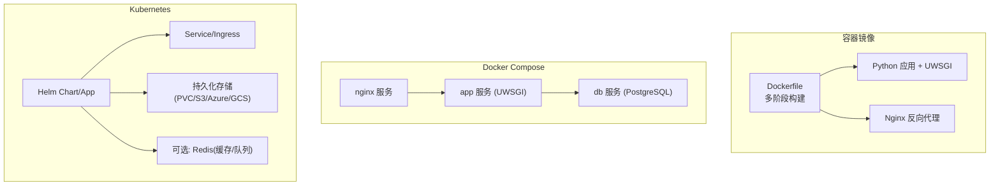
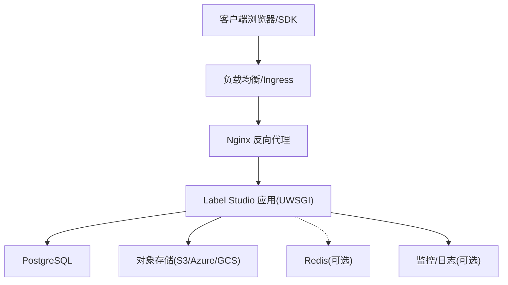
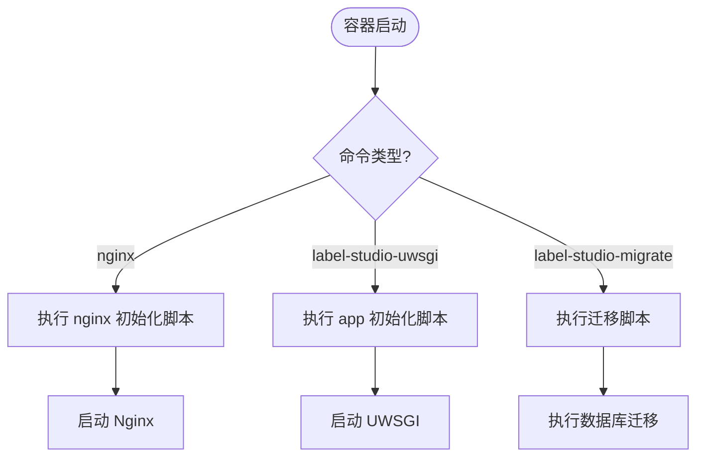
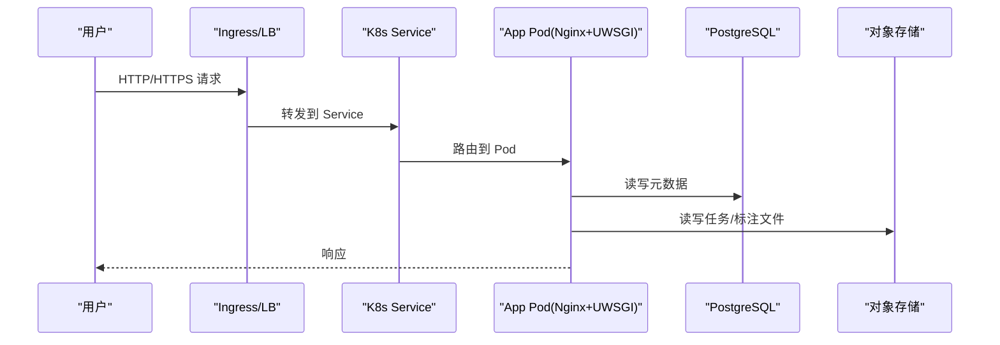
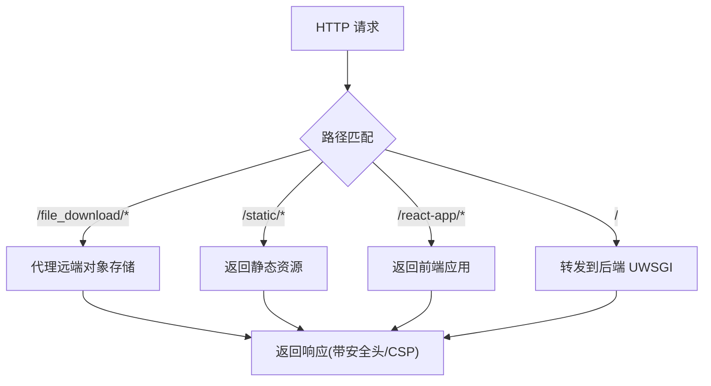
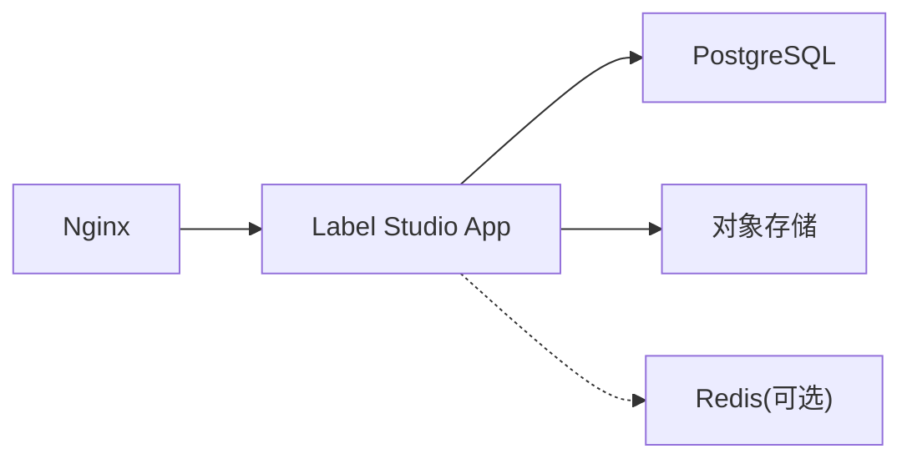

# 部署运维

<cite>
**本文引用的文件**   
- [README.md](file://README.md)
- [Dockerfile](file://Dockerfile)
- [docker-compose.yml](file://docker-compose.yml)
- [deploy/docker-entrypoint.sh](file://deploy/docker-entrypoint.sh)
- [deploy/default.conf](file://deploy/default.conf)
- [docs/source/guide/install.md](file://docs/source/guide/install.md)
- [docs/source/guide/ingress_config.md](file://docs/source/guide/ingress_config.md)
- [docs/source/guide/helm_values.md](file://docs/source/guide/helm_values.md)
- [docs/source/guide/storage_redis.md](file://docs/source/guide/storage_redis.md)
</cite>

## 目录
1. [简介](#简介)
2. [项目结构](#项目结构)
3. [核心组件](#核心组件)
4. [架构总览](#架构总览)
5. [详细组件分析](#详细组件分析)
6. [依赖关系分析](#依赖关系分析)
7. [性能与扩展性](#性能与扩展性)
8. [监控、日志与可观测性](#监控日志与可观测性)
9. [数据备份与灾难恢复](#数据备份与灾难恢复)
10. [安全加固](#安全加固)
11. [版本升级与回滚](#版本升级与回滚)
12. [故障排查指南](#故障排查指南)
13. [结论](#结论)

## 简介
本指南面向生产环境，提供 Label Studio 的容器化与集群化部署、负载均衡与高可用设计、监控告警与日志收集、数据备份与灾备、安全加固以及版本升级与回滚的综合实践。文档基于仓库提供的 Dockerfile、Compose 编排、Nginx 配置、Helm Values 与官方安装/Ingress/Redis 存储文档进行系统化整理，确保在生产场景下具备可操作性和可维护性。

## 项目结构
Label Studio 的生产镜像通过多阶段构建，将前端静态资源与后端 Python 应用打包进同一镜像，并内置 Nginx 作为反向代理与静态资源服务。Compose 编排示例包含 Nginx、应用（Uwsgi）、PostgreSQL 三个服务，便于本地或小型生产环境快速启动。Kubernetes 部署则通过 Helm Chart 管理 App、Rqworker、Ingress、持久化存储等组件。

**图示来源**
- [Dockerfile:105-159](file://Dockerfile#L105-L159)
- [docker-compose.yml:1-72](file://docker-compose.yml#L1-L72)
- [docs/source/guide/helm_values.md:126-214](file://docs/source/guide/helm_values.md#L126-L214)

**章节来源**
- [Dockerfile:1-160](file://Dockerfile#L1-L160)
- [docker-compose.yml:1-72](file://docker-compose.yml#L1-L72)

## 核心组件
- 应用容器：运行 Django/UWSGI 后端，暴露内部端口供 Nginx 转发。
- Nginx 反向代理：处理静态资源、大文件下载、CORS、安全头、TLS 终止（可选）。
- 数据库：PostgreSQL（生产推荐），支持 SSL 与自动升级镜像。
- 对象存储：S3/Azure Blob/GCS 或本地卷，用于任务与标注结果。
- 缓存/队列：Redis（可选，用于缓存或异步任务）。
- Ingress/Load Balancer：云厂商 LB 或 NGINX Ingress Controller。

**章节来源**
- [README.md:59-79](file://README.md#L59-L79)
- [docs/source/guide/install.md:86-139](file://docs/source/guide/install.md#L86-L139)

## 架构总览
下图展示典型生产架构：外部流量经 Ingress/LB 进入 Nginx，再转发到应用；数据库使用托管 PostgreSQL；对象存储使用云 S3 兼容服务；Redis 作为缓存或队列（可选）；Prometheus/Grafana/ELK 等用于监控与日志。

**图示来源**
- [docker-compose.yml:1-72](file://docker-compose.yml#L1-L72)
- [docs/source/guide/ingress_config.md:103-154](file://docs/source/guide/ingress_config.md#L103-L154)

## 详细组件分析

### Docker 容器化部署
- 多阶段构建：前端由 Bun 构建，后端用 uv 同步依赖，最终产物合并到 production 镜像。
- 运行时：镜像内集成 Nginx 与 Uwsgi，ENTRYPOINT 根据命令分支执行不同初始化脚本。
- 环境变量：通过 LABEL_STUDIO_BASE_DATA_DIR、DJANGO_SETTINGS_MODULE 等控制行为。
- 端口：默认对外暴露 8080（Nginx 在镜像内监听 8085，Compose 映射 8080:8085）。

**图示来源**
- [deploy/docker-entrypoint.sh:68-82](file://deploy/docker-entrypoint.sh#L68-L82)

**章节来源**
- [Dockerfile:1-160](file://Dockerfile#L1-L160)
- [deploy/docker-entrypoint.sh:1-83](file://deploy/docker-entrypoint.sh#L1-L83)

### Kubernetes 集群部署（Helm + Ingress）
- Helm Values：提供 App、Rqworker、PostgreSQL、Redis、Ingress、持久化存储等参数。
- Ingress：支持 AWS ALB、GCE、Azure AGIC 与通用 NGINX Ingress Controller。
- TLS：可在 LB 或 Ingress 层终止，必要时设置 LABEL_STUDIO_HOST。
- 大文件上传：通过 Ingress 注解调整请求体大小限制。

**图示来源**
- [docs/source/guide/ingress_config.md:29-154](file://docs/source/guide/ingress_config.md#L29-L154)
- [docs/source/guide/helm_values.md:126-214](file://docs/source/guide/helm_values.md#L126-L214)

**章节来源**
- [docs/source/guide/ingress_config.md:1-154](file://docs/source/guide/ingress_config.md#L1-L154)
- [docs/source/guide/helm_values.md:1-344](file://docs/source/guide/helm_values.md#L1-L344)

### Nginx 反向代理配置要点
- 静态资源：/static 与 /react-app 分别指向构建产物目录。
- 大文件下载：/file_download/* 通过内部重定向代理远端对象存储，隐藏敏感头部，启用 TLS SNI。
- 安全头：HSTS、X-Frame-Options、CSP（对上传 HTML/SVG/XML 启用 sandbox）。
- CORS：允许跨域请求，暴露必要头部。
- 健康检查：/nginx_health 返回 200。

**图示来源**
- [deploy/default.conf:111-224](file://deploy/default.conf#L111-L224)

**章节来源**
- [deploy/default.conf:1-226](file://deploy/default.conf#L1-L226)

### PostgreSQL 数据库配置
- 使用 pgautoupgrade 镜像实现自动升级。
- 支持挂载证书目录以启用 TLS。
- Compose 中通过 POSTGRE_* 环境变量连接。
- Helm 中可通过 global.pgConfig.* 配置主机、端口、SSL 模式与证书 Secret。

**章节来源**
- [docker-compose.yml:55-72](file://docker-compose.yml#L55-L72)
- [docs/source/guide/helm_values.md:64-74](file://docs/source/guide/helm_values.md#L64-L74)

### Redis 缓存/存储配置
- 用途：可作为任务/标注数据的源/目标存储（需分库），或作为缓存/队列。
- 当前 UI 仅支持默认 IP 模式的 Redis。
- Helm 提供 redis.enabled/architecture/auth 等开关。
- 建议开启持久化或使用托管 Redis 服务避免内存丢失。

**章节来源**
- [docs/source/guide/storage_redis.md:1-182](file://docs/source/guide/storage_redis.md#L1-L182)
- [docs/source/guide/helm_values.md:298-301](file://docs/source/guide/helm_values.md#L298-L301)

## 依赖关系分析
- 应用依赖：PostgreSQL（元数据）、对象存储（任务/标注文件）、Redis（可选）。
- Nginx 依赖：应用后端（UWSGI）、静态资源目录。
- Compose 依赖顺序：nginx -> app -> db。
- Helm 依赖：App/Rqworker 子组件、PostgreSQL/Redis 子图、Ingress/Service。

**图示来源**
- [docker-compose.yml:1-72](file://docker-compose.yml#L1-L72)
- [docs/source/guide/helm_values.md:126-214](file://docs/source/guide/helm_values.md#L126-L214)

**章节来源**
- [docker-compose.yml:1-72](file://docker-compose.yml#L1-L72)
- [docs/source/guide/helm_values.md:126-214](file://docs/source/guide/helm_values.md#L126-L214)

## 性能与扩展性
- 水平扩展：增加 App Pod 副本数，配合 Ingress/LB 做负载均衡。
- 资源配额：通过 Helm values 设置 requests/limits，避免资源争抢。
- 大文件上传：调整 Ingress 的 proxy-body-size 或 LB 配置，避免 413 错误。
- 静态资源：Nginx 直接提供静态资源，减少后端压力。
- 连接池与超时：合理设置 Nginx 与后端的连接/读写超时。

**章节来源**
- [docs/source/guide/ingress_config.md:135-154](file://docs/source/guide/ingress_config.md#L135-L154)
- [docs/source/guide/helm_values.md:130-140](file://docs/source/guide/helm_values.md#L130-L140)

## 监控、日志与可观测性
- Nginx 访问日志：输出 JSON 格式到 stdout，便于集中采集。
- 应用日志：可通过环境变量开启 JSON 日志（如 JSON_LOG=1）。
- 健康检查：/health、/version、/nginx_health 用于探针。
- 建议集成 Prometheus/Grafana 采集指标，ELK/Fluent Bit 收集日志。

**章节来源**
- [deploy/default.conf:33-70](file://deploy/default.conf#L33-L70)
- [docker-compose.yml:37-53](file://docker-compose.yml#L37-L53)
- [docs/source/guide/helm_values.md:143-195](file://docs/source/guide/helm_values.md#L143-L195)

## 数据备份与灾难恢复
- 数据库：定期备份 PostgreSQL（pg_dump 或云托管备份策略）。
- 对象存储：利用云厂商快照/生命周期策略，保证任务与标注文件冗余。
- 配置文件：将 Helm values、Ingress 配置纳入版本控制。
- 灾难恢复：从备份重建数据库与对象存储，重新部署应用与 Ingress。

[本节为通用运维建议，不直接分析具体文件]

## 安全加固
- TLS：在 LB 或 Ingress 层终止 TLS，或在 Nginx 侧启用证书。
- SSRF 防护：生产环境建议启用 SSRF_PROTECTION_ENABLED。
- 最小权限：容器以非 root 用户运行（UID 1001），限制文件系统权限。
- 安全头：HSTS、X-Frame-Options、CSP（针对上传 HTML/SVG/XML 启用 sandbox）。
- 网络隔离：通过 K8s NetworkPolicy 限制 Pod 间访问。

**章节来源**
- [docs/source/guide/helm_values.md:324-326](file://docs/source/guide/helm_values.md#L324-L326)
- [Dockerfile:154-159](file://Dockerfile#L154-L159)
- [deploy/default.conf:121-131](file://deploy/default.conf#L121-L131)

## 版本升级与回滚
- 滚动更新：Helm 默认使用 RollingUpdate 策略，逐步替换 Pod。
- 数据库迁移：在启动时执行迁移脚本（locked_migrate），确保向后兼容。
- 回滚策略：保留旧镜像标签与 Helm release，必要时回退到上一版本。
- 灰度发布：结合 Ingress 权重或金丝雀发布流程逐步放量。

**章节来源**
- [docs/source/guide/helm_values.md:133-134](file://docs/source/guide/helm_values.md#L133-L134)
- [deploy/docker-entrypoint.sh:76-78](file://deploy/docker-entrypoint.sh#L76-L78)

## 故障排查指南
- 无法访问页面：检查 Ingress/Service 路由、Nginx 健康检查、DNS 解析。
- 大文件上传失败：确认 Ingress 的 proxy-body-size 与 LB 配置是否足够。
- 数据库连接失败：核对 PostgreSQL 主机、端口、用户名、密码与 SSL 配置。
- 对象存储不可用：检查 S3/Azure/GCS 凭据、Endpoint URL、Bucket/Folder 权限。
- 日志定位：查看 Nginx access/error 日志与应用 JSON 日志，结合 Request-ID 追踪。

**章节来源**
- [docs/source/guide/ingress_config.md:135-154](file://docs/source/guide/ingress_config.md#L135-L154)
- [deploy/default.conf:33-70](file://deploy/default.conf#L33-L70)

## 结论
通过容器化与 Helm 管理，Label Studio 可在多种环境中稳定运行。生产环境应重点关注 Ingress/LB 配置、数据库与对象存储的高可用、监控与日志体系、安全加固与备份恢复策略，并结合业务规模进行水平扩展与性能调优。遵循本指南的流程与实践，可有效降低部署风险并提升系统可靠性。