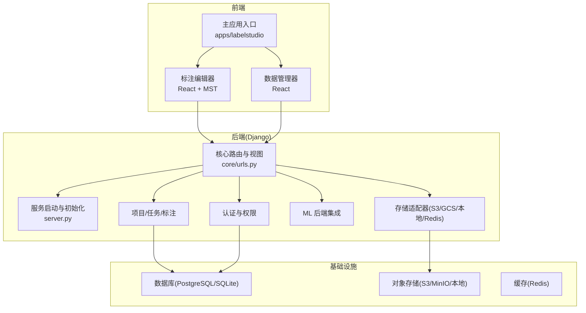
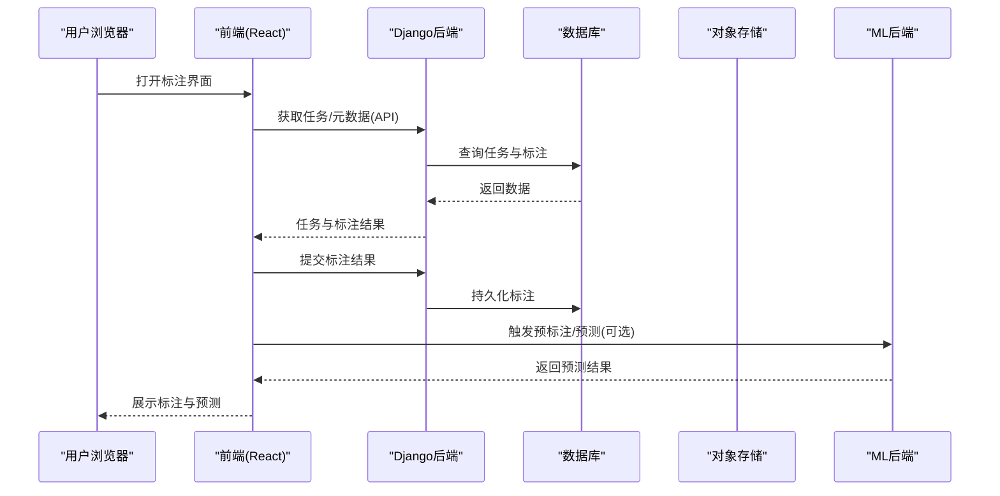
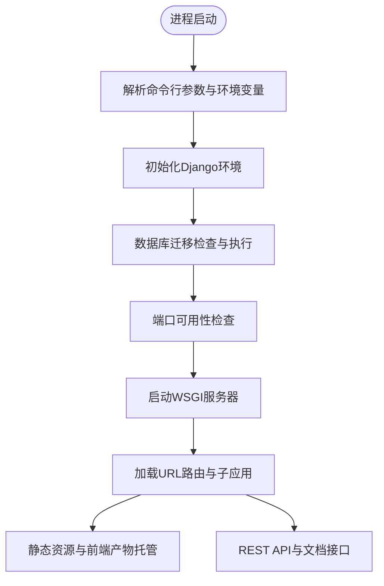
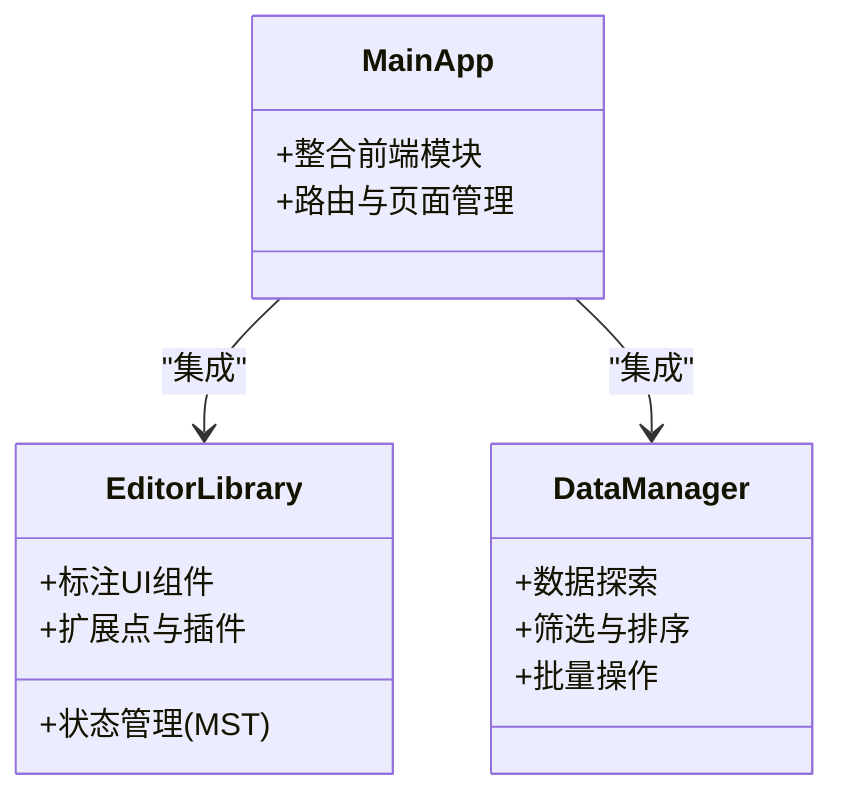
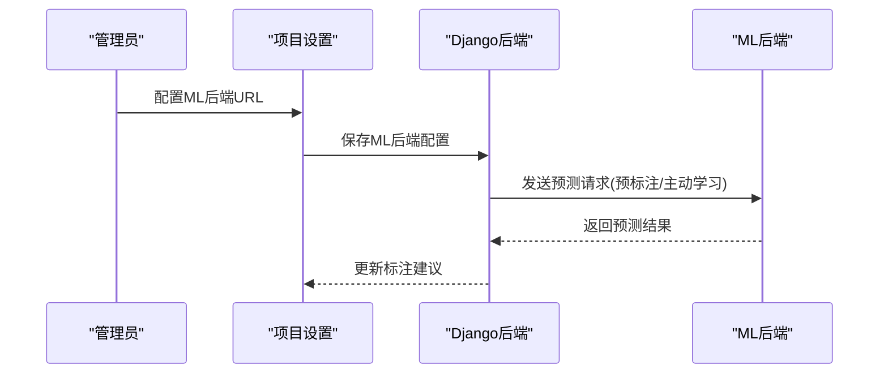
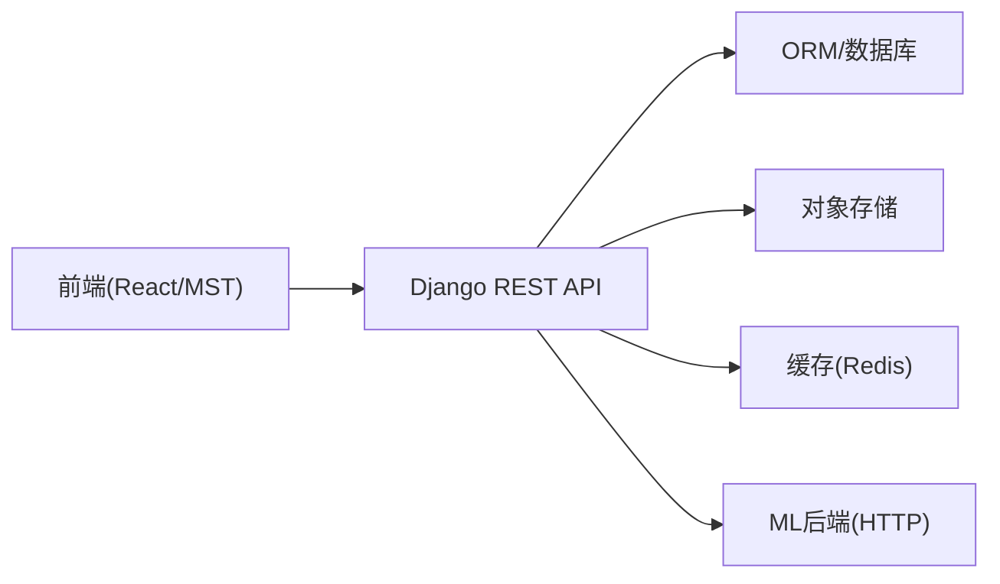

# 项目概述

<cite>
**本文引用的文件**   
- [README.md](file://README.md)
- [get_started.md](file://docs/source/guide/get_started.md)
- [install.md](file://docs/source/guide/install.md)
- [web/README.md](file://web/README.md)
- [server.py](file://label_studio/server.py)
- [urls.py](file://label_studio/core/urls.py)
</cite>

## 目录
1. [简介](#简介)
2. [项目结构](#项目结构)
3. [核心组件](#核心组件)
4. [架构总览](#架构总览)
5. [详细组件分析](#详细组件分析)
6. [依赖关系分析](#依赖关系分析)
7. [性能与可扩展性](#性能与可扩展性)
8. [快速开始指南](#快速开始指南)
9. [故障排查](#故障排查)
10. [结论](#结论)

## 简介
Label Studio 是一个开源的数据标注平台，支持音频、文本、图像、视频和时间序列等多种数据类型，提供直观的标注界面，并可将标注结果导出为多种机器学习模型格式。它既可作为独立工具使用，也可通过 REST API 嵌入到数据流水线中，配合 ML 后端实现预标注、主动学习与在线学习等能力，从而在机器学习工作流中发挥关键作用。

核心价值包括：
- 多用户协作与多项目管理
- 可配置的标注界面（基于配置语言）
- 丰富的数据类型支持与模板库
- 与外部 ML 模型的集成（预测、预标注、主动学习）
- 灵活的导入/导出与存储后端

**章节来源**
- [README.md:8-22](file://README.md#L8-L22)
- [get_started.md:13-20](file://docs/source/guide/get_started.md#L13-L20)

## 项目结构
仓库采用前后端分离的模块化组织方式：
- 后端：基于 Django 的 Python 应用，负责业务逻辑、API、权限、任务与项目生命周期管理、ML 后端对接、Webhook、存储适配等
- 前端：React + mobx-state-tree 构建的标注编辑器与数据管理器，作为独立库被主应用集成
- 文档：docs 目录包含安装、使用、模板、插件、教程等完整文档
- 部署：Docker、Docker Compose、Nginx、PostgreSQL 等生产就绪方案

**图表来源**
- [web/README.md:3-12](file://web/README.md#L3-L12)
- [urls.py:35-111](file://label_studio/core/urls.py#L35-L111)
- [server.py:32-40](file://label_studio/server.py#L32-L40)

**章节来源**
- [web/README.md:3-12](file://web/README.md#L3-L12)
- [README.md:227-236](file://README.md#L227-L236)

## 核心组件
- 标注编辑器（Frontend Library）：React + mobx-state-tree，提供可视化标注能力，支持自定义标签与交互
- 数据管理器（DataManager）：用于数据探索、筛选、批量操作与质量评估
- 主应用（Main App）：整合前端各模块，作为 React 应用的集成中心
- 后端服务（Django）：REST API、项目/任务/标注模型、权限、存储、ML 后端对接、Webhook、版本与指标接口
- ML 后端集成：连接外部预测服务，支持预标注、主动学习、在线学习
- 存储层：S3、GCS、Azure Blob、本地文件、Redis 等

**章节来源**
- [web/README.md:3-12](file://web/README.md#L3-L12)
- [README.md:191-203](file://README.md#L191-L203)
- [get_started.md:125-131](file://docs/source/guide/get_started.md#L125-L131)

## 架构总览
Label Studio 采用分层架构：
- 表现层：React 前端（标注编辑器、数据管理器），由主应用聚合
- 应用层：Django 后端暴露 REST API，处理业务逻辑、状态机、权限控制、任务调度
- 集成层：ML 后端、Webhook、第三方存储与认证系统
- 数据层：关系型数据库（PostgreSQL/SQLite）、对象存储（S3/MinIO/本地）、缓存（Redis）

**图表来源**
- [urls.py:35-111](file://label_studio/core/urls.py#L35-L111)
- [server.py:276-343](file://label_studio/server.py#L276-L343)

## 详细组件分析

### 后端服务与路由（Django）
- 服务启动：解析命令行参数、设置环境变量、执行数据库迁移、选择端口、启动 WSGI 服务器
- URL 路由：集中式路由分发，静态资源与前端产物托管，API 文档（Swagger/Redoc/OpenAPI），健康检查与指标采集
- 功能模块：组织、项目、任务、导入/导出、用户、存储、ML、Webhook、标签管理等子应用通过 include 挂载

**图表来源**
- [server.py:276-343](file://label_studio/server.py#L276-L343)
- [urls.py:35-111](file://label_studio/core/urls.py#L35-L111)

**章节来源**
- [server.py:32-40](file://label_studio/server.py#L32-L40)
- [server.py:276-343](file://label_studio/server.py#L276-L343)
- [urls.py:35-111](file://label_studio/core/urls.py#L35-L111)

### 前端应用与编辑器（React + MST）
- 主应用（apps/labelstudio）：整合所有前端模块，作为入口点
- 标注编辑器（libs/editor）：React + mobx-state-tree，提供强大的标注能力与扩展点
- 数据管理器（libs/datamanager）：数据探索、筛选、批量操作与质量评估

**图表来源**
- [web/README.md:3-12](file://web/README.md#L3-L12)

**章节来源**
- [web/README.md:3-12](file://web/README.md#L3-L12)

### ML 模型集成
- 通过 ML 后端连接外部预测服务，支持预标注、主动学习与在线学习
- 可在项目设置中配置 ML 后端地址，并在标注流程中调用预测结果

**图表来源**
- [README.md:210-222](file://README.md#L210-L222)

**章节来源**
- [README.md:210-222](file://README.md#L210-L222)

## 依赖关系分析
- 前端依赖：React、mobx-state-tree、构建工具链（Bun/Vite）
- 后端依赖：Django、DRF、数据库驱动（PostgreSQL/SQLite）、Redis（可选）
- 存储依赖：S3/GCS/Azure Blob/本地文件系统
- 集成依赖：ML 后端（HTTP API）、Webhook、认证（JWT/Session）

**图表来源**
- [web/README.md:3-12](file://web/README.md#L3-L12)
- [urls.py:35-111](file://label_studio/core/urls.py#L35-L111)

**章节来源**
- [web/README.md:3-12](file://web/README.md#L3-L12)
- [README.md:227-236](file://README.md#L227-L236)

## 性能与可扩展性
- 数据库：推荐使用 PostgreSQL 提升并发与稳定性；SQLite 适合轻量开发
- 存储：对象存储（S3/MinIO/本地）承载媒体文件，避免单点瓶颈
- 缓存：Redis 可用于会话、队列与热点数据缓存
- 水平扩展：通过反向代理（Nginx）与多实例部署提升吞吐
- 前端优化：HMR 与按需构建提升开发体验；静态资源 CDN 加速

[本节为通用指导，不直接分析具体文件]

## 快速开始指南

### Docker 安装与运行
- 拉取官方镜像并启动容器，映射端口与数据卷
- 访问 http://localhost:8080 进入应用
- 可通过追加参数覆盖默认启动命令（如日志级别）

**章节来源**
- [README.md:36-57](file://README.md#L36-L57)
- [install.md:86-127](file://docs/source/guide/install.md#L86-L127)

### Docker Compose（含 Nginx + PostgreSQL）
- 使用 docker-compose 一键启动生产就绪栈
- 默认提供 Nginx 反向代理与 PostgreSQL 数据库

**章节来源**
- [README.md:59-79](file://README.md#L59-L79)
- [install.md:129-139](file://docs/source/guide/install.md#L129-L139)

### pip 安装与本地开发
- 使用 pip 或 poetry 安装依赖
- 执行数据库迁移与静态资源收集
- 启动开发服务器

**章节来源**
- [README.md:82-132](file://README.md#L82-L132)
- [install.md:35-57](file://docs/source/guide/install.md#L35-L57)
- [install.md:180-201](file://docs/source/guide/install.md#L180-L201)

### 基本使用示例
- 创建账号与项目
- 配置标注界面与标签
- 导入数据并进行标注
- 导出标注结果

**章节来源**
- [get_started.md:65-93](file://docs/source/guide/get_started.md#L65-L93)

## 故障排查
- 端口占用：服务启动时自动检测端口占用并尝试切换可用端口
- 数据库未同步：首次启动自动执行迁移；若失败需检查数据库连接与权限
- 静态资源缺失：确保 collectstatic 已执行且静态路径正确
- 存储权限：Docker 非 root 用户需要挂载目录具备 UID 1001 权限
- 浏览器兼容：建议使用最新 Chrome；其他浏览器可能出现异常行为

**章节来源**
- [server.py:237-267](file://label_studio/server.py#L237-L267)
- [server.py:58-63](file://label_studio/server.py#L58-L63)
- [install.md:98-100](file://docs/source/guide/install.md#L98-L100)
- [install.md:25-30](file://docs/source/guide/install.md#L25-L30)

## 结论
Label Studio 以 Django 后端与 React 前端的清晰分层架构，提供了灵活、可扩展的数据标注平台。其多数据类型支持、可配置界面、ML 集成与完善的部署方案，使其成为机器学习工作流中的关键基础设施。无论是初学者还是经验丰富的开发者，都能在其生态中找到合适的切入点进行快速上手与深度定制。