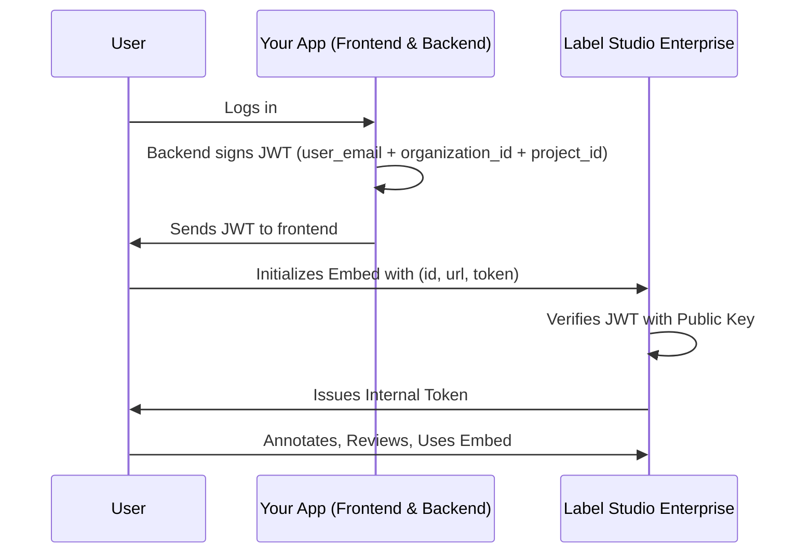

Label Studio 嵌入允许你将标注和审阅功能无缝集成到你自己的应用程序中。 

!!! note
    此功能并非对所有客户可用。请联系你的 [HumanSignal 客户经理](mailto:sales@humansignal.com) 以启用。

在开始之前，请确保你拥有：
* Label Studio：
    * 你必须在 Label Studio 中拥有所有者角色。
    * 从 **组织 > 设置 > 访问令牌设置**，确保至少启用了一种选项。


* 你的外部应用程序：
    * 可访问你的服务器后端（以生成签名令牌）。
    * 你的嵌入将被托管的 URL。


## 授权

在高层面上，嵌入过程是你的应用与 Label Studio 之间的安全握手：

1. 用户登录你的外部应用。

2. 你的后端使用他们的 `user_email`、`organization_id` 和 `project_id` 以及你的私钥签署 JWT。

3. 你的前端使用 `id`、`url` 和 `token` 初始化 Label Studio 嵌入。

4. Label Studio 验证 JWT 并签发其自己的内部令牌。




### 在你的服务器上生成 JWT

你必须首先生成一个对你的 Label Studio 进行身份验证的 JSON Web Token（JWT）。 

你还需要生成一个 base64 编码的公钥 URL，你将其添加到 Label Studio。 

所需的 JWT 声明：

```json
{
  "user_email": "user@example.com",
  "organization_id": 12345,
  "project_id": 67890,
  "iat": 1692445200,
  "exp": 1692452400
}
```

!!! note
    `exp`、`organization_id` 和 `project_id` 是必需的。每个都接受正整数或数字字符串。`exp` 是以秒为单位的 Unix 时间戳，并且必须落在你组织的令牌生存期内（默认 60 分钟）。`project_id` 将嵌入范围限定到该项目，并且必须与嵌入 URL 中的项目匹配。`iat` 是可选的。

**注意：**

* 你可以从 Label Studio 的 **组织** 页面找到你的组织 ID。   
* 下面的示例使用 RS256 作为验证算法，但你可以从 **组织 > 用量与许可证 > 嵌入** 找到受支持算法的完整列表。   
* 公钥必须以 base64-url 编码格式存储在 Label Studio 中。


#### 示例：Node.js（jsonwebtoken）

```javascript
const jwt = require("jsonwebtoken");
const fs = require("fs");

const privateKey = fs.readFileSync("./private.pem");

const token = jwt.sign(
  {
    user_email: "user@example.com",
    organization_id: 12345,
    project_id: 67890,
  },
  privateKey,
  { algorithm: "RS256", expiresIn: "1h" }
);

console.log(token);
```

## 在 Label Studio 中配置嵌入

在 Label Studio 中，转到 **组织 > 用量与许可证 > 嵌入** 并填写以下字段：

| 字段 | 描述  |
| :---- | :---- |
| **支持的域** | 列出你将添加嵌入的外部应用程序的域。  |
| **公共验证密钥** | 这必须是一个 base64-url 编码的密钥。  |
| **公共验证算法** | 你在创建密钥时使用的算法。  |
| **嵌入 SDK** | 将此添加到你的应用程序以初始化嵌入。   |

## 在你的外部应用程序中配置嵌入页面

至少，你需要将 **嵌入 SDK** 脚本添加到你应用程序中的 HTML 页面。例如：

```xml 
<script src="https://app.humansignal.com/react-app/embed-sdk.js"></script>
```

但要最大化嵌入的可用性，你还可以包含其他 Label Studio 元素。请参阅我们的[前端参考](frontend_reference)。 

下面是一个示例：

```xml
<html>
	<body>
		<!-- 嵌入的出口 -->
		<label-studio-embed id="embed-1"></label-studio-embed>
		
		<!-- 包含 EmbedSDK 脚本 -->
		<script src="https://app.humansignal.com/react-app/embed-sdk.js"></script>
		
		<!-- 实现示例 -->
		<script>
				// 初始化 Label Studio 嵌入 SDK 
        const sdk = LabelStudioEmbedSDK.create({
	        id: "embed-1", // 定位作为嵌入出口的 `label-studio-embed` WebComponent 的 id
	        url: "https://app.humansignal.com", // 目标 LabelStudioEnterprise 实例的 URL
	        token: "<signed-jwt-of-current-user>", // 使用组织设置中配置的配对公共验证密钥的私钥签署的 JWT，结构如下： {"user_email": "targetuser@email.com", "organization_id": 12345, "project_id": 67890, "exp": 1692452400}
	        mode: "label" // 将为用户加载的任务和标注将以预配置的界面呈现，用于标注目的
        });

				// 监听 ready 事件（在给定任务的所有嵌入加载完成后触发一次）
        sdk.on('ready', () => {
            console.log('LSE Embed - SDK ready for task');
        });

				// 监听错误事件
        sdk.on('error', (error) => {
            console.error('LSE Embed - SDK error:', error);
        });
        
        // 监听任务加载事件
        sdk.on('taskLoad', (task) => {
            console.error('LSE Embed - Task load:', task);
        });
        
        // 监听标注选择（切换/加载标注）事件
        sdk.on('selectAnnotation', (annotation) => {
	        console.error('LSE Embed - Annotation select:', annotation);
        });
        
        // 监听实体（区域/标签数据）创建事件
        sdk.on('entityCreate', (entity) => {
            console.log('LSE Embed - Entity create:', entity);
        });
        
        // 监听实体（区域/标签数据）删除事件
        sdk.on('entityDelete', (entity) => {
            console.log('LSE Embed - Entity delete:', entity);
        });
        
        // 监听标注提交事件
        sdk.on('submitAnnotation', (annotation) => {
            console.log('LSE Embed - Annotation submitted:', annotation);
        });

        // 监听标注更新事件
        sdk.on('updateAnnotation', (annotation) => {
            console.log('LSE Embed - Annotation updated:', annotation);
        });
        
        // 设置选项
	      // 例如：按 id 1 加载任务（这是 LSE 任务 id，LSE 中的用户必须能访问该任务，否则将抛出 403 授权错误）
	      sdk.setOptions({ taskId: 1 }); // 如果可用，加载该给定用户的最新标注
	      
	      // 例如：按 id 2 选择任务的标注（这是 LSE 标注 id，LSE 中的用户必须能访问该任务，否则将抛出 403 授权错误）
	      sdk.setOptions({ taskId: 1, annotationId: 2 }); // 如果找到将选择并加载该标注
	      
	      // 例如：按 id 3 选择任务的预测（这是 LSE 预测 id，LSE 中的用户必须能访问该任务，否则将抛出 403 授权错误）
	      sdk.setOptions({ taskId: 1, predictionId: 3 }); // 如果找到将选择并加载该预测
	      
	      // 例如：更改嵌入实例的配色方案
	      sdk.setOptions({ colorScheme: "dark" }); // "dark"、"light" 或 "auto"
		</script>
	</body>
</html>
```

## 故障排除

**空白/白屏**

* 域未列在 Label Studio 中的 **支持的域** 中。  
* 公共验证密钥配置错误/缺失  
* 公共验证算法配置错误/缺失  
* 对外部 JWT 的验证未能验证提供的一个或多个声明（无效的 JWT）。  
* 用户的活跃组织与 JWT 声明中指定的不同。  
* 你的组织尚未启用传统 API 令牌或个人 [访问令牌](https://docs.humansignal.com/guide/access_tokens)（至少需要一个）。 
* 提供的 `user_email` 对应的用户在 `LabelStudioEnterprise` 上不存在

**SDK 中的 HTTP 错误**

* 403（权限错误）  
  * 用户不是项目的成员  
  * 任务未分配给用户，但尝试加载  
  * 用户无权访问标注或预测，但仍尝试加载

* 404  
  * 未找到任务

* 导致系统中逻辑问题的其他非 HTTP 错误。
