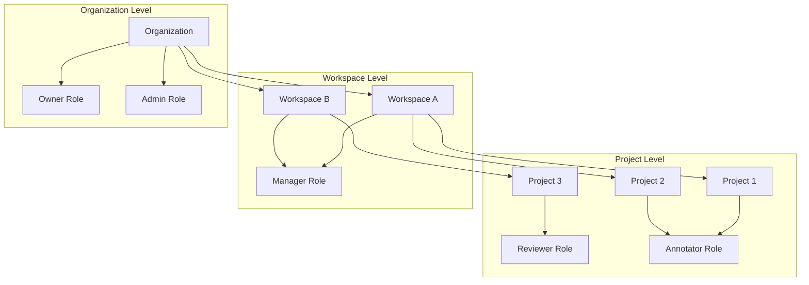

本页概述了仅在 [Label Studio Enterprise](https://humansignal.com/pricing/) 中提供的进阶功能。这些功能通过企业规模的用户管理、安全性、质量保证和自动化扩展了 Label Studio 的核心功能。

## 组织与工区

Label Studio Enterprise 引入了通过组织和工区来组织项目和用户的层次结构，这在社区版中不可用。

### 组织

组织是 Label Studio Enterprise 中的顶级实体，包含工区、项目和用户。每个组织与其他组织隔离，提供完全的数据分离。

组织的关键能力：

  - 组织级别的用户管理
  - 隔离的数据和资源
  - 集中的计费和使用跟踪
  - 自定义品牌选项

### 工区

工区提供了一种在组织内对相关项目进行分组的方式。它们按部门、团队或用例来构建项目。

工区的关键能力：

  - 将相关项目分组在一起
  - 委派管理职责
  - 在工区级别控制访问
  - 在同一工区的项目之间共享资源

## 多租户 SaaS 架构

组织提供不同 Label Studio Enterprise SaaS 客户之间的完全隔离，确保数据隔离和独立的用户管理。组织内的工区按团队、部门或产品线对相关项目进行分组。Label Studio Enterprise 也可以本地部署（请参阅[企业部署选项](#企业部署选项)）。 

## 用户管理和基于角色的访问控制

### 角色层级和权限

Label Studio Enterprise 实现了一个全面的基于角色的访问控制（RBAC）系统，具有五个不同的角色，每个角色提供特定的能力和访问级别。有关如何将用户分配到角色的信息，请参阅[管理用户账户。](https://docs.humansignal.com/guide/admin_manage_lse.html)

| 角色      | 组织访问 | 主要能力                       | 项目管理 | 标注 | 审阅 | 用户管理 |
| :-------- | :------------------ | :----------------------------------------- | :----------------- | :--------- | :----- | :-------------- |
| 所有者     | 完全控制        | 完全系统访问，计费管理     | 所有项目       | ✅          | ✅      | 完全            |
| 管理员     | 组织范围   | 用户管理，所有组织设置 | 所有项目       | ✅          | ✅      | 受限         |
| 经理   | 工区范围    | 项目创建，工区管理     | 已分配的项目  | ✅          | ✅      | 项目级别   |
| 审阅者  | 项目范围      | 审阅标注，管理质量控制 | 仅查看          | ✅          | ✅      | 无            |
| 标注者 | 项目范围      | 创建和编辑标注                | 仅查看          | ✅          | ❌      | 无            |

### 项目级别角色

项目角色独立于组织角色进行分配。例如，一个用户可以在一个项目中是标注者，在另一个项目中是审阅者，从而实现灵活的权限管理：

  - **标注者：** 可以查看项目和分配的任务，并可以创建标注
  - **审阅者：** 可以审阅标注，接受或拒绝它们，并提供反馈

### 用户生命周期管理

企业功能包含全面的用户账户管理能力：

  - **基于邀请的注册：** 通过邀请链接控制用户入门
  - **批量用户操作：** 批量分配角色和更新工区成员资格
  - **用户活动监控：** 跟踪标注活动和系统使用
  - **账户停用：** 在移除访问权限的同时保留标注历史

## 身份验证和身份管理

Label Studio Enterprise 为大规模部署提供全面的身份管理能力，支持与现有企业身份提供商集成。

### SSO 和 SAML 集成

企业版支持通过 SAML 2.0 断言进行单点登录，允许与 Okta、Google SAML、Ping Identity、Microsoft Active Directory 以及其他与 SAML 兼容的系统集成。有关设置说明，请参阅[身份验证和 SSO 配置指南](https://docs.humansignal.com/guide/auth_setup)。

### SCIM 2.0 配置

跨域身份管理系统（SCIM）2.0 支持从身份提供商自动进行用户的配置和取消配置。

SCIM 集成支持：

  - **创建用户：** 通过角色分配自动配置用户
  - **更新用户属性：** 同步配置文件更改和角色修改
  - **停用用户：** 在保留标注历史的同时移除访问权限
  - **推送组：** 工区和项目成员资格管理

有关设置说明，请参阅 [SCIM 2.0 集成指南](https://docs.humansignal.com/guide/scim_setup)。

### LDAP 集成

企业客户可以与 LDAP 目录集成进行用户身份验证，同时保持本地角色管理。

## 高级安全功能

### 企业安全架构

Label Studio Enterprise 包含为企业的合规性要求设计的全面安全功能。企业安全功能包括：

- 通过 TLS 的 Redis，使用客户端证书身份验证
- 用于云存储的 IP 允许列表和 VPN 访问控制  
 （OSS 仅支持针对 GCP 的有限 IP 过滤）
- 高级审计日志
- SCIM 2.0 用户配置和取消配置
- 基于 SAML 的单点登录（SSO）集成
- 跨组织和工区的基于角色的访问控制
- 精细的任务和标注者护栏（例如自动暂停用户、设置信任阈值）
- 具有组织级别隔离的自定义插件和前端自定义
- 对完全气隙、本地环境的部署支持
- 正常运行时间 SLA 和安全认证（例如 SOC 2、HIPAA 就绪）

### 数据安全

  - **端到端 TLS/SSL：** 所有组件之间的安全通信
  - **审计日志：** 所有用户活动的全面日志

### 高级云存储选项 

Label Studio Enterprise 支持更广泛的持久化存储选项，用于可扩展的、生产级的部署。这些包括：

* **AWS S3 IAM 角色访问**：使用 IAM 角色或静态凭据配置安全访问
* **带有 Workload Identity Federation（WIF）的 Google Cloud Storage**：使用短期凭据避免硬编码密钥

## 高级标注和评估工作流

### AI 功能和模型集成

Label Studio Enterprise 提供增强的机器学习能力：

  - **AI 功能开关：** 启用 AI 辅助工具
  - **预测分数显示：** 在标注界面中查看预测/置信度分数
  - **批量标注：** 快速一次性标注多个任务

### 自动化主动学习循环

Label Studio Enterprise 支持主动学习工作流，随着标注的进行自动更新模型预测。

每次标注后，Label Studio 可以向连接的机器学习后端发送 webhook。后端使用新数据重新训练模型 `(fit())`，Label Studio 为下一个任务获取更新的预测 `(predict())`，从而创建一个持续的反馈循环。

关键组件：

  - **ML 后端设置：** 注册一个模型以接收训练数据并返回预测
  - **预测集成：** 在标注期间显示更新的预测
  - **Webhooks：** 在标注后触发模型重新训练
  - **任务采样：** 使用预测分数来确定要标注哪些任务的优先级
  - **持续循环：** 随着标注继续进行，预测在每次迭代中都会改进

### Prompts

需额外付费，Label Studio Enterprise 包含一个内置的 Prompts 界面，用于在标注工作流中使用语言模型。

Prompt 模板允许用户定义要发送到连接的 LLM 的输入、模型和输出。Prompts 可用于预标注数据、生成新任务或支持审阅工作流。

Prompts 界面支持：

  - **Prompt 模板：** 定义输入、输出和模型参数
  - **内联生成：** 直接从标注界面运行 prompts
  - **模型连接：** 通过 API 连接到 OpenAI、Anthropic 或自定义端点
  - **预标注：** 使用模型生成的响应填充字段
  - **任务创建：** 从 prompt 输出生成新任务

有关更多信息，请参阅 [Prompts 概述](https://docs.humansignal.com/guide/prompts_overview/)。

### 使用插件进行自定义

Label Studio Enterprise 支持自定义 JavaScript 插件，以根据项目特定需求扩展和定制标注界面。

插件在用户与标注任务交互时自动运行。它们可用于验证标注、添加视觉元素、调用外部服务，或基于标注 UI 中的事件应用自定义逻辑。

插件框架支持：

  - **项目特定脚本：** 在每个项目的基础上定义自定义插件
  - **事件驱动行为：** 在任务加载、标注切换和其他操作时触发逻辑
  - **UI 扩展：** 添加验证、覆盖层或上下文感知功能
  - **外部集成：** 实时连接到 API 或获取参考数据
  - **测试和预览：** 使用内置面板在部署前测试插件

要了解组织如何在真实工作流中使用插件，请参阅博客文章[使用插件构建强大的标注界面](https://humansignal.com/blog/build-powerful-labeling-interfaces-with-plugins/)。

## 质量工作流和分析

Label Studio Enterprise 通过为质量控制和团队协作以及优化标注和数据集质量的分析功能来增强标注工作流。

### 质量控制功能

  - **自动验证**
  - **审阅工作流：** 为标注配置审阅流程
  - **标注者之间的一致性：** 测量标注者之间的一致性以确保质量
  - **标注者绩效仪表板：** 跟踪和分析标注者质量以识别表现不佳者，实施培训和纠正措施
  - **项目绩效仪表板：** 查看标签分布以确保完整性
  - **低信任标注者的护栏：** 设置限制或暂停标注者以防止

### 标注者之间的一致性指标和矩阵

查看实时一致性指标，以对质量采取主动行动。企业版包含 30 多个针对不同的标注类型的内置一致性指标，包括：

* **基本匹配：** 每种控制标签类型的默认评估
* **交并比（IoU）：** 用于边界框和多边形
* **编辑距离算法：** 用于文本转录任务
* **F1、精确率、召回率：** 用于分类和检测任务

要了解不同的团队结构如何使用一致性指标来扩展高质量标注，请参阅博客文章[用于可扩展标注的 3 个标注团队手册](https://labelstud.io/blog/the-spectrum-of-annotators-how-to-match-your-labeling-workflow-to-your-team/)。

### 低信任标注者护栏

  * **标注者暂停：** 基于性能标准的手动和自动暂停
  * **标注限制：** 配置每用户最大标注数以防止垃圾信息
 
### 项目绩效仪表板

[项目仪表板](https://docs.humansignal.com/guide/dashboards) 提供了项目状态随时间的宏观视图，包括已完成的任务、已提交的标注、已执行的审阅、标签分布和 lead time 等指标。用户可以按日期范围筛选并重新排序可视化以专注于关键指标。

### 标注者绩效仪表板

组织所有者和管理员可以查看个人的[标注者仪表板](https://docs.humansignal.com/guide/dashboard_annotator)，以分析任务计数、平均标注时间、审阅周转和绩效评分。这些仪表板有助于管理资源、识别表现最佳者，并在不构建自定义分析工具的情况下跟踪质量。

 

## 项目管理

Label Studio Enterprise 包含高级项目配置选项，以支持跨团队和工区的复杂工作流。

### 仅限企业的项目设置

| 设置类别       | 选项                                                                                                                                                                                        | 开源 | 企业 |
| :--------------------- | :-------------------------------------------------------------------------------------------------------------------------------------------------------------------------------------------- | :---------- | :--------- |
| **常规**            | **项目名称、描述、颜色**                                                                                                                                                          | ✅           | ✅          |
|                        | **工区**                                                                                                                                                                                 | ❌           | ✅          |
|                        | **代理凭据**                                                                                                                                                                         | ❌           | ✅          |
| **标注界面** | **标注配置（XML 标签）**                                                                                                                                                         | ✅           | ✅          |
| **标注**         | **标注说明（“标注前显示”）**                                                                                                                                            | ✅           | ✅          |
|                        | **分发标注任务（自动 vs. 手动）**                                                                                                                                               | ❌           | ✅          |
|                        | **任务保留**                                                                                                                                                                          | ❌           | ✅          |
|                        | **跳过队列行为（重新排队、忽略等）**                                                                                                                                                   | ❌           | ✅          |
|                        | **标注选项**  • **显示跳过按钮**  • **允许空标注**  • **交互式显示预标注**  • **要求跳过评论** • **向标注者显示数据管理器** | ❌           | ✅          |
| **实时预测**   | **通过连接的 ML 后端或 Prompts 预标注任务**                                                                                                                                       | ✅           | ✅          |
| **任务采样**      | **顺序、均匀、不确定性采样**                                                                                                                                                 | ❌           | ✅          |
| **审阅**             | **审阅流设置：**  • **说明**  • **审阅选项**  • **拒绝选项**  • **审阅者的数据管理器**  • **一致性列可见性**                          | ❌           | ✅          |
| **质量**            | **标注重叠**                                                                                                                                                                    | ❌           | ✅          |
|                        | **标注限制（每用户上限）**                                                                                                                                                          | ❌           | ✅          |
|                        | **标注者评估（真值或接受分数和自动暂停）**                                                                                                                      | ❌           | ✅          |
|                        | **任务一致性（指标、低一致性策略）**                                                                                                                                           | ❌           | ✅          |
|                        | **自定义标签权重**                                                                                                                                                                      | ❌           | ✅          |
| **成员**            | **项目级别角色（每个项目的标注者/审阅者）**                                                                                                                                      | ❌           | ✅          |
|                        | **管理成员（添加/删除用户，分配项目角色）**                                                                                                                                   | ❌           | ✅          |
| **模型**              | **连接 ML 后端（提交时拟合，交互式预标注）**                                                                                                                          | ✅           | ✅          |
| **预测**        | **查看/导入预标注**                                                                                                                                                               | ✅           | ✅          |
| **云存储**      | **源/目标连接器（S3、GCS、Azure、本地）**                                                                                                                                          | ✅           | ✅          |
| **Webhooks**           | **配置任务/标注 webhooks**                                                                                                                                                         | ✅           | ✅          |
| **危险区域**        | **删除项目、删除所有标签**                                                                                                                                                             | ✅           | ✅          |
|                        | **重置缓存**                                                                                                                                                                               | ❌           | ✅          |

有关详细信息，请查看[企业项目设置](https://docs.humansignal.com/guide/project_settings_lse)。

## 标注工作流功能

### 批量标注

Label Studio Enterprise 使将相同的标注一次性应用于多个任务变得容易，非常适合快速标注筛选的子集或一致的重复数据。

关键功能：

* **支持所有主要数据类型：** 适用于图像、文本、音频和视频

* **在数据管理器中选择任务：** 通过列表或网格视图选择多个任务，然后应用批量标注

* **基于角色的访问：** 对具有审阅者、经理、管理员或所有者角色的用户可用（标注者可以通过插件参与）

* **支持的控制标签：** Choices、DateTime、Number、Rating、Taxonomy、TextArea

### 自动分发

Label Studio Enterprise 支持自动任务分配工作流——帮助团队无需手动设置即可开始标注。

当你在标注设置下启用 **自动分发** 时，将应用以下项目行为：

* **即时任务访问：** 项目一发布，标注者就可以开始标注
* **可配置的任务重叠：** 使用“每个任务最小标注数”来定义必须有多少个标注者标注每个任务
* **任务保留（锁定超时）：** 定义任务在再次可用之前为标注者锁定的时长
* **跳过队列行为：** 选择跳过的任务是否应重新排队给其他人、忽略或直到可重新分配才跳过

这些设置简化了大型团队的标注，并通过自动路由任务和在处理跳过的任务时处理重试来支持主动学习工作流。

### 标注结果过滤

Label Studio Enterprise 通过数据管理器中的灵活筛选和排序选项增强了任务审阅和管理。

关键能力：
* **字段级筛选：** 按标注结果、标签值、区域属性或审阅者操作筛选任务
* **任务排序：** 按创建日期、预测置信度或其他元数据对任务排序
* **组合筛选：** 一次应用多个筛选器以缩小用于审阅、QA 或定向标注的结果

## 协作功能

Label Studio Enterprise 支持丰富的协作功能，以增强沟通、审阅工作流和跨团队的绩效可见性。

### 评论和通知

标注者和审阅者可以留下链接到标注中特定区域或字段的线程评论，从而实现上下文反馈和澄清。所有协作者都可以查看和添加评论，并根据其角色拥有解决或删除的权限。通知会在有新评论时通知用户，无论是作为标注的第一条评论还是对正在进行的讨论的回复

### 深度链接

用户可以生成指向特定标注、区域或字段的直接链接，允许审阅者或队友直接跳转到需要关注的确切位置。这提高了沟通效率和审阅精度。

## 企业部署选项

Label Studio Enterprise 可以本地部署用于气隙环境。它支持为 High Availability 和可扩展性设计的灵活部署选项。

### Kubernetes 部署

Label Studio Enterprise 可以部署在具有高级配置选项的 Kubernetes 集群上：

### Docker Compose 部署

对于更简单的企业部署，Label Studio Enterprise 支持带有外部 PostgreSQL 和 Redis 依赖项的 Docker Compose。关键配置元素：

  * **镜像仓库：** `humansignal/label-studio-enterprise`
  * **许可证集成：** 卷挂载的许可证文件
  * **环境变量：** 数据库连接、Redis 配置、存储设置
  * **工作队列：** 用于不同优先级级别的单独容器

### 高可用性配置

企业部署支持高可用性配置：

  * 多个应用副本以实现容错
  * 针对不同队列的可配置 RQ worker 副本
  * 用于优化性能的资源配置
  * 带有 TLS 支持和高可用性选项的 PostgreSQL 和 Redis

## 性能和可扩展性功能

  * 存储代理
  * 优化的数据库查询：改进大型项目的性能
  * 横向扩展架构：在多个 Pod 之间分配工作负载
  * 用于后台任务的 Redis：处理异步操作的高效队列系统

## 白标

需额外付费，企业客户可以自定义其 Label Studio 实例的外观：

  * **自定义品牌：** 自定义 logo、颜色和样式
  * **自定义域：** 为 Label Studio 实例使用你自己的域
  * **登录页面重定向：** 使用 LOGIN\_PAGE\_URL 变量配置自定义登录页面重定向

## 企业支持与专业服务

企业客户可获得：

  * 99.9% 正常运行时间 SLA：生产可靠性保证
  * 高级技术支持与 SLA：优先技术支持访问
  * 客户成功经理：专属账户管理
  * 专业服务：实施和优化协助
  * 标注服务：按需专家标注服务，增强核心团队，完全集成到平台中，具有完全的可见性和治理

请参阅 Label Studio Enterprise 如何在你的组织中运作，并[联系销售](https://humansignal.com/contact-sales/)。 
