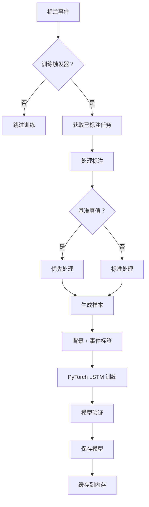
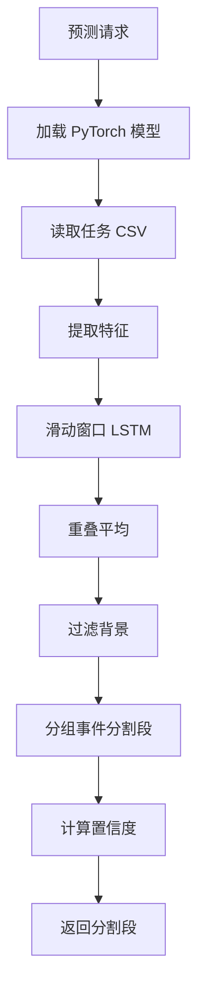

# Label Studio 的时间序列分割器

此示例演示了一个执行时间序列分割的最小 ML 后端。它在已标注的 CSV 数据上训练一个小型 LSTM 神经网络，并为新任务预测分割段。后端期望标注配置使用 `<TimeSeries>` 和 `<TimeSeriesLabels>` 标签。

<video src="https://github.com/user-attachments/assets/9f6a7ebb-bf3e-42d5-bde9-087719494f2d" controls="controls" style="max-width: 800px;" class="gif-border" />

## 开始之前

1. 安装 [Label Studio ML 后端](https://github.com/HumanSignal/label-studio-ml-backend?tab=readme-ov-file#quickstart)。
2. 在 `docker-compose.yml` 中设置 `LABEL_STUDIO_HOST` 和 `LABEL_STUDIO_API_KEY`，以便后端可以下载已标注的任务用于训练。

## 快速开始

```bash
# 构建并运行
docker-compose up --build
```

`tests/time_series.csv` 中提供了一个小的示例 CSV。

从项目设置中的 **模型（Model）** 页面连接模型。默认 URL 为 `http://localhost:9090`。

## 标注配置

使用类似于以下的配置：

```xml
<View>
  <TimeSeriesLabels name="label" toName="ts">
    <Label value="Run"/>
    <Label value="Walk"/>
  </TimeSeriesLabels>
  <TimeSeries name="ts" valueType="url" value="$csv_url">
    <Channel column="value" />
  </TimeSeries>
</View>
```

后端读取时间列和通道以构建特征向量。`csv_url` 引用的每个 CSV 必须包含时间列和通道列。

你可以使用 [以下数据](https://raw.githubusercontent.com/HumanSignal/label-studio-ml-backend/refs/heads/master/label_studio_ml/examples/timeseries_segmenter/tests/test_from_video_tutorial.csv) 配合此标注配置进行测试。

## 标注类型

后端支持两种类型的时间序列分割：

**区间标注（Range Annotations）**
- **用例**：具有持续时间的事件（例如，"从 10 秒到 30 秒跑步"）
- **创建方式**：在时间序列上拖动以选择一个时间范围
- **行为**：`start` ≠ `end`，`instant` = `false`

**瞬间标注（Instant Annotations）**
- **用例**：时间点事件或时刻（例如，"在 15 秒检测到跌倒"）
- **创建方式**：在时间序列的特定点上双击
- **行为**：`start` = `end`，`instant` = `true`

**注意**：瞬间标签通常会创建高度不平衡的数据集，因为它们代表长时间序列中的短暂时刻。模型的 **平衡学习方法（balanced learning approach）** 专门设计用于有效地处理这一挑战。

## 训练

训练在创建或更新标注时自动开始。该模型使用基于 PyTorch 的 LSTM 神经网络，具有适当的时间建模和 **平衡学习（balanced learning）**，以有效处理不平衡的时间序列数据。

### 训练过程

模型在训练期间执行以下步骤：

1. **数据收集**：从你的 Label Studio 项目中获取所有已标注的任务
2. **样本生成**：将已标注的时间范围转换为训练样本：
   - **背景类**：未标注的时间段被视为 "背景"（类 0）
   - **事件类**：你已标注的分割段（例如 "Run"、"Walk"）成为类 1、2 等
   - **基准真值优先级**：如果某个任务存在多个标注，基准真值标注优先
3. **平衡模型训练**：拟合一个多层 LSTM 网络，具有：
   - **类加权损失函数** 以处理不平衡数据（对瞬间标签很重要）
   - **平衡准确率监控** 而不是常规准确率
   - **每类 F1 分数跟踪** 以确保所有类都得到正确学习
   - 可配置的序列窗口（默认：50 个时间步）
   - 用于更好泛化的丢弃（Dropout）正则化
   - 用于真实时间序列建模的背景类支持
4. **模型持久化**：将训练好的模型工件保存到 `MODEL_DIR`

### 训练配置

你可以使用以下环境变量自定义训练行为：

**基本配置：**
- `START_TRAINING_EACH_N_UPDATES`：重新训练的频率（默认：1，每次标注都训练）
- `TRAIN_EPOCHS`：训练轮数（默认：1000）
- `SEQUENCE_SIZE`：时间上下文的滑动窗口大小（默认：50）
- `HIDDEN_SIZE`：LSTM 隐藏层大小（默认：64）

**平衡学习（用于不平衡数据）：**
- `BALANCED_ACCURACY_THRESHOLD`：当平衡准确率超过此值时停止训练（默认：0.85）
- `MIN_CLASS_F1_THRESHOLD`：当最小每类 F1 超过此值时停止训练（默认：0.70）
- `USE_CLASS_WEIGHTS`：启用类加权损失函数（默认：true）

平衡学习方法 **在使用瞬间标签时尤其重要**（通过双击时间序列创建），因为这些通常会创建高度不平衡的数据集，其中背景时间段远远多于事件实例。

### 处理不平衡数据

时间序列数据通常高度不平衡，尤其是在使用瞬间标签时：

**问题：**
- 背景时间段通常占数据的 90% 以上
- 事件实例（跑步、步行等）稀少且短暂
- 标准训练方法通过简单地在任何地方预测 "背景" 来实现高准确率
- 模型无法学习实际的事件模式

**我们的解决方案：**
```
类权重：自动计算的逆频率权重
├── 背景（类 0）：低权重（例如 0.1x）
├── 跑步（类 1）：高权重（例如 5.0x） 
└── 步行（类 2）：高权重（例如 4.0x）

提前停止：双重标准防止过早停止
├── 平衡准确率 ≥ 85%（跨类的宏平均）
└── 最小每类 F1 ≥ 70%（表现最差的类必须达到可接受的水平）

指标：关注每类性能
├── 平衡准确率：对每个类给予相等的权重
├── 宏 F1：跨所有类的平均 F1  
└── 每类 F1：单个类的性能跟踪
```

这确保了模型学习检测实际事件，而不仅仅是预测背景。

### 基准真值处理

当同一任务存在多个标注时，模型优先处理基准真值标注：
- 首先处理非基准真值标注
- 基准真值标注会覆盖先前的标签，并停止处理该任务
- 这确保了用于训练的是最高质量的标签

## 预测

模型通过应用训练好的 LSTM 分类器（具有滑动窗口时间上下文）来处理新的时间序列数据。只将有意义的时间段返回给 Label Studio，自动过滤掉背景时间段。

### 预测过程

对于每个任务，模型执行以下步骤：

1. **模型加载**：从磁盘加载训练好的 PyTorch 模型
2. **数据处理**：读取任务 CSV 并从传感器通道创建特征向量
3. **时间预测**：应用带有滑动窗口的 LSTM 以实现时间上下文：
   - 使用 50% 重叠的重叠窗口以获得更平滑的预测
   - 对重叠窗口的预测进行平均
   - 保持时间步之间的时间依赖性
4. **分割段提取**：将连续的预测分组为有意义的分割段：
   - **背景过滤**：自动过滤掉背景（未标注）时间段
   - **事件分割**：只返回具有实际事件标签的分割段
   - **瞬间检测**：自动将 `instant=true` 设置为点事件（start=end，你可以使用双击标注的单样本事件），将 `instant=false` 设置为区间
   - **分数计算**：每个返回的分割段的平均预测置信度
5. **结果格式化**：以具有正确 instant 字段值的 Label Studio JSON 格式返回分割段

### 预测质量

模型提供几个质量指标：

- **每分割段置信度**：每个返回分割段的平均预测概率
- **时间一致性**：滑动窗口方法减少了预测噪声
- **背景抑制**：只返回模型对特定事件有信心的分割段

这种方法确保预测专注于实际事件，而不是在每个时间步上强制贴标签。

## 项目特定的模型

后端通过为每个项目维护单独的训练模型来自动处理多个 Label Studio 项目。这确保了适当的隔离并防止跨项目干扰。

### 项目隔离如何工作

**模型存储：**
- 每个项目都有自己的模型文件：`model_project_{project_id}.pt`
- 示例：项目 47 → `model_project_47.pt`，项目 123 → `model_project_123.pt`
- 向后兼容的默认回退：`model_project_0.pt`

**模型训练：**
- 训练事件自动识别源项目 ID
- 模型以项目特定的名称进行训练和保存
- 每个项目的模型只从该项目自己的标注中学习

**模型预测：**
- 后端自动检测应使用哪个项目的模型
- 项目 ID 从任务上下文或预测请求中提取
- 如果没有可用的项目信息，则回退到默认模型（project_id=0）

### 多租户的好处

此架构提供了几个关键优势：

**数据隔离：**
- 项目 A 的敏感医疗数据永远不会训练项目 B 的金融模型
- 每个项目可以具有完全不同的标注配置
- 模型不会意外地从其他项目预测错误的标签类型

**性能独立性：**
- 在一个项目上的训练不会影响其他项目的预测质量
- 每个项目的模型专门针对该项目的数据特征进行优化
- 一个项目中的不良标注不会降低其他项目的模型

**可扩展性：**
- 后端可以同时满足多个 Label Studio 项目
- 内存管理缓存频繁使用的模型
- 不活跃的项目模型按需加载

### 配置

不需要额外的配置 —— 项目隔离自动工作。后端从以下方面确定项目上下文：

1. **训练**：来自标注 webhook 事件的项目 ID
2. **预测**：来自任务上下文或请求元数据的项目 ID
3. **回退**：对于向后兼容，使用默认 project_id=0

这种无缝的多租户支持使后端适合多个团队或客户需要隔离 ML 模型的企业 Label Studio 部署。

## 它的工作原理

### 训练流水线



### 预测流水线



### 关键技术特性

- **基于 PyTorch 的 LSTM**：具有更好性能和灵活性的现代深度学习框架
- **时间建模**：滑动窗口捕获时间依赖性（默认 50 个时间步）
- **背景类**：未标注时间段为显式背景的真实建模
- **平衡学习**：用于不平衡数据的类加权损失函数和平衡指标
- **瞬间标签支持**：正确处理点事件（`instant=true`）与持续时间事件（`instant=false`）
- **智能提前停止**：双重标准（平衡准确率 + 最小每类 F1）防止过早停止
- **基准真值优先级**：确保用于训练的是最高质量的标注
- **重叠平均**：通过重叠窗口共识获得更平滑的预测
- **项目特定的模型**：每个 Label Studio 项目都获得自己训练的模型，以实现适当的多租户隔离

## 自定义

编辑 `docker-compose.yml` 以为你的特定用例设置环境变量：

### 基本配置
```yaml
environment:
  - LABEL_STUDIO_HOST=http://localhost:8080
  - LABEL_STUDIO_API_KEY=your_api_key_here
  - MODEL_DIR=/app/models
  - START_TRAINING_EACH_N_UPDATES=1
  - TRAIN_EPOCHS=1000
  - SEQUENCE_SIZE=50
  - HIDDEN_SIZE=64
```

### 平衡学习（推荐用于瞬间标签）
```yaml
environment:
  # ... 上面的基本配置 ...
  - BALANCED_ACCURACY_THRESHOLD=0.85
  - MIN_CLASS_F1_THRESHOLD=0.70  
  - USE_CLASS_WEIGHTS=true
```

### 常见场景

**对于瞬间标签（点事件）：**
- 保持平衡学习启用（`USE_CLASS_WEIGHTS=true`）
- 对于非常稀有的事件，考虑更低的阈值（`MIN_CLASS_F1_THRESHOLD=0.60`）
- 增加轮数（`TRAIN_EPOCHS=2000`）以更好地学习少数类

**对于具有平衡数据的区间标注：**
- 如果类大致相等，可以禁用类权重（`USE_CLASS_WEIGHTS=false`）
- 使用标准准确率阈值

**对于短时间序列：**
- 减少序列大小（`SEQUENCE_SIZE=20`）以处理少于 50 个时间步的序列
- 减少隐藏大小（`HIDDEN_SIZE=32`）以防止过拟合
