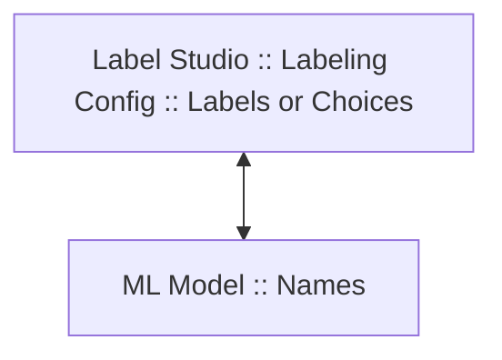

# 用于 Label Studio 的 YOLO ML 后端

用于 Label Studio 的 YOLO ML 后端，旨在将先进的目标检测、分割、分类和视频目标跟踪能力直接集成到 Label Studio 中。

该集成让你能够利用强大的 YOLOv8 模型完成各种机器学习任务，从而更轻松地对大型数据集进行标注并保证高质量的预测。

<iframe width="560" height="315" src="https://www.youtube.com/embed/UyaecID1iG8?si=UQQW3mpqu2uDtt7i" title="YouTube video player" frameborder="0" allow="accelerometer; autoplay; clipboard-write; encrypted-media; gyroscope; picture-in-picture; web-share" referrerpolicy="strict-origin-when-cross-origin" allowfullscreen></iframe>

**支持的功能**

| YOLO 任务名称                                               | LS 控制标签                           | 是否支持预测 | LS 导入支持 | LS 导出支持 |
|--------------------------------------------------------------|--------------------------------------|--------------|-------------|-------------|
| 目标检测（Object Detection）                                 | `<RectangleLabels>`                  | ✅            | YOLO, COCO  | YOLO, COCO  |
| 有向边界框（OBB）                                            | `<RectangleLabels model_obb="true">` | ✅            | YOLO        | YOLO        |
| 图像实例分割：多边形（Polygons）                              | `<PolygonLabels>`                    | ✅            | COCO        | YOLO, COCO  |
| 图像语义分割：掩码（Masks）                                  | `<BrushLabels>`                      | ❌            | Native      | Native      |
| 图像分类（Image Classification）                             | `<Choices>`                          | ✅            | Native      | Native      |
| 姿态检测（Pose Detection）                                   | `<KeyPoints>`                        | ✅            | Native      | Native      |
| 视频目标跟踪（Video Object Tracking）                        | `<VideoRectangle>`                   | ✅            | Native      | Native      |
| [视频时序分类](https://github.com/HumanSignal/label-studio-ml-backend/blob/master/label_studio_ml/examples/yolo/README_TIMELINE_LABELS.md) | `<TimelineLabels>`                   | ✅            | Native      | Native      |


* **LS 控制标签（LS Control Tag）**：标注配置中来自 Label Studio 的[控制标签](https://labelstud.io/tags/)。
* **LS 导入支持（LS Import Supported）**：指示 Label Studio 是否支持从 YOLO 格式导入到 Label Studio（使用 LS 转换器）。
* **LS 导出支持（LS Export Supported）**：指示 Label Studio 是否支持从 Label Studio 导出为 YOLO 格式（数据管理器上的 **Export（导出）** 按钮以及使用 LS 转换器）。
* **Native（原生）**：原生表示仅支持 Label Studio 原生的 JSON 格式。


## 准备工作

开始之前，你需要安装 [Label Studio ML 后端](https://github.com/HumanSignal/label-studio-ml-backend?tab=readme-ov-file#quickstart)。

本教程使用 [YOLO 示例](https://github.com/HumanSignal/label-studio-ml-backend/tree/master/label_studio_ml/examples/yolo)。

## 快速开始

1. 将 `LABEL_STUDIO_URL` 和 `LABEL_STUDIO_API_KEY` 添加到 `docker-compose.yml` 文件中。
   这些变量应分别指向你的 Label Studio 实例及其 API 密钥。
   关于如何找到你的 Label Studio API 密钥的更多信息，[请参阅我们的文档](https://labelstud.io/guide/user_account#Access-token)。

2. 运行 docker compose

    ```bash
    docker-compose up --build
    ```

3. 打开 Label Studio 并使用以下标注配置创建一个新项目：

    ```xml
    <View>
      <Image name="image" value="$image"/>
      <RectangleLabels name="label" toName="image" model_score_threshold="0.25">
        <Label value="Car" background="blue" predicted_values="jeep,cab,limousine,truck"/>
      </RectangleLabels>
    </View>
    ```

4. 然后从项目设置的 **Model（模型）** 页面[连接模型](https://labelstud.io/guide/ml#Connect-the-model-to-Label-Studio)。默认 URL 为 `http://localhost:9090`。

5. 向 Label Studio 添加图像或视频（取决于你要解决的任务）。

6. 在数据管理器中打开任意任务，即可看到来自 YOLO 模型的预测结果。

## 标注配置

### 支持的对象标签与控制标签

**对象标签（Object tags）**

- `<Image>` - [待标注的图像](https://labelstud.io/tags/image)
- `<Video>` - [待标注的视频](https://labelstud.io/tags/video)

**控制标签（Control tags）**

- `<Choices>` - [分类](https://labelstud.io/tags/choices)；图像分类任务
- `<RectangleLabels>` - [边界框](https://labelstud.io/tags/rectanglelabels)；目标检测任务
- `<PolygonLabels>` - [多边形](https://labelstud.io/tags/polygonlables)；分割任务
- `<VideoRectangle>` - [视频边界框](https://labelstud.io/tags/videorectangle)；视频目标跟踪任务
- `<KeyPointLabels>` - [关键点](https://labelstud.io/tags/keypointlabels)；姿态检测任务
- `<TimelineLabels>` - [视频时序标签](https://labelstud.io/tags/timelinelabels)；视频多标签时序分类任务


**如何跳过某个控制标签？**

如果你不想对某个控制标签使用 ML 后端，可以通过为该控制标签添加 `model_skip="true"` 属性来强制跳过：

```xml
<Choices name="choice" toName="image" model_skip="true">
```

### 混合对象标签与控制标签

你可以在一个项目中混合使用不同的对象标签和控制标签。YOLO 模型将检测所有已知的控制标签并为它们生成预测。例如：

```xml
<View>
  <Image name="image1" value="$image"/>
  <RectangleLabels name="label" toName="image1" model_score_threshold="0.1">
    <Label value="person" background="red"/>
    <Label value="car" background="blue"/>
  </RectangleLabels>
  
  <Image name="image2" value="$image"/>
  <Choices name="choice" toName="image2" model_score_threshold="0.1">
    <Choice value="airship"/>
    <Choice value="passenger_car"/>
  </Choices>
</View>
```

在此示例中，`RectangleLabels` 和 `Choices` 都会被 YOLO 模型检测并预测。

你也可以使用不同的 YOLO 模型处理同一任务，以便直观地对比它们：

```xml
<View>
  <Image name="image1" value="$image"/>
  <RectangleLabels name="label1" toName="image1" model_path="yolov8n.pt" model_score_threshold="0.1">
    <Label value="car" background="blue"/>
  </RectangleLabels>
  <RectangleLabels name="label2" toName="image1" model_path="yolov8m.pt" model_score_threshold="0.1">
    <Label value="car" background="red"/>
  </RectangleLabels>
</View>
```


### 标签与选择项映射



如果你使用通用的 YOLO 模型，则必须在你的标签与 ML 模型标签之间添加映射。默认情况下，YOLO ML 后端将使用你在 `value` 属性中指定的相同（或小写）名称。

在此示例中，标签 "Jeep" 将被映射到 ML 模型中的 "jeep"：

```xml
<Choice value="Jeep"/> 
```

为了更精确地控制，你可以使用 `predicted_values` 属性来指定来自 ML 模型的多个不同标签：

```xml
<Choice value="Car" predicted_values="jeep,cab,limousine"/>
```

<details>
<summary>提示：如何找到所有 YOLO 模型名称？</summary>
<br/>
当你以 INFO 日志级别开始使用 ML 后端时，标签会打印在 ML 模型日志中。

或者，你可以在 [YOLO_CLASSES.md](https://github.com/HumanSignal/label-studio-ml-backend/blob/master/label_studio_ml/examples/yolo/YOLO_CLASSES.md) 中找到一些标签。
</details>

<details>
<summary>提示：如何使用 LLM 将我的标签映射到 YOLO 名称？</summary>
<br/>
你可以使用一个 LLM 模型（例如 ChatGPT）来自动构建 Label Studio 标签与 ML 模型标签之间的映射。下面是一个用于此目的的提示词示例。它包含了来自 YOLOv8 分类模型（`yolov8n-cls`）的 1000 个标签。

```
**Task:**

1. **ML Model Labels:**
   - I have the following labels in my ML model:
['tench', 'goldfish', 'great_white_shark', 'tiger_shark', 'hammerhead', 'electric_ray', 'stingray', 'cock', 'hen', 'ostrich', 'brambling', 'goldfinch', 'house_finch', 'junco', 'indigo_bunting', 'robin', 'bulbul', 'jay', 'magpie', 'chickadee', 'water_ouzel', 'kite', 'bald_eagle', 'vulture', 'great_grey_owl', 'European_fire_salamander', 'common_newt', 'eft', 'spotted_salamander', 'axolotl', 'bullfrog', 'tree_frog', 'tailed_frog', 'loggerhead', 'leatherback_turtle', 'mud_turtle', 'terrapin', 'box_turtle', 'banded_gecko', 'common_iguana', 'American_chameleon', 'whiptail', 'agama', 'frilled_lizard', 'alligator_lizard', 'Gila_monster', 'green_lizard', 'African_chameleon', 'Komodo_dragon', 'African_crocodile', 'American_alligator', 'triceratops', 'thunder_snake', 'ringneck_snake', 'hognose_snake', 'green_snake', 'king_snake', 'garter_snake', 'water_snake', 'vine_snake', 'night_snake', 'boa_constrictor', 'rock_python', 'Indian_cobra', 'green_mamba', 'sea_snake', 'horned_viper', 'diamondback', 'sidewinder', 'trilobite', 'harvestman', 'scorpion', 'black_and_gold_garden_spider', 'barn_spider', 'garden_spider', 'black_widow', 'tarantula', 'wolf_spider', 'tick', 'centipede', 'black_grouse', 'ptarmigan', 'ruffed_grouse', 'prairie_chicken', 'peacock', 'quail', 'partridge', 'African_grey', 'macaw', 'sulphur-crested_cockatoo', 'lorikeet', 'coucal', 'bee_eater', 'hornbill', 'hummingbird', 'jacamar', 'toucan', 'drake', 'red-breasted_merganser', 'goose', 'black_swan', 'tusker', 'echidna', 'platypus', 'wallaby', 'koala', 'wombat', 'jellyfish', 'sea_anemone', 'brain_coral', 'flatworm', 'nematode', 'conch', 'snail', 'slug', 'sea_slug', 'chiton', 'chambered_nautilus', 'Dungeness_crab', 'rock_crab', 'fiddler_crab', 'king_crab', 'American_lobster', 'spiny_lobster', 'crayfish', 'hermit_crab', 'isopod', 'white_stork', 'black_stork', 'spoonbill', 'flamingo', 'little_blue_heron', 'American_egret', 'bittern', 'crane_(bird)', 'limpkin', 'European_gallinule', 'American_coot', 'bustard', 'ruddy_turnstone', 'red-backed_sandpiper', 'redshank', 'dowitcher', 'oystercatcher', 'pelican', 'king_penguin', 'albatross', 'grey_whale', 'killer_whale', 'dugong', 'sea_lion', 'Chihuahua', 'Japanese_spaniel', 'Maltese_dog', 'Pekinese', 'Shih-Tzu', 'Blenheim_spaniel', 'papillon', 'toy_terrier', 'Rhodesian_ridgeback', 'Afghan_hound', 'basset', 'beagle', 'bloodhound', 'bluetick', 'black-and-tan_coonhound', 'Walker_hound', 'English_foxhound', 'redbone', 'borzoi', 'Irish_wolfhound', 'Italian_greyhound', 'whippet', 'Ibizan_hound', 'Norwegian_elkhound', 'otterhound', 'Saluki', 'Scottish_deerhound', 'Weimaraner', 'Staffordshire_bullterrier', 'American_Staffordshire_terrier', 'Bedlington_terrier', 'Border_terrier', 'Kerry_blue_terrier', 'Irish_terrier', 'Norfolk_terrier', 'Norwich_terrier', 'Yorkshire_terrier', 'wire-haired_fox_terrier', 'Lakeland_terrier', 'Sealyham_terrier', 'Airedale', 'cairn', 'Australian_terrier', 'Dandie_Dinmont', 'Boston_bull', 'miniature_schnauzer', 'giant_schnauzer', 'standard_schnauzer', 'Scotch_terrier', 'Tibetan_terrier', 'silky_terrier', 'soft-coated_wheaten_terrier', 'West_Highland_white_terrier', 'Lhasa', 'flat-coated_retriever', 'curly-coated_retriever', 'golden_retriever', 'Labrador_retriever', 'Chesapeake_Bay_retriever', 'German_short-haired_pointer', 'vizsla', 'English_setter', 'Irish_setter', 'Gordon_setter', 'Brittany_spaniel', 'clumber', 'English_springer', 'Welsh_springer_spaniel', 'cocker_spaniel', 'Sussex_spaniel', 'Irish_water_spaniel', 'kuvasz', 'schipperke', 'groenendael', 'malinois', 'briard', 'kelpie', 'komondor', 'Old_English_sheepdog', 'Shetland_sheepdog', 'collie', 'Border_collie', 'Bouvier_des_Flandres', 'Rottweiler', 'German_shepherd', 'Doberman', 'miniature_pinscher', 'Greater_Swiss_Mountain_dog', 'Bernese_mountain_dog', 'Appenzeller', 'EntleBucher', 'boxer', 'bull_mastiff', 'Tibetan_mastiff', 'French_bulldog', 'Great_Dane', 'Saint_Bernard', 'Eskimo_dog', 'malamute', 'Siberian_husky', 'dalmatian', 'affenpinscher', 'basenji', 'pug', 'Leonberg', 'Newfoundland', 'Great_Pyrenees', 'Samoyed', 'Pomeranian', 'chow', 'keeshond', 'Brabancon_griffon', 'Pembroke', 'Cardigan', 'toy_poodle', 'miniature_poodle', 'standard_poodle', 'Mexican_hairless', 'timber_wolf', 'white_wolf', 'red_wolf', 'coyote', 'dingo', 'dhole', 'African_hunting_dog', 'hyena', 'red_fox', 'kit_fox', 'Arctic_fox', 'grey_fox', 'tabby', 'tiger_cat', 'Persian_cat', 'Siamese_cat', 'Egyptian_cat', 'cougar', 'lynx', 'leopard', 'snow_leopard', 'jaguar', 'lion', 'tiger', 'cheetah', 'brown_bear', 'American_black_bear', 'ice_bear', 'sloth_bear', 'mongoose', 'meerkat', 'tiger_beetle', 'ladybug', 'ground_beetle', 'long-horned_beetle', 'leaf_beetle', 'dung_beetle', 'rhinoceros_beetle', 'weevil', 'fly', 'bee', 'ant', 'grasshopper', 'cricket', 'walking_stick', 'cockroach', 'mantis', 'cicada', 'leafhopper', 'lacewing', 'dragonfly', 'damselfly', 'admiral', 'ringlet', 'monarch', 'cabbage_butterfly', 'sulphur_butterfly', 'lycaenid', 'starfish', 'sea_urchin', 'sea_cucumber', 'wood_rabbit', 'hare', 'Angora', 'hamster', 'porcupine', 'fox_squirrel', 'marmot', 'beaver', 'guinea_pig', 'sorrel', 'zebra', 'hog', 'wild_boar', 'warthog', 'hippopotamus', 'ox', 'water_buffalo', 'bison', 'ram', 'bighorn', 'ibex', 'hartebeest', 'impala', 'gazelle', 'Arabian_camel', 'llama', 'weasel', 'mink', 'polecat', 'black-footed_ferret', 'otter', 'skunk', 'badger', 'armadillo', 'three-toed_sloth', 'orangutan', 'gorilla', 'chimpanzee', 'gibbon', 'siamang', 'guenon', 'patas', 'baboon', 'macaque', 'langur', 'colobus', 'proboscis_monkey', 'marmoset', 'capuchin', 'howler_monkey', 'titi', 'spider_monkey', 'squirrel_monkey', 'Madagascar_cat', 'indri', 'Indian_elephant', 'African_elephant', 'lesser_panda', 'giant_panda', 'barracouta', 'eel', 'coho', 'rock_beauty', 'anemone_fish', 'sturgeon', 'gar', 'lionfish', 'puffer', 'abacus', 'abaya', 'academic_gown', 'accordion', 'acoustic_guitar', 'aircraft_carrier', 'airliner', 'airship', 'altar', 'ambulance', 'amphibian', 'analog_clock', 'apiary', 'apron', 'ashcan', 'assault_rifle', 'backpack', 'bakery', 'balance_beam', 'balloon', 'ballpoint', 'Band_Aid', 'banjo', 'bannister', 'barbell', 'barber_chair', 'barbershop', 'barn', 'barometer', 'barrel', 'barrow', 'baseball', 'basketball', 'bassinet', 'bassoon', 'bathing_cap', 'bath_towel', 'bathtub', 'beach_wagon', 'beacon', 'beaker', 'bearskin', 'beer_bottle', 'beer_glass', 'bell_cote', 'bib', 'bicycle-built-for-two', 'bikini', 'binder', 'binoculars', 'birdhouse', 'boathouse', 'bobsled', 'bolo_tie', 'bonnet', 'bookcase', 'bookshop', 'bottlecap', 'bow', 'bow_tie', 'brass', 'brassiere', 'breakwater', 'breastplate', 'broom', 'bucket', 'buckle', 'bulletproof_vest', 'bullet_train', 'butcher_shop', 'cab', 'caldron', 'candle', 'cannon', 'canoe', 'can_opener', 'cardigan', 'car_mirror', 'carousel', "carpenter's_kit", 'carton', 'car_wheel', 'cash_machine', 'cassette', 'cassette_player', 'castle', 'catamaran', 'CD_player', 'cello', 'cellular_telephone', 'chain', 'chainlink_fence', 'chain_mail', 'chain_saw', 'chest', 'chiffonier', 'chime', 'china_cabinet', 'Christmas_stocking', 'church', 'cinema', 'cleaver', 'cliff_dwelling', 'cloak', 'clog', 'cocktail_shaker', 'coffee_mug', 'coffeepot', 'coil', 'combination_lock', 'computer_keyboard', 'confectionery', 'container_ship', 'convertible', 'corkscrew', 'cornet', 'cowboy_boot', 'cowboy_hat', 'cradle', 'crane_(machine)', 'crash_helmet', 'crate', 'crib', 'Crock_Pot', 'croquet_ball', 'crutch', 'cuirass', 'dam', 'desk', 'desktop_computer', 'dial_telephone', 'diaper', 'digital_clock', 'digital_watch', 'dining_table', 'dishrag', 'dishwasher', 'disk_brake', 'dock', 'dogsled', 'dome', 'doormat', 'drilling_platform', 'drum', 'drumstick', 'dumbbell', 'Dutch_oven', 'electric_fan', 'electric_guitar', 'electric_locomotive', 'entertainment_center', 'envelope', 'espresso_maker', 'face_powder', 'feather_boa', 'file', 'fireboat', 'fire_engine', 'fire_screen', 'flagpole', 'flute', 'folding_chair', 'football_helmet', 'forklift', 'fountain', 'fountain_pen', 'four-poster', 'freight_car', 'French_horn', 'frying_pan', 'fur_coat', 'garbage_truck', 'gasmask', 'gas_pump', 'goblet', 'go-kart', 'golf_ball', 'golfcart', 'gondola', 'gong', 'gown', 'grand_piano', 'greenhouse', 'grille', 'grocery_store', 'guillotine', 'hair_slide', 'hair_spray', 'half_track', 'hammer', 'hamper', 'hand_blower', 'hand-held_computer', 'handkerchief', 'hard_disc', 'harmonica', 'harp', 'harvester', 'hatchet', 'holster', 'home_theater', 'honeycomb', 'hook', 'hoopskirt', 'horizontal_bar', 'horse_cart', 'hourglass', 'iPod', 'iron', "jack-o'-lantern", 'jean', 'jeep', 'jersey', 'jigsaw_puzzle', 'jinrikisha', 'joystick', 'kimono', 'knee_pad', 'knot', 'lab_coat', 'ladle', 'lampshade', 'laptop', 'lawn_mower', 'lens_cap', 'letter_opener', 'library', 'lifeboat', 'lighter', 'limousine', 'liner', 'lipstick', 'Loafer', 'lotion', 'loudspeaker', 'loupe', 'lumbermill', 'magnetic_compass', 'mailbag', 'mailbox', 'maillot_(tights)', 'maillot_(tank_suit)', 'manhole_cover', 'maraca', 'marimba', 'mask', 'matchstick', 'maypole', 'maze', 'measuring_cup', 'medicine_chest', 'megalith', 'microphone', 'microwave', 'military_uniform', 'milk_can', 'minibus', 'miniskirt', 'minivan', 'missile', 'mitten', 'mixing_bowl', 'mobile_home', 'Model_T', 'modem', 'monastery', 'monitor', 'moped', 'mortar', 'mortarboard', 'mosque', 'mosquito_net', 'motor_scooter', 'mountain_bike', 'mountain_tent', 'mouse', 'mousetrap', 'moving_van', 'muzzle', 'nail', 'neck_brace', 'necklace', 'nipple', 'notebook', 'obelisk', 'oboe', 'ocarina', 'odometer', 'oil_filter', 'organ', 'oscilloscope', 'overskirt', 'oxcart', 'oxygen_mask', 'packet', 'paddle', 'paddlewheel', 'padlock', 'paintbrush', 'pajama', 'palace', 'panpipe', 'paper_towel', 'parachute', 'parallel_bars', 'park_bench', 'parking_meter', 'passenger_car', 'patio', 'pay-phone', 'pedestal', 'pencil_box', 'pencil_sharpener', 'perfume', 'Petri_dish', 'photocopier', 'pick', 'pickelhaube', 'picket_fence', 'pickup', 'pier', 'piggy_bank', 'pill_bottle', 'pillow', 'ping-pong_ball', 'pinwheel', 'pirate', 'pitcher', 'plane', 'planetarium', 'plastic_bag', 'plate_rack', 'plow', 'plunger', 'Polaroid_camera', 'pole', 'police_van', 'poncho', 'pool_table', 'pop_bottle', 'pot', "potter's_wheel", 'power_drill', 'prayer_rug', 'printer', 'prison', 'projectile', 'projector', 'puck', 'punching_bag', 'purse', 'quill', 'quilt', 'racer', 'racket', 'radiator', 'radio', 'radio_telescope', 'rain_barrel', 'recreational_vehicle', 'reel', 'reflex_camera', 'refrigerator', 'remote_control', 'restaurant', 'revolver', 'rifle', 'rocking_chair', 'rotisserie', 'rubber_eraser', 'rugby_ball', 'rule', 'running_shoe', 'safe', 'safety_pin', 'saltshaker', 'sandal', 'sarong', 'sax', 'scabbard', 'scale', 'school_bus', 'schooner', 'scoreboard', 'screen', 'screw', 'screwdriver', 'seat_belt', 'sewing_machine', 'shield', 'shoe_shop', 'shoji', 'shopping_basket', 'shopping_cart', 'shovel', 'shower_cap', 'shower_curtain', 'ski', 'ski_mask', 'sleeping_bag', 'slide_rule', 'sliding_door', 'slot', 'snorkel', 'snowmobile', 'snowplow', 'soap_dispenser', 'soccer_ball', 'sock', 'solar_dish', 'sombrero', 'soup_bowl', 'space_bar', 'space_heater', 'space_shuttle', 'spatula', 'speedboat', 'spider_web', 'spindle', 'sports_car', 'spotlight', 'stage', 'steam_locomotive', 'steel_arch_bridge', 'steel_drum', 'stethoscope', 'stole', 'stone_wall', 'stopwatch', 'stove', 'strainer', 'streetcar', 'stretcher', 'studio_couch', 'stupa', 'submarine', 'suit', 'sundial', 'sunglass', 'sunglasses', 'sunscreen', 'suspension_bridge', 'swab', 'sweatshirt', 'swimming_trunks', 'swing', 'switch', 'syringe', 'table_lamp', 'tank', 'tape_player', 'teapot', 'teddy', 'television', 'tennis_ball', 'thatch', 'theater_curtain', 'thimble', 'thresher', 'throne', 'tile_roof', 'toaster', 'tobacco_shop', 'toilet_seat', 'torch', 'totem_pole', 'tow_truck', 'toyshop', 'tractor', 'trailer_truck', 'tray', 'trench_coat', 'tricycle', 'trimaran', 'tripod', 'triumphal_arch', 'trolleybus', 'trombone', 'tub', 'turnstile', 'typewriter_keyboard', 'umbrella', 'unicycle', 'upright', 'vacuum', 'vase', 'vault', 'velvet', 'vending_machine', 'vestment', 'viaduct', 'violin', 'volleyball', 'waffle_iron', 'wall_clock', 'wallet', 'wardrobe', 'warplane', 'washbasin', 'washer', 'water_bottle', 'water_jug', 'water_tower', 'whiskey_jug', 'whistle', 'wig', 'window_screen', 'window_shade', 'Windsor_tie', 'wine_bottle', 'wing', 'wok', 'wooden_spoon', 'wool', 'worm_fence', 'wreck', 'yawl', 'yurt', 'web_site', 'comic_book', 'crossword_puzzle', 'street_sign', 'traffic_light', 'book_jacket', 'menu', 'plate', 'guacamole', 'consomme', 'hot_pot', 'trifle', 'ice_cream', 'ice_lolly', 'French_loaf', 'bagel', 'pretzel', 'cheeseburger', 'hotdog', 'mashed_potato', 'head_cabbage', 'broccoli', 'cauliflower', 'zucchini', 'spaghetti_squash', 'acorn_squash', 'butternut_squash', 'cucumber', 'artichoke', 'bell_pepper', 'cardoon', 'mushroom', 'Granny_Smith', 'strawberry', 'orange', 'lemon', 'fig', 'pineapple', 'banana', 'jackfruit', 'custard_apple', 'pomegranate', 'hay', 'carbonara', 'chocolate_sauce', 'dough', 'meat_loaf', 'pizza', 'potpie', 'burrito', 'red_wine', 'espresso', 'cup', 'eggnog', 'alp', 'bubble', 'cliff', 'coral_reef', 'geyser', 'lakeside', 'promontory', 'sandbar', 'seashore', 'valley', 'volcano', 'ballplayer', 'groom', 'scuba_diver', 'rapeseed', 'daisy', "yellow_lady's_slipper", 'corn', 'acorn', 'hip', 'buckeye', 'coral_fungus', 'agaric', 'gyromitra', 'stinkhorn', 'earthstar', 'hen-of-the-woods', 'bolete', 'ear', 'toilet_tissue']

2. **Labeling Config:**
   - I have this labeling config from Label Studio:
   <View>
     <Image name="image" value="$image"/>
     <Choices name="choice" toName="image">
       <Choice value="Airplane"/>
       <Choice value="Car"/>
     </Choices>
   </View>

3. **Mapping Instructions:**
   - Map the labels from the Label Studio config to the closest matching ML model labels as follows:
     1. Use the `value` attribute from each `<Choice>` tag to identify the label.
     2. Find all similar and relevant labels from the ML model corresponding to each `<Choice>` label.
     3. Add a `predicted_values="<relevant_label1_from_ml_model>,<relevant_label2_from_ml_model>"` attribute inside each `<Choice>` tag using only labels from the ML model.

4. **Output:**
   - Provide the final labeling config with the `predicted_values` attribute added, using all relevant labels from the ML model, without any explanations.
```

</details>

## 支持的 YOLO 版本：YOLOv5、YOLO11 等

- **YOLOv5**：该模型支持目标检测任务。请务必指定 `model_path="yolov5nu.pt"`（不要忘记 **`u`**）以使用 YOLOv5 模型。

- **YOLOv8**：这些模型已成功通过当前 ML 后端的测试。在此查看 [v8 模型的完整列表](https://docs.ultralytics.com/models/yolov8/#supported-tasks-and-modes)。

- **YOLO11**：YOLO11 模型也已成功通过此 ML 后端的测试。在此查看 [v11 模型的完整列表](https://docs.ultralytics.com/models/yolo11/#supported-tasks-and-modes)。

    **警告 1**：如果你在 **2024 年 9 月 30 日（星期一）** 最新的 Ultralytics 更新之前使用过该后端，你必须将 `ultralytics` 包升级到最新版本（`pip install -U ultralytics`），或者从头重新构建 ML 后端 Docker（`docker-compose build --no-cache`）。

    **警告 2**：YOLO11 模型的命名约定不使用 `v`。例如，应使用 **`yolo11n.pt`** 而不是 `yolov11n.pt`，这与 YOLOv8 的命名约定不同。

- 关于支持的 YOLO 版本和模型的完整列表，请参阅 Ultralytics 文档：
  [Ultralytics 支持的 YOLO 模型](https://docs.ultralytics.com/models/)

    **注意**：Ultralytics 文档中列出的一些 YOLO 模型尚未经过此 ML 后端的测试，但它们可能仍然可以工作。


## 你自己的自定义 YOLO 模型

你可以使用以下步骤加载你自己的 YOLO 标签：

1. 将你的模型挂载为 Docker 内的 `/app/models/<your-model>.pt`。
2. 在标注配置的控制标签中添加 `model_path="<your-model>.pt"`，例如：

```xml
<RectangleLabels model_path="my_model.pt">
```

<details>
<summary><b>分步指南</b>：使用你自己的自定义 YOLOv8 模型</summary>
<br/>
你可以将你自己自定义训练的 YOLOv8 模型集成到用于 Label Studio 的 YOLO ML 后端中。请按照以下详细步骤在 ML 后端 Docker 中设置你的自定义模型：

### 步骤 0：安装 Label Studio 并克隆本 Github 仓库

1. 安装并运行 Label Studio（或在此查看[更多方式](https://labelstud.io/guide/install)）。

```
pip install label-studio
label-studio
```

2. 克隆 Label Studio ML 后端仓库并进入 `yolo` 示例文件夹：

```
git clone https://github.com/HumanSignal/label-studio-ml-backend.git
cd label-studio-ml-backend/examples/yolo
```

### 步骤 1：准备你的自定义 YOLOv8 模型

确保你的自定义 YOLOv8 模型保存为 `.pt` 文件，这是 PyTorch 模型的标准格式。假设你的模型文件名为 `my_custom_model.pt`。

### 步骤 2：放置你的模型

1. **创建 'models' 目录：**

   在你的项目根目录 `yolo`（即 `docker-compose.yml` 所在的目录）中，创建一个名为 `models` 的新文件夹，并将你的 `my_custom_model.pt` 文件放入其中。

   ```
   yolo/
   ├── docker-compose.yml
   ├── models/
       └── my_custom_model.pt
   ```

2. **修改 `docker-compose.yml` 以挂载 'models' 目录：**

   更新你的 `docker-compose.yml` 文件，添加一个卷（volume），将本地的 `models` 目录映射到 Docker 容器内的 `/app/models` 目录。

   ```yaml
   services:
     yolo:
       container_name: yolo
       ...
       volumes:
         - ./models:/app/models  # 挂载本地 'models' 目录
       environment:
         - ALLOW_CUSTOM_MODEL_PATH=true
       ...
   ```

### 步骤 3：确保环境变量设置正确

- **`ALLOW_CUSTOM_MODEL_PATH=true`**：确保在你的 Docker 环境变量中设置了此项，以允许 ML 后端加载自定义模型路径（默认即为 `true`）。
- **`LABEL_STUDIO_URL`**：需要指定你的 Label Studio 实例的外部 IP 或域名。如果你在本地运行 Label Studio 和 ML 后端，可以尝试将其设为 `LABEL_STUDIO_URL=http://host.docker.internal:8080`。
- **`LABEL_STUDIO_API_KEY`**：需要指定你的 Label Studio 实例的 API 密钥。你可以在 Label Studio 的 [User Account（用户账户）页面](https://labelstud.io/guide/user_account#Access-token)找到它。
- **`LOG_LEVEL`**：（可选）设置 ML 后端的日志级别。你可以使用 `DEBUG`、`INFO`、`WARNING`、`ERROR`。

示例 `docker-compose.yml`：

```yaml
environment:
  - ALLOW_CUSTOM_MODEL_PATH=true
  - LABEL_STUDIO_URL=http://host.docker.internal:8080
  - LABEL_STUDIO_API_KEY=your_api_key
  - LOG_LEVEL=DEBUG  # 可选
```

### 步骤 4：在 Label Studio 中更新你的标注配置

在你的 Label Studio 项目中，通过在所使用的控制标签（例如 `<RectangleLabels>`、`<PolygonLabels>`、`<Choices>` 等）中添加 `model_path` 参数，来指定自定义模型的路径。

**使用 `<RectangleLabels>` 进行目标检测的示例：**

```xml
<View>
  <Image name="image" value="$image"/>
  <RectangleLabels 
          name="label" toName="image" 
          model_path="my_custom_model.pt" 
          model_score_threshold="0.25">
    <Label value="Cat"/>
    <Label value="Dog"/>
  </RectangleLabels>
</View>
```

**重要说明：**

- **`model_path`**：**`model_path`** 应与你的自定义模型的文件名相匹配，并且必须位于 Docker 容器内的 `/app/models` 目录中。
- **类名映射**：确保你 `<Label>` 标签中的 `value` 属性与你模型预测出的**类名**相对应。如果不同，请使用 `predicted_values` 属性进行映射。示例：
  ```xml
  <Label value="Cat" predicted_values="feline"/>
  <Label value="Dog" predicted_values="canine"/>
  ```
- **在哪里可以找到类名**：查看 ML 后端日志以**了解你的模型预测的确切类名**，然后你可以直接在 `predicted_values` 属性和 Label 标签的 `value` 中使用这些名称。

### 步骤 5：重启 ML 后端

完成这些更改后，重启 ML 后端以应用新配置。

```bash
docker-compose down
docker-compose up --build
```

### 步骤 6：将 ML 后端连接到你的 Label Studio 项目

1. 打开你的 Label Studio 实例。
2. 进入你项目的 **Settings（设置）**。
3. 导航到 **Model（模型）** 标签页。
4. 通过输入 ML 后端 URL 来连接 ML 后端（如果你在本地运行，它很可能是 `http://localhost:9090`）。

### 步骤 7：测试你的设置

向你的 Label Studio 项目添加一些任务（图像或其他数据），并在标注界面中打开一个任务。ML 后端现在应当使用你的自定义模型来生成预测。

### 常见陷阱

- **模型路径不正确：** 确保标注配置中的 `model_path` 与 `/app/models` 中模型文件的文件名完全匹配。
- **标签不匹配：** 仔细检查你在 Label Studio 中的标签是否与模型预测的类相匹配，或者使用 `predicted_values` 进行映射。
- **关键点模型与 model_index：** 如果你使用关键点模型，你应当在每个 `Label` 标签中指定 `model_index` 参数。

</details>


## 训练

当前的 Label Studio ML 后端不支持训练 YOLO 模型。你必须自己在本地手动训练。或者，你可以为此仓库做出贡献，为此 ML 后端添加训练支持。

<br>

-------------------

<br>


## 使用 `<Choices>` 进行分类

YOLO 提供分类模型，Label Studio 通过 `Choices` 控制标签支持这一功能。

更多信息：https://docs.ultralytics.com/tasks/classify/

<video src="https://github.com/user-attachments/assets/30c5ce43-2c89-4ddf-a77d-9d1d75ac3419" controls="controls" style="max-width: 800px;" class="gif-border" />


### 标注配置

```xml
<View>
  <Image name="image" value="$image"/>
  <Choices name="choice" toName="image" model_score_threshold="0.25">
    <Choice value="Airplane" predicted_values="aircraft_carrier,airliner,airship,warplane"/>
    <Choice value="Car" predicted_values="limousine,minivan,jeep,sports_car,passenger_car,police_van"/>
  </Choices>
</View>
```

### 参数

| 参数                    | 类型   | 默认值  | 说明                                                                                                                                                                                                                                                                                                                                                         |
|-------------------------|--------|---------|--------------------------------------------------------------------------------------------------------------------------------------------------------------------------------------------------------------------------------------------------------------------------------------------------------------------------------------------------------------|
| `model_score_threshold` | float  | 0.5     | 设置检测的最小置信度阈值。置信度低于此阈值的检测目标将被忽略。调整此值有助于减少误报。                                                                                                                                                                                                                                                                     |
| `model_path`            | string | None    | 自定义 YOLO 模型的路径。更多内容详见[你自己的自定义 YOLO 模型](#Your-own-custom-YOLO-models)一节。                                                                                                                                                                                                                                                          |
| `choice`                | string | single  | 可能的值：`single`、`single-radio`、`multiple`。如果你使用 `choice="single"`（默认），则只能选择一个标签。ML 后端将使用 argmax 策略返回置信度最高的标签。如果你使用 `choice="multiple"`，则可以选择多个标签。ML 后端将返回所有置信度高于 `model_score_threshold` 的标签。                                                                                |


例如：
```xml
<Choices name="choice" toName="image" model_score_threshold="0.25" model_path="my_model.pt">
```

### 默认模型

`yolov8n-cls.pt` 是默认的分类模型。

<br>

-------------------

<br>

## 使用 `RectangleLabels` 进行目标检测

YOLO 模型提供边界框检测，也称为"目标检测"。Label Studio 通过 `RectangleLabels` 控制标签支持这一功能。

YOLO OBB 模型也同样受支持。

更多信息：https://docs.ultralytics.com/tasks/detect/

<video src="https://github.com/user-attachments/assets/413b4650-422d-43dc-809d-51c08f0ad434" controls="controls" style="max-width: 800px;" class="gif-border" />


### 标注配置

```xml
<View>
  <Image name="image" value="$image"/>
  <RectangleLabels name="label" toName="image" model_score_threshold="0.25" opacity="0.1">
    <Label value="Person" background="red"/>
    <Label value="Car" background="blue"/>
  </RectangleLabels>
</View>
```

### 参数

| 参数                    | 类型   | 默认值  | 说明                                                                                                                                                                             |
|-------------------------|--------|---------|---------------------------------------------------------------------------------------------------------------------------------------------------------------------------------|
| `model_score_threshold` | float  | 0.5     | 设置检测的最小置信度阈值。置信度低于此阈值的检测目标将被忽略。调整此值有助于减少误报。                                                                                          |
| `model_path`            | string | None    | 自定义 YOLO 模型的路径。更多内容详见[你自己的自定义 YOLO 模型](#Your-own-custom-YOLO-models)一节。                                                                               |
| `model_obb`             | bool   | False   | 启用有向边界框（OBB）模式。通常使用 `*-obb.pt` 这类 YOLO 模型。                                                                                                                  |

例如：
```xml
<RectangleLabels name="label" toName="image" model_score_threshold="0.25" model_path="my_model.pt">
```

### 默认模型

`yolov8m.pt` 是默认的目标检测模型。
`yolov8n-obb.pt` 是默认的 OBB 目标检测模型。

### 有向边界框（YOLO OBB）

如果你使用 OBB 模型，将会自动生成有向（旋转）边界框。在 `RectangleLabels` 标签中指定 `model_obb="true"` 即可启用此模式：

```xml
<RectangleLabels name="label" toName="image" model_score_threshold="0.25" model_obb="true">
```

更多信息：https://docs.ultralytics.com/tasks/obb/

<br>

-------------------

<br>

## 使用 `PolygonLabels` 进行分割

YOLO 模型提供分割检测，也称为"实例分割"。Label Studio 通过 `PolygonLabels` 控制标签支持这一功能。

更多信息：https://docs.ultralytics.com/tasks/segment/

<video src="https://github.com/user-attachments/assets/9b2447d3-392d-42be-bc7f-ef2b6c81d54c" controls="controls" style="max-width: 800px;" class="gif-border" />


### 标注配置

```xml
<View>
  <Image name="image" value="$image"/>
  <PolygonLabels name="label" toName="image" model_score_threshold="0.25" opacity="0.1">
    <Label value="Car" background="blue"/>
    <Label value="Person" background="red"/>
  </PolygonLabels>
</View>
```

### 参数

| 参数                    | 类型   | 默认值  | 说明                                                                                                                                                                             |
|-------------------------|--------|---------|---------------------------------------------------------------------------------------------------------------------------------------------------------------------------------|
| `model_score_threshold` | float  | 0.5     | 设置检测的最小置信度阈值。置信度低于此阈值的检测目标将被忽略。调整此值有助于减少误报。                                                                                          |
| `model_path`            | string | None    | 自定义 YOLO 模型的路径。更多内容详见[你自己的自定义 YOLO 模型](#Your-own-custom-YOLO-models)一节。                                                                               |

例如：
```xml
<PolygonLabels name="label" toName="image" model_score_threshold="0.25" model_path="my_model.pt">
```

### 默认模型

`yolov8n-seg.pt` 是默认的分割模型。

<br>

-------------------

<br>

## 使用 `KeyPointLabels` 进行关键点检测

YOLO 模型提供关键点检测，也称为"姿态估计"。Label Studio 通过 `KeyPointLabels` 控制标签支持这一功能。

更多信息：[Ultralytics YOLO 关键点文档](https://docs.ultralytics.com/tasks/pose/)


### 标注配置

```xml
<View>
  <RectangleLabels name="keypoints_bbox" toName="image" model_skip="true">
    <Label value="person"/>
  </RectangleLabels>
  
  <KeyPointLabels name="keypoints" toName="image"
    model_score_threshold="0.75" model_point_threshold="0.5" 
    model_add_bboxes="true" model_point_size="1"
    model_path="yolov8n-pose.pt"
  >
    <Label value="nose" predicted_values="person" model_index="0" background="red" />

    <Label value="left_eye" predicted_values="person" model_index="1" background="yellow" />
    <Label value="right_eye" predicted_values="person" model_index="2" background="yellow" />

    <Label value="left_ear" predicted_values="person" model_index="3" background="purple" />
    <Label value="right_ear" predicted_values="person" model_index="4" background="purple" />
    
    <View>
      <Label value="left_shoulder" predicted_values="person" model_index="5" background="green" />
      <Label value="left_elbow" predicted_values="person" model_index="7" background="green" />
      <Label value="left_wrist" predicted_values="person" model_index="9" background="green" />

      <Label value="right_shoulder" predicted_values="person" model_index="6" background="blue" />
      <Label value="right_elbow" predicted_values="person" model_index="8" background="blue" />
      <Label value="right_wrist" predicted_values="person" model_index="10" background="blue" />
    </View>
    
    <View>
      <Label value="left_hip" predicted_values="person" model_index="11" background="brown" />
      <Label value="left_knee" predicted_values="person" model_index="13" background="brown" />
      <Label value="left_ankle" predicted_values="person" model_index="15" background="brown" />

      <Label value="right_hip" predicted_values="person" model_index="12" background="orange" />
      <Label value="right_knee" predicted_values="person" model_index="14" background="orange" />
      <Label value="right_ankle" predicted_values="person" model_index="16" background="orange" />
    </View>
  </KeyPointLabels>
  
  <Image name="image" value="$image" />
</View>
```

### 参数

| 参数                    | 类型   | 默认值  | 说明                                                                                                                                                                     |
|-------------------------|--------|---------|-------------------------------------------------------------------------------------------------------------------------------------------------------------------------|
| `model_path`            | string | None    | 自定义 YOLO 模型的路径。更多内容详见[你自己的自定义 YOLO 模型](#Your-own-custom-YOLO-models)一节。                                                                       |
| `model_score_threshold` | float  | 0.5     | 设置边界框检测的最小置信度阈值。与该检测框相关、置信度低于此阈值的关键点将被忽略。                                                                                        |
| `model_point_threshold` | float  | 0.0     | 关键点的置信度最小阈值。置信度低于此值的关键点将被忽略。                                                                                                                  |
| `model_add_bboxes`      | bool   | True    | 为检测到的关键点添加边界框。所有关键点将按父边界框分组显示在区域（Region）面板上。详见下方的提示。                                                                        |
| `model_point_size`      | float  | 1       | 关键点的像素大小。仅是一个视觉参数。                                                                                                                                      |
| `model_index`           | int    | None    | YOLO 模型输出中关键点的索引，从 0 开始。它仅用于 `Label` 标签，用于建立标签与输出点之间的映射。                                                                           |

例如：

```xml
<KeyPointLabels name="keypoints" toName="image"
                model_path="yolov8n-pose.pt"
                model_score_threshold="0.25" model_point_threshold="0.5" 
                model_add_bboxes="true" model_point_size="2">
```

### 默认模型

`yolov8n-pose.pt` 是默认的关键点检测模型。

### 将关键点与边界框分组

使用关键点检测时，ML 后端会按每个检测到的人或物体所对应的边界框（bbox）对关键点进行分组。你将在 Label Studio 右侧的 **Regions（区域）** 面板下看到这种分组。请注意，你可以根据需要拖放区域项。

边界框默认会添加到预测结果中。你可以通过设置 `model_add_bboxes` 来启用或禁用此行为：

```xml
<KeyPointLabels name="keypoints" toName="image" model_add_bboxes="false">
```

<details><summary>提示：如何只保留关键点而丢弃边界框？</summary>

要在同一任务中同时启用关键点检测和边界框检测，你必须：
1. 在 `KeyPointLabels` 标签中设置 `model_add_bboxes="false"`，
2. 移除 `RectangleLabels` 标签。

你可以使用以下标注配置来去掉边界框，只保留关键点：

```xml
<View>
  <KeyPointLabels name="keypoints" toName="image"
    model_score_threshold="0.75" model_point_threshold="0.5" 
    model_path="yolov8n-pose.pt" model_point_size="1"
    model_add_bboxes="false"              
  >
    <Label value="nose" predicted_values="person" model_index="0" background="red" />

    <Label value="left_eye" predicted_values="person" model_index="1" background="yellow" />
    <Label value="right_eye" predicted_values="person" model_index="2" background="yellow" />

    <Label value="left_ear" predicted_values="person" model_index="3" background="purple" />
    <Label value="right_ear" predicted_values="person" model_index="4" background="purple" />
    
    <View>
      <Label value="left_shoulder" predicted_values="person" model_index="5" background="green" />
      <Label value="left_elbow" predicted_values="person" model_index="7" background="green" />
      <Label value="left_wrist" predicted_values="person" model_index="9" background="green" />

      <Label value="right_shoulder" predicted_values="person" model_index="6" background="blue" />
      <Label value="right_elbow" predicted_values="person" model_index="8" background="blue" />
      <Label value="right_wrist" predicted_values="person" model_index="10" background="blue" />
    </View>
    
    <View>
      <Label value="left_hip" predicted_values="person" model_index="11" background="brown" />
      <Label value="left_knee" predicted_values="person" model_index="13" background="brown" />
      <Label value="left_ankle" predicted_values="person" model_index="15" background="brown" />

      <Label value="right_hip" predicted_values="person" model_index="12" background="orange" />
      <Label value="right_knee" predicted_values="person" model_index="14" background="orange" />
      <Label value="right_ankle" predicted_values="person" model_index="16" background="orange" />
    </View>
  </KeyPointLabels>
  <Image name="image" value="$image" />
</View>
```

</details>

### 点映射

为了精确控制，你可以将关键点映射到 Label Studio 配置中的特定标签。每个关键点可以与人体或物体的某个特定部位相关联，你可以使用 `model_index` 和 `predicted_values` 属性来定义这种映射。

```xml
<Label value="left_eye" predicted_values="person" model_index="1" />
<Label value="right_eye" predicted_values="person" model_index="2" />
```

这种配置可确保 YOLO 模型检测到的关键点能在 Label Studio 界面中被正确标注。对于姿态检测模型，`model_index` 属性用于根据 YOLO 模型输出将关键点映射到身体的特定部位：

```
0: Nose 1: Left Eye 2: Right Eye 3: Left Ear 4: Right Ear 
5: Left Shoulder 6: Right Shoulder 7: Left Elbow 8: Right Elbow 9: Left Wrist 10: Right Wrist 
11: Left Hip 12: Right Hip 13: Left Knee 14: Right Knee 15: Left Ankle 16: Right Ankle
```

### 建议

- **边界框可视化**：使用 `model_add_bboxes` 参数来可视化包含关键点的边界框。这在处理多个检测到的人或物体时尤其有用。
- **阈值调整**：根据你的数据集以及对准确关键点检测所需的置信度水平，调整 `model_score_threshold` 和 `model_point_threshold` 参数。

<br>

-------------------

<br>

## 使用 `VideoRectangle` 进行视频目标跟踪

YOLO 模型提供目标跟踪，也称为"多目标跟踪"。Label Studio 通过 `VideoRectangle` + `Labels` 控制标签支持这一功能。

更多信息：https://docs.ultralytics.com/modes/track/

<video src="https://github.com/user-attachments/assets/7b0d50e6-164a-4d66-87cf-df443b77f638" controls="controls" style="max-width: 800px;" class="gif-border" />


### 标注配置

```xml
<View>
    <Video name="video" value="$video"/>
    <VideoRectangle name="box" toName="video" model_tracker="botsort" model_conf="0.25" model_iou="0.7" />
    <Labels name="label" toName="video">
      <Label value="Person" background="red"/>
      <Label value="Car" background="blue"/>
    </Labels>
</View>
```

### 跟踪器（Trackers）

https://docs.ultralytics.com/modes/track/?h=track#tracker-selection

使用哪款跟踪器最适合 Ultralytics YOLO，取决于你的具体需求。

默认跟踪器是 [BoT-SORT](https://github.com/NirAharon/BoT-SORT)，它通常适用于大多数场景。

不过，如果你想要一个具有不同优势的替代方案，[ByteTrack](https://github.com/ifzhang/ByteTrack) 是另一个不错的选择，并且可以轻松配置。ByteTrack 以其在多目标跟踪中的高性能而闻名，尤其是在物体外观变化和重新出现的情况下。

这两款跟踪器都可以使用 YAML 配置文件进行自定义，以适配你的具体使用场景。

你可以在控制标签中指定跟踪器：
* `<VideoRectangle model_tracker="botsort">`
* `<VideoRectangle model_tracker="bytetrack">`

### 边界框参数

该跟踪器与目标检测模型（边界框）一起工作。

第一步是检测边界框，第二步是跟踪它们（在各帧之间找到相同的框）。这些参数与第一步——边界框检测——相关。

关于这些参数的更多信息：
https://docs.ultralytics.com/modes/track/?h=track#tracking-arguments

| 参数            | 类型   | 默认值    | 说明                                                                                                                                                                             |
|-----------------|--------|-----------|---------------------------------------------------------------------------------------------------------------------------------------------------------------------------------|
| `model_conf`    | float  | 0.25      | 设置检测的最小置信度阈值。置信度低于此阈值的检测目标将被忽略。调整此值有助于减少误报。                                                                                           |
| `model_iou`     | float  | 0.7       | 非极大值抑制（NMS）的交并比（IoU）阈值。较低的值通过消除重叠框来减少检测数量，有助于减少重复检测。                                                                               |
| `model_tracker` | string | `botsort` | 设置用于多目标跟踪的跟踪器。选项包括 `botsort`、`bytetrack`，或一个自定义的 YAML 文件。                                                                                         |
| `model_path`    | string | None      | 自定义 YOLO 模型的路径。更多内容详见[你自己的自定义 YOLO 模型](#Your-own-custom-YOLO-models)一节。                                                                              |

例如：
```xml
<VideoRectangle name="label" toName="video" model_tracker="botsort" model_conf="0.25" model_iou="0.7" />  
```

### 跟踪器参数

有关跟踪器参数的示例，请参见 https://github.com/ultralytics/ultralytics/tree/main/ultralytics/cfg/trackers。

主要参数是 `model_tracker`，它可以设置为：
* `botsort`
* `bytetrack`
* 或者你放入 `models` 目录的任何自定义 yaml 文件的名称（设置此参数时不要包含文件扩展名 `.yaml`）。

只要这些参数在 yaml 文件中可用，你就可以直接从标注配置中指定跟踪器参数。所有参数都应以 `botsort_` 或 `bytetrack_` 为前缀。

例如：
```xml
<VideoRectangle 
    name="label" toName="video" 
    model_tracker="botsort" 
    botsort_track_low_thresh="0.1" botsort_track_high_thresh="0.2" 
/>  
```

### 默认模型

`yolov8n.pt` 是默认的目标检测模型。

### 建议

* 视频目标跟踪是一项计算密集型任务。建议使用 `yolov8n.pt` 等小模型进行实时跟踪，不过它们的准确率可能不如更大的模型。

* Label Studio 对 ML 后端请求有超时限制。你可以在 Label Studio 后端设置中调整超时时间。

<!-- TODO: https://github.com/HumanSignal/label-studio/pull/5414/files#diff-20432d8093df2c0400b0f41b004a6b772b856b985fa1f5fd1e1f909247c89fc6L30 -->

* 或者使用 [CLI 工具](#何时使用-CLI) 以异步方式运行预测。

<br>

-------------------

<br>


## 使用 `TimelineLabels` 进行视频时序分类

该 ML 后端支持 Label Studio 中 [`<TimelineLabels>` 控制标签](https://labelstud.io/tags/timelinelabels) 的视频时序多标签分类。有两种可用模式：
- **简单模式（Simple）：** 在简单模式下，模型使用预训练的 YOLO 类别来生成预测，无需额外训练。
- **可训练模式（Trainable）：** 在[可训练模式](https://github.com/HumanSignal/label-studio-ml-backend/blob/master/label_studio_ml/examples/yolo/README_TIMELINE_LABELS.md)下，模型可以使用少样本学习（few-shot learning）在 Label Studio 中提交的自定义标签和标注上进行训练，因为训练是在少量标注上进行的。

<iframe width="560" height="315" src="https://www.youtube.com/embed/tfMn5q1tqKI?si=T5FhfImJEnWRSqpY" title="YouTube video player" frameborder="0" allow="accelerometer; autoplay; clipboard-write; encrypted-media; gyroscope; picture-in-picture; web-share" referrerpolicy="strict-origin-when-cross-origin" allowfullscreen></iframe>

### 标注配置

```xml
<View>
  <Video name="video" value="$video"/>
  <TimelineLabels 
          name="label" toName="video" 
          model_trainable="false" model_score_threshold="0.25">
    <Label value="Ball" predicted_values="soccer_ball" />
    <Label value="hamster" />
  </TimelineLabels>
</View>
```

### 模型训练

有关使用 `TimelineLabels` ML 后端的更多细节，包括训练模型和调整神经网络分类器参数，请参阅
**[README_TIMELINE_LABELS.md](https://github.com/HumanSignal/label-studio-ml-backend/blob/master/label_studio_ml/examples/yolo/README_TIMELINE_LABELS.md)**。

### 默认模型

`yolov8n-cls.pt` 是简单模式下默认的分类模型。


<br>

-------------------

<br>


## 运行 YOLO ML 后端


### 使用 Docker 运行（推荐）

1. 使用预构建镜像在 `http://localhost:9090` 启动机器学习后端：

    ```bash
    docker-compose up
    ```

2. 验证后端是否运行

    ```bash
    $ curl http://localhost:9090/
    {"status":"UP"}
    ```

3. 在 Label Studio 中创建一个项目。然后从项目设置的 **Model（模型）** 页面[连接模型](https://labelstud.io/guide/ml#Connect-the-model-to-Label-Studio)。默认 URL 为 `http://localhost:9090`。

### 从源码构建（高级）

要从源码构建 ML 后端，你需要克隆仓库并构建 Docker 镜像：

```bash
docker-compose build
```

### 不使用 Docker 运行（高级）

要在不使用 Docker 的情况下运行 ML 后端，你需要克隆仓库并使用 pip 安装所有依赖：

```bash
python -m venv ml-backend
source ml-backend/bin/activate
pip install -r requirements-base.txt
pip install -r requirements.txt
```

然后你可以启动 ML 后端：

```bash
label-studio-ml start ./dir_with_your_model
```

此外，你可以查看 [Dockerfile](https://github.com/HumanSignal/label-studio-ml-backend/blob/master/label_studio_ml/examples/yolo/Dockerfile) 以了解额外的依赖项并手动安装它们。

### 参数

在运行容器之前，请查看 [`docker-compose.yml`](https://github.com/HumanSignal/label-studio-ml-backend/blob/master/label_studio_ml/examples/yolo/docker-compose.yml) 文件中的 `environment` 部分。所有可用参数都列在那里。

> 注意：你可以在标注配置中直接使用许多 YOLO 模型参数，例如 `model_path` 或 `model_score_threshold`。

## 终端命令行接口（CLI）

### 概述

此命令行接口（CLI）工具便于将 YOLO 模型与 Label Studio 集成，以进行机器学习预测。它提供了一种替代方法来对 Label Studio 管理的任务运行 YOLO 预测，在处理长视频或大型数据集时尤其有用。

直接从 CLI 运行模型预测，有助于避免 Label Studio 与 ML 后端之间出现的连接超时等问题，这类问题可能在处理耗时较长时发生。

### 何时使用 CLI

在处理长视频等大型媒体文件时，处理时间可能相当可观。如果请求耗时过长，Label Studio 可能会中断与 ML 后端的连接，导致预测不完整。

通过运行此 CLI 工具，你可以异步执行模型预测，而无需 Label Studio 与后端保持持续连接。这确保了即使是大型或复杂的任务也能被完整处理，并且生成的预测会在完成后使用 SDK 保存回 Label Studio。

### 工作原理

1. **Label Studio 连接**：该工具使用提供的 API 密钥和 URL 连接到正在运行的 Label Studio 实例。
2. **任务准备**：任务可以直接通过 JSON 文件提供，也可以作为任务 ID 列表提供。如果提供了任务 ID，工具会从 Label Studio 获取任务数据。
3. **模型加载**：根据项目的配置加载并初始化 YOLO 模型。
4. **预测过程**：对于每个任务，YOLO 模型生成预测，然后后处理为 Label Studio 期望的格式。
5. **异步上传**：生成的预测被上传回 Label Studio，使得大型任务能够在不会超时的情况下被处理。

### 用法

```bash
python cli.py --ls-url http://localhost:8080 --ls-api-key your_api_key --project 1 --tasks tasks.json
```

或者：

```bash
python cli.py --ls-url http://localhost:8080 --ls-api-key YOUR_API_KEY --project 1 --tasks 1,2,3
```

### 参数

- **`--ls-url`**：Label Studio 实例的 URL。默认为 `http://localhost:8080`。
- **`--ls-api-key`**：Label Studio 的 API 密钥。用于认证连接。
- **`--project`**：管理任务的 Label Studio 项目 ID。默认为 `1`。
- **`--tasks`**：

  1. 包含任务列表或任务 ID 的 JSON 文件路径，例如：

    tasks_ids.json
    ```json
    [1,2,3]
    ```
  
    tasks.json
    ```json
    [{"id": 1, "data": {"image": "https://example.com/1.jpg"}}, {"id": 2, "data": {"image": "https://example.com/2.jpg"}}]
    ```
  
  2. 如果未提供文件，你可以直接传入以逗号分隔的任务 ID 列表，例如：`1,2,3`

### 日志

使用 `LOG_LEVEL=DEBUG` 获取详细日志。示例：

```bash
LOG_LEVEL=DEBUG python cli.py --ls-url http://localhost:8080 --ls-api-key YOUR_API_KEY --project 2 --tasks 1,2,3
```

## 面向开发者

项目的架构和开发指南在 [README_DEVELOP.md](https://github.com/HumanSignal/label-studio-ml-backend/blob/master/label_studio_ml/examples/yolo/README_DEVELOP.md) 文件中有描述。
