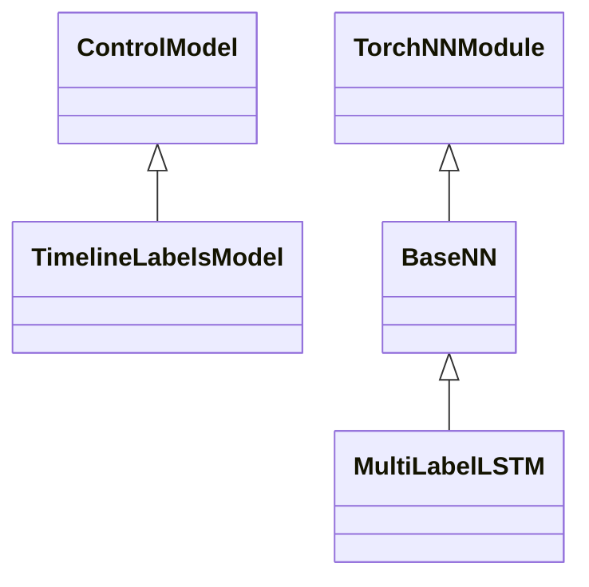
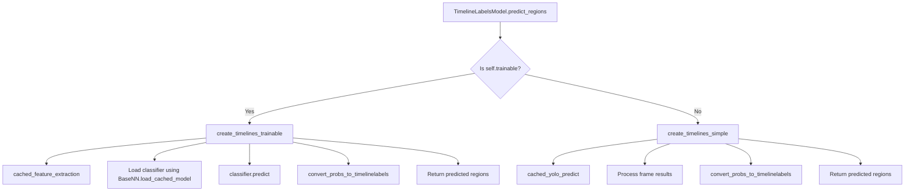
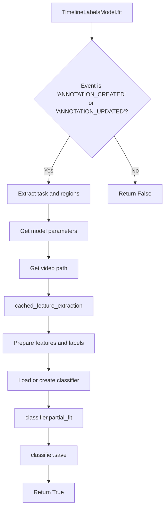

# 用于 Label Studio 时序视频多标签分类的 TimelineLabels 模型

本文档对如何在 Label Studio 中使用 TimelineLabels 模型进行视频数据的时序多标签分类，提供了一份清晰而全面的指南。

该模型在 YOLO 的分类能力之上集成了一个 LSTM 神经网络——具体来说，它利用了 YOLO 最后一层的特征——来处理时序标注任务。用户可以直接在标注配置中自定义神经网络参数，以使模型适配特定的使用场景，或者将此模型作为进一步开发的基础。

在可训练（trainable）模式下，你先手动标注少量样本。每次点击 **Submit（提交）** 时，模型都会根据你提供的新标注进行重新训练。一旦模型开始对新任务预测你训练过的标签，它会自动在时间轴上填充它预测出的标签。你可以验证或修改这些标签，而更新它们会再次触发模型训练，帮助你迭代式地改进模型。

<iframe width="560" height="315" src="https://www.youtube.com/embed/UyaecID1iG8?si=RHPYDfYgIWea1Odq" title="YouTube video player" frameborder="0" allow="accelerometer; autoplay; clipboard-write; encrypted-media; gyroscope; picture-in-picture; web-share" referrerpolicy="strict-origin-when-cross-origin" allowfullscreen></iframe>
<br/>

**提示：** 如果你正在寻找更先进的时序分类方法，可以查看 [VideoMAE 模型](https://huggingface.co/docs/transformers/en/model_doc/videomae)。虽然我们没有为 VideoMAE 提供示例后端，但你可以[将其作为你自己的 ML 后端进行集成](https://labelstud.io/guide/ml_create)。

## 安装与快速开始

开始之前，你需要安装 [Label Studio ML 后端](https://github.com/HumanSignal/label-studio-ml-backend/blob/master/README.md#quickstart)。

本教程使用 [YOLO 示例](https://github.com/HumanSignal/label-studio-ml-backend/tree/master/label_studio_ml/examples/yolo)。有关在 Label Studio 中设置 YOLO 模型系列的详细说明，请参阅[主 README](https://github.com/HumanSignal/label-studio-ml-backend/blob/master/label_studio_ml/examples/yolo/README.md#quick-start)。

## 标注配置

```xml
<View>
    <TimelineLabels name="label" toName="video" 
        model_trainable="true"
        model_classifier_epochs="1000"
        model_classifier_sequence_size="16"
        model_classifier_hidden_size="32"
        model_classifier_num_layers="1"
        model_classifier_f1_threshold="0.95"
        model_classifier_accuracy_threshold="0.99"
        model_score_threshold="0.5"
    >
    <Label value="Ball touch" background="red"/>
    <Label value="Ball in frame" background="blue"/>
  </TimelineLabels>
  <Video name="video" value="$video" height="700" frameRate="25.0" timelineHeight="200" />
</View>
```

<span style="color:red"><b>重要：</b></span> 你必须在 `Video` 标签中设置正确的 **`frameRate`** 属性。
<span style="color:red">你所有的视频应当具有相同的帧率。</span> 否则，提交的标注将与视频**错位**。

## 参数

| 参数                                  | 类型   | 默认值  | 说明                                                                                                                                            |
|---------------------------------------|--------|---------|-------------------------------------------------------------------------------------------------------------------------------------------------|
| `model_trainable`                     | bool   | False   | 启用可训练模式，使模型能够从你的标注中增量学习。                                                                                                |
| `model_classifier_epochs`             | int    | 1000    | LSTM 神经网络的训练轮数。                                                                                                                       |
| `model_classifier_sequence_size`      | int    | 16      | LSTM 序列的帧数大小。调整以捕获更长或更短的时序依赖关系，按 25 帧率换算，16 帧约为 ~0.6 秒。                                                    |
| `model_classifier_hidden_size`        | int    | 32      | LSTM 隐藏状态的大小。修改以改变 LSTM 的容量。                                                                                                   |
| `model_classifier_num_layers`         | int    | 1       | LSTM 层数。增大以构建更深的 LSTM 网络。                                                                                                         |
| `model_classifier_f1_threshold`       | float  | 0.95    | 训练时用于早停的 F1 分数阈值。设置以防止过拟合。                                                                                                |
| `model_classifier_accuracy_threshold` | float  | 1.00    | 训练时用于早停的准确率阈值。设置以防止过拟合。                                                                                                  |
| `model_score_threshold`               | float  | 0.5     | 预测的最小置信度阈值。置信度低于此阈值的标签将被忽略。                                                                                          |
| `model_path`                          | string | None    | 自定义 YOLO 模型的路径。详见[你自己的自定义模型](https://github.com/HumanSignal/label-studio-ml-backend/blob/master/label_studio_ml/examples/yolo/README.md#your-own-custom-yolo-models)一节。 |

**注意：** 你可以通过调整 `<TimelineLabels>` 标签中的属性，直接在标注配置中自定义神经网络参数。

## 使用模型

### 简单模式

在简单模式下，模型使用预训练的 YOLO 类别来生成预测，无需额外训练。

- **使用场景**：无需自定义训练即可快速搭建。它会立即开始生成预测。
- **配置**：在标注配置中设置 `model_trainable="false"`（或省略该属性，因为 `false` 是默认值）。
- **示例**：

  ```xml
  <View>
    <Video name="video" value="$video" height="700" frameRate="25.0" timelineHeight="200" />
    <TimelineLabels name="label" toName="video" model_trainable="false">
      <Label value="Ball" predicted_values="soccer_ball"/>
      <Label value="tiger_shark" />
    </TimelineLabels>
  </View>
  ```

### 可训练模式

可训练模式使模型能够从你的标注中增量学习。

它使用预训练的 YOLO 分类模型，并在其之上叠加一个自定义的 LSTM 神经网络，以捕获视频数据中的时序依赖关系。LSTM 模型是从零开始训练的，因此大约需要 10-20 个标注良好的视频（每个约 500 帧，约 20 秒）才能开始产生有意义的预测。

- **使用场景**：相对于简单模式，当需要自定义标签或更高的准确率时使用。
- **配置**：在标注配置中设置 `model_trainable="true"`。
- **训练流程**：
  - 开始使用 `TimelineLabels` 标签标注视频。
  - 提交第一个标注后，模型开始训练。
  - `partial_fit()` 方法使模型在每次新标注时增量训练。
- **要求**：大约需要 10-20 个标注任务才能获得合理的性能。

**注意**：`predicted_values` 属性对于可训练模型没有意义。

**示例**：

```xml
<View>
    <Video name="video" value="$video" height="700" frameRate="25.0" timelineHeight="200" />
    <TimelineLabels name="label" toName="video" 
                    model_trainable="true"
                    model_classifier_epochs="1000"
                    model_classifier_sequence_size="16"
                    model_classifier_hidden_size="32"
                    model_classifier_num_layers="1"
                    model_classifier_f1_threshold="0.95"
                    model_classifier_accuracy_threshold="0.99"
                    model_score_threshold="0.5">
      <Label value="Ball in frame"/>
      <Label value="Ball touch"/>
    </TimelineLabels>
</View>
```

## 可训练模型的工作原理

可训练模式使用了时序 LSTM 分类模型的自定义实现。模型在每次新标注提交或更新时进行增量训练，并为视频中的每一帧生成预测。

### 1. 使用 YOLO 进行特征提取

- **预训练 YOLO 模型**：使用 YOLO 分类模型（例如 `yolov8n-cls.pt`）从视频帧中提取特征。
- **层修改**：模型移除最后的分类层，以使用倒数第二层（penultimate layer）的特征表示（参见 `utils/neural_nets.py::cached_feature_extraction()`）。
- **缓存预测**：使用缓存来存储 YOLO 的中间特征提取结果，以提高效率和即时增量训练。

#### 用于特征提取的自定义 YOLO 模型

你可以使用[主 README](https://github.com/HumanSignal/label-studio-ml-backend/blob/master/label_studio_ml/examples/yolo/README.md#your-own-custom-yolo-models)中描述的步骤加载你自己的 YOLO 模型。不过，它应当具有与 `yolov8-cls` 模型相似的结构。更多细节请参见 `utils/neural_nets.py::cached_feature_extraction()`。

#### 缓存文件夹

它位于 `/app/cache_dir`，存储来自 YOLO 模型最后一层的缓存中间特征。该缓存用于即时增量训练以及加速预测。

### 2. LSTM 神经网络

- **目的**：通过处理来自 YOLO 最后一层的特征向量序列，捕获视频数据中的时序依赖关系。
- **架构**：
  - **输入层**：接收来自 YOLO 的特征向量。
  - **全连接层**：降低维度。
  - **层归一化与 Dropout**：提升训练稳定性并防止过拟合。
  - **LSTM 层**：处理序列以建模时序关系。
  - **输出层**：为每个时间步生成多标签预测。
- **损失函数**：使用带有 logits 的二元交叉熵损失（binary cross-entropy loss with logits）进行多标签分类，并使用权重衰减（weight decay）进行 L2 正则化。

### 3. 使用 `partial_fit()` 进行增量训练

- **功能**：允许模型在每次新标注时更新其参数。
- **流程**：
  - 使用 `utils/converter.py::convert_timelinelabels_to_probs()` 从标注视频中提取特征和标签。
  - 将数据预处理为按 `model_classifier_sequence_size` 分块的、适合 LSTM 输入的序列。
  - 增量训练模型，使用基于 F1 分数和准确率阈值的早停策略。
- **优势**：
  - **少样本学习（Few-shot learning）**：能够从少量示例中学习。
  - **避免过拟合**：基于 F1 分数和准确率的早停可防止模型在有限数据上过拟合。

### 局限性与注意事项

- **非最终生产模型**：尽管前景良好，但该模型主要是一个演示，在生产环境使用前可能需要进一步验证。
- **性能取决于数据**：需要足够且多样的标注（至少 10-20 个标注任务）才能开始工作。
- **参数敏感性**：调整神经网络参数可能会显著影响性能。
- **在训练数据上早停**：模型使用基于训练数据上 F1 分数和准确率的早停策略。这可能导致在训练数据上过拟合。之所以这样做，是因为在单条标注更新时缺乏验证数据。
- **YOLO 模型局限性**：该模型使用在物体分类任务上预训练的 YOLO 模型进行特征提取，这对于事件检测等所有使用场景可能并非最优。这种方法不会调优 YOLO 模型，它只在 YOLO 最后一层之上训练 LSTM 部分。
- **标签平衡**：模型可能在标签不平衡时表现不佳。确保在训练数据中标签分布良好。可考虑修改损失函数（`BCEWithLogitsLoss`）并使用类别正权重（class pos weights）来解决此问题。
- **在所有数据上训练**：尚不支持在所有数据上训练，因此模型只在上一条标注上训练。更多细节请参见 `timeline_labels.py::fit()`。

## 示例用例：在足球视频中检测球

### 搭建

1. **标注配置**：

   ```xml
   <View>
      <TimelineLabels name="videoLabels" toName="video">
        <Label value="Ball touch" background="red"/>
        <Label value="Ball in frame" background="blue"/>
      </TimelineLabels>
      <Video name="video" value="$video" height="700" timelineHeight="200" frameRate="25.0" />
    </View>
   ```

2. **连接模型后端**：

    创建一个新项目，进入 **Settings > Model（设置 > 模型）** 并添加 YOLO 后端。
     1. 在终端中进入本仓库中的 `yolo` 文件夹。
     2. 更新你的 `docker-compose.yml` 文件。
     3. 执行 `docker compose up` 以运行后端。
     4. 在 Label Studio 项目设置中将此后端连接到你的项目。确保 **Interactive Preannotations（交互式预标注）** 处于关闭状态（这是默认状态）。

### 标注与训练

1. **标注视频**：

   - 将足球视频上传到项目。
   - 使用 [`<TimelineLabels>` 控制标签](https://labelstud.io/tags/timelinelabels) 来标注球出现在画面中的时间区间。

2. **模型训练**：

   - 提交标注后，模型开始增量训练。
   - 继续标注，直到模型开始做出准确的预测。

3. **检查预测**：

   - 模型为未标注的视频建议标签。
   - 验证并修正预测，以进一步改进模型。

## 调整训练参数与重置模型

如果模型表现不佳，请考虑修改标注配置中的 LSTM 和分类器训练参数。这些参数以 `model_classifier_` 前缀开头。

更改以下参数后，模型将被**重置**：
 - `model_classifier_sequence_size`
 - `model_classifier_hidden_size`
 - `model_classifier_num_layers`
 - 在标注配置中新增或移除标签

因此，你可能需要对标注进行更新（点击 **Update（更新）**）以看到改进效果。

如果你想修改更多参数，可以直接在 `utils/neural_nets.py::MultiLabelLSTM` 中的代码里修改。

如果需要完全重置模型，你可以从 `/app/models` 中删除模型文件。模型路径请参见 `timeline_labels.py::get_classifier_path()`。通常它以 `timelinelabels-` 前缀开头。

## 调试

要调试模型，你应当使用 `LOG_LEVEL=DEBUG` 环境变量运行它（参见 `docker-compose.yml`），然后检查（docker）控制台中的日志。

## 将 TimelineLabels 区域转换为标签数组及其逆操作

有两个主要函数用于将 TimelineLabels 区域转换为标签数组及其逆操作：
- `utils/converter.py::convert_timelinelabels_to_probs()` - 将 TimelineLabels 区域转换为标签数组。
- `utils/converter.py::convert_probs_to_timelinelabels()` - 将标签数组转换为 TimelineLabels 区域。

标签数组中的每一行对应视频中的一帧。标签数组是一个二进制矩阵，其中每一列对应一个标签。如果某帧中存在该标签，则对应的单元格设为 `1`，否则为 `0`。

例如：
```
[
    [0, 0, 1], 
    [0, 1, 0], 
    [1, 0, 0]
]
```

这对应于第 1、2、3 帧中的标签 `[label3, label2, label1]`。

更多示例请参见 `tests/test_timeline_labels.py::test_convert_probs_to_timelinelabels()`。

<br>
<br>

-----------

<br>
<br>

## 面向开发者

本指南深入介绍了 Label Studio 的 TimelineLabels ML 后端的架构与代码流程。它包含类继承图和方法调用流程图，以帮助开发者理解各组件如何交互。此外，它还说明了关键的方法和类，突出起点及其在整个工作流中的角色。

### 类继承图

下图展示了 TimelineLabels ML 后端中的类继承层级。



- **`ControlModel`**：Label Studio 中控制标签（control tag）的基类。
- **`TimelineLabelsModel`**：继承自 `ControlModel`，实现 `<TimelineLabels>` 标签的特定功能。
- **`torch.nn.Module`**：PyTorch 中所有神经网络模块的基类。
- **`BaseNN`**：神经网络的自定义基类，继承自 `torch.nn.Module`。
- **`MultiLabelLSTM`**：继承自 `BaseNN`，实现用于多标签分类的 LSTM 神经网络。

### 方法调用流程图

#### 预测工作流

以下流程图描绘了预测过程中的方法调用。



#### 训练工作流

以下流程图展示了训练过程中的方法调用。



### 代码结构说明

#### TimelineLabelsModel 类

**文件**：`timeline_labels.py`

`TimelineLabelsModel` 类继承自 `ControlModel` 基类，并实现 `<TimelineLabels>` 控制标签的特定功能。

**关键方法：**

- **`is_control_matched(cls, control)`**：类方法，检查提供的控制标签是否与 `<TimelineLabels>` 标签匹配。

- **`create(cls, *args, **kwargs)`**：类方法，创建模型实例，并初始化 `trainable` 和 `label_map` 等属性。

- **`predict_regions(self, video_path)`**：预测时调用的主方法。根据 `trainable` 属性决定使用简单还是可训练的预测方法。

  - **`create_timelines_simple(self, video_path)`**：使用预训练的 YOLO 类别进行预测，无需额外训练。

    - 调用 `cached_yolo_predict` 获取 YOLO 模型的预测结果。
    - 处理帧结果以提取概率。
    - 将概率转换为时间轴标签。

  - **`create_timelines_trainable(self, video_path)`**：使用自定义训练的 LSTM 神经网络进行预测。

    - 调用 `cached_feature_extraction` 从视频中提取特征。
    - 加载训练好的分类器模型。
    - 使用分类器预测概率。
    - 将概率转换为时间轴标签。

- **`fit(self, event, data, **kwargs)`**：在新标注创建或更新时调用。处理 LSTM 模型的增量训练。

  - 从标注视频中提取特征和标签。
  - 为 LSTM 输入预处理数据。
  - 加载或初始化分类器。
  - 在分类器上调用 `partial_fit` 以更新模型参数。
  - 保存更新后的分类器模型。

- **`get_classifier_path(self, project_id)`**：根据项目 ID 和模型名称生成用于存储分类器模型的文件路径。

#### 神经网络类

##### BaseNN 类

**文件**：`neural_nets.py`

`BaseNN` 类作为神经网络模型的基类，提供保存、加载和管理标签映射的通用方法。

**关键方法：**

- **`set_label_map(self, label_map)`**：存储标签映射字典。

- **`get_label_map(self)`**：检索标签映射字典。

- **`save(self, path)`**：使用 `torch.save` 将模型保存到指定路径。

- **`load(cls, path)`**：类方法，从指定路径加载已保存的模型。

- **`load_cached_model(cls, model_path)`**：如果缓存的模型存在则加载，否则返回 `None`。

##### MultiLabelLSTM 类

**文件**：`neural_nets.py`

`MultiLabelLSTM` 类继承自 `BaseNN`，实现用于多标签分类的 LSTM 神经网络。

**关键方法：**

- **`__init__(...)`**：初始化神经网络的层和参数，包括输入大小、隐藏层、dropout 和优化器设置。

- **`forward(self, x)`**：定义网络的前向传播。

  - 使用全连接层降低输入维度。
  - 应用层归一化和 dropout。
  - 数据通过 LSTM 层。
  - 应用全连接层生成输出预测。

- **`preprocess_sequence(self, sequence, labels=None, overlap=2)`**：通过切分和填充来准备用于训练的输入序列和标签。

- **`partial_fit(self, sequence, labels, ...)`**：在新增数据上增量训练模型。

  - 预处理输入序列。
  - 创建用于批处理的 DataLoader。
  - 运行训练循环，并使用基于准确率和 F1 分数阈值的早停策略。

- **`predict(self, sequence)`**：对给定输入序列生成预测。

  - 将序列切分为块。
  - 在评估模式下让数据通过模型。
  - 拼接输出以匹配原始序列长度。

### 起点与执行流程

#### 预测过程

1. **预测请求**：当对某个视频请求预测时，会调用 `TimelineLabelsModel.predict_regions(video_path)`。

2. **确定模式**：

   - **可训练模式**（`self.trainable == True`）：调用 `create_timelines_trainable(video_path)`。

     - 使用 `cached_feature_extraction` 提取特征。
     - 使用 `BaseNN.load_cached_model` 加载训练好的分类器模型。
     - 使用 `classifier.predict(yolo_probs)` 预测概率。
     - 使用 `convert_probs_to_timelinelabels` 将概率转换为时间轴标签。

   - **简单模式**（`self.trainable == False`）：调用 `create_timelines_simple(video_path)`。

     - 使用 `cached_yolo_predict` 获取 YOLO 预测结果。
     - 处理帧结果以提取概率。
     - 使用 `convert_probs_to_timelinelabels` 将概率转换为时间轴标签。

3. **返回预测**：该方法返回带有标签和时间戳的预测区域列表。

#### 训练过程

1. **事件触发**：当发生标注事件时（例如 'ANNOTATION_CREATED' 或 'ANNOTATION_UPDATED'），会调用 `fit(event, data, **kwargs)` 方法。

2. **事件处理**：

   - 检查该事件是否与训练相关。
   - 提取任务与标注数据。

3. **参数提取**：从控制标签的属性中检索模型参数，如轮数、序列大小、隐藏层大小和阈值。

4. **数据准备**：

   - 获取与任务关联的视频路径。
   - 使用 `cached_feature_extraction` 从视频中提取特征。
   - 将标注转换为适合训练的标签。

5. **模型加载或初始化**：

   - 尝试使用 `BaseNN.load_cached_model` 加载现有分类器模型。
   - 如果不存在模型或参数已更改，则初始化一个新的 `MultiLabelLSTM` 模型。

6. **训练**：

   - 调用 `classifier.partial_fit(features, labels, ...)` 以增量方式训练模型。
   - 训练包含基于准确率和 F1 分数阈值的早停，以防止过拟合。

7. **模型保存**：使用 `classifier.save(path)` 将训练好的模型保存到磁盘。

## 工具函数与辅助函数

**缓存预测与特征提取**：

- **`cached_yolo_predict(yolo_model, video_path, cache_params)`**：使用 joblib 的 `Memory` 缓存 YOLO 预测，避免重复计算。

- **`cached_feature_extraction(yolo_model, video_path, cache_params)`**：通过挂载（hook）到倒数第二层来从 YOLO 模型提取特征，并缓存结果。

**数据转换函数**：

- **`convert_probs_to_timelinelabels(probs, label_map, threshold)`**：将概率输出转换为适合 Label Studio 的时间轴标签。

- **`convert_timelinelabels_to_probs(regions, label_map, max_frame)`**：将标注区域转换回用于训练的序列概率。

## 结论

TimelineLabels ML 后端与 Label Studio 无缝集成，为视频数据提供时序多标签分类能力。该架构利用预训练的 YOLO 模型进行特征提取，并叠加一个 LSTM 神经网络来增强时序依赖关系的捕获。

理解类层级和方法流程，对于希望扩展或修改该后端的开发者至关重要。遵循本指南中概述的起点与执行流程，开发者可以更有效地浏览代码库，并实现自定义功能或优化。

**注意**：如需进一步开发或贡献，请参阅 [`README_DEVELOP.md`](https://github.com/HumanSignal/label-studio-ml-backend/blob/master/label_studio_ml/examples/yolo/README_DEVELOP.md) 文件，其中提供了额外的指南和架构细节。
