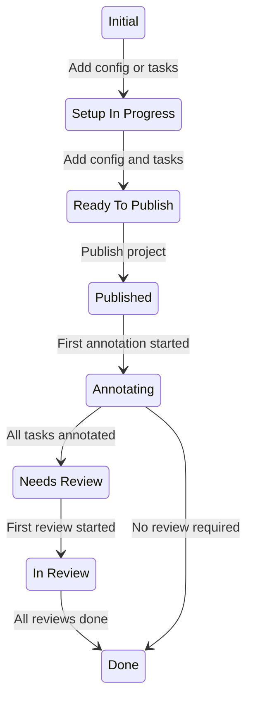
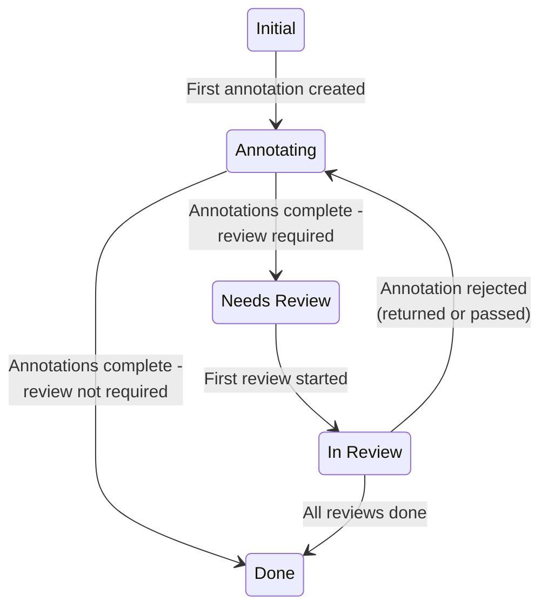

项目和任务在从初始创建状态到完成的过程中会经历一系列状态。

!!! note
    请注意，状态变更历史跟踪直到为你的组织实施状态管理才开始。对于大多数 Label Studio Cloud 组织，状态管理是在 2026 年 2 月实施的。

## 项目状态

项目会经历以下状态：

| 状态 | 描述 |
|-----------|---------|
| **初始（Initial）** | 你已创建项目，但尚未创建任务或配置标注界面。 |
| **设置进行中（Setup In Progress）** | 你已创建项目，并且你已创建任务或配置了标注界面，但尚未同时完成两者。  如果你的项目位于个人沙箱（Personal Sandbox）中，在将其移动到共享工作区之前，它无法超出此状态。 |
| **准备发布（Ready to Publish）** | 你的项目已有任务，并且你已配置标注界面，但你尚未发布项目。 |
| **已发布（Published）** | 项目已发布，但还没有任何标注。 |
| **标注中（Annotating）** | 至少有一个任务至少有一个已提交的标注，意味着标注工作已经开始。 |
| **需要审查（Needs Review）** | 所有任务已由所需数量的用户标注，但仍有任务需要审查。  你的项目是否进入此状态取决于你的项目设置和任务状态。请参阅下面的 [附加说明](#Additional-notes)。 |
| **审查中（In Review）** | 所有任务都已收到至少一次审查，但审查尚未对所有任务完成。  你的项目是否进入此状态取决于你的项目设置和任务状态。请参阅下面的 [附加说明](#Additional-notes)。 |
| **已完成（Done）** | 所有任务都已完成。 |

## 任务状态

| 状态 | 描述 | 
|----------|------------|
| **初始（Initial）** | 任务已创建但还没有任何标注。 |
| **标注中（Annotating）** | 已提交第一个标注，或者已拒绝的标注已被 [退回给标注者或传递给另一个标注者](project_settings_lse#reject-options)。  任务是否会在此状态停留足够长时间以反映在数据管理器中，取决于你的项目设置。请参阅下面的 [附加说明](#Additional-notes)。|
| **需要审查（Needs Review）** | 已完成所需数量的标注，任务已准备好审查。  任务是否进入此状态取决于你的项目设置。请参阅下面的 [附加说明](#Additional-notes)。 |
| **审查中（In Review）** | 已为任务内的任何标注创建第一次审查。  任务是否进入此状态取决于你的项目设置。请参阅下面的 [附加说明](#Additional-notes)。|
| **已完成（Done）** | 所有所需的标注和审查都已完成。 |

!!! info 提示
    你可以点击数据管理器中的状态以查看状态变更历史：

    

## 附加说明

### 项目设置与状态

有几个项目设置会影响项目和任务是否以及如何进入某些状态。

##### 标注中状态

任务的 **标注中（Annotating）** 状态受 [**质量 > 标注重叠（Overlap of Annotations）**](project_settings_lse#overlap) 的影响。

如果你的重叠为 `1`，任务会在提交第一个标注后立即进入下一个状态。

如果你的重叠大于 `1`，任务将停留在 **标注中** 状态，直到你达到所需的标注数量。

##### 需要审查状态

有几个设置可能导致任务（以及扩展的项目）跳过 **需要审查（Needs Review）** 状态：

* 如果你启用了 [**审查 > 审查选项 > 仅审查手动分配的任务（Review > Reviewing Options > Review only manually assigned tasks）**](project_settings_lse#reviewing-options)，但未分配任何审查者。
* 如果你的 [**审查抽样（Review Sampling）**](project_settings_lse#review-sampling) 设置配置为允许部分或所有任务绕过 **需要审查** 状态。

##### 审查中状态

任务（以及扩展的项目）的 **审查中（In Review）** 状态仅在以下情况发生：

* 任务有多个标注（意味着重叠大于 1）。
* 启用了 [**审查 > 审查选项 > 当所有标注都被审查时任务被视为已审查（Review > Reviewing Options > Task is reviewed when all annotations are reviewed）**](project_settings_lse#reviewing-options) 设置。

默认情况下，如果任务的任何标注已被接受/拒绝，则整个任务被视为已审查。在这些情况下，任务会在提交一次审查后立即从 **需要审查** 移动到 **已完成**。

如果你启用 **当所有标注都被审查时任务被视为已审查**，任务会在提交第一次审查后从 **需要审查** 移动到 **审查中**，然后在提交最终审查后移动到 **已完成**。

### 任务状态汇总到项目状态

一旦你的项目达到 **已发布（Published）** 状态，其后续状态由项目内任务的状态决定。

项目采用任务的 **最不先进** 状态。

例如，如果你有 10 个任务：
* 1 个任务处于 **标注中** 状态
* 6 个任务处于 **审查中** 状态
* 3 个任务处于 **已完成** 状态

你的项目将处于 **标注中** 状态。

##### 初始状态例外

例外是 **初始（Initial）** 状态。就项目状态汇总而言，**初始** 任务被计算为 **标注中** 任务。

例如，如果你有 10 个任务：

* 5 个任务处于 **初始** 状态
* 5 个任务处于 **审查中** 状态

即使你没有任何任务处于 **标注中** 状态，你的项目也将处于 **标注中** 状态。

### API 值

如果你使用的是 [SDK](https://api.labelstud.io/api-reference/introduction/getting-started)，每个状态的 API 值如下。

项目：

| 项目状态 | API 值 | 
|-----------|----------|
| **初始（Initial）** | `CREATED` | 
| **设置进行中（Setup In Progress）** | `SETUP_IN_PROGRESS` | 
| **准备发布（Ready to Publish）** | `READY_TO_PUBLISH` | 
| **已发布（Published）** | `PUBLISHED` | 
| **标注中（Annotating）** | `ANNOTATION_IN_PROGRESS` | 
| **需要审查（Needs Review）** | `NEEDS_REVIEW` | 
| **审查中（In Review）** | `REVIEW_IN_PROGRESS` | 
| **已完成（Done）** | `COMPLETED` | 

任务：

| 任务状态 | API 值 | 
|----------|------------|
| **初始（Initial）** | `CREATED` | 
| **标注中（Annotating）** | `ANNOTATION_IN_PROGRESS` | 
| **需要审查（Needs Review）** | `NEEDS_REVIEW` | 
| **审查中（In Review）** | `REVIEW_IN_PROGRESS` | 
| **已完成（Done）** | `COMPLETED` | 
